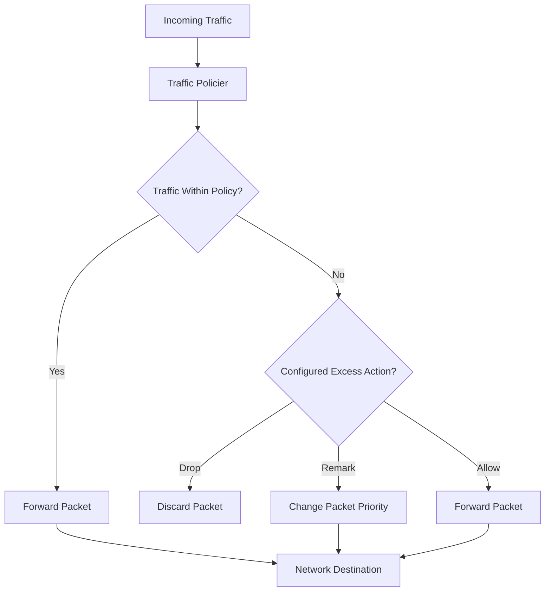

# 🗁 Traffic Policing

Traffic policing is a Quality of Service (QoS) technique used to monitor and enforce a configured traffic-rate limit.

It measures the rate of incoming or outgoing traffic and determines whether packets comply with a defined bandwidth policy.

When traffic exceeds the permitted rate, a traffic policer can:

* Drop excess packets.
* Remark packets with a different priority or DSCP value.
* Allow packets within the configured burst tolerance.
* Apply different actions depending on the traffic policy.

Traffic policing is commonly used by ISPs, enterprise networks, and service providers to enforce bandwidth agreements and protect network resources.

# 🗁 How Traffic Policing Works

A traffic policer monitors traffic against configured rate and burst parameters.

When packets arrive, the policer evaluates whether they comply with the traffic policy.

For example, assume an ISP configures a customer with a 20 Mbps traffic policy.

* Traffic within the permitted rate is allowed.
* Traffic within the configured burst allowance may also be allowed.
* Traffic exceeding the policy may be dropped or remarked.

Unlike traffic shaping, policing generally does not buffer excess packets to smooth their transmission rate.

# 🗁 Traffic Policing Diagram



# 🗁 Why Traffic Policing Is Used

Traffic policing helps network administrators enforce bandwidth policies and protect network resources.

Common objectives include:

* **Rate Enforcement:** Ensure traffic complies with configured bandwidth limits.
* **Bandwidth Agreements:** Enforce customer traffic policies defined by an ISP.
* **Congestion Protection:** Prevent excessive traffic from consuming shared network capacity.
* **Traffic Classification:** Apply different actions to traffic based on its class.
* **Priority Management:** Remark excess traffic with a lower priority.
* **Resource Protection:** Control traffic entering or leaving a network.

# 🗁 Traffic Policing Parameters

A traffic policer commonly uses the following parameters:

| Parameter | Description |
| --- | --- |
| Committed Information Rate (CIR) | Configured average traffic rate |
| Committed Burst Size (CBS) | Amount of traffic permitted in a committed burst |
| Excess Burst Size (EBS) | Additional burst allowance in some policing models |
| Conform Action | Action applied to traffic that complies with the policy |
| Exceed Action | Action applied when traffic exceeds the committed policy |
| Violate Action | Action applied to traffic exceeding additional burst allowances in multi-level models |

The exact parameters and actions depend on the platform and policing algorithm.

# 🗁 Token Bucket Algorithm

The Token Bucket algorithm is commonly used to implement traffic policing.

Tokens are generated at a configured rate and stored in a bucket.

When a packet arrives:

* The policer checks whether sufficient tokens are available.
* If sufficient tokens exist, the packet conforms to the policy.
* If insufficient tokens exist, the packet exceeds the policy.
* The policer applies the configured action.

The token bucket allows controlled bursts while enforcing a long-term average traffic rate.

**Example:**

Assume the following policy:

| Parameter | Value |
| --- | ---: |
| CIR | 20 Mbps |
| CBS | 1 MB |
| Traffic rate | 30 Mbps |

If sufficient tokens have accumulated, a short burst above 20 Mbps may be accepted.

However, sustained traffic above the configured average rate eventually exhausts the available tokens.

The policer then applies its configured excess-traffic action.

# 🗁 Traffic Policing vs Traffic Shaping

Both techniques control traffic rates, but their packet-handling behavior differs.

| Feature | Traffic Policing | Traffic Shaping |
| --- | --- | --- |
| Primary purpose | Enforce a rate policy | Smooth traffic transmission |
| Excess traffic | Dropped or remarked | Buffered and transmitted later |
| Buffering | Does not normally buffer to smooth traffic | Uses queues |
| Delay | Does not normally introduce shaping delay | Can introduce queueing delay |
| Burst handling | Allows bursts within configured tolerance | Absorbs bursts within queue capacity and burst policy |
| Packet loss | Can drop excess packets | Can drop packets when queues become full |
| Typical placement | Ingress or egress | Usually egress |

**Example:**

Suppose a customer has a 20 Mbps bandwidth policy.

* A policer can discard packets that exceed the permitted rate.
* A shaper can queue excess packets and transmit them as capacity becomes available.

# 🗁 Ingress and Egress Policing

Traffic policing can be applied in different directions depending on the network architecture and device capabilities.

### 🖆 Ingress Policing

Ingress policing evaluates traffic as it enters an interface.

For example, an enterprise router can police incoming traffic from a customer-facing interface to enforce an agreed bandwidth policy.

### 🖆 Egress Policing

Egress policing evaluates traffic before it leaves an interface.

For example, an ISP can police outgoing traffic toward a customer to enforce a service-rate policy.

The actual enforcement direction depends on where the policer is configured and which traffic path it observes.

# 🗁 Traffic Policing in ISP Networks

ISPs commonly use traffic policing to enforce customer bandwidth agreements.

For example:

| Customer | Configured Policy |
| --- | ---: |
| Customer A | 10 Mbps |
| Customer B | 20 Mbps |
| Customer C | 50 Mbps |
| Customer D | 100 Mbps |

Each customer's traffic can be evaluated against an individual rate policy.

When a customer exceeds the permitted rate, the ISP can drop excess packets or remark them with a lower priority.

Traffic policing can also be used at network boundaries to enforce service-level agreements (SLAs).

# 🗁 Traffic Policing and DSCP Remarking

Instead of dropping every packet that exceeds a configured rate, a policer can change the packet's Differentiated Services Code Point (DSCP).

DSCP is a field in the IP header used to communicate traffic-classification and forwarding-priority information.

For example:

* Conforming packets retain their original DSCP marking.
* Excess packets receive a lower-priority DSCP marking.
* Downstream routers can process the remarked packets according to their QoS policies.

This approach allows excess traffic to remain deliverable while giving it a lower forwarding priority.

DSCP remarking is useful only when downstream network devices recognize and apply the corresponding QoS policy.

# 🗁 Traffic Policing in MikroTik RouterOS

MikroTik RouterOS provides queueing and firewall mechanisms for traffic management.

Simple Queues and Queue Trees can enforce bandwidth limits by controlling packet transmission through queues.

However, queue-based bandwidth limiting should not automatically be treated as identical to a dedicated ingress traffic policer. The packet-processing path and queue behavior must be considered.

### 🖆 Simple Queue Example

The following example applies upload and download maximum rates to a customer.

```routeros
/queue simple
add name="Customer-A" target=192.168.10.10/32 max-limit=10M/20M
```

This configures:

| Direction | Maximum Rate |
| --- | ---: |
| Upload | 10 Mbps |
| Download | 20 Mbps |

The queue controls the customer's traffic according to the configured limits.

### 🖆 Queue Tree Example

A Queue Tree can enforce a maximum rate for traffic associated with a selected parent.

```routeros
/queue tree
add name="Upload-Policy" parent=ether1 max-limit=50M
```

This creates a queue with a maximum rate of 50 Mbps under `ether1`.

For more advanced policies, firewall mangle rules can classify traffic and assign packet marks to Queue Tree entries.

The actual traffic controlled depends on the interface direction, parent configuration, and packet-processing path.

### 🖆 FastTrack Consideration

FastTrack can bypass parts of the normal firewall and queue-processing path for FastTracked connections.

When implementing bandwidth policies, verify whether the relevant packets pass through the intended queue configuration.

# 🗁 Practical Example

Consider an ISP that provides a customer with a 20 Mbps service.

The ISP wants to enforce this rate at its network boundary.

A possible policing policy is:

| Parameter | Configuration |
| --- | ---: |
| Customer rate | 20 Mbps |
| Burst allowance | Configured according to policy |
| Conforming traffic | Forward |
| Excess traffic | Drop |
| Alternative excess action | Remark with lower DSCP priority |

When traffic stays within the policy, packets are forwarded normally.

When traffic exceeds the permitted rate and burst allowance, the policer applies the configured action.

This prevents the customer from continuously consuming more bandwidth than the service agreement permits.

# 🗁 Best Practices

* Define clear traffic-rate policies for each customer or traffic class.
* Configure burst parameters according to the expected traffic behavior.
* Choose between dropping and DSCP remarking based on network requirements.
* Apply policing at appropriate network boundaries.
* Monitor packet drops and policy counters.
* Verify that DSCP markings are understood by downstream devices.
* Consider the impact of packet loss on TCP and real-time applications.
* Distinguish queue-based bandwidth limiting from dedicated policing mechanisms.
* Test policies under both normal and burst traffic conditions.

# 🗁 Summary

Traffic policing is a QoS technique used to enforce configured traffic-rate policies.

It evaluates traffic against rate and burst parameters and applies actions such as forwarding, dropping, or remarking packets.

The main difference between policing and shaping is how excess traffic is handled: policing generally drops or remarks excess packets, while shaping buffers packets and transmits them later.

Traffic policing is particularly useful for ISP bandwidth enforcement, network-boundary protection, and service-level agreement management.
