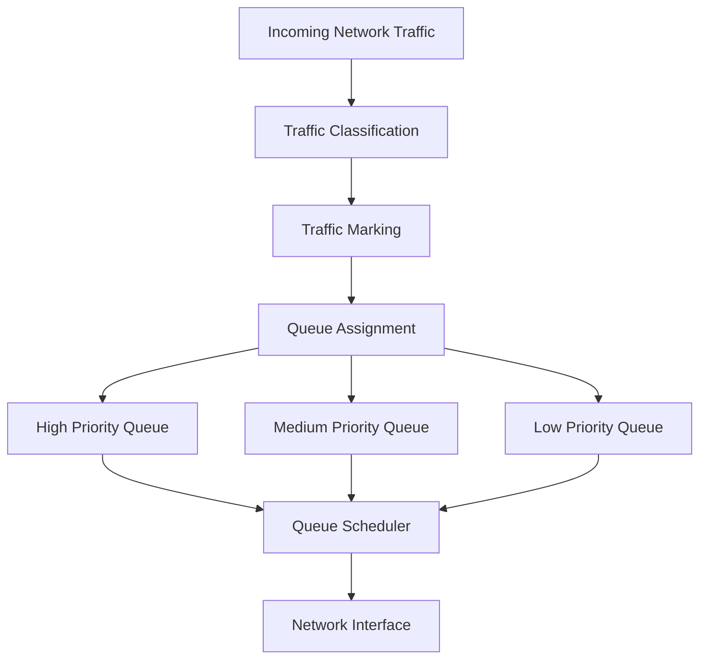

# 🗁 Traffic Prioritization

Traffic prioritization is a Quality of Service (QoS) technique that assigns different levels of importance to network traffic.

It allows network devices to process important traffic before less important traffic when network resources become congested.

For example, voice calls and video conferences are generally more sensitive to delay and packet loss than background file downloads.

Traffic prioritization helps ensure that time-sensitive applications receive appropriate treatment during periods of network congestion.

# 🗁 Why Traffic Prioritization Is Important

Networks carry different types of traffic, and each application has different performance requirements.

Consider these examples:

| Application | Traffic Requirement |
| --- | --- |
| VoIP | Low latency, low jitter, and low packet loss |
| Video Conferencing | Low latency and stable throughput |
| Online Gaming | Low latency and consistent packet delivery |
| Web Browsing | Responsive communication |
| File Downloads | High throughput |
| Email | Usually tolerant of delay |
| Software Updates | Usually tolerant of delay |

Without prioritization, all traffic may compete for available bandwidth without considering application requirements.

During congestion, this can negatively affect real-time applications.

Traffic prioritization helps allocate network resources according to the importance of each traffic class.

# 🗁 How Traffic Prioritization Works

Traffic prioritization generally involves three major operations:

* **Classification:** Identify traffic using addresses, protocols, ports, interfaces, or other packet attributes.
* **Marking:** Assign a priority indicator to classified traffic.
* **Scheduling:** Decide which queued packets should be transmitted first.

For example, a router may classify VoIP traffic and assign it a higher priority than ordinary file downloads.

When congestion occurs, the scheduler can transmit higher-priority packets before lower-priority packets.

# 🗁 Traffic Prioritization Diagram



# 🗁 Traffic Classification

Traffic classification identifies packets and determines which traffic class they belong to.

Common classification methods include:

| Classification Method | Description |
| --- | --- |
| Source IP Address | Identify traffic from a specific source |
| Destination IP Address | Identify traffic going to a specific destination |
| Protocol | Identify TCP, UDP, ICMP, and other protocols |
| Source Port | Identify traffic using a source port |
| Destination Port | Identify applications using destination ports |
| DSCP | Identify traffic using its IP priority marking |
| VLAN Priority | Identify traffic using IEEE 802.1p priority |
| Interface | Classify traffic based on the incoming or outgoing interface |

**Example:**

An administrator wants to prioritize VoIP traffic using UDP ports associated with a voice service.

The router can classify matching packets and assign them to a high-priority traffic class.

Port-based classification should account for the actual application configuration because applications may use dynamic or non-standard ports.

# 🗁 Traffic Marking

Traffic marking assigns an identifier to packets so that network devices can recognize their traffic class.

Common marking mechanisms include:

* DSCP (Differentiated Services Code Point)
* IP Precedence
* IEEE 802.1p Priority Code Point (PCP)

### 🖆 DSCP

DSCP is a 6-bit field in the Differentiated Services (DS) field of the IP header.

It provides a mechanism for identifying different forwarding classes.

The DS field contains:

| Field | Size |
| --- | ---: |
| DSCP | 6 bits |
| ECN | 2 bits |
| Total | 8 bits |

Common DSCP values include:

| DSCP Name | Decimal Value | Typical Purpose |
| --- | ---: | --- |
| CS0 | 0 | Default traffic |
| CS1 | 8 | Low-priority traffic |
| AF11 | 10 | Assured forwarding |
| AF21 | 18 | Assured forwarding |
| AF31 | 26 | Assured forwarding |
| AF41 | 34 | Assured forwarding |
| EF | 46 | Expedited forwarding |

Expedited Forwarding (EF) is commonly used for low-latency traffic such as voice media.

DSCP markings indicate intended forwarding treatment. They do not guarantee priority unless network devices are configured to honor those markings.

### 🖆 IEEE 802.1p Priority

IEEE 802.1p defines priority information carried in the Priority Code Point (PCP) field of an IEEE 802.1Q VLAN tag.

The PCP field contains 3 bits and supports eight priority values.

| PCP Value | Priority |
| --- | --- |
| 0 | Best Effort |
| 1 | Background |
| 2 | Excellent Effort |
| 3 | Critical Applications |
| 4 | Video |
| 5 | Voice |
| 6 | Internetwork Control |
| 7 | Network Control |

Higher PCP values represent higher priority levels.

PCP operates at Layer 2, while DSCP operates at Layer 3.

# 🗁 Queue Scheduling

After traffic has been classified and assigned to queues, a scheduling algorithm determines which packets are transmitted.

Common scheduling mechanisms include:

### 🖆 Strict Priority Queuing

Strict Priority Queuing always serves the highest-priority queue first when it contains packets.

For example:

* High priority: Voice traffic
* Medium priority: Video traffic
* Low priority: File downloads

The scheduler serves voice traffic before video and file-download traffic whenever the high-priority queue has packets waiting.

**Advantages:**

* Very low queueing delay for high-priority traffic.
* Suitable for latency-sensitive applications.
* Simple priority-based scheduling.

**Disadvantages:**

* Lower-priority traffic may experience starvation.
* Continuous high-priority traffic can prevent other queues from receiving service.

### 🖆 Weighted Fair Queuing

Weighted Fair Queuing (WFQ) distributes available bandwidth among traffic flows according to configured weights.

Higher-weighted flows receive a larger share of available capacity.

**Advantages:**

* Provides more balanced bandwidth allocation.
* Reduces the risk of starving lower-priority traffic.
* Supports differentiated service levels.

### 🖆 Class-Based Weighted Fair Queuing

Class-Based Weighted Fair Queuing (CBWFQ) groups traffic into configured classes and allocates bandwidth according to class policies.

For example:

| Traffic Class | Allocated Bandwidth |
| --- | ---: |
| Voice | 20% |
| Video | 30% |
| Business Applications | 30% |
| General Traffic | 20% |

The actual allocation depends on the configured policy and available interface capacity.

### 🖆 Deficit Round Robin

Deficit Round Robin (DRR) is a scheduling algorithm that serves multiple queues in a rotating manner while accounting for packet sizes.

It uses a deficit counter to allow queues to transmit packets according to configured service allowances.

DRR can provide efficient and relatively fair scheduling without requiring every packet to have the same size.

# 🗁 Traffic Prioritization vs Bandwidth Allocation

Traffic prioritization and bandwidth allocation are related but different concepts.

| Feature | Traffic Prioritization | Bandwidth Allocation |
| --- | --- | --- |
| Main purpose | Determine service order | Control or distribute transmission capacity |
| Focus | Traffic importance | Traffic rate or capacity |
| Common mechanisms | Priority queues and schedulers | Rate limits, reservations, and queue policies |
| Example | Voice before downloads | Allocate 20 Mbps to a customer |

A high-priority queue does not automatically receive a fixed bandwidth reservation.

Similarly, a bandwidth allocation does not necessarily mean that traffic receives priority over other classes.

A complete QoS policy may combine both mechanisms.

# 🗁 Traffic Prioritization in MikroTik RouterOS

MikroTik RouterOS provides queueing mechanisms for traffic classification, bandwidth allocation, and priority scheduling.

Common components include:

* Simple Queues
* Queue Trees
* Packet marking with firewall mangle
* Queue types and scheduling mechanisms

### 🖆 Simple Queue Priority

Simple Queues support a `priority` parameter.

The priority range is:

| Value | Priority |
| --- | --- |
| 1 | Highest |
| 2 | Very High |
| 3 | High |
| 4 | Above Normal |
| 5 | Normal |
| 6 | Below Normal |
| 7 | Low |
| 8 | Lowest |

Example:

```routeros
/queue simple
add name="VoIP" target=192.168.10.10/32 max-limit=5M/5M priority=1/1
add name="Downloads" target=192.168.10.20/32 max-limit=20M/20M priority=8/8
```

The configuration assigns higher priority to the VoIP queue and lower priority to the download queue.

The priority parameter is meaningful when queues compete for capacity under a shared parent or bandwidth constraint. It does not independently guarantee that the VoIP queue always receives a particular amount of bandwidth.

### 🖆 Queue Tree Priority

Queue Trees support priority-based scheduling for child queues competing under a common parent.

Example:

```routeros
/queue tree
add name="VoIP" parent=global max-limit=10M priority=1
add name="Video" parent=global max-limit=20M priority=3
add name="Downloads" parent=global max-limit=50M priority=8
```

This example defines three queues with different priorities.

For a production configuration, the traffic must be classified and assigned to the appropriate queues. Queue parent selection, packet marks, and traffic direction must also be configured correctly.

# 🗁 Practical Example

Consider an organization with a 100 Mbps internet connection.

The network carries voice, video conferencing, business applications, and ordinary downloads.

A possible QoS design is:

| Traffic Class | Priority | Bandwidth Policy |
| --- | --- | --- |
| VoIP | Highest | Low latency; sufficient capacity |
| Video Conferencing | High | Adequate reserved capacity |
| Business Applications | Medium | Guaranteed minimum where configured |
| File Downloads | Low | Uses remaining available capacity |

During normal network conditions, all applications can use available bandwidth.

During congestion, the scheduler gives more favorable treatment to important traffic.

This improves the responsiveness of real-time applications while allowing less time-sensitive traffic to continue using available capacity.

# 🗁 Best Practices

* Classify traffic based on actual application requirements.
* Prioritize latency-sensitive traffic such as voice and interactive applications.
* Avoid assigning the highest priority to too many traffic classes.
* Use DSCP consistently across network devices.
* Understand the difference between Layer 2 PCP and Layer 3 DSCP.
* Configure bandwidth reservations where guaranteed capacity is required.
* Monitor queue utilization, latency, jitter, and packet loss.
* Prevent lower-priority traffic from experiencing starvation.
* Consider trust boundaries before accepting DSCP markings from external networks.
* Test prioritization under realistic congestion conditions.
* Verify RouterOS packet flow and FastTrack behavior when implementing queue policies.

# 🗁 Summary

Traffic prioritization is a QoS technique that determines how network traffic is treated when multiple traffic classes compete for limited resources.

It involves classification, marking, queue assignment, and scheduling.

Common mechanisms include DSCP, IEEE 802.1p PCP, Strict Priority Queuing, WFQ, CBWFQ, and DRR.

Traffic prioritization is particularly important for VoIP, video conferencing, online gaming, and other applications that require predictable network performance.
