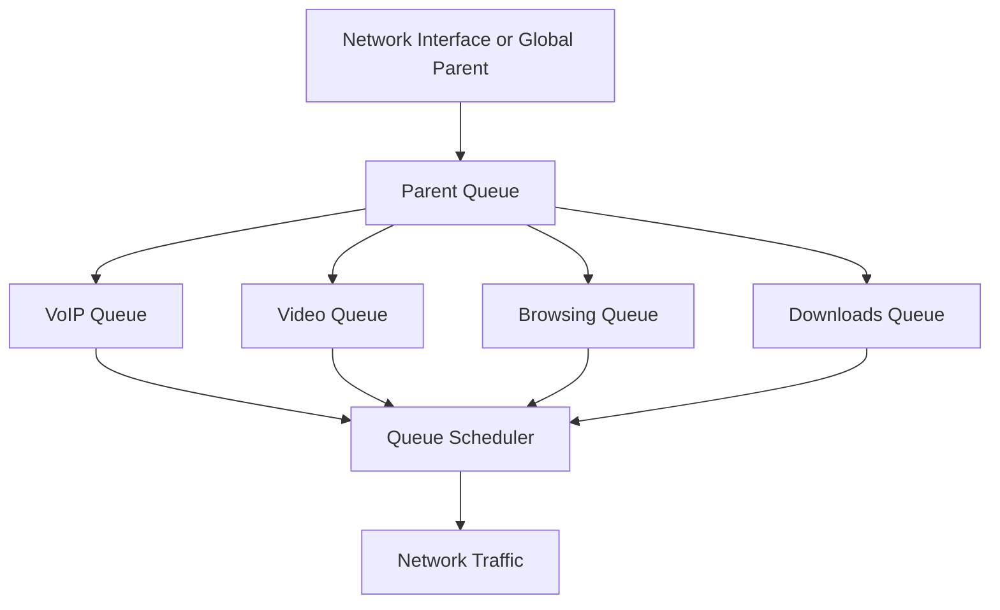

# 🗁 MikroTik Queue Trees

Queue Trees are an advanced bandwidth-management feature in MikroTik RouterOS used to control and prioritize network traffic through a hierarchical queue structure.

Unlike Simple Queues, which commonly identify traffic directly through IP addresses or network targets, Queue Trees provide flexible traffic management using parent queues, packet marks, queue types, and scheduling priorities.

They are particularly useful for ISP networks, enterprise environments, and networks that require detailed QoS policies.

# 🗁 What Are Queue Trees?

A Queue Tree is a hierarchical queueing mechanism that organizes traffic into parent and child queues.

* **Parent Queue:** Defines an aggregate queue or bandwidth limit.
* **Child Queue:** Manages a specific traffic class under a parent.
* **Packet Mark:** Identifies traffic that should enter a particular queue.
* **Queue Type:** Determines how packets are handled within a queue.
* **Priority:** Controls scheduling preference between competing child queues.

For example, an ISP can create separate queues for VoIP, video, browsing, and downloads.

Each traffic class can have its own bandwidth policy and scheduling priority.

# 🗁 Why Queue Trees Are Used

Queue Trees provide flexible control over network traffic.

Common use cases include:

* **Traffic Classification:** Separate traffic into application or service categories.
* **Bandwidth Management:** Control aggregate and individual traffic rates.
* **Traffic Prioritization:** Give important traffic higher scheduling priority.
* **ISP Bandwidth Management:** Manage bandwidth across customers and service classes.
* **Network Congestion Control:** Allocate available capacity during congestion.
* **Hierarchical QoS:** Organize traffic policies using parent and child queues.

# 🗁 Queue Tree Architecture

A typical Queue Tree contains one parent queue and multiple child queues.



The parent queue controls the aggregate traffic rate, while child queues apply policies to individual traffic classes.

The actual hierarchy and traffic direction depend on the selected parent and packet-processing path.

# 🗁 Queue Tree Components

| Component | Description |
| --- | --- |
| Name | Identifies the queue |
| Parent | Defines the parent queue or processing point |
| Packet Mark | Selects traffic classified by firewall mangle rules |
| Max Limit | Defines the maximum queue rate |
| Limit At | Defines a committed rate, subject to parent capacity |
| Priority | Defines scheduling priority |
| Queue | Specifies the queue discipline |
| Burst | Configures temporary burst behavior |

# 🗁 Understanding Parent Queues

The `parent` parameter determines where a Queue Tree is attached.

Common parent choices include:

| Parent | Description |
| --- | --- |
| `global` | Applies to traffic at the global queueing point |
| Interface name | Attaches the queue to a specific interface |
| Another queue name | Creates a child queue under an existing Queue Tree entry |

Example:

```routeros
/queue tree
add name="Total-Upload" parent=ether1 max-limit=100M
```

This creates a parent queue attached to `ether1` with a maximum rate of 100 Mbps.

The parent determines which traffic can enter the queue. Selecting the correct parent is essential for controlling the intended direction of traffic.

# 🗁 Understanding Packet Marks

Queue Trees commonly use firewall mangle rules to classify and mark packets.

A packet mark is an internal RouterOS identifier attached to a packet during firewall processing.

Queue Tree entries can use these marks to select the traffic they manage.

The general process is:

* Identify traffic using firewall mangle rules.
* Assign connection marks when connection-level classification is needed.
* Assign packet marks to matching packets.
* Create Queue Tree entries that match those packet marks.
* Apply bandwidth and priority policies.

For example, VoIP packets can receive the packet mark `voip_traffic`, while download packets receive `download_traffic`.

# 🗁 Connection Marks vs Packet Marks

RouterOS provides different marking mechanisms.

| Mark Type | Purpose |
| --- | --- |
| Connection Mark | Identifies a connection and stores classification information |
| Packet Mark | Identifies individual packets for further processing, including Queue Tree classification |
| Routing Mark | Selects a routing table for policy-based routing |

A connection mark is associated with connection-tracking information.

A packet mark is associated with an individual packet.

Queue Tree classification normally uses packet marks rather than connection marks.

# 🗁 Creating a Queue Tree

Consider a network with two traffic classes:

* VoIP traffic.
* General download traffic.

The objective is to classify these traffic types and apply different queue policies.

### 🖆 Create Packet Marks

The following example marks UDP traffic associated with a hypothetical VoIP service using port `5060`.

```routeros
/ip firewall mangle
add chain=forward protocol=udp dst-port=5060 \
    action=mark-packet new-packet-mark=voip_traffic passthrough=no
```

This rule marks matching forwarded packets.

Port `5060` is commonly associated with SIP signaling. Real VoIP media may use separate RTP ports, so a production QoS policy should classify the actual signaling and media traffic.

### 🖆 Create the Parent Queue

```routeros
/queue tree
add name="Total-Download" parent=global max-limit=100M
```

This creates an aggregate queue with a maximum rate of 100 Mbps at the global queueing point.

### 🖆 Create the VoIP Child Queue

```routeros
/queue tree
add name="VoIP" parent=Total-Download \
    packet-mark=voip_traffic max-limit=10M priority=1
```

This creates a child queue for marked VoIP traffic.

### 🖆 Create the General Traffic Queue

```routeros
/queue tree
add name="General-Traffic" parent=Total-Download \
    max-limit=100M priority=8
```

This creates another child queue under the same parent.

The two child queues represent different traffic classes.

Their priorities influence scheduling when they compete for available capacity under the parent.

# 🗁 Understanding Max Limit and Limit At

Queue Trees support two important bandwidth parameters.

| Parameter | Description |
| --- | --- |
| `max-limit` | Maximum rate the queue can reach |
| `limit-at` | Committed rate the queue is entitled to receive when sufficient parent capacity is available |

Example:

```routeros
/queue tree
add name="VoIP" parent=Total-Download \
    packet-mark=voip_traffic \
    limit-at=5M max-limit=10M priority=1
```

This configures:

* Committed rate: 5 Mbps
* Maximum rate: 10 Mbps
* Priority: 1

The queue can use up to 10 Mbps when capacity is available, while its committed rate is subject to the available capacity and parent hierarchy.

# 🗁 Queue Tree Priority

Queue Trees support eight priority levels.

| Priority | Meaning |
| --- | --- |
| 1 | Highest |
| 2 | Very High |
| 3 | High |
| 4 | Above Normal |
| 5 | Normal |
| 6 | Below Normal |
| 7 | Low |
| 8 | Lowest |

Priority affects how RouterOS schedules competing child queues.

It does not independently reserve bandwidth.

For committed bandwidth requirements, use `limit-at` with an appropriate parent configuration.

# 🗁 Queue Types

Queue Types determine how packets are managed inside a queue.

Common RouterOS queue disciplines include:

| Queue Type | Description |
| --- | --- |
| PFIFO | Packet-based First In, First Out |
| BFIFO | Byte-based First In, First Out |
| SFQ | Stochastic Fairness Queuing |
| RED | Random Early Detection |
| FQ-CoDel | Flow Queue Controlled Delay |
| CAKE | Common Applications Kept Enhanced |

To view available queue types:

```routeros
/queue type print
```

To create a custom FQ-CoDel queue type:

```routeros
/queue type
add name="FQ-CoDel-Custom" kind=fq-codel
```

A custom queue type can be assigned to a Queue Tree entry:

```routeros
/queue tree
set [find name="General-Traffic"] queue=FQ-CoDel-Custom
```

Queue discipline selection should consider CPU resources, traffic patterns, latency requirements, and device support.

# 🗁 Upload and Download Queue Trees

Upload and download traffic must be handled according to the router's packet-processing direction.

Consider this topology:

```text
LAN Clients
    |
    |
MikroTik Router
    |
    |
WAN Interface
    |
    |
Internet
```

From the router's perspective:

| Traffic | Direction |
| --- | --- |
| Upload | LAN → Router → WAN |
| Download | WAN → Router → LAN |

For an interface-based Queue Tree:

* Upload shaping is commonly attached to the WAN egress interface.
* Download shaping is commonly attached to the LAN egress interface.

This is because an interface queue controls traffic leaving that interface.

The selected parent and packet marks must match the intended traffic path.

# 🗁 Download Queue Tree Example

Assume:

* WAN interface: `ether1`
* LAN interface: `bridge`
* Download traffic enters through `ether1` and leaves through `bridge`.

Create a packet mark for forwarded download traffic:

```routeros
/ip firewall mangle
add chain=forward in-interface=ether1 out-interface=bridge \
    action=mark-packet new-packet-mark=download_traffic passthrough=no
```

Create the download queue:

```routeros
/queue tree
add name="Download-Limit" parent=bridge \
    packet-mark=download_traffic max-limit=50M
```

The queue is attached to the LAN egress interface because download packets leave the router through `bridge`.

# 🗁 Upload Queue Tree Example

Create a packet mark for forwarded upload traffic:

```routeros
/ip firewall mangle
add chain=forward in-interface=bridge out-interface=ether1 \
    action=mark-packet new-packet-mark=upload_traffic passthrough=no
```

Create the upload queue:

```routeros
/queue tree
add name="Upload-Limit" parent=ether1 \
    packet-mark=upload_traffic max-limit=20M
```

The queue is attached to the WAN egress interface because upload packets leave the router through `ether1`.

These examples assume that the traffic is routed through the specified interfaces. Bridging, VLANs, tunnels, hardware offloading, and other packet-processing configurations may require different classification and queue placement.

# 🗁 FastTrack Considerations

FastTrack accelerates eligible connection processing by bypassing parts of the normal firewall and packet-processing path.

FastTracked traffic can bypass firewall mangle processing and certain queueing paths.

As a result, Queue Trees that depend on packet marks may not process FastTracked traffic as intended.

When implementing Queue Trees:

* Check whether FastTrack is enabled.
* Verify that the relevant traffic receives packet marks.
* Ensure packets reach the intended queue.
* Exclude traffic requiring normal QoS processing from FastTrack where appropriate.
* Test the actual packet flow.

# 🗁 Monitoring Queue Trees

RouterOS provides commands for inspecting Queue Tree configurations and statistics.

Display Queue Trees:

```routeros
/queue tree print
```

Display detailed queue configuration:

```routeros
/queue tree print detail
```

Monitor queue statistics:

```routeros
/queue tree monitor [find name="Download-Limit"]
```

Monitoring helps identify:

* Current traffic rate.
* Packet and byte counters.
* Queue utilization.
* Dropped packets.
* Whether traffic is reaching the expected queue.

# 🗁 Simple Queues vs Queue Trees

| Feature | Simple Queues | Queue Trees |
| --- | --- | --- |
| Configuration complexity | Lower | Higher |
| Traffic targeting | IP and network targets | Parent and packet-mark-based classification |
| Packet marking | Not required for basic targeting | Commonly required |
| Hierarchical management | Supported | Supported |
| Advanced traffic classification | More limited | More flexible |
| Typical use | Individual subscriber limits | Advanced QoS and traffic classes |

Both mechanisms can be used for bandwidth management, but their configuration models and processing behavior differ.

# 🗁 Best Practices

* Plan the queue hierarchy before creating Queue Trees.
* Select the correct parent for the intended traffic direction.
* Use meaningful packet-mark names.
* Classify only the traffic that needs special treatment.
* Configure `limit-at` according to actual capacity requirements.
* Use `max-limit` to enforce maximum rates.
* Keep child committed rates within the available parent capacity.
* Avoid unnecessary overlapping queue policies.
* Select suitable queue types.
* Account for FastTrack and hardware offloading.
* Monitor queue statistics under realistic traffic conditions.
* Test upload and download policies independently.

# 🗁 Summary

Queue Trees are a flexible RouterOS QoS mechanism for managing traffic through hierarchical queues.

They commonly use firewall mangle rules to classify packets, packet marks to identify traffic, and parent-child queue relationships to control bandwidth and scheduling priority.

Queue Trees are particularly useful for advanced ISP bandwidth management, traffic classification, aggregate bandwidth control, and application-based QoS policies.
