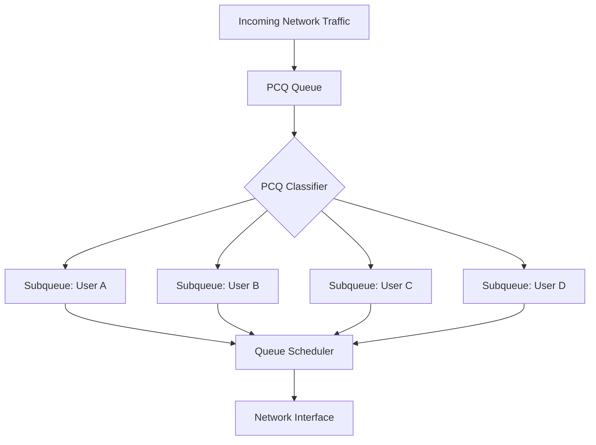

# Per Connection Queue (PCQ)

Per Connection Queue (PCQ) is a queueing mechanism in MikroTik RouterOS designed to distribute available bandwidth among multiple traffic flows or users.

PCQ creates multiple subqueues dynamically based on a configured classifier. Each subqueue receives traffic belonging to a particular classification group.

This makes PCQ particularly useful for ISPs, offices, public Wi-Fi networks, and environments where multiple users share a limited internet connection.

Instead of manually creating a separate queue for every user, administrators can use PCQ to manage bandwidth distribution automatically.

# 🗁 What Is PCQ?

PCQ stands for Per Connection Queue.

Despite its name, PCQ can classify traffic using different packet attributes, including source addresses, destination addresses, and ports.

It creates individual subqueues based on the selected classifier.

For example, an ISP has 100 Mbps of available download bandwidth shared by 10 customers.

With a suitable PCQ configuration, the router can distribute available bandwidth among the customers instead of requiring a manually configured queue for each subscriber.

# 🗁 Why PCQ Is Used

PCQ simplifies bandwidth management in networks with many users.

Common use cases include:

* **Automatic Bandwidth Distribution:** Distribute available bandwidth among multiple classification groups.
* **Subscriber Management:** Manage bandwidth for many ISP customers.
* **Fairness:** Prevent a single user or flow from consuming all available capacity.
* **Scalability:** Avoid creating individual queue configurations for every subscriber.
* **Shared Internet Connections:** Manage bandwidth in offices, schools, hotels, and public Wi-Fi networks.
* **Traffic Management:** Apply different PCQ policies to upload and download traffic.

# 🗁 How PCQ Works

PCQ uses a classifier to determine how traffic should be separated into subqueues.

For example, when using `dst-address` as the classifier:

* Packets are grouped according to their destination IP addresses.
* Each destination address gets its own subqueue.
* The configured PCQ rate can limit each subqueue.
* When the PCQ rate is zero, bandwidth is distributed dynamically among active subqueues according to available capacity.

The actual bandwidth distribution depends on the classifier, queue configuration, parent limits, and competing traffic.

# 🗁 PCQ Architecture Diagram



Each subqueue handles traffic belonging to a classification group.

# 🗁 PCQ Classifiers

A PCQ classifier determines how traffic is divided into subqueues.

Common classifiers include:

| Classifier | Description |
| --- | --- |
| `src-address` | Groups traffic by source IP address |
| `dst-address` | Groups traffic by destination IP address |
| `src-port` | Groups traffic by source port |
| `dst-port` | Groups traffic by destination port |
| `src-address,dst-address` | Groups traffic by source and destination address |
| `src-port,dst-port` | Groups traffic by source and destination port |

The classifier must match the intended fairness model.

For example:

* `src-address` is commonly used for upload distribution among clients.
* `dst-address` is commonly used for download distribution among clients.

# 🗁 Understanding PCQ Rate

The `pcq-rate` parameter defines the maximum rate assigned to each PCQ subqueue.

There are two common configurations.

**Fixed PCQ Rate**

When `pcq-rate` is greater than zero, each subqueue is limited to the configured rate.

Example:

```routeros id="7h4n9x"
/queue type
add name="PCQ-Download-10M" kind=pcq \
    pcq-rate=10M pcq-classifier=dst-address
```

Each destination-address subqueue can use up to 10 Mbps, subject to the capacity of its parent queue and other queue constraints.

**Dynamic Bandwidth Distribution**

When `pcq-rate` is set to `0`, PCQ distributes available bandwidth dynamically among active subqueues.

Example:

```routeros id="3kq8jm"
/queue type
add name="PCQ-Download" kind=pcq \
    pcq-rate=0 pcq-classifier=dst-address
```

In this configuration, PCQ does not impose a fixed per-subqueue rate. Available bandwidth is shared among active subqueues.

This does not guarantee perfectly equal throughput under every traffic condition.

# 🗁 PCQ Burst Parameters

PCQ supports burst-related settings similar to other RouterOS queue configurations.

| Parameter | Description |
| --- | --- |
| `pcq-burst-rate` | Temporary maximum rate for a subqueue |
| `pcq-burst-threshold` | Average-rate threshold used for burst eligibility |
| `pcq-burst-time` | Time interval used to calculate the average rate |

Burst configuration allows a subqueue to temporarily exceed its normal PCQ rate when the configured conditions are satisfied.

# 🗁 Upload and Download PCQ

Upload and download traffic should normally use different PCQ classifiers.

Consider this network:

```text id="z8p3ft"
Customers
    |
    |
MikroTik Router
    |
    |
Internet
```

From the router's perspective:

| Traffic Direction | Packet Source | Packet Destination | Common Classifier |
| --- | --- | --- | --- |
| Upload | Customer | Internet destination | `src-address` |
| Download | Internet source | Customer | `dst-address` |

This allows the router to create separate subqueues for individual customer addresses.

# 🗁 Creating PCQ Queue Types

Consider an ISP that wants to distribute bandwidth among multiple customers.

The ISP will create two queue types:

* Upload PCQ.
* Download PCQ.

### 🖆 Upload PCQ Type

```routeros id="x7m2vn"
/queue type
add name="PCQ-Upload" kind=pcq \
    pcq-rate=0 pcq-classifier=src-address
```

This groups upload traffic by source IP address.

Each customer source address gets its own PCQ subqueue.

### 🖆 Download PCQ Type

```routeros id="c4w8lp"
/queue type
add name="PCQ-Download" kind=pcq \
    pcq-rate=0 pcq-classifier=dst-address
```

This groups download traffic by destination IP address.

Each customer destination address gets its own PCQ subqueue.

# 🗁 Applying PCQ with Simple Queues

PCQ queue types can be assigned to Simple Queues.

Example:

```routeros id="m5q1rd"
/queue simple
add name="Customer-Network" target=192.168.10.0/24 \
    max-limit=50M/100M \
    queue=PCQ-Upload/PCQ-Download
```

This configuration applies:

| Direction | Queue Type | Aggregate Maximum |
| --- | --- | ---: |
| Upload | PCQ-Upload | 50 Mbps |
| Download | PCQ-Download | 100 Mbps |

The Simple Queue controls the aggregate rate for the target network.

PCQ distributes that available capacity among the subqueues created by its classifiers.

The `max-limit` values are aggregate ceilings, not guaranteed rates for every customer.

# 🗁 Applying PCQ with Queue Trees

PCQ can also be used with Queue Trees for more flexible traffic management.

Example:

```routeros id="q6z3pt"
/queue tree
add name="Upload-PCQ" parent=ether1 \
    queue=PCQ-Upload max-limit=50M

add name="Download-PCQ" parent=bridge \
    queue=PCQ-Download max-limit=100M
```

This example assumes:

* `ether1` is the WAN egress interface.
* `bridge` is the LAN egress interface.
* Upload and download traffic reach the respective queues.

For more advanced configurations, firewall mangle rules can classify traffic and assign packet marks to specific Queue Tree entries.

# 🗁 PCQ with Multiple Customers

Consider an ISP with the following configuration:

| Parameter | Value |
| --- | ---: |
| Total upload bandwidth | 50 Mbps |
| Total download bandwidth | 100 Mbps |
| Active customers | 10 |

If all 10 customers are actively using the connection and traffic is distributed evenly, the approximate available bandwidth per customer would be:

**Upload:**

\[
\frac{50\text{ Mbps}}{10}=5\text{ Mbps}
\]

**Download:**

\[
\frac{100\text{ Mbps}}{10}=10\text{ Mbps}
\]

<text>These figures illustrate an idealized equal-sharing scenario. Actual throughput depends on active traffic, packet sizes, queue scheduling, parent capacity, and other network conditions.</text>

# 🗁 PCQ and Fair Bandwidth Distribution

PCQ helps prevent individual classification groups from monopolizing shared bandwidth.

However, PCQ fairness depends on how traffic is classified.

For example, when using `src-address`, devices with multiple source IP addresses may receive multiple subqueues.

Similarly, when using `dst-address`, traffic to multiple destination addresses may be divided into separate groups.

Therefore, PCQ does not automatically guarantee fairness per person or per physical device.

The classifier must match the network's intended sharing policy.

# 🗁 Monitoring PCQ

RouterOS provides commands for inspecting queue types and queue activity.

Display configured queue types:

```routeros id="p2x8jm"
/queue type print
```

Display Simple Queues:

```routeros id="v6c3nk"
/queue simple print
```

Display Queue Trees:

```routeros id="k1w7fq"
/queue tree print
```

Monitor a Simple Queue:

```routeros id="z5m9bx"
/queue simple monitor [find name="Customer-Network"]
```

Monitor Queue Tree statistics:

```routeros id="a8r4jd"
/queue tree monitor [find]
```

Monitor queue activity and verify that the expected traffic is being classified and distributed.

# 🗁 PCQ vs Simple Queues vs Queue Trees

| Feature | PCQ | Simple Queues | Queue Trees |
| --- | --- | --- | --- |
| Main purpose | Distribute bandwidth among subqueues | Manage bandwidth for targets | Manage hierarchical traffic classes |
| Classification | PCQ classifier | Target and queue configuration | Commonly packet marks |
| Automatic subqueues | Yes | No equivalent PCQ subqueue behavior by default | No equivalent PCQ subqueue behavior by default |
| Hierarchical policies | Used as a queue type within a hierarchy | Supported | Supported |
| Typical use | Shared bandwidth distribution | Individual customer limits | Advanced QoS policies |

PCQ is a queue discipline that can be used with Simple Queues or Queue Trees. It is not a replacement for those queueing mechanisms.

# 🗁 FastTrack Considerations

FastTrack can bypass parts of the normal firewall and queue-processing path for eligible connections.

As a result, PCQ configurations may not process all intended traffic if that traffic is FastTracked.

When using PCQ:

* Check whether FastTrack is enabled.
* Verify that packets reach the intended queue.
* Confirm the correct upload and download classifiers.
* Test bandwidth distribution with multiple active clients.
* Account for the RouterOS packet-processing path.

# 🗁 Best Practices

* Select classifiers that match the intended fairness model.
* Use `src-address` for common upload distribution among customers.
* Use `dst-address` for common download distribution among customers.
* Set `pcq-rate=0` when dynamic sharing is required.
* Use a fixed `pcq-rate` when each subqueue needs an individual maximum.
* Configure aggregate parent limits to protect shared links.
* Avoid assuming PCQ guarantees perfectly equal bandwidth.
* Monitor the number of active subqueues and queue utilization.
* Account for FastTrack and hardware offloading.
* Test with multiple simultaneous users.
* Combine PCQ with appropriate Simple Queue or Queue Tree policies.

# 🗁 Summary

Per Connection Queue (PCQ) is a MikroTik RouterOS queueing mechanism that automatically creates subqueues based on configured traffic classifiers.

It is useful for distributing shared bandwidth among multiple users, customers, or traffic groups.

By combining PCQ with Simple Queues or Queue Trees, network administrators can build scalable bandwidth-management policies without manually creating an individual queue for every traffic flow.
