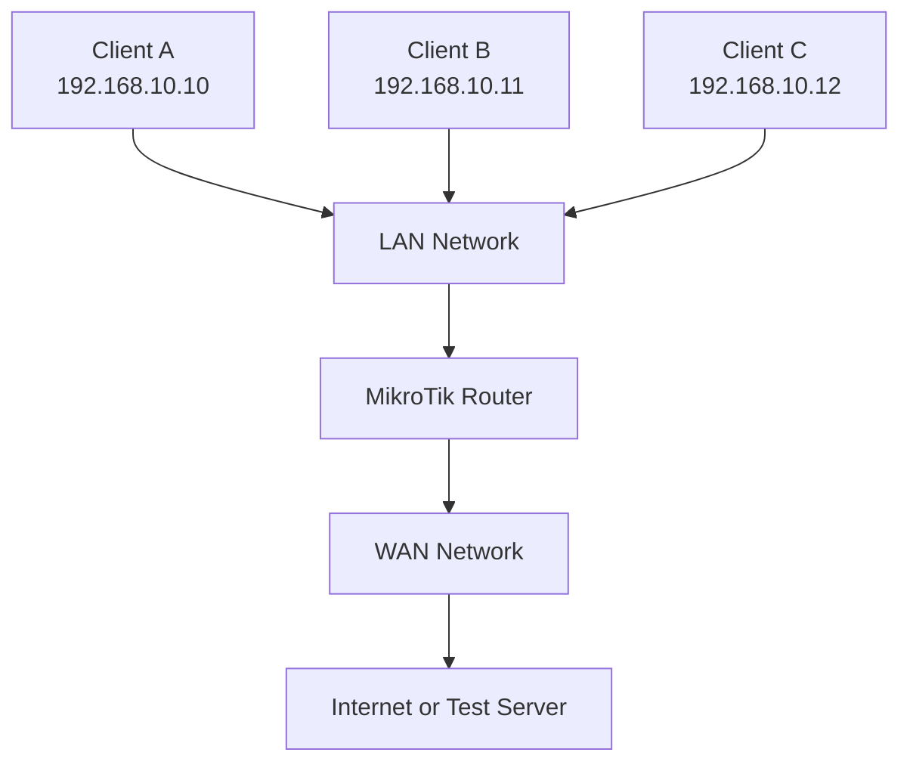

# QoS Labs and Practical Exercises

Practical labs are essential for understanding Quality of Service (QoS), bandwidth management, traffic shaping, traffic policing, prioritization, and queueing mechanisms.

This section provides hands-on exercises using MikroTik RouterOS v7 to configure and test QoS policies in a controlled network environment.

The labs progress from basic bandwidth limiting to more advanced traffic classification and bandwidth distribution.

# 🗁 Lab Objectives

After completing these labs, you should be able to:

* Configure bandwidth limits using Simple Queues.
* Understand upload and download traffic directions.
* Configure committed and maximum bandwidth rates.
* Apply traffic prioritization.
* Create and manage Queue Trees.
* Classify traffic using firewall mangle rules.
* Configure PCQ for automatic bandwidth distribution.
* Monitor queue statistics.
* Troubleshoot common QoS configuration problems.
* Understand the impact of FastTrack on queue processing.

# 🗁 Lab Environment

You can perform these exercises using:

* MikroTik RouterOS v7.
* MikroTik CHR (Cloud Hosted Router).
* VirtualBox, VMware, GNS3, or EVE-NG.
* Two or more Linux or Windows client machines.
* A virtual LAN and WAN network.

**Recommended topology:**



**Example IP addressing:**

| Device | Interface | IP Address |
| --- | --- | --- |
| MikroTik Router | LAN | `192.168.10.1/24` |
| Client A | LAN | `192.168.10.10/24` |
| Client B | LAN | `192.168.10.11/24` |
| Client C | LAN | `192.168.10.12/24` |
| Test Server | WAN/Test Network | `203.0.113.10` |

The address `203.0.113.10` belongs to a documentation-only IP range. Use an actual reachable test-server address in your lab.

# 🗁 Lab 1: Configure a Simple Queue

**Objective:** Limit upload and download bandwidth for an individual client.

**Network details:**

| Parameter | Value |
| --- | --- |
| Client IP | `192.168.10.10` |
| Upload Limit | 5 Mbps |
| Download Limit | 10 Mbps |

**Configuration:**

```routeros
/queue simple
add name="Client-A" target=192.168.10.10/32 max-limit=5M/10M
```

**Verify configuration:**

```routeros
/queue simple print
```

**Monitor queue activity:**

```routeros
/queue simple monitor [find name="Client-A"]
```

**Testing:**

From Client A, download and upload a test file or run a bandwidth test against a separate test server.

Verify that:

* Upload traffic is limited to approximately 5 Mbps.
* Download traffic is limited to approximately 10 Mbps.
* Queue statistics increase during traffic transmission.

**Expected result:** Client A's traffic is controlled by the configured Simple Queue limits.

# 🗁 Lab 2: Configure Multiple Customer Queues

**Objective:** Apply different bandwidth policies to multiple clients.

**Customer configuration:**

| Customer | IP Address | Upload | Download |
| --- | --- | ---: | ---: |
| Customer A | `192.168.10.10` | 5 Mbps | 10 Mbps |
| Customer B | `192.168.10.11` | 10 Mbps | 20 Mbps |
| Customer C | `192.168.10.12` | 15 Mbps | 30 Mbps |

**Configuration:**

```routeros
/queue simple
add name="Customer-A" target=192.168.10.10/32 max-limit=5M/10M
add name="Customer-B" target=192.168.10.11/32 max-limit=10M/20M
add name="Customer-C" target=192.168.10.12/32 max-limit=15M/30M
```

**Verify:**

```routeros
/queue simple print
```

**Testing:**

Generate traffic simultaneously from all three clients.

Verify that each client receives bandwidth according to its individual queue configuration.

**Expected result:** Each customer has an independent upload and download maximum.

# 🗁 Lab 3: Configure Limit At and Max Limit

**Objective:** Understand committed and maximum bandwidth allocation.

**Network policy:**

| Parameter | Upload | Download |
| --- | ---: | ---: |
| Limit At | 3 Mbps | 5 Mbps |
| Max Limit | 10 Mbps | 20 Mbps |

**Configuration:**

```routeros
/queue simple
add name="Customer-A" target=192.168.10.10/32 \
    limit-at=3M/5M \
    max-limit=10M/20M
```

**Testing:**

* Generate traffic from Customer A.
* Monitor its upload and download rates.
* Introduce competing traffic under a shared parent queue.
* Observe how the committed rate and maximum rate behave.

**Expected result:** The queue can use bandwidth up to its maximum limit when capacity is available. Its committed rate depends on sufficient capacity being available through the parent hierarchy.

# 🗁 Lab 4: Configure Traffic Prioritization

**Objective:** Give important traffic a higher scheduling priority than ordinary traffic.

**Scenario:**

An organization wants to prioritize a VoIP client over a file-download client.

| Traffic | Client IP | Priority |
| --- | --- | --- |
| VoIP | `192.168.10.10` | 1 |
| File Downloads | `192.168.10.11` | 8 |

**Configuration:**

```routeros
/queue simple
add name="VoIP" target=192.168.10.10/32 \
    max-limit=5M/5M priority=1/1

add name="Downloads" target=192.168.10.11/32 \
    max-limit=20M/20M priority=8/8
```

**Testing:**

* Generate traffic from both clients.
* Introduce congestion under an appropriate shared queue hierarchy.
* Observe how the queues behave when competing for bandwidth.

**Expected result:** The VoIP queue receives higher scheduling priority when the queues compete under the relevant hierarchy.

Priority alone does not guarantee a fixed bandwidth reservation.

# 🗁 Lab 5: Configure PCQ Upload and Download

**Objective:** Distribute shared bandwidth among multiple clients automatically.

**Network policy:**

| Parameter | Value |
| --- | ---: |
| Upload Aggregate Limit | 30 Mbps |
| Download Aggregate Limit | 60 Mbps |
| Number of Clients | 3 |

**Step 1: Create the upload PCQ type.**

```routeros
/queue type
add name="PCQ-Upload" kind=pcq \
    pcq-rate=0 pcq-classifier=src-address
```

**Step 2: Create the download PCQ type.**

```routeros
/queue type
add name="PCQ-Download" kind=pcq \
    pcq-rate=0 pcq-classifier=dst-address
```

**Step 3: Apply PCQ to the customer network.**

```routeros
/queue simple
add name="Shared-Network" target=192.168.10.0/24 \
    max-limit=30M/60M \
    queue=PCQ-Upload/PCQ-Download
```

**Testing:**

* Generate upload traffic from all three clients.
* Generate download traffic from all three clients.
* Monitor the aggregate queue.
* Compare bandwidth distribution among active clients.

**Expected result:** PCQ creates separate subqueues based on source addresses for upload and destination addresses for download.

When clients are similarly active, they should receive approximately balanced shares of the available bandwidth.

Actual throughput depends on traffic demand, queue capacity, and other network conditions.

# 🗁 Lab 6: Configure a Queue Tree

**Objective:** Create hierarchical queues for managing different traffic classes.

**Scenario:**

An organization has a 50 Mbps download policy and wants separate queues for VoIP and general traffic.

**Step 1: Mark VoIP traffic.**

This example uses UDP destination port `5060` for SIP signaling.

```routeros
/ip firewall mangle
add chain=forward protocol=udp dst-port=5060 \
    action=mark-packet \
    new-packet-mark=voip_traffic \
    passthrough=no
```

**Step 2: Create a parent queue.**

```routeros
/queue tree
add name="Total-Download" parent=bridge max-limit=50M
```

**Step 3: Create the VoIP queue.**

```routeros
/queue tree
add name="VoIP" parent=Total-Download \
    packet-mark=voip_traffic \
    max-limit=10M priority=1
```

**Step 4: Create a general traffic queue.**

```routeros
/queue tree
add name="General-Traffic" parent=Total-Download \
    max-limit=50M priority=8
```

**Testing:**

* Generate matching VoIP signaling traffic.
* Generate general network traffic.
* Monitor Queue Tree statistics.
* Verify that marked packets enter the VoIP queue.

**Expected result:** The Queue Tree separates marked VoIP traffic from general traffic.

For a production voice QoS policy, classify actual media traffic as well as signaling. The parent queue's selected interface and traffic direction must match the intended download path.

# 🗁 Lab 7: Configure Upload and Download Queue Trees

**Objective:** Control upload and download traffic using interface-based Queue Trees.

**Network topology:**

```text
LAN Clients
    |
    |
MikroTik Router
    |
    |
WAN Interface: ether1
    |
    |
Internet
```

**Interface details:**

| Interface | Purpose |
| --- | --- |
| `bridge` | LAN |
| `ether1` | WAN |

**Step 1: Mark upload traffic.**

```routeros
/ip firewall mangle
add chain=forward in-interface=bridge out-interface=ether1 \
    action=mark-packet \
    new-packet-mark=upload_traffic \
    passthrough=no
```

**Step 2: Mark download traffic.**

```routeros
/ip firewall mangle
add chain=forward in-interface=ether1 out-interface=bridge \
    action=mark-packet \
    new-packet-mark=download_traffic \
    passthrough=no
```

**Step 3: Create the upload queue.**

```routeros
/queue tree
add name="Upload-Limit" parent=ether1 \
    packet-mark=upload_traffic max-limit=20M
```

**Step 4: Create the download queue.**

```routeros
/queue tree
add name="Download-Limit" parent=bridge \
    packet-mark=download_traffic max-limit=50M
```

**Testing:**

* Upload a test file from a LAN client.
* Download a test file to a LAN client.
* Monitor both Queue Tree entries.
* Verify that each direction is limited independently.

**Expected result:**

* Upload traffic is controlled by the WAN egress queue.
* Download traffic is controlled by the LAN egress queue.

This example assumes routed traffic through the specified interfaces and no conflicting queue configuration.

# 🗁 Lab 8: Configure Queue Types

**Objective:** Understand how queue disciplines affect packet processing and latency.

**Step 1: Display available queue types.**

```routeros
/queue type print
```

**Step 2: Create an FQ-CoDel queue type.**

```routeros
/queue type
add name="FQ-CoDel-Custom" kind=fq-codel
```

**Step 3: Apply it to a Simple Queue.**

```routeros
/queue simple
add name="Latency-Control" target=192.168.10.10/32 \
    max-limit=10M/20M \
    queue=FQ-CoDel-Custom/FQ-CoDel-Custom
```

**Testing:**

* Generate sustained traffic.
* Measure latency before and during congestion.
* Observe queue behavior.
* Compare results with another supported queue discipline.

**Expected result:** You should understand how queue disciplines affect packet scheduling and latency under load.

The actual behavior depends on RouterOS support, device resources, and the traffic profile.

# 🗁 Lab 9: Monitor QoS Performance

**Objective:** Monitor traffic rates, queue utilization, and packet drops.

**Display Simple Queues:**

```routeros
/queue simple print
```

**Monitor a specific Simple Queue:**

```routeros
/queue simple monitor [find name="Customer-A"]
```

**Display Queue Trees:**

```routeros
/queue tree print
```

**Monitor Queue Trees:**

```routeros
/queue tree monitor [find]
```

**Display queue types:**

```routeros
/queue type print
```

**Additional network diagnostics:**

```routeros
/ping 8.8.8.8
/tool traceroute 8.8.8.8
```

**Testing:**

* Generate traffic under normal conditions.
* Generate traffic under congestion.
* Monitor queue rates and drops.
* Compare latency and packet loss.
* Identify whether traffic reaches the expected queue.

**Expected result:** You should be able to inspect QoS behavior and identify common performance problems.

# 🗁 Lab 10: Troubleshoot FastTrack and QoS

**Objective:** Understand how FastTrack can affect bandwidth-management policies.

**Step 1: Inspect firewall filter rules.**

```routeros
/ip firewall filter print
```

Look for rules using:

```routeros
action=fasttrack-connection
```

**Step 2: Inspect queue configurations.**

```routeros
/queue simple print detail
/queue tree print detail
```

**Step 3: Inspect mangle rules.**

```routeros
/ip firewall mangle print detail
```

**Step 4: Generate traffic and observe queue statistics.**

If traffic is not reaching the expected queue, check whether FastTrack is bypassing the relevant firewall or queue-processing path.

For a controlled test, temporarily disable the FastTrack rule:

```routeros
/ip firewall filter
disable [find action=fasttrack-connection]
```

After testing, restore the rule if it was enabled before:

```routeros
/ip firewall filter
enable [find action=fasttrack-connection]
```

If multiple FastTrack rules exist, identify and manage the specific rule instead of disabling all matching rules indiscriminately.

**Expected result:** You should understand why FastTrack can interfere with certain QoS configurations and how to diagnose the packet-processing path.

# 🗁 Troubleshooting Common QoS Problems

| Problem | Possible Cause | Suggested Investigation |
| --- | --- | --- |
| Bandwidth limit is not working | Incorrect queue target | Verify the target IP address |
| Upload limit is incorrect | Upload/download values reversed | Check Simple Queue direction |
| Download queue receives no traffic | Incorrect parent interface | Verify LAN egress interface |
| Upload queue receives no traffic | Incorrect parent interface | Verify WAN egress interface |
| PCQ does not distribute bandwidth | Incorrect classifier | Check source/destination classification |
| Queue Tree does not receive packets | Missing packet marks | Inspect firewall mangle counters |
| FastTrack bypasses QoS | FastTracked traffic | Review FastTrack configuration |
| High latency under load | Excessive queueing or bufferbloat | Review queue discipline and limits |
| Packet drops increase | Queue congestion | Inspect queue capacity and traffic rates |
| Customers receive unequal bandwidth | Different demand or classification | Review PCQ classifier and active traffic |

# 🗁 Practical ISP Scenario

**Scenario:**

An ISP has a 100 Mbps download connection and 50 Mbps upload connection.

It serves three customers with different service plans.

| Customer | Upload | Download |
| --- | ---: | ---: |
| Customer A | 5 Mbps | 10 Mbps |
| Customer B | 10 Mbps | 20 Mbps |
| Customer C | 15 Mbps | 30 Mbps |

The ISP wants to:

* Enforce individual customer bandwidth limits.
* Manage aggregate upstream bandwidth.
* Prioritize voice traffic.
* Distribute available capacity among shared users.
* Monitor network performance.

**Suggested implementation:**

| Requirement | RouterOS Mechanism |
| --- | --- |
| Individual customer limits | Simple Queues |
| Aggregate bandwidth control | Parent queues or Queue Trees |
| Application classification | Firewall mangle |
| Traffic prioritization | Queue priority |
| Dynamic bandwidth distribution | PCQ |
| Traffic monitoring | Queue statistics |

This design demonstrates how different QoS mechanisms can work together.

The actual configuration should account for interface capacity, queue hierarchy, packet direction, FastTrack, and the ISP's traffic policies.

# 🗁 Lab Completion Checklist

* [ ] Create a Simple Queue for an individual client.
* [ ] Configure upload and download bandwidth limits.
* [ ] Configure multiple customer queues.
* [ ] Understand `limit-at` and `max-limit`.
* [ ] Configure queue priorities.
* [ ] Create PCQ upload and download queue types.
* [ ] Apply PCQ to a shared network.
* [ ] Create a Queue Tree with parent and child queues.
* [ ] Mark traffic using firewall mangle.
* [ ] Configure upload and download Queue Trees.
* [ ] Monitor queue statistics.
* [ ] Investigate FastTrack and QoS behavior.
* [ ] Troubleshoot bandwidth and queueing problems.

# 🗁 Summary

These practical labs demonstrate how MikroTik RouterOS can implement QoS and bandwidth-management policies.

By completing the exercises, you gain practical experience with Simple Queues, Queue Trees, PCQ, traffic marking, prioritization, and queue monitoring.

These skills are especially useful when managing ISP subscriber networks, enterprise networks, and shared internet connections.
