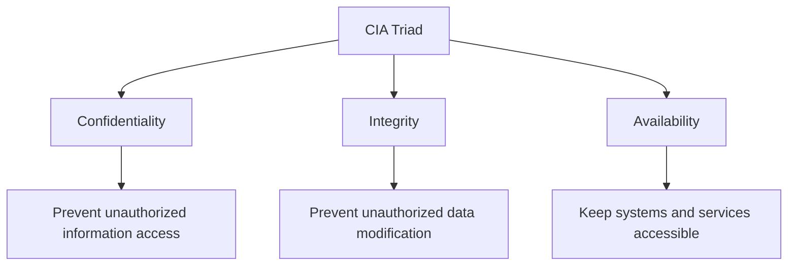
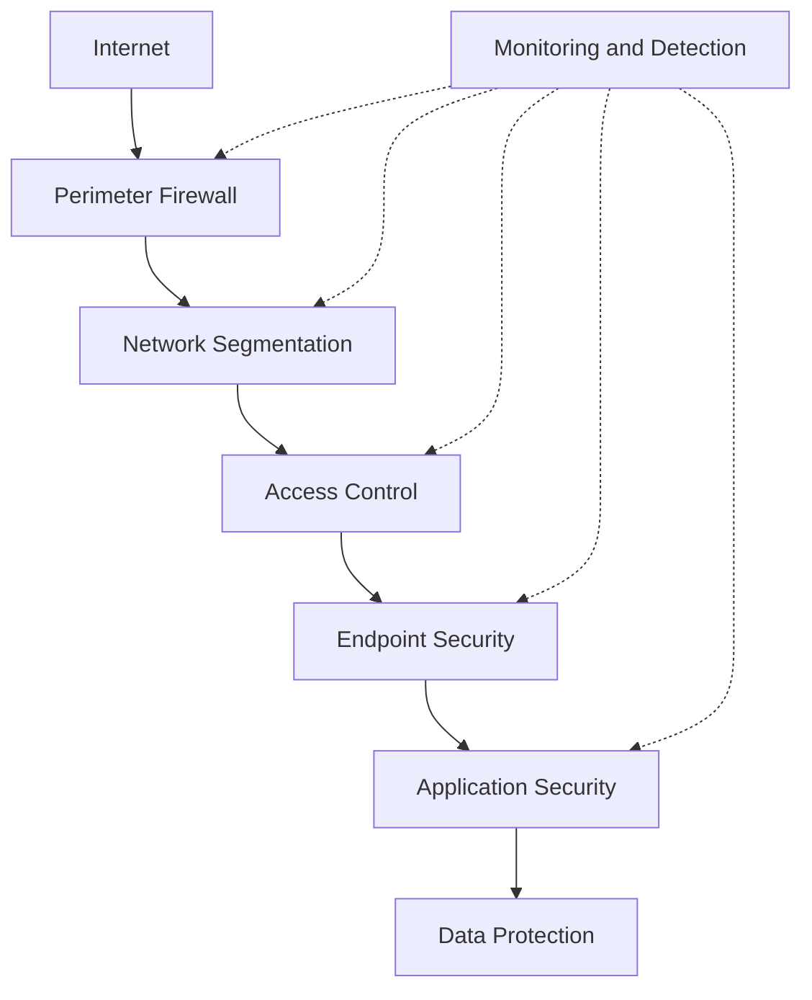
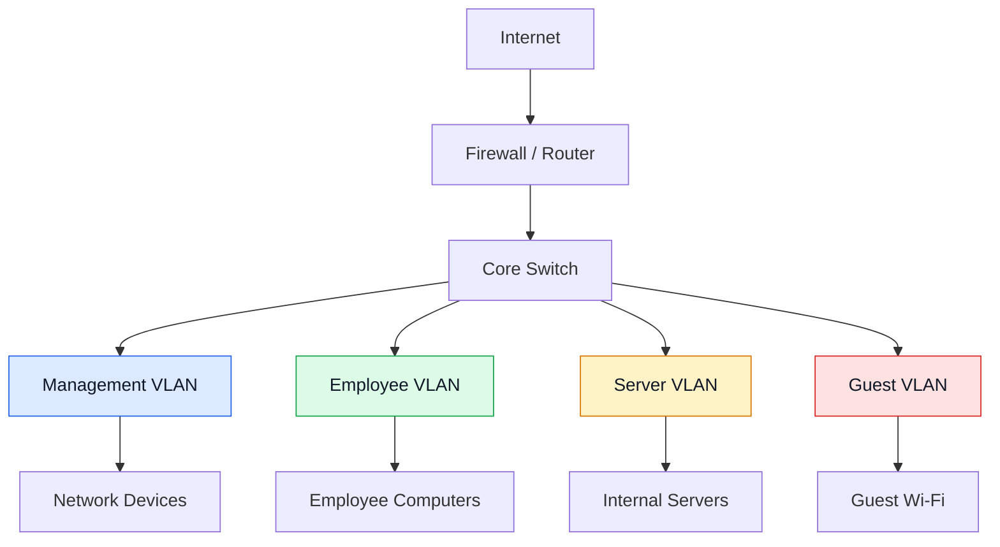

# Network Security Fundamentals

Network security is the practice of protecting network infrastructure, connected devices, communication channels, and transmitted information against unauthorized access, attacks, misuse, and disruption.

It involves implementing security policies, technologies, and operational procedures to ensure that network resources remain protected and available.

Network security applies to routers, switches, firewalls, servers, endpoints, wireless networks, cloud infrastructure, and communication services.

# 🗁 Why Network Security Is Important

Networks carry sensitive information and provide access to critical services. Without appropriate security controls, attackers may exploit vulnerabilities to access systems, steal information, modify data, or interrupt services.

Common reasons for implementing network security include:

* Protecting confidential information.
* Preventing unauthorized network access.
* Maintaining reliable network services.
* Protecting servers and connected devices.
* Preventing data theft and manipulation.
* Reducing the impact of cyberattacks.
* Meeting organizational security requirements.
* Maintaining customer trust and business continuity.

# 🗁 CIA Triad

The CIA triad is a fundamental information security model consisting of three core principles: Confidentiality, Integrity, and Availability.

**Confidentiality**

Confidentiality ensures that information is accessible only to authorized users, devices, and systems.

Security mechanisms include:

* Encryption.
* Authentication.
* Access control lists (ACLs).
* Role-based access control (RBAC).
* Network segmentation.
* Data access policies.

Example:

An administrator uses SSH with authenticated credentials to access a router. Unauthorized users cannot access its management interface.

**Integrity**

Integrity ensures that information remains accurate, consistent, and protected against unauthorized modification or destruction.

Security mechanisms include:

* Cryptographic hashes.
* Digital signatures.
* Message authentication codes (MACs).
* Access control.
* Audit logging.
* Secure configuration management.

Example:

A system uses a cryptographic hash to verify that a downloaded configuration file has not been modified.

**Availability**

Availability ensures that network services, systems, and resources remain accessible to authorized users when required.

Security mechanisms include:

* Network redundancy.
* High availability configurations.
* Load balancing.
* DDoS protection.
* Backup systems.
* Disaster recovery.
* Infrastructure monitoring.

Example:

An ISP uses redundant upstream connections to maintain Internet connectivity when one upstream provider becomes unavailable.

# 🗁 Additional Security Principles

Beyond the CIA triad, several additional principles help establish a comprehensive security strategy.

| Principle | Description |
| --- | --- |
| Authentication | Verifies the identity of a user, device, or service. |
| Authorization | Determines which resources an authenticated entity can access. |
| Accounting | Records user activities and resource usage. |
| Non-repudiation | Provides evidence that an action or communication occurred. |
| Least Privilege | Grants only the permissions necessary to perform a task. |
| Accountability | Ensures that activities can be attributed to responsible entities. |

# 🗁 Authentication, Authorization, and Accounting

AAA is a security framework used to control and monitor access to network resources.

Its three components have different responsibilities:

| Component | Purpose | Example |
| --- | --- | --- |
| Authentication | Verifies identity. | Checking a username and password. |
| Authorization | Determines permissions. | Allowing an administrator to configure a router. |
| Accounting | Records activities. | Logging login time and executed commands. |

AAA is commonly implemented using RADIUS or TACACS+ in enterprise and service-provider networks.

# 🗁 Security Threat, Vulnerability, and Risk

These three terms describe different aspects of security.

**Threat**

A threat is a potential event, actor, or activity that could cause damage to a system or network.

Examples:

* Malware.
* Phishing.
* DDoS attacks.
* Unauthorized access.
* Insider threats.
* Network interception.

**Vulnerability**

A vulnerability is a weakness in a system, configuration, application, or security process that could be exploited.

Examples:

* Weak passwords.
* Outdated firmware.
* Unpatched software.
* Open management ports.
* Incorrect firewall rules.
* Insecure network protocols.

**Risk**

Risk represents the potential for loss or damage when a threat exploits a vulnerability.

A simplified risk model is:

\[
\text{Risk} = \text{Likelihood} \times \text{Impact}
\]

For example:

A router with an exposed management interface and weak credentials has a vulnerability. An attacker attempting unauthorized access represents a threat. The possibility and consequences of a successful compromise represent the risk.

# 🗁 Defense in Depth

Defense in Depth is a security strategy that uses multiple independent security layers to protect network resources.

If one security control fails, other controls can still reduce the likelihood or impact of an attack.

Common defense-in-depth layers include:

| Layer | Security Control |
| --- | --- |
| Perimeter | Firewalls, DDoS protection, and filtering. |
| Network | VLANs, ACLs, and network segmentation. |
| Access | Authentication, authorization, and MFA. |
| Endpoint | Antivirus, endpoint detection, and system hardening. |
| Application | Secure development and application access control. |
| Data | Encryption, backups, and data access restrictions. |
| Monitoring | Logging, intrusion detection, and security analysis. |

# 🗁 Principle of Least Privilege

The Principle of Least Privilege (PoLP) means granting users, devices, and applications only the minimum permissions required to perform their assigned responsibilities.

For example:

* A network administrator may have full configuration access.
* A monitoring account may have read-only access.
* A regular user should not have router administration privileges.
* An application should not receive unnecessary operating-system permissions.

This principle reduces the potential impact of compromised accounts and unauthorized activities.

# 🗁 Zero Trust Security

Zero Trust is a security model based on the principle that no user, device, or connection should automatically be trusted.

Every access request must be evaluated using identity, device condition, context, and applicable security policies.

Its core principles include:

* Verify explicitly.
* Apply least-privilege access.
* Assume breach.
* Continuously evaluate access.
* Segment access to reduce lateral movement.

Example:

A user connected to an internal office network must still authenticate and satisfy access policies before accessing a sensitive server.

Zero Trust does not mean removing all network boundaries. It means continuously enforcing access decisions rather than relying only on network location.

# 🗁 Network Segmentation

Network segmentation divides a larger network into smaller logical or physical sections to control communication and limit unauthorized access.

Common segmentation methods include:

* VLANs.
* Subnets.
* Firewall zones.
* Access control lists.
* Virtual routing and forwarding (VRF).
* Software-defined segmentation.

Example network:

| Network | Subnet | Purpose |
| --- | --- | --- |
| Management | `192.168.10.0/24` | Network device administration. |
| Servers | `192.168.20.0/24` | Internal server infrastructure. |
| Employees | `192.168.30.0/24` | Employee workstations. |
| Guests | `192.168.40.0/24` | Guest Internet access. |

Communication between these networks should be controlled through appropriate routing and security policies.

# 🗁 Common Network Security Controls

| Control | Description |
| --- | --- |
| Firewall | Filters traffic according to defined security policies. |
| ACL | Permits or denies traffic based on specified conditions. |
| IDS | Detects suspicious activities and generates alerts. |
| IPS | Detects and blocks malicious traffic. |
| VPN | Protects communication through encrypted tunnels. |
| Encryption | Protects information from unauthorized disclosure. |
| MFA | Requires multiple authentication factors. |
| NAC | Controls network access based on identity and device policies. |
| SIEM | Collects and analyzes security events from multiple sources. |
| Security Auditing | Reviews configurations, access, and security controls. |

# 🗁 Secure Network Design Principles

A secure network design should incorporate security from the beginning rather than treating it as an additional feature.

Important design principles include:

* Separate management, user, server, and guest networks.
* Restrict administrative access to trusted sources.
* Use encrypted management protocols such as SSH and HTTPS.
* Disable unused services and interfaces.
* Apply explicit firewall policies.
* Use secure authentication mechanisms.
* Keep network device firmware and software updated.
* Maintain centralized logging and monitoring.
* Implement redundancy for critical network services.
* Regularly review configurations and security policies.

# 🗁 Practical Example: Basic Network Security Design

Consider a small organization with separate employee, server, guest, and management networks.

Security policies for this design might include:

| Source          | Destination         | Policy                               |
| --------------- | ------------------- | ------------------------------------ |
| Management VLAN | Network Devices     | Allow authorized administration.     |
| Employee VLAN   | Server VLAN         | Allow required application services. |
| Guest VLAN      | Internet            | Allow Internet access only.          |
| Guest VLAN      | Management VLAN     | Deny.                                |
| Guest VLAN      | Server VLAN         | Deny.                                |
| Internet        | Internal Management | Deny unsolicited access.             |

The firewall and network devices enforce these policies according to the organization's requirements.

# 🗁 Security Fundamentals Checklist

* [ ] Understand the CIA triad.
* [ ] Understand authentication, authorization, and accounting.
* [ ] Distinguish threats, vulnerabilities, and risks.
* [ ] Understand defense in depth.
* [ ] Apply the principle of least privilege.
* [ ] Understand Zero Trust security.
* [ ] Understand network segmentation.
* [ ] Identify common network security controls.
* [ ] Understand secure network design principles.

# 🗁 Summary

Network security protects infrastructure, communication, and information from unauthorized access, modification, and disruption.

The CIA triad provides the foundation for confidentiality, integrity, and availability. Additional principles such as AAA, least privilege, defense in depth, Zero Trust, and network segmentation help establish stronger security architectures.

Effective network security requires multiple coordinated controls, continuous monitoring, and regular security reviews.
