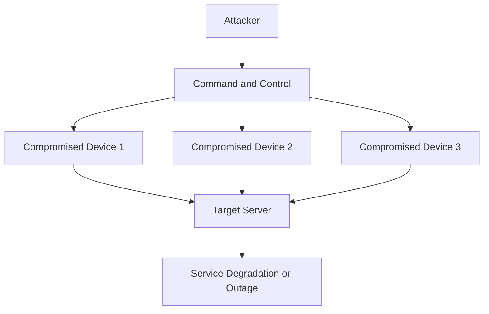

# Network Threats

A network threat is any potential activity, event, or condition that can compromise the confidentiality, integrity, or availability of network resources.

Network threats may originate from external attackers, malicious software, compromised devices, misconfigured systems, or malicious insiders.

Understanding network threats is essential for designing security controls, identifying vulnerabilities, and protecting network infrastructure.

# 🗁 Categories of Network Threats

Network threats can be classified into several categories based on their behavior and objectives.

| Category | Description | Examples |
| --- | --- | --- |
| Malware | Malicious software designed to damage, disrupt, or compromise systems. | Viruses, worms, ransomware, trojans. |
| DoS and DDoS | Attacks that overwhelm network resources or services. | SYN flood, UDP flood, HTTP flood. |
| Spoofing | Forging identity or network information. | IP spoofing, ARP spoofing, DNS spoofing. |
| Sniffing | Capturing and analyzing network traffic. | Packet capture on an unsecured network. |
| Man-in-the-Middle | Intercepting communication between two parties. | ARP-based traffic interception. |
| Password Attacks | Attempting to obtain or guess authentication credentials. | Brute force, password spraying. |
| Session Hijacking | Taking control of an authenticated communication session. | Stolen session cookies. |
| Reconnaissance | Gathering information about network systems and services. | Port scanning, network discovery. |
| Insider Threats | Misuse of authorized access by internal users. | Data theft, unauthorized configuration changes. |

# 🗁 Malware

Malware is software designed to compromise, damage, disrupt, or gain unauthorized access to computer systems and networks.

Common malware types include:

| Malware | Description |
| --- | --- |
| Virus | Malicious code that attaches itself to legitimate files or programs and spreads when executed. |
| Worm | Self-replicating malware that can spread across systems and networks. |
| Trojan Horse | Malicious software disguised as legitimate software. |
| Ransomware | Malware that encrypts or blocks access to data and demands payment. |
| Spyware | Software that secretly collects information about users or systems. |
| Rootkit | Malware designed to hide malicious activities and maintain privileged access. |
| Botnet Malware | Malware that turns compromised devices into remotely controlled bots. |

**Example:**

A worm exploits a vulnerability in an operating system and spreads to other vulnerable devices on the same network.

Security controls:

* Keep operating systems and applications updated.
* Use endpoint protection software.
* Restrict unnecessary network communication.
* Apply network segmentation.
* Monitor suspicious network traffic.
* Maintain regular backups.

# 🗁 Denial-of-Service (DoS)

A Denial-of-Service attack attempts to make a network service, server, or application unavailable to legitimate users.

The attacker achieves this by exhausting available resources such as bandwidth, CPU, memory, connection tables, or application processing capacity.

Common DoS attack techniques include:

| Attack | Description |
| --- | --- |
| SYN Flood | Sends excessive TCP SYN requests to consume connection resources. |
| UDP Flood | Sends large volumes of UDP packets to overwhelm network or system resources. |
| ICMP Flood | Sends excessive ICMP packets to consume bandwidth or processing capacity. |
| HTTP Flood | Generates excessive HTTP requests against an application. |
| Ping of Death | Uses malformed or oversized IP packets to target vulnerable systems. |

A successful DoS attack can interrupt services, degrade performance, and prevent legitimate users from accessing network resources.

# 🗁 Distributed Denial-of-Service (DDoS)

A Distributed Denial-of-Service attack uses multiple distributed sources to overwhelm a target.

These sources are frequently compromised devices controlled through a botnet.



Common DDoS attack categories:

| Category | Description | Examples |
| --- | --- | --- |
| Volumetric | Consumes available network bandwidth. | UDP floods, amplification attacks. |
| Protocol | Exhausts resources in network protocol infrastructure. | SYN floods, fragmented packet attacks. |
| Application Layer | Overwhelms application processing resources. | HTTP request floods, expensive API requests. |

DDoS mitigation techniques include:

* Rate limiting.
* Traffic filtering.
* SYN cookies.
* Upstream traffic filtering.
* DDoS protection services.
* Anycast distribution.
* Traffic anomaly detection.
* Redundant network infrastructure.

# 🗁 IP Spoofing

IP spoofing is an attack technique in which an attacker forges the source IP address of network packets.

The objective may be to hide the attacker's identity, impersonate another system, or bypass weak source-address-based security controls.

Example:

A packet may contain the following information:

| Field | Value |
| --- | --- |
| Source IP | `192.168.1.100` |
| Destination IP | `192.168.1.1` |
| Protocol | UDP |

The source address may be forged and may not represent the actual sending device.

Security controls:

* Ingress and egress filtering.
* Source address validation.
* Access control lists.
* Unicast Reverse Path Forwarding (uRPF), where appropriate.
* Network segmentation.

# 🗁 ARP Spoofing

ARP spoofing is an attack in which an attacker sends forged Address Resolution Protocol (ARP) messages to associate an incorrect MAC address with an IP address.

This can redirect traffic through the attacker's device.

Example:

Normal ARP mapping:

| IP Address | MAC Address |
|---|---|
| `192.168.1.1` | `AA:AA:AA:AA:AA:AA` |

After ARP spoofing, a victim may receive a forged mapping:

| IP Address | MAC Address |
|---|---|
| `192.168.1.1` | `CC:CC:CC:CC:CC:CC` |

The victim may send traffic intended for the gateway to the attacker's MAC address.

Potential consequences:

* Traffic interception.
* Man-in-the-middle attacks.
* Session compromise.
* Communication disruption.

Security controls:

* Dynamic ARP Inspection (DAI).
* DHCP snooping.
* Static ARP entries for selected critical systems.
* Switch port security.
* Network segmentation.
* Encrypted communication protocols.

# 🗁 DNS Spoofing

DNS spoofing is an attack technique in which an attacker causes a DNS client or resolver to receive false DNS information.

The victim may be redirected to an unintended IP address instead of the legitimate destination.

Example:

A user requests:

```text
example.com
```

The legitimate DNS response may contain:

```text
93.184.216.34
```

A manipulated response could instead contain:

```text
203.0.113.50
```

The address `203.0.113.50` belongs to a documentation-only IPv4 range and is used here as an illustrative example.

Security controls:

* DNSSEC validation.
* Secure DNS resolver configuration.
* DNS transaction validation.
* Encrypted DNS transport where appropriate.
* Monitoring unusual DNS responses.
* Protecting DNS infrastructure.

# 🗁 Packet Sniffing

Packet sniffing is the process of capturing and inspecting network packets.

It is a legitimate technique used by administrators for troubleshooting, monitoring, and security analysis. However, unauthorized packet capture can expose sensitive information.

Common packet analysis tools include:

* Wireshark.
* tcpdump.
* TShark.

Potential risks include:

* Exposure of unencrypted credentials.
* Disclosure of sensitive information.
* Analysis of internal network communication.
* Collection of session-related data.

Security controls:

* Use HTTPS instead of HTTP.
* Use SSH instead of Telnet.
* Use encrypted VPN tunnels on untrusted networks.
* Protect wireless networks with WPA2 or WPA3.
* Restrict physical and administrative access to network infrastructure.

# 🗁 Man-in-the-Middle (MITM)

A Man-in-the-Middle attack occurs when an attacker intercepts or manipulates communication between two parties.

The attacker may observe, modify, or redirect traffic without the communicating parties being aware.


Common MITM techniques include:

* ARP spoofing.
* Rogue Wi-Fi access points.
* DNS manipulation.
* Session hijacking.
* TLS downgrade attempts.

Security controls:

* Use properly validated TLS certificates.
* Avoid insecure wireless networks.
* Use HTTPS for web communication.
* Use VPNs on untrusted networks.
* Implement secure DNS and network access controls.

# 🗁 Password Attacks

Password attacks attempt to obtain, guess, or compromise authentication credentials.

Common techniques include:

| Attack | Description |
| --- | --- |
| Brute Force | Attempts many possible passwords until one succeeds. |
| Dictionary Attack | Tests passwords from a predefined wordlist. |
| Password Spraying | Attempts a small number of common passwords against many accounts. |
| Credential Stuffing | Uses previously leaked username-password combinations. |
| Phishing | Tricks users into revealing their credentials. |
| Keylogging | Records keyboard input to capture sensitive information. |

Security controls:

* Use strong, unique passwords.
* Enable multi-factor authentication.
* Implement account lockout or rate-limiting policies.
* Use password managers.
* Monitor failed authentication attempts.
* Disable unused accounts.
* Protect administrative accounts separately.

# 🗁 Session Hijacking

Session hijacking occurs when an attacker obtains or takes control of an authenticated session.

A session may be compromised through stolen cookies, intercepted session tokens, malware, or other vulnerabilities.

Potential consequences include:

* Unauthorized account access.
* Impersonation of legitimate users.
* Access to protected resources.
* Unauthorized transactions or configuration changes.

Security controls:

* Use HTTPS.
* Set secure cookie attributes such as `Secure`, `HttpOnly`, and appropriate `SameSite` policies.
* Regenerate session identifiers after authentication.
* Set appropriate session expiration.
* Revoke sessions after logout or suspected compromise.
* Protect endpoints against malware.

# 🗁 Network Reconnaissance

Network reconnaissance is the process of collecting information about network infrastructure, devices, services, and potential vulnerabilities.

Reconnaissance can be performed for legitimate administration and authorized security assessments. Attackers also use it to identify potential targets.

Common reconnaissance activities include:

| Activity | Description |
| --- | --- |
| Host Discovery | Identifies active devices on a network. |
| Port Scanning | Identifies accessible network ports. |
| Service Detection | Determines which services are running. |
| OS Detection | Attempts to identify operating systems. |
| DNS Enumeration | Collects information about DNS records and infrastructure. |
| Network Mapping | Builds a representation of network topology. |

Common tools:

* Nmap.
* traceroute.
* dig.
* nslookup.
* Wireshark.

Security controls:

* Restrict unnecessary exposed services.
* Apply firewall policies.
* Monitor unusual scanning activity.
* Limit information exposed by public services.
* Review externally accessible infrastructure.

# 🗁 Insider Threats

An insider threat originates from someone who has legitimate access to an organization's systems, network, or information but uses that access in a harmful or unauthorized way.

Insider threats may be intentional or accidental.

Examples:

* An employee copying confidential data without authorization.
* An administrator changing firewall rules improperly.
* A user accidentally exposing sensitive files.
* A compromised employee account being used by an attacker.

Security controls:

* Apply least-privilege access.
* Separate administrative responsibilities.
* Monitor privileged activities.
* Maintain audit logs.
* Review account permissions regularly.
* Use data loss prevention controls where appropriate.
* Establish clear security policies.

# 🗁 Threat Mitigation Strategy

Effective threat mitigation requires a combination of preventive, detective, and responsive security controls.

| Security Approach | Purpose | Examples |
| --- | --- | --- |
| Preventive | Prevents attacks from succeeding. | Firewalls, MFA, patching, segmentation. |
| Detective | Identifies suspicious activities. | IDS, SIEM, log monitoring. |
| Corrective | Restores systems and reduces damage. | Malware removal, configuration correction. |
| Recovery | Restores normal operations. | Backups, disaster recovery, redundancy. |
| Deterrent | Discourages unauthorized activities. | Security policies, access restrictions, monitoring notices. |

# 🗁 Practical Threat Analysis

Consider a small organization with an internal network:

```text
Internet
   |
Firewall
   |
Core Switch
   |
   +-- Employee VLAN
   |
   +-- Server VLAN
   |
   +-- Management VLAN
   |
   +-- Guest VLAN
```

Potential threats and appropriate controls:

| Threat | Potential Impact | Security Control |
| --- | --- | --- |
| Unauthorized access | Compromised internal resources. | MFA, AAA, firewall rules. |
| ARP spoofing | Traffic interception. | DHCP snooping and DAI. |
| DDoS | Service interruption. | Upstream DDoS mitigation. |
| Malware | Endpoint compromise and lateral movement. | Endpoint protection and segmentation. |
| Password attacks | Account compromise. | MFA and authentication rate limiting. |
| Packet sniffing | Sensitive information exposure. | Encryption and secure protocols. |
| Insider threats | Data theft or misuse. | Least privilege and audit logging. |

# 🗁 Network Threat Assessment Checklist

* [ ] Identify critical network assets.
* [ ] Identify potential threat sources.
* [ ] Review network vulnerabilities.
* [ ] Evaluate the likelihood and impact of threats.
* [ ] Review firewall and access control policies.
* [ ] Identify unnecessary exposed services.
* [ ] Review authentication security.
* [ ] Monitor suspicious network activities.
* [ ] Maintain security logs.
* [ ] Prepare incident response and recovery procedures.

# 🗁 Summary

Network threats can compromise confidentiality, integrity, and availability through malicious software, denial-of-service attacks, spoofing, sniffing, credential attacks, reconnaissance, and insider misuse.

Effective protection requires understanding how these threats operate and applying appropriate preventive, detective, corrective, and recovery controls.

Network security should be treated as an ongoing process involving continuous monitoring, vulnerability management, access control, and regular security assessments.
