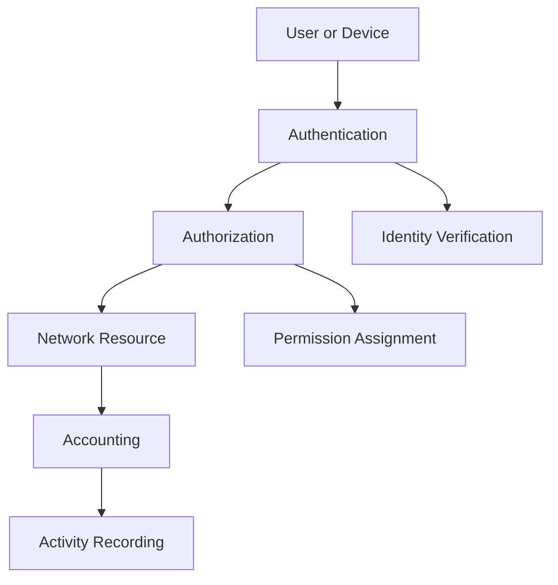
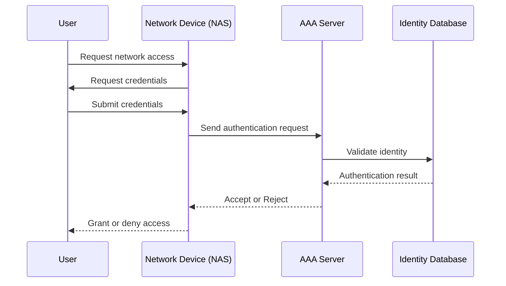
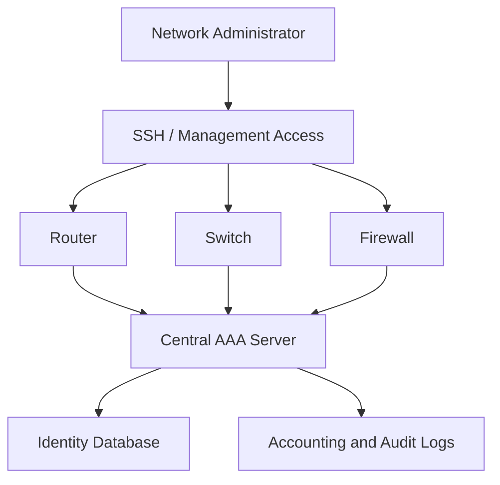

# AAA (Authentication, Authorization, and Accounting)

AAA stands for Authentication, Authorization, and Accounting. It is a security framework used to control access to network devices, systems, applications, and services.

AAA provides a structured way to verify identities, determine access permissions, and record user activities.

It is commonly implemented in enterprise networks, data centers, wireless infrastructure, and Internet Service Provider (ISP) environments.

AAA is particularly useful when multiple network devices need to use a centralized authentication and access management system.

# 🗁 What Is AAA?

AAA consists of three independent but related security functions.

| Component | Purpose | Main Question |
| --- | --- | --- |
| Authentication | Verifies the identity of a user or device. | Who are you? |
| Authorization | Determines what an authenticated entity is allowed to do. | What can you access or perform? |
| Accounting | Records activities and resource usage. | What did you do? |



# 🗁 Authentication

Authentication is the process of verifying the identity of a user, device, or service before granting access.

A network device or authentication server validates the supplied credentials against configured authentication information.

Common authentication methods include:

| Method | Description |
| --- | --- |
| Username and Password | Verifies identity using a username and password. |
| Certificate-Based Authentication | Uses digital certificates to establish identity. |
| Multi-Factor Authentication (MFA) | Requires multiple independent authentication factors. |
| One-Time Password (OTP) | Uses a temporary authentication code. |
| Public-Key Authentication | Uses cryptographic key pairs to verify identity. |
| EAP | Provides an extensible framework for network authentication. |

**Example:**

An administrator connects to a router through SSH.

```bash
ssh admin@192.168.10.1
```

The router requests authentication credentials and verifies the administrator's identity.

If the credentials are valid, authentication succeeds.

# 🗁 Authentication Factors

Authentication factors are generally classified into three categories.

| Factor | Description | Example |
| --- | --- | --- |
| Something You Know | Information known by the user. | Password or PIN. |
| Something You Have | A physical or digital item controlled by the user. | Hardware security key or authenticator token. |
| Something You Are | A biometric characteristic. | Fingerprint or facial recognition. |

Multi-factor authentication combines at least two different factor categories.

For example, a password and a hardware security key provide two different authentication factors.

# 🗁 Authorization

Authorization determines which operations, resources, and services an authenticated user is permitted to access.

Authentication must establish identity before an authorization decision can be made.

Common authorization models include:

| Model | Description |
| --- | --- |
| Role-Based Access Control (RBAC) | Permissions are assigned according to user roles. |
| Attribute-Based Access Control (ABAC) | Access decisions are based on attributes such as identity, device, location, and context. |
| Discretionary Access Control (DAC) | Resource owners control access permissions. |
| Mandatory Access Control (MAC) | Access is determined by centrally defined security classifications and policies. |

**Example:**

An organization has three network administration roles:

| Role | Permissions |
| --- | --- |
| Network Administrator | Full network configuration access. |
| Network Operator | Limited operational and troubleshooting access. |
| Monitoring User | Read-only access to monitoring information. |

All three users may successfully authenticate, but their authorization permissions are different.

# 🗁 Accounting

Accounting records user activities, session information, and resource consumption.

It helps administrators understand who accessed a resource, when access occurred, how long a session lasted, and what resources were used.

Common accounting information includes:

* Username or identity.
* Login and logout timestamps.
* Session duration.
* Assigned IP address.
* Network device identifier.
* Connection information.
* Data transmitted and received.
* Command or administrative activity, when supported.

Example accounting record:

| Field | Example |
| --- | --- |
| Username | `admin01` |
| NAS IP Address | `192.168.10.1` |
| Login Time | `09:00:00` |
| Logout Time | `09:45:00` |
| Session Duration | `45 minutes` |
| Assigned IP | `192.168.20.100` |
| Input Traffic | `120 MB` |
| Output Traffic | `35 MB` |

Accounting records are useful for auditing, troubleshooting, usage reporting, and security investigations.

# 🗁 AAA Architecture

AAA can be implemented locally on individual network devices or centrally through an authentication server.

**Local AAA**

Each network device maintains its own user accounts and authentication information.

Example:

```text
Administrator
     |
     v
   Router
     |
     v
Local User Database
```

Characteristics:

* Simple to configure.
* Does not require a centralized authentication server.
* Suitable for small networks.
* User accounts must be maintained separately on each device.
* Difficult to manage consistently across large networks.

**Centralized AAA**

Network devices communicate with a centralized AAA server to authenticate users and obtain authorization information.

```text
                Administrator
                     |
                     v
              Network Device
                     |
                     v
                AAA Server
                     |
                     v
              User Database
```

Characteristics:

* Centralized identity management.
* Consistent access policies.
* Easier user administration.
* Centralized accounting.
* Suitable for enterprise and service-provider networks.

# 🗁 Centralized AAA Architecture

A typical centralized AAA environment includes several components.

| Component | Responsibility |
| --- | --- |
| User or Supplicant | Requests access to a network resource. |
| Network Access Server (NAS) | Receives access requests and communicates with the AAA server. |
| AAA Server | Processes authentication, authorization, and accounting requests. |
| Identity Database | Stores user identities and authentication information. |
| Policy Engine | Determines access permissions and applicable policies. |

The NAS may be a router, switch, wireless controller, VPN gateway, or other network access device.

# 🗁 AAA Authentication Workflow

The following diagram illustrates a simplified centralized authentication workflow.



The general process is:

* A user requests access to a network device or service.
* The network device collects authentication information.
* The device sends an authentication request to the AAA server.
* The AAA server validates the supplied credentials.
* The server returns an authentication decision.
* The network device applies the appropriate authorization policy.
* Accounting information is recorded when accounting is configured and supported.

# 🗁 AAA Protocols

Several protocols support AAA functionality.

| Protocol | Transport | Common Use |
| --- | --- | --- |
| RADIUS | UDP | Network access authentication and accounting. |
| TACACS+ | TCP | Centralized administrative access to network devices. |
| Diameter | Commonly SCTP or TCP | AAA services in telecommunications and mobile networks. |

**RADIUS**

Remote Authentication Dial-In User Service (RADIUS) is a centralized AAA protocol commonly used for:

* Wi-Fi authentication.
* VPN authentication.
* PPP and PPPoE authentication.
* Network device access.
* ISP subscriber management.

RADIUS commonly uses:

| Function | Default UDP Port |
| --- | ---: |
| Authentication and Authorization | `1812` |
| Accounting | `1813` |

Older deployments may use UDP ports `1645` and `1646`.

**TACACS+**

Terminal Access Controller Access-Control System Plus (TACACS+) is commonly used to manage administrative access to network infrastructure.

It provides:

* Centralized administrator authentication.
* Command authorization.
* Administrative activity accounting.
* Separation of authentication, authorization, and accounting functions.

TACACS+ commonly uses TCP port `49`.

**Diameter**

Diameter is an AAA protocol used in telecommunications and other environments requiring extensible authentication, authorization, and accounting services.

It is commonly associated with mobile network architectures and carrier-grade services.

# 🗁 RADIUS vs TACACS+

| Feature | RADIUS | TACACS+ |
| --- | --- | --- |
| Transport | UDP | TCP |
| Default Port | UDP `1812` and `1813` | TCP `49` |
| Primary Use | Network access authentication | Administrative device access |
| Encryption | Protects selected sensitive attributes; traditional RADIUS does not encrypt the entire packet. | Encrypts most of the packet body, excluding the header. |
| AAA Separation | Authentication and authorization are commonly combined in access decisions. | Authentication, authorization, and accounting are separated. |
| Command Authorization | Not its traditional primary purpose. | Supports granular command authorization. |
| Common Environment | Wi-Fi, VPN, PPPoE, ISP access. | Router and switch administration. |

# 🗁 AAA in Enterprise Networks

AAA is frequently used to centralize administrator access to network infrastructure.

Example architecture:



Benefits include:

* Centralized administrator authentication.
* Consistent authorization policies.
* Individual user accountability.
* Reduced dependency on shared administrator accounts.
* Improved auditing and incident investigation.

# 🗁 AAA in ISP Networks

Internet Service Providers use AAA to manage subscriber access and service usage.

Common ISP applications include:

* PPPoE subscriber authentication.
* Hotspot user authentication.
* VPN subscriber authentication.
* Bandwidth profile assignment.
* Session tracking.
* Usage accounting.
* Subscriber disconnection and session management.

Example ISP architecture:

```text
Subscriber Router
       |
       v
Access Network
       |
       v
BNG / NAS
       |
       v
RADIUS Server
       |
       v
Subscriber Database
       |
       v
Accounting Database
```

The Broadband Network Gateway (BNG), or another NAS, communicates with the RADIUS server to authenticate subscribers and obtain applicable service attributes.

# 🗁 AAA Security Best Practices

* Use centralized AAA for large network environments.
* Avoid shared administrator accounts.
* Apply role-based authorization.
* Use strong authentication credentials.
* Enable multi-factor authentication where supported.
* Restrict AAA server communication to trusted network paths.
* Protect RADIUS shared secrets.
* Use secure transport or protected deployment options where available.
* Maintain reliable accounting and audit logs.
* Configure local emergency access for critical infrastructure.
* Monitor failed authentication attempts.
* Regularly review user permissions and inactive accounts.

# 🗁 Practical AAA Planning Example

Consider an organization managing multiple routers and switches.

| User | Authentication | Authorization | Accounting |
| --- | --- | --- | --- |
| `admin01` | Central AAA | Full administration | Login and activity records |
| `operator01` | Central AAA | Operational access | Login and activity records |
| `monitor01` | Central AAA | Read-only access | Login records |
| `emergency-admin` | Local fallback | Emergency administration | Local audit records where supported |

This approach provides centralized management while maintaining a controlled emergency access mechanism.

# 🗁 AAA Troubleshooting Checklist

* [ ] Verify connectivity between the NAS and AAA server.
* [ ] Confirm the configured server address.
* [ ] Verify the correct authentication and accounting ports.
* [ ] Check the shared secret or other configured credentials.
* [ ] Verify that the NAS is registered as a client on the AAA server.
* [ ] Check user credentials and account status.
* [ ] Review authentication and authorization policies.
* [ ] Verify time synchronization when certificates or time-sensitive credentials are used.
* [ ] Check firewall rules and routing.
* [ ] Review AAA server logs and accounting records.
* [ ] Verify local fallback behavior.

# 🗁 Summary

AAA provides a structured framework for managing network access.

Authentication verifies identity, authorization determines permissions, and accounting records user activities and resource usage.

Local AAA is suitable for smaller environments, while centralized AAA provides consistent identity management and access policies across enterprise and ISP networks.

RADIUS and TACACS+ are two widely used AAA protocols, each serving different operational requirements.
