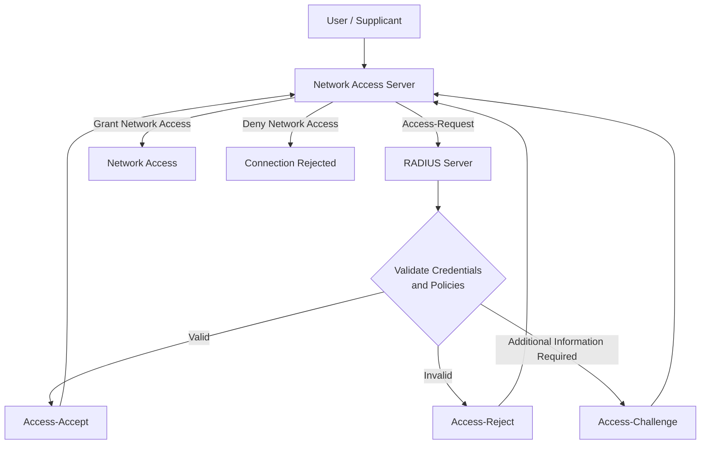
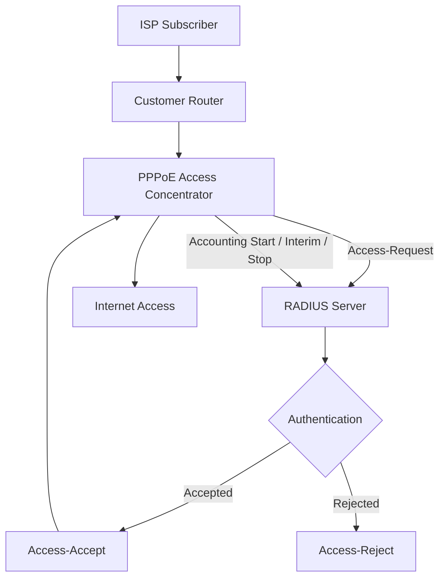

# RADIUS

RADIUS (Remote Authentication Dial-In User Service) is a client-server protocol used to provide centralized Authentication, Authorization, and Accounting (AAA) for network access.

Instead of maintaining separate user accounts and access policies on every network device, administrators can use a centralized RADIUS server to authenticate users, apply access policies, and record network sessions.

RADIUS is commonly used in enterprise Wi-Fi, VPNs, PPPoE, ISP subscriber management, network access control, and centralized device access.

# 🗁 What Is RADIUS?

RADIUS is an AAA protocol that allows Network Access Servers (NAS) to communicate with a centralized authentication server.

A NAS is a network device that provides users with access to a network. Examples include:

* Wireless access points and wireless controllers
* Routers and switches
* VPN gateways
* PPPoE access concentrators
* ISP Broadband Network Gateways (BNGs)

When a user attempts to connect, the NAS sends an authentication request to the RADIUS server. The server evaluates the credentials and configured policies, then returns a response.

# 🗁 RADIUS Architecture

A typical RADIUS architecture contains three main components:

| Component | Description |
| --- | --- |
| Supplicant / User | The person or device requesting network access |
| RADIUS Client (NAS) | The network device that communicates with the RADIUS server |
| RADIUS Server | The centralized system that processes authentication, authorization, and accounting requests |

**Important:** The RADIUS client is the NAS, not the end user.

# 🗁 How RADIUS Works

The following diagram illustrates a simplified RADIUS authentication process.



The general authentication sequence is:

* A user attempts to connect to a network.
* The NAS collects the required authentication information.
* The NAS sends an `Access-Request` packet to the RADIUS server.
* The RADIUS server validates the credentials and evaluates authorization policies.
* The server responds with `Access-Accept`, `Access-Reject`, or `Access-Challenge`.
* The NAS grants or denies access based on the response.

# 🗁 RADIUS Ports and Transport Protocol

Traditional RADIUS uses UDP for communication between the NAS and the RADIUS server.

| UDP Port | Purpose |
| --- | --- |
| 1812 | Authentication and authorization |
| 1813 | Accounting |
| 1645 | Legacy authentication port |
| 1646 | Legacy accounting port |

The standard ports are UDP 1812 and UDP 1813.

Older deployments may use UDP 1645 and UDP 1646 for compatibility.

RADIUS uses UDP rather than TCP. Reliability is handled through mechanisms such as request retransmission, timeout handling, and duplicate request detection.

# 🗁 RADIUS Authentication and Authorization

Authentication verifies the identity of a user or device.

Authorization determines what the authenticated user or device is allowed to access.

For example:

* Authentication: Is this subscriber's username and password valid?
* Authorization: Which IP address, VLAN, bandwidth profile, or network permissions should be assigned?

A RADIUS server can return authorization attributes in an `Access-Accept` response.

Common examples include:

| Attribute | Purpose |
| --- | --- |
| `Framed-IP-Address` | Assigns an IP address to the user |
| `Framed-IP-Netmask` | Specifies an IP subnet mask |
| `Framed-Route` | Provides routing information |
| `Session-Timeout` | Defines the maximum session duration |
| `Idle-Timeout` | Defines how long an idle session may remain active |
| `Filter-Id` | Identifies a filtering or access policy |
| `Service-Type` | Indicates the requested network service |
| `Class` | Carries implementation-specific policy or session information |

The NAS must support the relevant attributes and know how to apply them.

# 🗁 RADIUS Packet Types

RADIUS defines several packet types for authentication and accounting.

**Authentication packet types**

| Packet Type | Description |
| --- | --- |
| `Access-Request` | NAS requests authentication and authorization |
| `Access-Accept` | Server accepts the request and may include authorization attributes |
| `Access-Reject` | Server rejects the request |
| `Access-Challenge` | Server requests additional information or authentication steps |

**Accounting packet types**

| Packet Type | Description |
| --- | --- |
| `Accounting-Request` | NAS sends accounting information to the server |
| `Accounting-Response` | Server acknowledges an accounting request |

# 🗁 RADIUS Accounting

RADIUS accounting records user sessions and network usage.

It helps administrators monitor subscriber activity, calculate bandwidth consumption, generate billing records, and investigate network issues.

A typical accounting lifecycle contains three event types:

| Event | Description |
| --- | --- |
| `Start` | Indicates that a user session has started |
| `Interim-Update` | Reports updated session information while the session is active |
| `Stop` | Indicates that a user session has ended |

Common accounting attributes include:

| Attribute | Description |
| --- | --- |
| `Acct-Status-Type` | Identifies Start, Stop, or Interim-Update |
| `Acct-Session-Id` | Identifies a particular session |
| `Acct-Session-Time` | Reports session duration |
| `Acct-Input-Octets` | Reports received data volume |
| `Acct-Output-Octets` | Reports transmitted data volume |
| `Acct-Input-Packets` | Reports received packet count |
| `Acct-Output-Packets` | Reports transmitted packet count |
| `NAS-IP-Address` | Identifies the NAS |
| `User-Name` | Identifies the user or subscriber |

Accounting information is especially important for ISPs because it can support subscriber usage monitoring and billing systems.

# 🗁 RADIUS Authentication Methods

RADIUS can support different authentication methods depending on the network access technology and server configuration.

Common methods include:

| Method | Description |
| --- | --- |
| PAP | Password Authentication Protocol |
| CHAP | Challenge Handshake Authentication Protocol |
| EAP | Extensible Authentication Protocol |

**PAP (Password Authentication Protocol)**

PAP provides a simple username and password authentication mechanism. The NAS carries the credentials in the RADIUS request, where RADIUS applies its password-hiding mechanism to the `User-Password` attribute.

**CHAP (Challenge Handshake Authentication Protocol)**

CHAP uses a challenge-response mechanism instead of sending the user's password directly as a normal PAP credential.

**EAP (Extensible Authentication Protocol)**

EAP supports multiple authentication methods and is commonly used with IEEE 802.1X for enterprise Wi-Fi and wired network access.

The security properties of an authentication method depend on the selected EAP method and the surrounding network configuration.

# 🗁 RADIUS Security

Traditional RADIUS does not encrypt the entire packet.

It uses an MD5-based mechanism to protect certain information, including the traditional `User-Password` attribute. Other packet attributes may remain visible to someone who can observe the network traffic.

The RADIUS shared secret is configured on both the NAS and the RADIUS server. It is used to calculate and verify protocol authenticators and protect selected attributes.

**The shared secret is not the user's password.**

Important security practices include:

* Use a strong, unique shared secret for each NAS.
* Restrict RADIUS communication to trusted network devices.
* Apply firewall rules to limit access to UDP 1812 and UDP 1813.
* Use secure management access for RADIUS servers.
* Protect RADIUS traffic with a trusted network path or an appropriate secure transport.
* Monitor authentication failures and suspicious access attempts.
* Keep the RADIUS server and NAS software updated.

For stronger transport protection, deployments can use RADIUS over TLS, commonly known as RadSec, where supported.

# 🗁 RADIUS and EAP in IEEE 802.1X

In an IEEE 802.1X environment, RADIUS commonly works together with EAP.

Three components participate in the authentication process:

| Component | Role |
| --- | --- |
| Supplicant | Client device requesting network access |
| Authenticator | Switch or wireless access point controlling network access |
| Authentication Server | RADIUS server validating authentication requests |

The communication paths are different:

* EAP over LAN (EAPOL) is used between the supplicant and authenticator.
* RADIUS is used between the authenticator (NAS) and RADIUS server.
* The authenticator relays EAP messages between the two sides.

This architecture is commonly used for WPA2-Enterprise and WPA3-Enterprise wireless networks.

# 🗁 RADIUS in ISP Networks

RADIUS is widely used by Internet Service Providers to manage subscriber authentication and accounting.

Common ISP use cases include:

* PPPoE subscriber authentication
* Hotspot user authentication
* VPN subscriber authentication
* Dynamic IP address assignment
* Bandwidth profile assignment
* Session accounting
* Subscriber session monitoring
* Integration with billing systems

For example, when a subscriber connects through PPPoE, the access concentrator can send the subscriber's credentials to a RADIUS server.

After successful authentication, the server may return attributes defining the subscriber's service profile.



This allows an ISP to manage thousands of subscribers through a centralized authentication and accounting system.

# 🗁 RADIUS vs TACACS+

RADIUS and TACACS+ are both AAA protocols, but they have different characteristics and common use cases.

| Feature | RADIUS | TACACS+ |
| --- | --- | --- |
| Full Name | Remote Authentication Dial-In User Service | Terminal Access Controller Access-Control System Plus |
| Transport | UDP | TCP |
| Default Port | UDP 1812 / 1813 | TCP 49 |
| Authentication | Supported | Supported |
| Authorization | Commonly integrated with authentication responses | Separate and granular authorization |
| Accounting | Supported | Supported |
| Packet Encryption | Does not encrypt the entire traditional RADIUS packet | Encrypts most of the packet body |
| Common Use | Network access and subscriber authentication | Network device administration |

RADIUS is commonly used for Wi-Fi, VPN, PPPoE, and ISP subscriber authentication.

TACACS+ is commonly used for centralized administrative access to routers, switches, and other network infrastructure.

# 🗁 RADIUS Troubleshooting

RADIUS authentication problems can originate from the NAS, RADIUS server, network connectivity, shared secret, or authentication policy.

Common problems and their possible causes include:

| Problem | Possible Cause |
| --- | --- |
| Authentication timeout | RADIUS server unreachable or firewall blocking traffic |
| Access-Reject | Invalid credentials or rejected authorization policy |
| Invalid authenticator | Shared secret mismatch or packet integrity issue |
| Accounting records missing | Accounting disabled or UDP 1813 blocked |
| User authenticates but cannot access network | NAS authorization or network configuration problem |
| Incorrect IP address assignment | Incorrect or unsupported authorization attributes |
| Duplicate session records | Retransmissions or session-handling problems |

**Basic troubleshooting checklist**

* Verify that the NAS can reach the RADIUS server.
* Confirm that the RADIUS server is listening on the expected UDP ports.
* Verify that the shared secret matches on both sides.
* Check firewall rules for UDP 1812 and UDP 1813.
* Confirm that the NAS source IP address is registered as a RADIUS client.
* Review authentication and accounting logs.
* Verify that the user account and authorization policy are correct.
* Check whether the NAS supports the returned RADIUS attributes.
* Confirm that time synchronization is working across relevant systems.

**Useful Linux commands**

Check whether the server is listening on the standard RADIUS ports:

```bash
sudo ss -lunp | grep -E '1812|1813'
```

Capture RADIUS traffic:

```bash
sudo tcpdump -ni any 'udp port 1812 or udp port 1813'
```

Check firewall rules using UFW:

```bash
sudo ufw status verbose
```

Allow RADIUS authentication and accounting traffic when required:

```bash
sudo ufw allow 1812/udp
sudo ufw allow 1813/udp
```

These firewall rules should be restricted to trusted NAS addresses in a production environment.

# 🗁 Practical RADIUS Example

Consider an ISP with the following network:

| Component | IP Address |
| --- | --- |
| RADIUS Server | `192.0.2.10` |
| MikroTik NAS | `192.0.2.1` |
| Subscriber | `subscriber01` |

The MikroTik router acts as the RADIUS client, while the server handles subscriber authentication.

A simplified RouterOS v7 configuration for PPP AAA is:

```routeros
/radius
add service=ppp address=192.0.2.10 secret="StrongSharedSecret"

/ppp aaa
set use-radius=yes accounting=yes interim-update=5m
```

The configuration enables RADIUS authentication and accounting for PPP services.

The RADIUS server must also have the MikroTik NAS registered with the correct client address and matching shared secret.

The server must contain the subscriber account and the appropriate authorization policy.

# 🗁 Key Takeaways

* RADIUS is a centralized AAA protocol.
* NAS devices act as RADIUS clients.
* UDP 1812 is used for authentication and authorization.
* UDP 1813 is used for accounting.
* `Access-Request`, `Access-Accept`, `Access-Reject`, and `Access-Challenge` are important authentication packet types.
* RADIUS accounting supports Start, Interim-Update, and Stop events.
* The shared secret is different from the user's password.
* Traditional RADIUS does not encrypt the entire packet.
* RADIUS is widely used in enterprise Wi-Fi, VPN, PPPoE, and ISP networks.
* RadSec provides a TLS-based transport option for RADIUS deployments.
