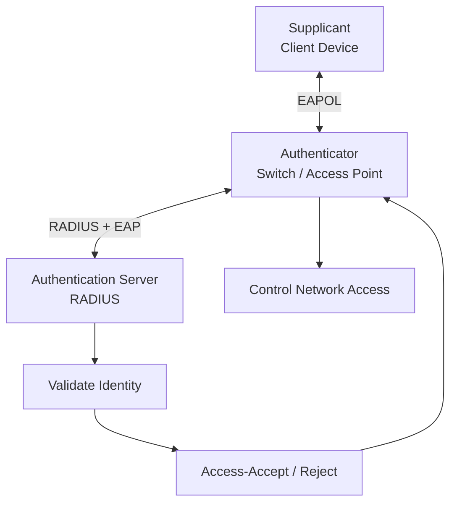
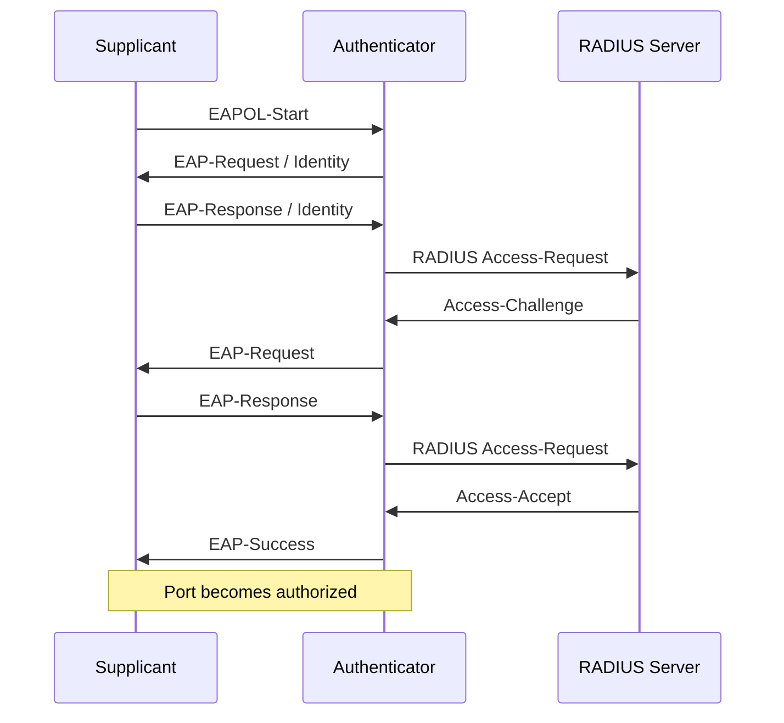

# IEEE 802.1X

IEEE 802.1X is a network access control standard that provides port-based authentication for wired Ethernet and wireless networks.

It ensures that a device or user must successfully authenticate before receiving normal network access.

802.1X is commonly deployed in enterprise networks, universities, corporate offices, data centers, and Wi-Fi Enterprise environments.

It works with an authentication server, commonly a RADIUS server, to centrally validate credentials and enforce network access policies.

# 🗁 What Is IEEE 802.1X?

IEEE 802.1X defines an authentication framework that controls access to a network through a network port.

A port can represent:

* A physical Ethernet switch port.
* A logical network access point.
* A wireless association managed by an access point.

When a device connects to an 802.1X-enabled network, it must authenticate before the network grants normal access.

For example, when an employee connects a laptop to a company Ethernet port, the switch can require authentication through 802.1X before allowing access to internal network resources.

# 🗁 Why 802.1X Is Needed

Without centralized port-based authentication, a device may receive network access simply by connecting an Ethernet cable or joining a wireless network with an available password.

802.1X helps organizations enforce identity-based network access.

Its benefits include:

* Preventing unauthorized devices from accessing protected networks.
* Centralizing user and device authentication.
* Integrating with RADIUS authentication servers.
* Supporting enterprise Wi-Fi authentication.
* Applying access policies based on user or device identity.
* Assigning VLANs dynamically when supported by the network infrastructure.
* Improving visibility into authenticated network users and devices.

# 🗁 802.1X Architecture

An 802.1X deployment contains three primary components.

| Component | Description | Example |
| --- | --- | --- |
| Supplicant | Client requesting network access | Laptop, desktop, smartphone |
| Authenticator | Network device controlling access | Ethernet switch, wireless access point |
| Authentication Server | Validates authentication credentials | RADIUS server |

**Supplicant**

The supplicant is the client device requesting network access.

It runs an 802.1X supplicant service and communicates with the authenticator using EAP over LAN (EAPOL).

Examples include:

* Windows computers.
* Linux computers.
* macOS devices.
* Enterprise wireless clients.

**Authenticator**

The authenticator controls whether the supplicant can access the network.

It typically operates on an Ethernet switch or wireless access point.

Its responsibilities include:

* Receiving authentication messages from the supplicant.
* Relaying authentication messages to the RADIUS server.
* Controlling the authorized or unauthorized state of the port.
* Applying access policies returned by the authentication server.

**Authentication Server**

The authentication server validates the identity of the supplicant.

A RADIUS server is commonly used for this purpose.

It may check credentials against:

* A local user database.
* LDAP directories.
* Active Directory integrations.
* Certificate-based authentication systems.
* Other supported identity providers.

# 🗁 802.1X Authentication Architecture

The following diagram illustrates the relationship between the three components.



The supplicant communicates with the authenticator using EAPOL, while the authenticator communicates with the RADIUS server using RADIUS.

The authenticator acts as an intermediary between the supplicant and authentication server.

# 🗁 EAP and EAPOL

802.1X commonly uses the Extensible Authentication Protocol (EAP) to carry authentication information.

EAP is an authentication framework that supports different authentication methods.

EAPOL stands for EAP over LAN. It transports EAP messages between the supplicant and authenticator over a local network.

The authenticator commonly encapsulates EAP messages in RADIUS packets when communicating with the authentication server.

| Protocol | Communication | Purpose |
| --- | --- | --- |
| EAP | Authentication framework | Defines authentication exchanges |
| EAPOL | Supplicant ↔ Authenticator | Carries EAP messages over LAN |
| RADIUS | Authenticator ↔ Authentication Server | Transports authentication requests and responses |

# 🗁 How 802.1X Authentication Works

A typical 802.1X authentication process follows these steps:

* A client device connects to an 802.1X-enabled switch port or wireless network.
* The authenticator places the port in an unauthorized state for normal network traffic.
* The supplicant sends an EAPOL authentication message.
* The authenticator forwards the EAP information to the RADIUS server.
* The RADIUS server evaluates the credentials or certificate.
* The server returns an authentication response.
* If authentication succeeds, the authenticator authorizes network access.
* If authentication fails, normal network access remains denied.



The exact message exchange depends on the selected EAP authentication method. Some methods require multiple challenge-response exchanges.

# 🗁 Controlled and Uncontrolled Ports

An 802.1X authenticator logically separates traffic into controlled and uncontrolled access paths.

**Uncontrolled Port**

The uncontrolled port allows authentication-related traffic to pass even before successful authentication.

It is necessary because the supplicant must communicate with the authenticator to begin authentication.

**Controlled Port**

The controlled port determines whether normal network traffic is allowed.

| Port State | Description |
| --- | --- |
| Unauthorized | Normal network access is blocked |
| Authorized | Network access is permitted according to the applied policy |

The authenticator uses the authorization result to control the controlled port.

# 🗁 EAP Authentication Methods

802.1X can use different EAP methods depending on the organization's security requirements.

Common methods include:

| EAP Method | Description |
| --- | --- |
| EAP-TLS | Uses digital certificates for mutual authentication |
| PEAP | Establishes a TLS-protected tunnel for inner authentication |
| EAP-TTLS | Uses a TLS tunnel to protect an inner authentication method |
| EAP-FAST | Uses a protected access credential to establish a secure tunnel |

**EAP-TLS**

EAP-TLS uses digital certificates to authenticate both the client and authentication server.

It is considered a strong enterprise authentication method when certificates are properly issued, validated, and managed.

**PEAP**

Protected EAP establishes a TLS-protected tunnel between the client and authentication server.

An inner authentication method is then used inside the tunnel.

**EAP-TTLS**

EAP-TTLS also establishes a TLS tunnel and supports different inner authentication methods.

**EAP-FAST**

EAP-FAST uses a Protected Access Credential (PAC) to establish a protected tunnel.

The selected method must be supported and correctly configured on both the client and authentication infrastructure.

# 🗁 802.1X in Wired Networks

In wired networks, 802.1X is commonly configured on managed Ethernet switches.

When a device connects to an authenticated switch port, the switch requests authentication before granting normal network access.

Example:

```text
Employee Laptop
       |
       | Ethernet
       |
Managed Switch
       |
       | RADIUS
       |
RADIUS Server
       |
       |
Identity Database
```

A typical enterprise deployment may use:

* 802.1X on employee switch ports.
* EAP-TLS for certificate-based authentication.
* RADIUS for centralized authentication.
* Dynamic VLAN assignment for different employee groups.
* A restricted VLAN for devices that cannot authenticate.

# 🗁 802.1X in Wireless Networks

802.1X is commonly used with WPA2-Enterprise and WPA3-Enterprise wireless security.

Instead of relying on one shared Wi-Fi password for all users, each user or device can authenticate through an individual identity.

A typical wireless authentication process is:

* A client connects to an enterprise SSID.
* The access point or wireless controller acts as the authenticator.
* The client and authenticator exchange EAPOL messages.
* The authenticator forwards EAP messages to the RADIUS server.
* The RADIUS server validates the client.
* Successful authentication allows the client to join the protected wireless network.

```text
Wireless Client
       |
       | EAPOL
       |
Wireless Access Point
       |
       | RADIUS
       |
RADIUS Server
       |
       |
Identity Provider
```

802.1X provides the authentication framework. WPA2-Enterprise or WPA3-Enterprise defines the wireless security context in which it is commonly used.

# 🗁 Dynamic VLAN Assignment

802.1X can work with RADIUS attributes to assign a VLAN after successful authentication.

This allows an organization to place users into different network segments based on their identity or authorization policy.

For example:

| User Group | Assigned VLAN | Purpose |
| --- | --- | --- |
| Employees | VLAN 10 | Internal corporate access |
| IT Administrators | VLAN 20 | Infrastructure management |
| Guests | VLAN 30 | Guest network access |
| Contractors | VLAN 40 | Restricted access |

A RADIUS server can return attributes such as:

* `Tunnel-Type`
* `Tunnel-Medium-Type`
* `Tunnel-Private-Group-ID`

The authenticator must support dynamic VLAN assignment and be configured to apply the returned attributes.

Dynamic VLAN assignment can simplify network access management because administrators can control access through centralized identity policies.

# 🗁 802.1X Security Considerations

802.1X improves network access security, but its effectiveness depends on correct configuration.

Important security practices include:

* Prefer certificate-based authentication such as EAP-TLS where practical.
* Validate the authentication server certificate on client devices.
* Configure trusted certificate authorities.
* Avoid accepting arbitrary or untrusted authentication servers.
* Use strong identity and credential management.
* Restrict RADIUS communication to authorized network devices.
* Protect the RADIUS shared secret.
* Keep supplicant, switch, access point, and RADIUS software updated.
* Use appropriate policies for devices that do not support 802.1X.
* Monitor authentication failures and unexpected access attempts.

Server certificate validation is particularly important for preventing clients from connecting to a fraudulent authentication server.

# 🗁 802.1X vs MAC Authentication Bypass

Some devices cannot perform 802.1X authentication.

Examples include:

* Printers.
* IP cameras.
* Some IoT devices.
* Legacy equipment.
* Certain embedded devices.

MAC Authentication Bypass (MAB) is an alternative that allows a network device to authenticate using the connecting device's MAC address.

| Feature | 802.1X | MAC Authentication Bypass |
| --- | --- | --- |
| Authentication | EAP-based identity authentication | MAC address-based |
| Security | Stronger when configured with secure EAP methods | Weaker because MAC addresses can be spoofed |
| Client Support | Requires an 802.1X supplicant | Does not require an 802.1X supplicant |
| Common Use | Computers and supported devices | Printers, cameras, and legacy devices |

MAB should generally be treated as a restricted fallback rather than an equivalent replacement for 802.1X.

# 🗁 802.1X Troubleshooting

Authentication failures can occur at the client, authenticator, RADIUS server, or certificate infrastructure.

Common problems include:

| Problem | Possible Cause |
| --- | --- |
| Authentication timeout | RADIUS server unreachable or communication blocked |
| Invalid credentials | Incorrect username or password |
| Certificate validation failure | Expired, untrusted, or incorrectly configured certificate |
| EAP negotiation failure | Incompatible EAP methods or client configuration |
| Port remains unauthorized | Authentication rejected or incomplete |
| Incorrect VLAN assignment | Invalid RADIUS attributes or switch configuration |
| Wireless connection fails | SSID security configuration or authentication mismatch |
| Repeated authentication attempts | Connectivity, identity, or policy problems |

**Troubleshooting checklist**

* Confirm that the client has an enabled and correctly configured 802.1X supplicant.
* Verify that the switch port or wireless SSID requires 802.1X authentication.
* Check the EAP method configured on the client.
* Confirm that the RADIUS server is reachable from the authenticator.
* Verify the RADIUS client address and shared secret.
* Check UDP 1812 and UDP 1813 firewall rules.
* Review RADIUS authentication logs.
* Validate server certificates and certificate trust.
* Check the authenticator's port authorization state.
* Verify dynamic VLAN attributes and VLAN availability.

**Useful Linux commands**

Check the network interface state:

```bash
ip link show
```

Inspect network interfaces and IP configuration:

```bash
ip address show
```

Capture EAPOL traffic:

```bash
sudo tcpdump -ni any ether proto 0x888e
```

Capture RADIUS authentication traffic:

```bash
sudo tcpdump -ni any 'udp port 1812 or udp port 1813'
```

The EAPOL EtherType `0x888e` identifies EAP over LAN frames.

# 🗁 Key Takeaways

* IEEE 802.1X provides port-based network access control.
* Its three main components are the supplicant, authenticator, and authentication server.
* A RADIUS server is commonly used as the authentication server.
* EAP is the authentication framework.
* EAPOL carries EAP messages between the supplicant and authenticator.
* RADIUS carries authentication messages between the authenticator and server.
* 802.1X is commonly used in wired enterprise networks and enterprise Wi-Fi.
* WPA2-Enterprise and WPA3-Enterprise commonly use 802.1X authentication.
* RADIUS can return attributes for dynamic VLAN assignment.
* MAB provides an alternative for devices that cannot perform 802.1X authentication.
