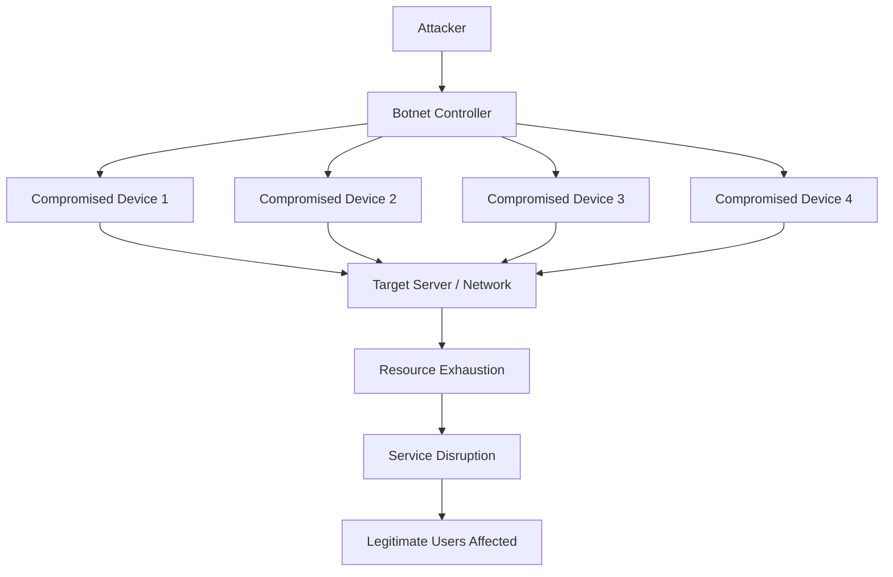

# DDoS Fundamentals

DDoS (Distributed Denial of Service) is a cyberattack in which multiple sources generate excessive traffic or requests toward a target system, network, or application to make its services unavailable or significantly degrade their performance.

DDoS attacks commonly target websites, web servers, DNS infrastructure, routers, firewalls, VPN gateways, and ISP networks.

The primary objective is to exhaust the target's available resources, preventing legitimate users from accessing services.

# 🗁 What Is DoS?

DoS (Denial of Service) is an attack that attempts to make a service unavailable to legitimate users.

An attacker may generate excessive traffic, exploit protocol weaknesses, or consume system resources until the target can no longer respond normally.

For example, an attacker may send a large number of requests to a web server, consuming its CPU, memory, or available connections.

# 🗁 What Is DDoS?

DDoS stands for Distributed Denial of Service.

It is a type of denial-of-service attack in which traffic originates from multiple distributed systems rather than a single source.

Attackers commonly use compromised devices, known as bots, to generate traffic toward a target.

These devices collectively form a botnet.

**DoS vs DDoS**

| Feature | DoS | DDoS |
| --- | --- | --- |
| Full Name | Denial of Service | Distributed Denial of Service |
| Attack Sources | Usually one source | Multiple distributed sources |
| Traffic Volume | Generally more limited | Can be extremely large |
| Detection | Often easier to identify the source | More difficult due to distributed sources |
| Mitigation | Often easier to block individual sources | Requires broader traffic filtering and mitigation |
| Infrastructure | Usually simpler | Often more complex |

# 🗁 How a DDoS Attack Works

A typical DDoS attack involves several stages.

* An attacker compromises vulnerable devices or obtains access to existing botnets.
* Compromised devices become part of a distributed group of attack sources.
* The attacker coordinates these devices to generate traffic toward a target.
* The target receives excessive requests or packets.
* Network capacity, connection tables, or application resources become exhausted.
* Legitimate users experience slow responses, connection failures, or complete service unavailability.



The attacker does not necessarily need direct control over every compromised device. A command-and-control infrastructure may coordinate the botnet.

# 🗁 Common DDoS Attack Categories

DDoS attacks can be classified according to the network layer or resource being targeted.

The major categories are:

* Volumetric attacks.
* Protocol attacks.
* Application-layer attacks.

# 🗁 Volumetric Attacks

Volumetric attacks attempt to consume the available network bandwidth of a target or its upstream connection.

The objective is to overwhelm the network with excessive traffic.

Common examples include:

**UDP Flood**

A UDP flood sends a large volume of UDP packets toward a target.

The target may consume network bandwidth and processing resources handling incoming traffic.

**ICMP Flood**

An ICMP flood generates excessive ICMP packets toward a target.

The traffic may consume bandwidth and processing capacity.

**Amplification and Reflection Attacks**

These attacks abuse third-party services to generate responses larger than the original requests.

In a reflection attack, the attacker uses the victim's address as the apparent source address of requests sent to third-party systems.

Those systems send their responses toward the victim.

Amplification occurs when the responses are significantly larger than the requests.

Commonly abused protocols include:

* DNS.
* NTP.
* Memcached.
* SSDP.

# 🗁 Protocol Attacks

Protocol attacks target weaknesses or resource limitations in network protocols and infrastructure.

They commonly exhaust connection state, protocol processing capacity, or device resources.

**SYN Flood**

TCP uses a three-way handshake to establish connections.

A SYN flood sends large numbers of TCP SYN requests without completing the handshake.

The server may maintain many incomplete connection states, consuming resources.

Normal TCP handshake:

```text id="kq3f6m"
Client                  Server
  |                        |
  |------ SYN ------------>|
  |                        |
  |<----- SYN-ACK ----------|
  |                        |
  |------ ACK ------------>|
  |                        |
  |   Connection Ready     |
```

A SYN flood creates many incomplete connection attempts.

**Other Protocol Attacks**

Other attacks may target:

* TCP connection tracking tables.
* Firewall state tables.
* Fragment reassembly resources.
* IP protocol processing.
* Network device control planes.

# 🗁 Application-Layer Attacks

Application-layer attacks target services running at Layer 7 of the OSI model.

They attempt to exhaust application resources by generating large numbers of requests or expensive operations.

Common examples include:

**HTTP Flood**

An HTTP flood generates excessive HTTP requests toward a web application.

The requests may consume server CPU, memory, worker processes, database connections, or application capacity.

**Slow HTTP Attacks**

Some attacks attempt to keep HTTP connections open for extended periods by sending requests very slowly or incompletely.

This can exhaust connection-handling resources.

**DNS Query Flood**

A DNS query flood generates excessive DNS requests toward a DNS server.

It may overwhelm query processing capacity and affect name resolution.

# 🗁 DDoS Attack Classification

| Attack Category | Target | Examples |
| --- | --- | --- |
| Volumetric | Network bandwidth | UDP flood, ICMP flood, amplification |
| Protocol | Network protocol resources | SYN flood, state exhaustion |
| Application | Application resources | HTTP flood, Slow HTTP, DNS query flood |

# 🗁 Common DDoS Attack Indicators

DDoS attacks can produce several network and application symptoms.

Common indicators include:

* Sudden increases in inbound traffic.
* Unusual packet rates.
* High CPU utilization on routers or servers.
* Increased connection counts.
* Large numbers of incomplete TCP connections.
* Unexpected UDP or ICMP traffic.
* Increased application response times.
* High packet loss.
* Network interface congestion.
* Service timeouts.
* Legitimate users unable to access services.

No single indicator proves that a DDoS attack is occurring. Traffic patterns should be compared with normal network behavior.

# 🗁 DDoS Impact on Network Infrastructure

DDoS attacks can affect different parts of a network.

| Component | Potential Impact |
| --- | --- |
| Router | High packet-processing load or control-plane exhaustion |
| Firewall | Connection tracking table exhaustion |
| Load Balancer | Excessive connection or request processing |
| Web Server | CPU, memory, and worker exhaustion |
| DNS Server | Query processing overload |
| ISP Upstream Link | Bandwidth saturation |
| Database | Excessive connections or expensive queries |
| VPN Gateway | Session and processing resource exhaustion |

An important distinction is that an attack may overwhelm the upstream network connection before traffic reaches the target firewall.

In that situation, local firewall rules alone cannot restore the unavailable bandwidth.

# 🗁 DDoS Mitigation Fundamentals

DDoS mitigation involves detecting malicious traffic, filtering unwanted requests, distributing traffic, and protecting critical infrastructure.

Common mitigation techniques include:

**Rate Limiting**

Rate limiting controls how many requests or packets a source or client can send within a defined period.

It is useful for protecting application endpoints and limiting abusive request rates.

**Access Control Lists**

ACLs can filter traffic based on source addresses, destination addresses, protocols, and ports.

They are useful for blocking clearly unwanted traffic patterns.

**Firewall Filtering**

Firewalls can apply policies to control traffic and restrict access to exposed services.

Stateful firewalls can track connection states, although their connection tables can themselves become a target.

**SYN Cookies**

SYN cookies help protect TCP servers against SYN flood attacks by avoiding the need to allocate normal connection state for every incoming SYN request.

**Load Balancing**

Load balancing distributes incoming traffic across multiple servers.

It can improve service capacity and resilience, but it does not independently stop a large volumetric attack.

**Content Delivery Network (CDN)**

A CDN distributes content across geographically distributed edge locations.

It can absorb and distribute some traffic before it reaches the origin infrastructure.

**DDoS Protection Services**

Specialized mitigation providers inspect incoming traffic and filter malicious traffic through distributed mitigation infrastructure.

For large volumetric attacks, upstream filtering or a dedicated DDoS protection provider is often necessary.

# 🗁 Network-Level and Application-Level Protection

Different attack categories require different mitigation strategies.

| Protection Method | Primary Purpose |
| --- | --- |
| Upstream traffic filtering | Reduce malicious traffic before it reaches the target network |
| BGP Flow Specification | Distribute traffic filtering rules through supported routing infrastructure |
| ACL filtering | Block unwanted network traffic |
| Firewall policies | Restrict network access |
| SYN cookies | Reduce TCP SYN flood impact |
| Rate limiting | Control request or packet rates |
| CDN | Distribute and absorb application traffic |
| WAF | Filter malicious HTTP and HTTPS requests |
| Reverse proxy | Centralize and control application traffic |
| Anycast | Distribute traffic across multiple network locations |

A Web Application Firewall (WAF) is particularly useful for protecting web applications against HTTP-based attacks.

It does not replace network-layer DDoS protection.

# 🗁 DDoS Protection for ISP Networks

Internet Service Providers must protect their infrastructure and customers against large traffic floods.

An ISP may need to protect:

* Core routers.
* Edge routers.
* Broadband Network Gateways.
* DNS infrastructure.
* PPPoE concentrators.
* Customer-facing services.
* Upstream links.
* Management infrastructure.

Common ISP protection strategies include:

* Upstream DDoS mitigation agreements.
* Traffic monitoring and anomaly detection.
* Source address validation.
* BGP-based traffic filtering.
* Rate limiting where appropriate.
* Control-plane protection.
* Blackhole routing for severe attacks.
* Flow-based traffic analysis.
* Network capacity planning.

**Remote Triggered Black Hole (RTBH)**

RTBH is a mitigation technique that uses routing policies to direct traffic destined for a targeted IP address into a discard route.

This can protect the wider network from an attack, but traffic to the blackholed destination becomes unavailable.

RTBH is therefore a containment technique, not a method of keeping the targeted service online.

**BGP Flow Specification**

BGP Flow Specification (BGP FlowSpec) distributes traffic filtering rules through BGP.

It can help network operators apply more specific filtering policies across multiple routers.

Its use requires compatible routers, carefully controlled routing policies, and trusted FlowSpec rule sources.

# 🗁 MikroTik RouterOS v7 DDoS Protection Concepts

MikroTik RouterOS provides firewall filtering and connection tracking capabilities that can help protect network infrastructure.

However, RouterOS cannot recover upstream bandwidth that has already been saturated by a large volumetric attack.

**Monitor interface traffic**

```routeros
/interface monitor-traffic ether1
```

**Inspect active connections**

```routeros
/ip firewall connection print
```

**Inspect firewall filter rules**

```routeros
/ip firewall filter print
```

**Example: Restrict access to a management service**

```routeros
/ip firewall filter
add chain=input action=accept protocol=tcp dst-port=22 src-address=192.0.2.0/24 comment="Allow trusted SSH management"
add chain=input action=drop protocol=tcp dst-port=22 comment="Block other SSH access"
```

The example allows SSH management from a trusted source subnet and blocks other SSH connections.

It must be integrated into the existing firewall policy with correct rule ordering.

**Important protection considerations**

* Protect the router's control plane.
* Restrict management services.
* Monitor connection tracking usage.
* Apply appropriate input-chain filtering.
* Avoid unnecessary services exposed to the internet.
* Coordinate upstream filtering for large attacks.
* Test firewall rules carefully to avoid disrupting legitimate traffic.

Aggressive packet or connection limits can block legitimate users, especially behind carrier-grade NAT where many subscribers share public IP addresses.

# 🗁 DDoS Detection and Monitoring

Monitoring helps identify abnormal traffic patterns before they cause severe service disruption.

Useful monitoring metrics include:

| Metric | What It Reveals |
| --- | --- |
| Bandwidth | Traffic volume |
| Packets per Second (PPS) | Packet processing load |
| Bits per Second (BPS) | Network throughput |
| Connections per Second (CPS) | Connection establishment rate |
| Active Connections | Current connection state |
| CPU Utilization | Processing pressure |
| Memory Usage | Resource consumption |
| Packet Drops | Congestion or filtering |
| Interface Errors | Physical or transmission problems |

Common monitoring tools include:

* Wireshark.
* tcpdump.
* NetFlow.
* IPFIX.
* sFlow.
* SNMP monitoring systems.
* RouterOS Torch.
* RouterOS Traffic Flow.

# 🗁 DDoS Incident Response

A structured response process helps reduce the impact of an attack.

**Detection**

Identify unusual traffic patterns, service degradation, and resource exhaustion.

**Analysis**

Determine:

* Which service or destination is affected.
* Whether the attack is volumetric, protocol-based, or application-layer.
* Which protocols and ports are involved.
* Whether traffic is saturating the upstream link.
* Which legitimate users and services are affected.

**Mitigation**

Apply appropriate controls:

* Filter malicious traffic.
* Activate upstream mitigation.
* Enable appropriate rate limits.
* Use CDN or WAF protection where applicable.
* Apply RTBH when necessary to protect the wider network.

**Recovery**

Verify that services are responding normally, monitor traffic levels, and remove temporary mitigation policies when safe.

**Post-Incident Review**

Document the attack, identify infrastructure weaknesses, and improve monitoring and mitigation procedures.

# 🗁 DDoS Troubleshooting Commands

The following Linux commands can help inspect traffic and system resource usage.

**Monitor interface traffic**

```bash
ip -s link
```

**Monitor active connections**

```bash
ss -s
```

**Count TCP connections**

```bash
ss -tan | wc -l
```

**Inspect network traffic**

```bash
sudo tcpdump -ni eth0
```

**Monitor CPU and memory**

```bash
top
```

**Inspect interface bandwidth**

```bash
sar -n DEV 1
```

The `sar` command is provided by the `sysstat` package on many Linux distributions.

These commands provide visibility into traffic and resource usage. They do not independently identify every type of DDoS attack.

# 🗁 Key Takeaways

* DoS attempts to make a service unavailable.
* DDoS uses multiple distributed sources to attack a target.
* Botnets are commonly used to generate distributed attack traffic.
* Volumetric attacks consume network bandwidth.
* Protocol attacks exhaust network protocol resources.
* Application-layer attacks target services such as HTTP and DNS.
* DDoS attacks can affect routers, firewalls, servers, DNS, and ISP infrastructure.
* Rate limiting, ACLs, firewalls, CDNs, WAFs, and upstream mitigation help reduce attack impact.
* RTBH can protect wider network infrastructure by discarding traffic toward a targeted destination.
* Large volumetric attacks often require upstream filtering because local devices cannot recover saturated bandwidth.
* Continuous monitoring and incident response planning are essential for network resilience.
