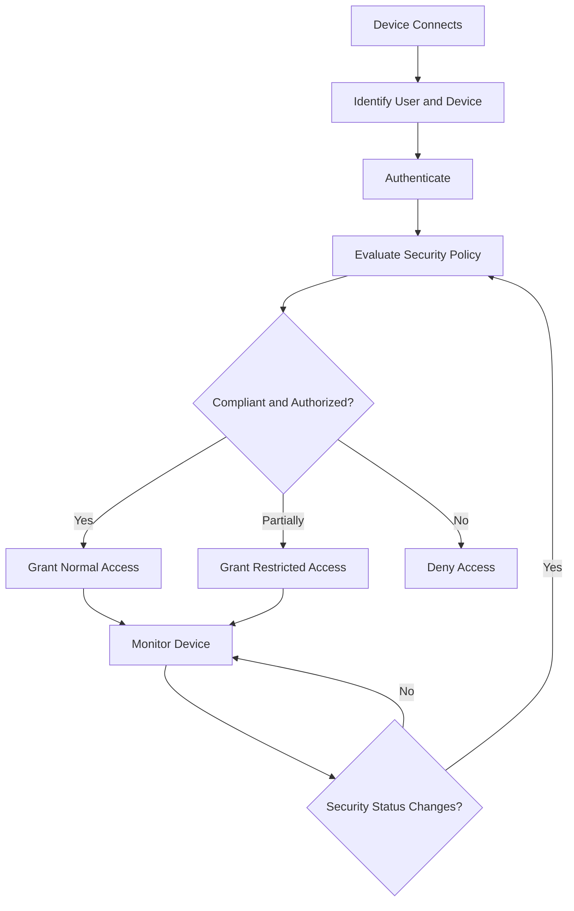
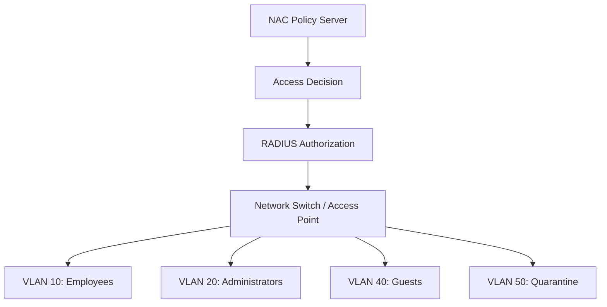

# 🗁 Network Access Control (NAC)

Network Access Control (NAC) is a security approach that controls which users and devices can connect to a network and what resources they are allowed to access.

NAC evaluates identity, device characteristics, authentication status, and security policies before granting or restricting network access.

It helps organizations prevent unauthorized devices from connecting to internal networks and enforce consistent security policies across wired, wireless, and remote access environments.

NAC is commonly used in enterprise networks, universities, healthcare organizations, government networks, and large service-provider environments.

# 🗁 What Is Network Access Control?

Network Access Control is a combination of technologies, policies, and enforcement mechanisms used to manage network access.

A NAC system can determine:

* Who is requesting network access.
* Which device is requesting access.
* Whether the user is authenticated.
* Whether the device complies with security requirements.
* Which network resources the device may access.
* Whether the device should receive normal, restricted, or denied access.

For example, an organization may allow an employee's managed laptop to access internal applications while placing an unknown personal device into a restricted guest network.

# 🗁 Why NAC Is Important

Traditional network security often relies on network boundaries and firewall rules.

However, modern organizations have many different types of connected devices, including employee laptops, smartphones, printers, IP cameras, IoT devices, and guest devices.

NAC provides identity-aware access control instead of relying only on physical network connectivity.

Its benefits include:

* Preventing unauthorized network access.
* Identifying connected users and devices.
* Enforcing security policies.
* Supporting network segmentation.
* Restricting unmanaged devices.
* Applying dynamic VLAN assignments.
* Improving network visibility.
* Supporting compliance requirements.
* Reducing the risk of lateral movement.

# 🗁 NAC Architecture

A typical NAC architecture contains several components.

| Component | Responsibility |
| --- | --- |
| Endpoint | Device requesting network access |
| Supplicant | Software or service that performs authentication |
| Authenticator | Switch, wireless access point, or VPN gateway enforcing access |
| Authentication Server | Validates identity, commonly through RADIUS |
| NAC Policy Server | Evaluates identity, device, and security policies |
| Enforcement Point | Applies the access decision |
| Monitoring System | Collects device and network activity information |

In smaller deployments, some of these functions may be provided by the same platform.

# 🗁 How NAC Works

A typical NAC process follows these steps:

* A device connects to a wired network, wireless network, or remote access service.
* The network identifies the connecting device.
* The user or device performs authentication.
* The NAC system evaluates the identity and applicable access policies.
* The system may inspect device compliance or posture.
* An access decision is generated.
* The enforcement point applies the appropriate network permissions.
* The system continues monitoring the device and may change its access if its security status changes.



The exact process depends on the NAC architecture and the security capabilities available on the network devices.

# 🗁 NAC Authentication Methods

NAC can use different authentication methods to identify users and devices.

**IEEE 802.1X**

802.1X provides port-based authentication for wired and wireless networks.

It commonly uses EAP for authentication and RADIUS for communication between the authenticator and authentication server.

**MAC Authentication Bypass (MAB)**

MAB allows devices without an 802.1X supplicant to authenticate using their MAC addresses.

It is commonly used for printers, cameras, and certain IoT devices.

Because MAC addresses can be spoofed, MAB provides weaker identity assurance than properly configured 802.1X.

**Captive Portal**

A captive portal redirects users to a web-based authentication page before granting access.

It is commonly used in guest Wi-Fi networks, hotels, universities, and public hotspots.

**Certificate-Based Authentication**

Digital certificates can identify users or devices through cryptographic authentication.

Certificate-based authentication is commonly used with EAP-TLS.

**VPN Authentication**

Remote users may authenticate through a VPN gateway using centralized identity and access policies.

# 🗁 NAC Access Control Models

NAC systems can apply different access policies depending on the identity and security status of a device.

| Access Model | Description |
| --- | --- |
| Full Access | Grants access to authorized network resources |
| Restricted Access | Allows access only to selected services |
| Guest Access | Provides limited internet or guest network access |
| Quarantine Access | Isolates devices that fail security requirements |
| Denied Access | Prevents network access entirely |

For example:

| Device | Security Status | Access Decision |
| --- | --- | --- |
| Managed employee laptop | Compliant | Corporate network |
| Guest smartphone | Unknown | Guest VLAN |
| Unmanaged laptop | Unverified | Restricted network |
| Infected workstation | Non-compliant | Quarantine network |
| Unauthorized device | Rejected | Access denied |

# 🗁 Device Posture Assessment

Device posture assessment evaluates whether a device meets the organization's security requirements.

A NAC solution may inspect:

* Operating system version.
* Security patch level.
* Antivirus or endpoint protection status.
* Firewall status.
* Disk encryption status.
* Device ownership.
* Device registration.
* Security agent status.
* Device compliance information.

For example, an organization may require employee laptops to have an updated operating system, active endpoint protection, and enabled disk encryption.

A device that fails these requirements may receive restricted access until it becomes compliant.

Posture assessment capabilities depend on the NAC platform and endpoint integration.

# 🗁 Network Segmentation with NAC

NAC can work with network segmentation to assign devices to appropriate network segments.

One common technique is dynamic VLAN assignment.

A RADIUS server can return authorization attributes that instruct a compatible switch or wireless access point to place a device into a specific VLAN.

Example:

| Device or User Type | VLAN | Access Policy |
| --- | --- | --- |
| Employees | VLAN 10 | Corporate access |
| Administrators | VLAN 20 | Infrastructure management |
| Servers | VLAN 30 | Application services |
| Guests | VLAN 40 | Internet-only access |
| Quarantined Devices | VLAN 50 | Remediation services |
| IoT Devices | VLAN 60 | Restricted device access |



VLAN assignment provides Layer 2 segmentation. Additional firewall rules or access-control policies are needed to control communication between VLANs.

# 🗁 NAC Enforcement Methods

NAC enforcement determines how the network applies access decisions.

Common enforcement methods include:

**Port-Based Enforcement**

The switch controls access through an Ethernet port using IEEE 802.1X.

**Wireless Enforcement**

A wireless access point or controller controls client access according to authentication and authorization results.

**VLAN-Based Enforcement**

The network assigns devices to different VLANs based on their identity or policy.

**ACL-Based Enforcement**

Access Control Lists restrict which network resources a device can reach.

**Firewall-Based Enforcement**

A firewall applies security policies to restrict communication between devices or network segments.

**VPN-Based Enforcement**

A VPN gateway controls remote user access according to identity and authorization policies.

# 🗁 NAC Deployment Models

Organizations can deploy NAC using different architectures.

| Deployment Model | Description |
| --- | --- |
| On-Premises NAC | NAC infrastructure runs inside the organization's network |
| Cloud-Based NAC | NAC management or policy services are hosted in the cloud |
| Hybrid NAC | Combines on-premises enforcement with cloud-based services |

**On-Premises NAC**

The organization manages NAC servers and supporting infrastructure internally.

It provides direct control over the deployment but requires maintenance and infrastructure resources.

**Cloud-Based NAC**

NAC management and policy services are delivered through a cloud platform.

It can simplify centralized administration across distributed locations.

**Hybrid NAC**

A hybrid architecture combines local enforcement and cloud-based management or policy services.

It can support organizations with both on-premises infrastructure and cloud services.

# 🗁 NAC and Zero Trust

Zero Trust is a security model based on the principle of never automatically trusting a user or device simply because it is connected to an internal network.

Instead, access decisions should be based on identity, device security, context, and policy.

NAC supports Zero Trust initiatives by identifying devices, evaluating their security posture, and controlling network access.

However, NAC alone does not implement a complete Zero Trust architecture.

A broader Zero Trust design may also include:

* Identity and Access Management (IAM).
* Multi-Factor Authentication (MFA).
* Endpoint Detection and Response (EDR).
* Network segmentation.
* Least-privilege access.
* Continuous monitoring.
* Application-level access control.

# 🗁 NAC vs AAA vs 802.1X

These technologies are related but serve different purposes.

| Technology | Primary Purpose |
| --- | --- |
| AAA | Framework for authentication, authorization, and accounting |
| RADIUS | Protocol commonly used to exchange AAA information |
| IEEE 802.1X | Port-based network authentication framework |
| NAC | Broader system for identifying devices and enforcing network access policies |

For example, an enterprise NAC deployment may use 802.1X to authenticate a laptop, RADIUS to communicate with the authentication server, and NAC policies to determine the appropriate VLAN and network permissions.

# 🗁 NAC Use Cases

NAC is useful in many types of network environments.

**Enterprise Networks**

* Authenticate employee devices.
* Separate employee and guest networks.
* Restrict unmanaged devices.
* Enforce device compliance policies.

**Educational Institutions**

* Authenticate students and staff.
* Control access to laboratory networks.
* Provide guest network access.
* Separate administrative and academic networks.

**Healthcare Networks**

* Identify medical equipment.
* Restrict access to sensitive systems.
* Segment clinical and administrative devices.
* Manage legacy medical devices.

**ISP and Service Provider Networks**

* Identify subscriber devices.
* Integrate subscriber authentication with RADIUS.
* Apply subscriber access policies.
* Support customer network segmentation.

**IoT Environments**

* Identify connected IoT devices.
* Restrict device-to-device communication.
* Assign devices to dedicated network segments.
* Limit access to required services.

# 🗁 NAC Security Best Practices

A well-designed NAC deployment should follow these practices:

* Use IEEE 802.1X wherever supported.
* Prefer certificate-based authentication for managed devices.
* Use MAB only when necessary for unsupported devices.
* Maintain accurate device inventories.
* Apply least-privilege access policies.
* Use dedicated guest and quarantine networks.
* Restrict communication between network segments.
* Integrate NAC with centralized AAA infrastructure.
* Monitor authentication and authorization events.
* Regularly review device compliance policies.
* Protect NAC management interfaces.
* Maintain a fallback access procedure for infrastructure recovery.

# 🗁 NAC Troubleshooting

NAC problems can originate from endpoint configuration, authentication infrastructure, policy evaluation, or network enforcement.

| Problem | Possible Cause |
| --- | --- |
| Device cannot connect | Authentication failure or incorrect port configuration |
| 802.1X authentication timeout | RADIUS server unreachable |
| Device assigned to wrong VLAN | Incorrect authorization attributes |
| Device placed in quarantine | Failed posture assessment |
| MAB authentication failure | MAC address missing from the authorized device database |
| Guest access unavailable | Captive portal or guest policy problem |
| Device authenticates but cannot access resources | Firewall or segmentation policy issue |
| Repeated authentication failures | Credential, certificate, or EAP configuration problem |

**Troubleshooting checklist**

* Confirm that the endpoint supports the selected authentication method.
* Verify the switch port or wireless SSID configuration.
* Check the RADIUS server connectivity.
* Confirm that the shared secret matches.
* Review authentication and authorization logs.
* Validate the assigned VLAN and its availability.
* Check firewall rules and inter-VLAN routing.
* Verify device posture and compliance status.
* Confirm that the enforcement device supports the required NAC features.

**Useful Linux commands**

Check network interface information:

```bash
ip address show
```

Check the default route:

```bash
ip route show
```

Capture EAPOL traffic:

```bash
sudo tcpdump -ni any ether proto 0x888e
```

Capture RADIUS traffic:

```bash
sudo tcpdump -ni any 'udp port 1812 or udp port 1813'
```

Inspect the network connection status:

```bash
nmcli device status
```

# 🗁 Key Takeaways

* NAC controls which users and devices can access a network.
* It evaluates identity, device information, and security policies.
* NAC commonly integrates with 802.1X and RADIUS.
* MAB provides an alternative for devices without 802.1X support.
* Device posture assessment checks security compliance.
* NAC can assign dynamic VLANs and apply restricted access policies.
* Quarantine networks help isolate non-compliant devices.
* NAC supports network segmentation and Zero Trust initiatives.
* NAC is commonly used in enterprise, educational, healthcare, ISP, and IoT environments.
* Effective NAC requires continuous monitoring, appropriate enforcement, and centralized policy management.
