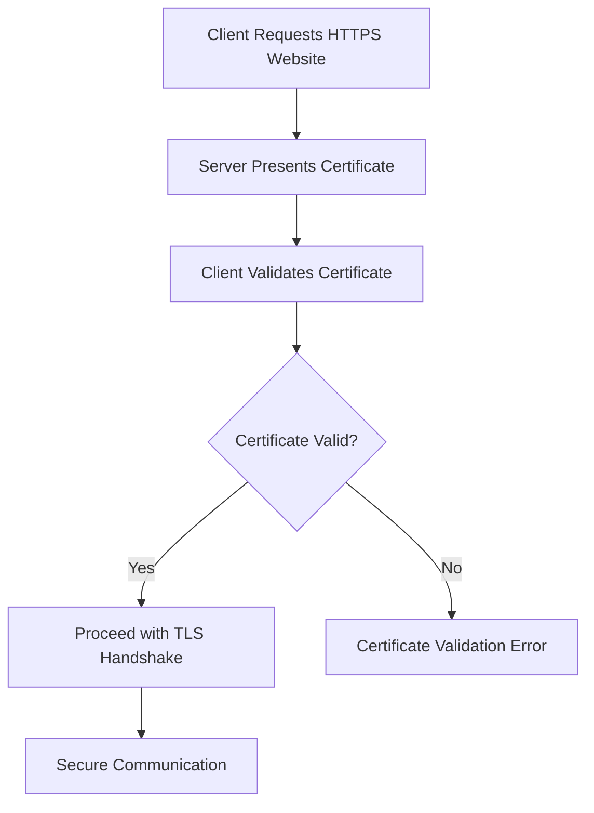

# Certificates and Public Key Infrastructure (PKI)

Public Key Infrastructure (PKI) is a framework of technologies, policies, procedures, and trusted entities used to create, distribute, manage, validate, and revoke digital certificates.

PKI enables secure communication, identity verification, authentication, and digital signatures across networks.

It is widely used in HTTPS, VPNs, SSH-related certificate systems, enterprise Wi-Fi, email security, device authentication, and network infrastructure management.

Digital certificates bind an identity to a public key, allowing systems to verify that they are communicating with the intended user, device, or server.

# 🗁 What Is Cryptography?

Cryptography is the practice of protecting information through mathematical techniques.

It provides several important security properties:

| Security Property | Description |
| --- | --- |
| Confidentiality | Prevents unauthorized parties from reading information |
| Integrity | Detects unauthorized modification of information |
| Authentication | Verifies the identity of communicating parties |
| Non-repudiation | Provides evidence supporting the origin of a digital action or signature |

Cryptography is a fundamental building block of secure network communication.

# 🗁 Symmetric Encryption

Symmetric encryption uses the same secret key for encryption and decryption.

The sender encrypts data using a secret key, and the receiver uses the same key to decrypt it.

```text
Plaintext
    |
    v
Encryption + Secret Key
    |
    v
Ciphertext
    |
    v
Decryption + Same Secret Key
    |
    v
Plaintext
```

Common symmetric encryption algorithms include:

* AES (Advanced Encryption Standard).
* ChaCha20.

**Advantages**

* High performance.
* Efficient for large amounts of data.
* Suitable for encrypting network traffic.

**Limitation**

Both communicating parties must securely obtain the same secret key.

# 🗁 Asymmetric Encryption

Asymmetric cryptography uses a mathematically related key pair:

* Public key.
* Private key.

The public key can be shared, while the private key must remain protected.

Asymmetric cryptography supports encryption schemes, digital signatures, and key establishment.

```text
Public Key  <---- Mathematically Related ---->  Private Key
   |                                               |
   | Shared                                        | Protected
   |                                               |
Used by Others                               Kept by Owner
```

Common asymmetric algorithms and schemes include:

* RSA.
* Elliptic Curve Cryptography (ECC).
* Ed25519 for digital signatures.

**Advantages**

* Supports identity verification through digital signatures.
* Enables secure key establishment.
* Avoids distributing one shared secret to every communicating party.

**Limitation**

Asymmetric operations are generally more computationally expensive than symmetric encryption.

# 🗁 Symmetric vs Asymmetric Cryptography

| Feature | Symmetric | Asymmetric |
| --- | --- | --- |
| Keys | One shared secret key | Public and private key pair |
| Performance | Generally faster | Generally slower |
| Key Distribution | Requires secure secret sharing | Public key can be distributed |
| Common Algorithms | AES, ChaCha20 | RSA, ECC |
| Common Use | Bulk data encryption | Key establishment and digital signatures |

Modern secure protocols commonly combine both approaches.

For example, TLS uses asymmetric or other public-key cryptographic mechanisms to authenticate peers and establish shared session keys, then uses symmetric cryptography to protect application data.

# 🗁 What Is a Digital Certificate?

A digital certificate is an electronic document that binds an identity to a public key.

It is commonly based on the X.509 standard.

A certificate is issued by a Certificate Authority (CA) or another trusted issuer.

A certificate typically contains:

| Field | Description |
| --- | --- |
| Subject | Identity associated with the certificate |
| Issuer | Certificate Authority that issued it |
| Public Key | Public key associated with the identity |
| Serial Number | Unique identifier assigned by the issuer |
| Valid From | Start of the certificate validity period |
| Valid To | Certificate expiration date |
| Signature Algorithm | Algorithm used to sign the certificate |
| Digital Signature | Issuer's signature over the certificate data |
| Subject Alternative Name (SAN) | DNS names, IP addresses, or other identities covered by the certificate |
| Key Usage | Defines permitted cryptographic operations |
| Extended Key Usage | Defines intended application purposes |

# 🗁 How Digital Certificates Work

A certificate allows a client to verify that a public key belongs to a particular identity.

For example, when a browser connects to an HTTPS website, the web server presents its digital certificate.

The browser checks whether:

* The certificate is issued by a trusted authority.
* The certificate is within its validity period.
* The requested hostname matches the certificate identity.
* The certificate chain is valid.
* The certificate has not been revoked, where applicable and checked.
* The certificate's intended usage is appropriate.

If validation succeeds, the browser can proceed with the TLS connection.



A valid certificate helps authenticate the server. It does not, by itself, guarantee that the website or its content is trustworthy.

# 🗁 What Is Public Key Infrastructure?

PKI is the complete trust framework used to manage digital certificates and their associated public keys.

It defines how certificates are:

* Created.
* Issued.
* Distributed.
* Validated.
* Renewed.
* Revoked.
* Archived or retired.

A typical PKI environment includes several components.

| Component | Responsibility |
| --- | --- |
| Certificate Authority (CA) | Issues and signs certificates |
| Registration Authority (RA) | Verifies certificate applicants |
| Root CA | Establishes the trust anchor |
| Intermediate CA | Issues certificates under a trusted parent CA |
| Certificate Repository | Stores and distributes certificates |
| Certificate Revocation List (CRL) | Lists revoked certificates |
| OCSP Responder | Provides certificate revocation status information |
| End Entity | User, server, device, or service holding a certificate |

# 🗁 Certificate Authority (CA)

A Certificate Authority is a trusted entity responsible for issuing and digitally signing certificates.

The CA verifies that an applicant meets its certificate issuance requirements before issuing a certificate.

Examples of CA providers include:

* Let's Encrypt.
* DigiCert.
* GlobalSign.
* Sectigo.
* Internal enterprise Certificate Authorities.

A CA's digital signature allows clients to verify that the certificate was issued under the CA's authority and has not been modified.

# 🗁 Root CA and Intermediate CA

A PKI hierarchy commonly contains a root CA and one or more intermediate CAs.

**Root CA**

The root CA is the top-level trust anchor in a certificate hierarchy.

Its certificate is typically self-signed and distributed through trusted certificate stores.

The root CA private key must be protected with especially strong security controls.

**Intermediate CA**

An intermediate CA receives its certificate from a trusted parent CA and issues certificates to other entities.

Intermediate CAs help protect the root CA by keeping its private key offline or otherwise isolated from routine issuance operations.

Typical certificate hierarchy:

```text
                Root CA
                   |
                   |
             Intermediate CA
                   |
          +--------+--------+
          |        |        |
        Server   Client   Device
       Certificate Certificate Certificate
```

The client validates the certificate chain from the presented certificate through the intermediate CA certificates to a trusted root.

# 🗁 Certificate Chain of Trust

A certificate chain of trust establishes whether a certificate can be traced to a trusted root CA.

For example:

```text
Trusted Root CA
       |
       v
Intermediate CA
       |
       v
Web Server Certificate
       |
       v
Client Validates Certificate Chain
```

The client checks the signatures and constraints of the certificates in the chain.

A certificate may be correctly signed but still fail validation because of expiration, hostname mismatch, inappropriate usage, or an untrusted issuer.

# 🗁 Certificate Types

Digital certificates are used for different identities and purposes.

| Certificate Type | Purpose |
| --- | --- |
| Server Certificate | Authenticates a server |
| Client Certificate | Authenticates a client or user |
| Code Signing Certificate | Verifies software publisher identity and code integrity |
| Email Certificate | Supports email encryption and digital signatures |
| Device Certificate | Identifies a network device |
| Root CA Certificate | Establishes a trust anchor |
| Intermediate CA Certificate | Establishes an intermediate level of trust |

# 🗁 Certificate Validation

Certificate validation ensures that a certificate can be trusted for a specific purpose.

Important validation checks include:

**Signature Validation**

The certificate signature must be valid under the issuer's public key.

**Validity Period**

The current time must fall within the certificate's validity period.

**Hostname Validation**

For server authentication, the requested hostname must match an identity listed in the certificate, normally in the Subject Alternative Name extension.

**Certificate Chain Validation**

The certificate must chain to a trusted root CA.

**Key Usage Validation**

The certificate must permit the intended cryptographic operations.

**Revocation Checking**

The client may check whether the certificate has been revoked.

# 🗁 Certificate Revocation

A certificate may need to be revoked before its expiration date.

Common reasons include:

* Private key compromise.
* Incorrect certificate issuance.
* Device loss or theft.
* Employee departure.
* Changes in organizational security policy.

Two common revocation mechanisms are CRL and OCSP.

**Certificate Revocation List (CRL)**

A CRL is a digitally signed list published by a CA containing certificates that have been revoked.

Clients can download the list and check whether a certificate's serial number appears in it.

**Online Certificate Status Protocol (OCSP)**

OCSP allows a client to request the revocation status of a certificate from an OCSP responder.

The response generally indicates whether the certificate is good, revoked, or unknown.

| Feature | CRL | OCSP |
| --- | --- | --- |
| Method | Download revocation list | Request certificate status |
| Information | Contains multiple revoked certificates | Usually reports the status of a specific certificate |
| Network Usage | May require downloading a larger list | Typically smaller individual requests |
| Common Use | Certificate revocation checking | Online certificate status checking |

# 🗁 Certificate Signing Request (CSR)

A Certificate Signing Request (CSR) is a request submitted to a Certificate Authority when requesting a digital certificate.

It is generated by the applicant and normally contains:

* Public key.
* Subject information.
* Subject Alternative Names, where applicable.
* Requested certificate attributes.
* Digital signature created using the corresponding private key.

The private key is not included in the CSR.

**Generate a private key**

```bash
openssl genrsa -out server.key 2048
```

**Generate a CSR**

```bash
openssl req -new -key server.key -out server.csr
```

**Inspect the CSR**

```bash
openssl req -in server.csr -noout -text
```

The CA validates the request according to its issuance policy before issuing the certificate.

For modern deployments, RSA 2048-bit keys or appropriately selected elliptic-curve keys are commonly used, depending on compatibility and security requirements.

# 🗁 Generate a Self-Signed Certificate

A self-signed certificate is signed using its own private key rather than being issued by a trusted external CA.

It can be useful for:

* Development environments.
* Internal testing.
* Lab environments.
* Temporary services.
* Private infrastructure with explicitly managed trust.

Generate a self-signed certificate:

```bash
openssl req -x509 -newkey rsa:2048 -keyout server.key -out server.crt -days 365 -sha256 -nodes
```

This command creates:

* `server.key` — Private key.
* `server.crt` — Self-signed certificate.

The `-nodes` option creates an unencrypted private key. For production use, protect the key with appropriate file permissions and consider encrypted private-key storage.

A self-signed certificate is not automatically trusted by browsers or operating systems. Its public certificate must be explicitly trusted where appropriate.

# 🗁 Inspect a Digital Certificate

OpenSSL provides useful commands for inspecting certificates.

Display certificate information:

```bash
openssl x509 -in server.crt -noout -text
```

Display certificate validity dates:

```bash
openssl x509 -in server.crt -noout -dates
```

Display the certificate issuer:

```bash
openssl x509 -in server.crt -noout -issuer
```

Display the certificate subject:

```bash
openssl x509 -in server.crt -noout -subject
```

Display the certificate fingerprint:

```bash
openssl x509 -in server.crt -noout -fingerprint -sha256
```

Check a certificate against a CA certificate:

```bash
openssl verify -CAfile ca.crt server.crt
```

# 🗁 PKI in HTTPS and TLS

HTTPS uses HTTP over TLS to provide secure communication between clients and servers.

Certificates play an important role in TLS server authentication.

A simplified HTTPS connection works as follows:

* A client connects to a server.
* The server presents its certificate and supporting certificate chain.
* The client validates the certificate.
* The TLS handshake establishes cryptographic session keys.
* Both parties use symmetric encryption to protect application traffic.

Modern TLS versions use carefully designed key-exchange and authentication mechanisms. The certificate does not simply encrypt all transmitted data.

# 🗁 PKI in VPN Networks

PKI is commonly used to authenticate VPN endpoints and users.

For example, IPsec VPNs can use certificates to authenticate peers instead of relying only on pre-shared keys.

Certificates can identify:

* VPN gateways.
* Remote-access clients.
* Site-to-site VPN endpoints.
* Enterprise devices.

Certificate-based VPN authentication offers centralized identity management and avoids distributing the same pre-shared secret across many endpoints.

# 🗁 PKI in Enterprise Wi-Fi and 802.1X

PKI is widely used in enterprise wireless networks.

EAP-TLS uses certificates to authenticate clients and authentication servers.

A typical architecture includes:

* A trusted Certificate Authority.
* Client certificates installed on managed devices.
* A server certificate installed on the RADIUS server.
* An 802.1X-compatible wireless infrastructure.
* A RADIUS server configured for EAP-TLS.

The client validates the RADIUS server certificate, while the authentication server validates the client certificate.

This enables certificate-based mutual authentication without relying on a shared Wi-Fi password.

# 🗁 Public CA vs Private CA

Organizations can use publicly trusted or privately managed Certificate Authorities.

| Feature | Public CA | Private CA |
| --- | --- | --- |
| Trust | Commonly trusted by browsers and operating systems | Requires explicit trust distribution |
| Management | Managed by external CA provider | Managed by the organization |
| Common Use | Public websites and internet services | Internal servers, devices, and enterprise authentication |
| Certificate Issuance | Follows public CA validation policies | Follows internal organizational policies |
| Control | Limited to provider-supported policies | Greater organizational control |

Public CAs are generally used for public-facing services.

Private CAs are useful for internal network infrastructure, enterprise devices, client authentication, and private services.

# 🗁 PKI Security Best Practices

A secure PKI deployment requires strong protection of private keys and careful certificate lifecycle management.

**Private Key Protection**

* Never expose private keys publicly.
* Restrict private-key file permissions.
* Use encrypted private-key storage where appropriate.
* Protect CA private keys using hardware security modules (HSMs) when justified.
* Maintain secure backups.

**Certificate Management**

* Monitor certificate expiration dates.
* Renew certificates before expiration.
* Revoke compromised or unnecessary certificates.
* Maintain accurate certificate inventories.
* Use appropriate key sizes and cryptographic algorithms.
* Apply certificate usage restrictions.

**Trust Management**

* Protect root CA private keys.
* Use intermediate CAs for routine certificate issuance.
* Distribute trusted CA certificates securely.
* Validate certificate chains.
* Enforce hostname and certificate usage checks.
* Maintain reliable time synchronization.

**Monitoring**

* Monitor certificate expiration.
* Audit certificate issuance.
* Monitor failed validation attempts.
* Track revoked certificates.
* Record CA administrative activity.

# 🗁 PKI Troubleshooting

Certificate-related problems can prevent secure connections even when the network itself is functioning correctly.

| Problem | Possible Cause |
| --- | --- |
| Certificate expired | Validity period has ended |
| Certificate not trusted | Issuing CA is missing from the trust store |
| Hostname mismatch | Requested hostname is not included in the certificate |
| Invalid certificate signature | Certificate was modified or signature validation failed |
| Incomplete certificate chain | Intermediate certificate is missing |
| Private key mismatch | Certificate and private key do not belong together |
| Revoked certificate | CA has revoked the certificate |
| TLS handshake failure | Protocol, cipher, certificate, or configuration incompatibility |
| Client authentication failure | Missing or invalid client certificate |

**Useful troubleshooting commands**

Check a remote HTTPS certificate:

```bash
openssl s_client -connect example.com:443 -servername example.com
```

Display the remote certificate chain:

```bash
openssl s_client -connect example.com:443 -servername example.com -showcerts
```

Check certificate dates:

```bash
openssl s_client -connect example.com:443 -servername example.com </dev/null 2>/dev/null | openssl x509 -noout -dates
```

Inspect a certificate:

```bash
openssl x509 -in server.crt -noout -text
```

Verify a certificate chain against a CA:

```bash
openssl verify -CAfile ca.crt server.crt
```

# 🗁 Key Takeaways

* PKI manages digital certificates and public-key trust.
* Cryptography provides confidentiality, integrity, and authentication.
* Symmetric encryption uses one shared secret key.
* Asymmetric cryptography uses public and private keys.
* Digital certificates bind identities to public keys.
* A Certificate Authority issues and signs certificates.
* Root and intermediate CAs establish a certificate hierarchy.
* Certificate chains connect issued certificates to trusted roots.
* CRLs and OCSP provide certificate revocation information.
* CSR files are used to request certificates without exposing private keys.
* PKI supports HTTPS, VPNs, enterprise Wi-Fi, and device authentication.
* Private-key protection and certificate lifecycle management are essential to PKI security.
