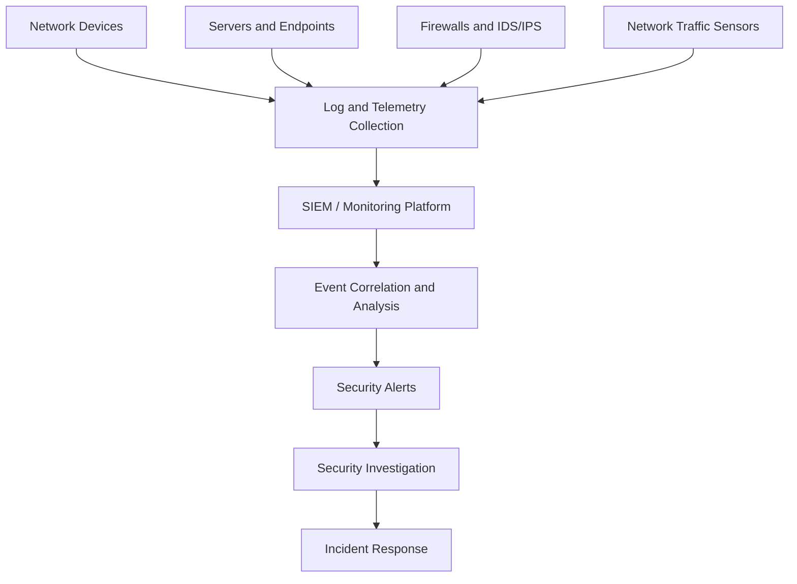
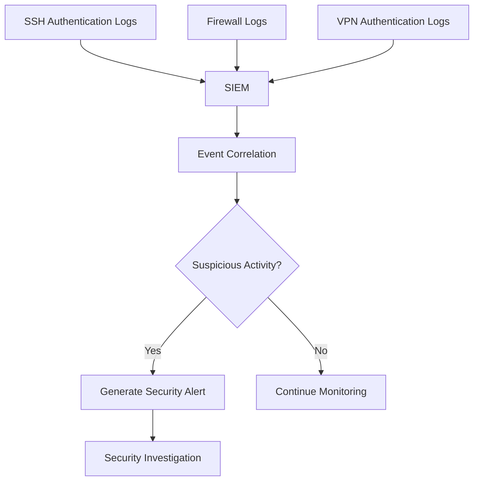
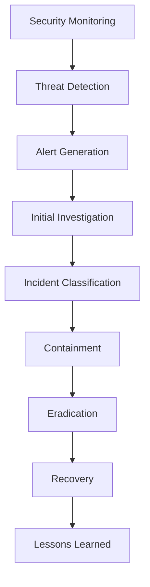

# Network Security Monitoring

Network Security Monitoring is the continuous observation, collection, analysis, and investigation of network activities to identify security threats, suspicious behavior, unauthorized access, and potential attacks.

It helps network administrators and security teams understand what is happening across their infrastructure and respond to security incidents before they cause significant damage.

Security monitoring combines network traffic analysis, log management, intrusion detection, endpoint information, and security event correlation.

# 🗁 What Is Network Security Monitoring?

Network security monitoring focuses on identifying abnormal or malicious activities within a network.

It involves monitoring:

* Incoming and outgoing network traffic.
* Network devices and infrastructure.
* Firewall and router activities.
* Authentication attempts.
* User and device behavior.
* DNS queries and responses.
* VPN connections.
* Server and application logs.
* Intrusion detection alerts.

For example, a network administrator may detect an unauthorized device repeatedly attempting to connect to an internal server.

Without monitoring, this activity might remain unnoticed.

# 🗁 Goals of Security Monitoring

The primary goals of network security monitoring include:

| Goal | Description |
|---|---|
| Threat Detection | Identify malicious network activities |
| Intrusion Detection | Detect unauthorized access attempts |
| Traffic Analysis | Understand network communication patterns |
| Anomaly Detection | Identify unusual behavior |
| Incident Investigation | Determine what happened during a security event |
| Compliance | Maintain records required by security policies |
| Threat Response | Support timely investigation and containment |
| Visibility | Maintain awareness of network infrastructure activities |

# 🗁 Network Security Monitoring Architecture

A typical security monitoring architecture collects information from multiple network and system sources.



**Monitoring Sources**

* Routers and switches.
* Firewalls.
* Wireless access points.
* VPN gateways.
* DNS and DHCP servers.
* Web servers and application servers.
* Endpoint security systems.
* Network traffic sensors.

# 🗁 Types of Network Security Monitoring

Different monitoring techniques provide different levels of visibility.

**Network Traffic Monitoring**

Examines network traffic to identify suspicious communication patterns, unexpected connections, and unusual traffic volumes.

**Log Monitoring**

Collects and analyzes logs generated by network devices, servers, applications, and security systems.

**Intrusion Detection Monitoring**

Uses Intrusion Detection Systems (IDS) to identify suspicious activities and potential attacks.

**Network Behavior Monitoring**

Establishes normal network behavior and detects deviations from expected patterns.

**Authentication Monitoring**

Tracks successful and failed authentication attempts, account usage, and suspicious login behavior.

**Configuration Monitoring**

Detects unauthorized or unexpected changes to network device configurations and security policies.

# 🗁 Security Logs

Security logs are records of events generated by operating systems, applications, network devices, and security tools.

They provide valuable information for detecting and investigating security incidents.

Common log sources include:

| Source | Example Events |
|---|---|
| Router | Routing changes, administrative logins |
| Firewall | Allowed and blocked connections |
| Switch | Port changes, authentication events |
| VPN Gateway | VPN connection and disconnection events |
| DNS Server | DNS queries and resolution failures |
| DHCP Server | IP address assignments |
| Linux Server | SSH logins, authentication failures |
| Web Server | HTTP requests and access errors |
| RADIUS Server | Authentication successes and failures |

# 🗁 Syslog Monitoring

Syslog is a standard mechanism for transmitting and collecting log messages from network devices and systems.

It is widely supported by routers, switches, firewalls, Linux servers, and other infrastructure components.

A typical centralized logging architecture looks like this:

```text
Router --------\
Switch ---------\
Firewall --------> Central Syslog Server
Linux Server ----/
VPN Gateway ----/
```

Centralized logging makes it easier to investigate events across multiple devices.

Common Syslog severity levels:

| Level | Severity | Description |
|---|---|---|
| 0 | Emergency | System is unusable |
| 1 | Alert | Immediate action required |
| 2 | Critical | Critical condition |
| 3 | Error | Error condition |
| 4 | Warning | Warning condition |
| 5 | Notice | Normal but significant event |
| 6 | Informational | Informational message |
| 7 | Debug | Debugging information |

**Configure remote Syslog on Linux using rsyslog**

Install rsyslog:

```bash
sudo apt update
sudo apt install rsyslog
```

Check the service:

```bash
sudo systemctl status rsyslog
```

The remote Syslog server can receive logs over UDP port `514` or TCP port `514`, depending on its configuration.

Use TCP or a protected logging transport when reliable delivery and stronger transport security are required. Traditional Syslog over UDP does not provide encryption or guaranteed delivery.

# 🗁 Firewall Log Monitoring

Firewalls generate logs describing traffic that matches configured security policies.

These logs help administrators identify:

* Blocked connection attempts.
* Unexpected inbound traffic.
* Unauthorized access attempts.
* Suspicious outbound connections.
* Port scanning activity.
* Repeated connection failures.
* Unusual traffic patterns.

Example firewall log:

```text
SRC=192.168.1.50
DST=203.0.113.10
PROTO=TCP
SPT=51522
DPT=22
ACTION=DROP
```

Interpretation:

| Field | Meaning |
|---|---|
| SRC | Source IP address |
| DST | Destination IP address |
| PROTO | Transport protocol |
| SPT | Source port |
| DPT | Destination port |
| ACTION | Firewall decision |

This example indicates that a TCP connection from `192.168.1.50` to destination port `22` was dropped.

# 🗁 Intrusion Detection System (IDS)

An Intrusion Detection System monitors network traffic or system activities to identify suspicious behavior and potential security threats.

An IDS primarily detects and reports suspicious activities rather than automatically blocking them.

Common IDS detection approaches:

**Signature-Based Detection**

Compares observed activities against known attack patterns.

Examples:

* Known malware communication patterns.
* Recognized exploit signatures.
* Known malicious packet sequences.

**Anomaly-Based Detection**

Identifies activities that deviate from established normal behavior.

Examples:

* Unexpected traffic spikes.
* Unusual login patterns.
* Abnormal communication between network segments.

**Advantages**

* Detects suspicious activities.
* Provides security visibility.
* Supports incident investigation.
* Helps identify known attack patterns.

**Limitations**

* May generate false positives.
* Can miss unknown attacks.
* Requires regular updates and tuning.
* Detection does not automatically mean prevention.

# 🗁 Intrusion Prevention System (IPS)

An Intrusion Prevention System monitors network traffic and can automatically take action when it identifies malicious or policy-violating activity.

Possible actions include:

* Dropping malicious packets.
* Blocking suspicious connections.
* Rejecting traffic from specific sources.
* Preventing known exploit attempts.

Unlike a passive IDS, an inline IPS can actively affect network traffic.

# 🗁 IDS vs IPS

| Feature | IDS | IPS |
|---|---|---|
| Full Form | Intrusion Detection System | Intrusion Prevention System |
| Primary Function | Detect threats | Detect and prevent threats |
| Traffic Handling | Commonly passive or out-of-band | Commonly inline |
| Blocking | Does not normally block traffic | Can block malicious traffic |
| Alerting | Yes | Yes |
| False Positives | Possible | Possible |
| Deployment Risk | Usually lower traffic disruption risk | Incorrect rules can disrupt legitimate traffic |

# 🗁 Network Traffic Analysis

Network Traffic Analysis (NTA) examines communication patterns to identify security threats, performance problems, and unusual network behavior.

It can analyze:

* Source and destination IP addresses.
* Source and destination ports.
* Protocols.
* Traffic volume.
* Connection duration.
* Packet rates.
* Communication frequency.
* Application behavior.

Common tools include:

| Tool | Purpose |
|---|---|
| Wireshark | Packet capture and protocol analysis |
| tcpdump | Command-line packet capture |
| Zeek | Network security monitoring and protocol analysis |
| Suricata | Network IDS, IPS, and threat detection |
| ntopng | Network traffic visibility and analysis |
| NetFlow | Flow-based traffic monitoring |
| sFlow | Sampled network traffic and interface telemetry |

# 🗁 Packet Capture Monitoring with tcpdump

`tcpdump` is a command-line packet analyzer used to capture and inspect network packets.

Install tcpdump:

```bash
sudo apt update
sudo apt install tcpdump
```

List available interfaces:

```bash
sudo tcpdump -D
```

Capture traffic on an interface:

```bash
sudo tcpdump -i eth0
```

Capture only DNS traffic:

```bash
sudo tcpdump -i eth0 port 53
```

Capture HTTP traffic:

```bash
sudo tcpdump -i eth0 tcp port 80
```

Capture SSH traffic:

```bash
sudo tcpdump -i eth0 tcp port 22
```

Capture traffic from a specific host:

```bash
sudo tcpdump -i eth0 host 192.168.1.10
```

Capture traffic and save it to a file:

```bash
sudo tcpdump -i eth0 -w capture.pcap
```

Read a saved packet capture:

```bash
sudo tcpdump -r capture.pcap
```

Packet captures may contain sensitive information. Store and share them securely.

# 🗁 Network Flow Monitoring

Flow monitoring summarizes network communication without necessarily recording every packet.

A network flow commonly describes communication between endpoints using information such as:

* Source IP address.
* Destination IP address.
* Source port.
* Destination port.
* Transport protocol.
* Packet count.
* Byte count.
* Flow start and end times.

Common flow technologies:

**NetFlow**

A flow-export technology originally developed by Cisco and widely supported by network equipment and monitoring systems.

**IPFIX**

Internet Protocol Flow Information Export is a standardized flow-export protocol.

**sFlow**

A technology that uses packet sampling and interface counter information to provide network visibility.

Flow monitoring helps identify:

* Top bandwidth consumers.
* Unexpected traffic destinations.
* Unusual outbound connections.
* Traffic distribution between networks.
* Changes in communication patterns.

# 🗁 Security Information and Event Management (SIEM)

SIEM is a security platform that collects, normalizes, correlates, and analyzes security events from multiple sources.

It provides centralized visibility into an organization's security environment.

Common SIEM capabilities include:

* Log collection.
* Event correlation.
* Threat detection.
* Security dashboards.
* Alert generation.
* Incident investigation.
* Compliance reporting.

Examples of SIEM platforms:

* Splunk Enterprise Security.
* IBM QRadar.
* Microsoft Sentinel.
* Elastic Security.
* Wazuh.

**Example: Failed Login Detection**

Suppose a user account experiences repeated failed SSH login attempts from one source address.

A SIEM platform can collect authentication logs, identify the repeated failures, correlate them with other events, and generate an alert.



# 🗁 Security Monitoring with Wazuh

Wazuh is an open-source security platform that provides security monitoring, threat detection, log analysis, and endpoint security capabilities.

It can collect and analyze information from monitored endpoints and infrastructure.

Common capabilities include:

* Security event analysis.
* File integrity monitoring.
* Vulnerability detection.
* Configuration assessment.
* Log analysis.
* Threat detection.
* Security alerting.

A basic Wazuh architecture includes:

| Component | Responsibility |
|---|---|
| Wazuh Agent | Collects endpoint security information |
| Wazuh Server | Analyzes incoming security data |
| Wazuh Indexer | Stores and indexes security events |
| Wazuh Dashboard | Provides visualization and investigation interfaces |

# 🗁 Security Monitoring with Suricata

Suricata is an open-source network threat detection engine.

It supports:

* Network Intrusion Detection System (NIDS).
* Network Intrusion Prevention System (NIPS).
* Network Security Monitoring (NSM).
* Protocol identification.
* File extraction.
* Rule-based traffic detection.

Install Suricata on Ubuntu:

```bash
sudo apt update
sudo apt install suricata
```

Check the installed version:

```bash
suricata --build-info
```

Check the service:

```bash
sudo systemctl status suricata
```

View Suricata logs:

```bash
sudo tail -f /var/log/suricata/fast.log
```

View structured event logs:

```bash
sudo tail -f /var/log/suricata/eve.json
```

Suricata requires appropriate interface, rule, and operating-mode configuration to monitor the intended traffic.

# 🗁 MikroTik RouterOS Security Monitoring

MikroTik RouterOS provides several built-in tools for observing network activity and security events.

**View system logs**

```routeros
/log print
```

Monitor logs continuously:

```routeros
/log print follow
```

**Monitor active connections**

```routeros
/ip firewall connection print
```

**Monitor firewall rules and counters**

```routeros
/ip firewall filter print stats
```

**Monitor interface traffic**

```routeros
/interface monitor-traffic ether1
```

**Inspect traffic using Torch**

```routeros
/tool torch interface=ether1
```

Torch can display traffic information such as source and destination addresses, ports, protocols, and data rates.

**Inspect packets using the sniffer**

```routeros
/tool sniffer quick interface=ether1
```

**Configure remote Syslog**

Example configuration for sending RouterOS logs to a remote Syslog server:

```routeros
/system logging action add name=remote-syslog target=remote remote=192.168.1.100 remote-port=514
/system logging add topics=firewall action=remote-syslog
```

Replace `192.168.1.100` with the actual Syslog server address.

For production environments, configure an appropriate protected logging transport and restrict access to the logging service.

# 🗁 Security Monitoring Indicators

Security teams monitor several indicators to identify suspicious network activities.

| Indicator | Possible Security Concern |
|---|---|
| Repeated Failed Logins | Brute-force attempts |
| Unusual Outbound Traffic | Data exfiltration or malware communication |
| Unexpected DNS Queries | Suspicious domains or DNS tunneling |
| High Connection Rate | Port scanning or denial-of-service activity |
| Unknown Devices | Unauthorized network access |
| Unexpected Configuration Changes | Unauthorized administration |
| Unusual Privileged Account Activity | Account compromise |
| Unexpected Traffic Between VLANs | Network segmentation violation |
| Repeated Firewall Drops | Scanning or unauthorized connection attempts |

An individual indicator does not necessarily prove an attack. Effective detection requires context and correlation.

# 🗁 Security Alerts and Incident Response

A security alert is a notification generated when monitoring systems identify suspicious activity or a security policy violation.

An alert should provide enough information for an administrator to investigate the event.

Useful alert information includes:

* Event timestamp.
* Source and destination addresses.
* User or device identity.
* Protocol and port.
* Detection rule.
* Severity.
* Related log events.

A typical incident response workflow:



Security teams should establish documented response procedures so that incidents can be handled consistently.

# 🗁 Security Monitoring Best Practices

**Centralized Logging**

* Collect logs from critical infrastructure.
* Use a central logging platform.
* Protect logs against unauthorized modification.
* Define appropriate log retention periods.

**Time Synchronization**

* Configure reliable NTP synchronization.
* Maintain consistent timestamps across devices.
* Use accurate timestamps during incident investigation.

**Monitoring Coverage**

* Monitor critical network segments.
* Include firewalls, routers, switches, servers, and VPN gateways.
* Monitor administrative access.
* Track changes to security configurations.

**Alert Management**

* Define meaningful detection rules.
* Tune alerts to reduce false positives.
* Assign severity levels.
* Establish incident escalation procedures.

**Security Protection**

* Restrict access to monitoring platforms.
* Protect monitoring credentials.
* Secure log transmission.
* Maintain monitoring platform updates.
* Back up important security configurations.

# 🗁 Key Takeaways

* Network security monitoring provides visibility into network and system activities.
* Security logs help investigate suspicious events.
* Syslog supports centralized log collection.
* IDS detects suspicious activity, while IPS can actively block it.
* Network traffic analysis helps identify abnormal communication patterns.
* NetFlow, IPFIX, and sFlow provide flow-based visibility.
* SIEM platforms correlate security events from multiple sources.
* Wazuh and Suricata provide useful open-source security monitoring capabilities.
* MikroTik RouterOS includes tools such as Torch, Sniffer, firewall counters, and system logs.
* Effective monitoring requires accurate time synchronization, alert tuning, secure log storage, and documented incident response procedures.
