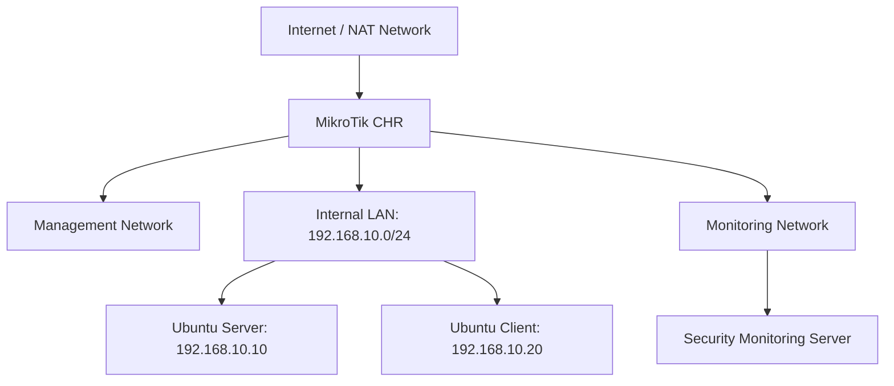

# 🗁 Network Security Labs

Network security labs provide practical experience with security technologies, network monitoring, access control, firewall policies, intrusion detection, and security troubleshooting.

These labs help transform theoretical security concepts into practical networking skills.

The exercises use Ubuntu Linux, MikroTik RouterOS v7, Wireshark, tcpdump, and open-source security tools.

# 🗁 Lab Environment

You can build a network security lab using virtual machines and network simulation tools.

**Recommended tools**

| Tool | Purpose |
|---|---|
| VirtualBox | Virtual machine environment |
| Ubuntu Server | Linux server and security testing |
| MikroTik CHR | RouterOS-based routing and firewall |
| Wireshark | Packet capture and protocol analysis |
| tcpdump | Command-line packet capture |
| Nmap | Network discovery and security auditing |
| UFW | Linux firewall management |
| Suricata | Network IDS/IPS |
| Wazuh | Security monitoring and log analysis |
| OpenSSL | Certificate and cryptographic operations |

**Example lab topology**



Use isolated virtual networks for security testing. Keep intentionally vulnerable systems and attack simulations away from production networks.

# 🗁 Lab: Network Discovery with Nmap

**Objective**

Discover active hosts and identify exposed services within an authorized lab network.

**Environment**

* Ubuntu Server: `192.168.10.10`
* Ubuntu Client: `192.168.10.20`

Install Nmap:

```bash
sudo apt update
sudo apt install nmap
```

Discover active hosts:

```bash
nmap -sn 192.168.10.0/24
```

Scan a specific lab host:

```bash
nmap 192.168.10.10
```

Identify service versions:

```bash
nmap -sV 192.168.10.10
```

Scan selected ports:

```bash
nmap -p 22,80,443 192.168.10.10
```

**Expected Learning**

* Understand network discovery.
* Identify open ports.
* Understand service detection.
* Recognize unnecessary exposed services.

# 🗁 Lab: Linux Firewall Configuration with UFW

**Objective**

Configure a host-based firewall and control incoming network connections.

Install UFW:

```bash
sudo apt update
sudo apt install ufw
```

Check firewall status:

```bash
sudo ufw status verbose
```

Set default policies:

```bash
sudo ufw default deny incoming
sudo ufw default allow outgoing
```

Allow SSH:

```bash
sudo ufw allow 22/tcp
```

Allow HTTPS:

```bash
sudo ufw allow 443/tcp
```

Enable the firewall:

```bash
sudo ufw enable
```

Check configured rules:

```bash
sudo ufw status numbered
```

Delete a rule using its number:

```bash
sudo ufw delete 2
```

**Expected Learning**

* Understand host-based firewalls.
* Configure default firewall policies.
* Allow required services.
* Restrict unnecessary inbound traffic.
* Inspect and manage firewall rules.

# 🗁 Lab: MikroTik Firewall Filter Rules

**Objective**

Create firewall rules to protect a MikroTik router and control forwarded traffic.

**Environment**

* MikroTik CHR.
* Internal LAN: `192.168.10.0/24`.
* Router LAN interface: `ether2`.
* Router WAN interface: `ether1`.

Create an address list for the trusted LAN:

```routeros
/ip firewall address-list add list=trusted-lan address=192.168.10.0/24
```

Allow established and related connections:

```routeros
/ip firewall filter add chain=input connection-state=established,related action=accept comment="Allow established and related input"
```

Drop invalid connections:

```routeros
/ip firewall filter add chain=input connection-state=invalid action=drop comment="Drop invalid input"
```

Allow management access from the trusted LAN:

```routeros
/ip firewall filter add chain=input src-address-list=trusted-lan protocol=tcp dst-port=22,8291 action=accept comment="Allow SSH and WinBox from trusted LAN"
```

Allow ICMP from the trusted LAN:

```routeros
/ip firewall filter add chain=input src-address-list=trusted-lan protocol=icmp action=accept comment="Allow ICMP from trusted LAN"
```

Drop other incoming traffic:

```routeros
/ip firewall filter add chain=input action=drop comment="Drop other router input"
```

**Important:** These rules are an illustrative lab configuration. Before applying them remotely, verify interface roles, existing firewall rules, management access, and rule order. Apply them in a controlled environment to avoid locking yourself out.

Inspect firewall rules:

```routeros
/ip firewall filter print
```

Inspect firewall counters:

```routeros
/ip firewall filter print stats
```

**Expected Learning**

* Understand the `input` firewall chain.
* Distinguish router traffic from forwarded traffic.
* Understand connection tracking.
* Apply default-deny firewall policies.
* Understand firewall rule ordering.

# 🗁 Lab: Network Segmentation with VLANs

**Objective**

Separate network devices into different logical networks and restrict communication between them.

**Example VLAN plan**

| VLAN | Name | Network |
|---|---|---|
| 10 | Management | 192.168.10.0/24 |
| 20 | Users | 192.168.20.0/24 |
| 30 | Servers | 192.168.30.0/24 |

**Topology**

```text
                 MikroTik Router
                       |
                  VLAN Trunk
                       |
                  Managed Switch
                  /     |      \
                 /      |       \
             VLAN 10  VLAN 20  VLAN 30
           Management  Users   Servers
```

Configure a bridge and VLAN filtering on MikroTik RouterOS v7.

```routeros
/interface bridge add name=br-lan vlan-filtering=no
```

Add switch-facing ports:

```routeros
/interface bridge port add bridge=br-lan interface=ether2 pvid=10
/interface bridge port add bridge=br-lan interface=ether3 pvid=20
/interface bridge port add bridge=br-lan interface=ether4 pvid=30
```

Configure VLAN membership:

```routeros
/interface bridge vlan add bridge=br-lan vlan-ids=10 tagged=br-lan untagged=ether2
/interface bridge vlan add bridge=br-lan vlan-ids=20 tagged=br-lan untagged=ether3
/interface bridge vlan add bridge=br-lan vlan-ids=30 tagged=br-lan untagged=ether4
```

Enable VLAN filtering after verifying the VLAN table and management access:

```routeros
/interface bridge set br-lan vlan-filtering=yes
```

**Expected Learning**

* Understand VLAN-based segmentation.
* Configure access ports.
* Understand tagged and untagged traffic.
* Configure VLAN membership.
* Recognize the role of Layer 2 and Layer 3 boundaries.

# 🗁 Lab: Packet Capture with Wireshark

**Objective**

Capture network packets and analyze common protocols.

Install Wireshark:

```bash
sudo apt update
sudo apt install wireshark
```

Start Wireshark and select the appropriate network interface.

Generate traffic by visiting a website or performing DNS lookups.

Useful display filters:

**DNS traffic**

```text
dns
```

**TCP traffic**

```text
tcp
```

**HTTP traffic**

```text
http
```

**HTTPS traffic**

```text
tls
```

**Traffic from a specific IP**

```text
ip.addr == 192.168.10.10
```

**Traffic using SSH**

```text
tcp.port == 22
```

**TCP connection establishment**

```text
tcp.flags.syn == 1 && tcp.flags.ack == 0
```

**Expected Learning**

* Understand packet capture.
* Identify network protocols.
* Analyze TCP connection establishment.
* Inspect DNS requests and responses.
* Understand the visibility limitations of encrypted traffic.

# 🗁 Lab: Packet Capture with tcpdump

**Objective**

Capture packets using a command-line network analyzer.

Install tcpdump:

```bash
sudo apt update
sudo apt install tcpdump
```

List interfaces:

```bash
sudo tcpdump -D
```

Capture packets:

```bash
sudo tcpdump -i eth0
```

Capture DNS traffic:

```bash
sudo tcpdump -i eth0 port 53
```

Capture traffic from a specific host:

```bash
sudo tcpdump -i eth0 host 192.168.10.20
```

Save captured packets:

```bash
sudo tcpdump -i eth0 -w security-lab.pcap
```

Read the capture:

```bash
sudo tcpdump -r security-lab.pcap
```

**Expected Learning**

* Understand command-line packet capture.
* Use capture filters.
* Save packet captures.
* Analyze captured traffic.
* Transfer packet captures into Wireshark for deeper analysis.

# 🗁 Lab: Generate and Analyze a TLS Certificate

**Objective**

Create a self-signed certificate, inspect its properties, and verify its identity.

Install OpenSSL:

```bash
sudo apt update
sudo apt install openssl
```

Generate a private key:

```bash
openssl genrsa -out server.key 2048
```

Generate a self-signed certificate with a Subject Alternative Name:

```bash
openssl req -x509 -new -key server.key -out server.crt -days 365 -sha256 -subj "/CN=lab.example.com" -addext "subjectAltName=DNS:lab.example.com"
```

Inspect the certificate:

```bash
openssl x509 -in server.crt -noout -text
```

Display the validity period:

```bash
openssl x509 -in server.crt -noout -dates
```

Verify the certificate using itself as the trusted certificate:

```bash
openssl verify -CAfile server.crt server.crt
```

**Expected Learning**

* Understand private keys and public certificates.
* Generate self-signed certificates.
* Inspect certificate fields.
* Understand Subject Alternative Names.
* Perform basic certificate verification.

# 🗁 Lab: Configure SSH Security

**Objective**

Improve SSH server security by using key-based authentication and restricting unnecessary access.

Install OpenSSH Server:

```bash
sudo apt update
sudo apt install openssh-server
```

Check SSH service status:

```bash
sudo systemctl status ssh
```

Generate an Ed25519 key pair on the client:

```bash
ssh-keygen -t ed25519 -C "lab-user@example.com"
```

Copy the public key to the server:

```bash
ssh-copy-id username@192.168.10.10
```

Connect using SSH:

```bash
ssh username@192.168.10.10
```

Edit the SSH server configuration:

```bash
sudo nano /etc/ssh/sshd_config
```

Example security settings:

```text
PermitRootLogin no
PubkeyAuthentication yes
PasswordAuthentication no
```

Validate the configuration:

```bash
sudo sshd -t
```

Reload the SSH service:

```bash
sudo systemctl reload ssh
```

Keep an existing working administrative session open and verify key-based login from a separate session before disabling password authentication.

**Expected Learning**

* Understand SSH authentication.
* Generate public and private keys.
* Configure key-based login.
* Restrict direct root login.
* Apply secure remote administration practices.

# 🗁 Lab: Network Intrusion Detection with Suricata

**Objective**

Install Suricata and inspect network security alerts.

Install Suricata:

```bash
sudo apt update
sudo apt install suricata
```

Check the version:

```bash
suricata --build-info
```

Update available rules:

```bash
sudo suricata-update
```

Check the configuration:

```bash
sudo nano /etc/suricata/suricata.yaml
```

Set the monitored network to the lab subnet:

```yaml
HOME_NET: "[192.168.10.0/24]"
```

Validate the configuration:

```bash
sudo suricata -T -c /etc/suricata/suricata.yaml
```

Restart Suricata:

```bash
sudo systemctl restart suricata
```

Inspect alerts:

```bash
sudo tail -f /var/log/suricata/fast.log
```

Inspect structured events:

```bash
sudo tail -f /var/log/suricata/eve.json
```

**Expected Learning**

* Understand network IDS.
* Configure monitored network ranges.
* Update detection rules.
* Inspect security alerts.
* Understand false positives and detection limitations.

# 🗁 Lab: Centralized Log Monitoring

**Objective**

Configure an Ubuntu server to receive Syslog messages from another Linux system.

**Environment**

* Syslog server: `192.168.10.10`.
* Log source: `192.168.10.20`.

On the Syslog server, install rsyslog:

```bash
sudo apt update
sudo apt install rsyslog
```

Create a remote logging configuration:

```bash
sudo nano /etc/rsyslog.d/10-remote.conf
```

Add:

```text
module(load="imudp")
input(type="imudp" port="514")

template(name="RemoteLogs" type="string" string="/var/log/remote/%FROMHOST-IP%/messages.log")

*.* action(type="omfile" dynaFile="RemoteLogs")
```

Restart rsyslog:

```bash
sudo systemctl restart rsyslog
```

On the client, create a forwarding configuration:

```bash
sudo nano /etc/rsyslog.d/90-forward.conf
```

Add:

```text
*.* @192.168.10.10:514
```

The single `@` indicates UDP forwarding. Use `@@` for TCP forwarding.

Restart rsyslog on the client:

```bash
sudo systemctl restart rsyslog
```

Generate a test log:

```bash
logger "Security monitoring lab test message"
```

Check the remote log file on the server:

```bash
sudo find /var/log/remote -type f
```

Read the received message:

```bash
sudo tail -f /var/log/remote/192.168.10.20/messages.log
```

**Expected Learning**

* Understand centralized logging.
* Configure a Syslog server.
* Forward logs from remote systems.
* Inspect received log messages.
* Understand the difference between UDP and TCP Syslog transport.

This basic lab uses unencrypted Syslog transport on an isolated network. Production logging should use an appropriately secured transport and restricted access.

# 🗁 Lab: Detect Failed SSH Login Attempts

**Objective**

Generate controlled authentication failures and inspect the resulting security events.

Attempt to connect to the Ubuntu server using an incorrect password:

```bash
ssh invalid-user@192.168.10.10
```

On the server, inspect authentication logs:

```bash
sudo journalctl -u ssh
```

On Ubuntu systems that record authentication events in `/var/log/auth.log`, inspect:

```bash
sudo grep "Failed password" /var/log/auth.log
```

Follow authentication events:

```bash
sudo tail -f /var/log/auth.log
```

Count failed password attempts:

```bash
sudo grep -c "Failed password" /var/log/auth.log
```

**Expected Learning**

* Understand authentication event logging.
* Identify failed SSH login attempts.
* Investigate suspicious login activity.
* Recognize basic brute-force indicators.
* Understand why authentication logs should be centrally monitored.

# 🗁 Lab: Security Monitoring with MikroTik RouterOS

**Objective**

Use MikroTik RouterOS v7 monitoring tools to inspect firewall activity, connections, and suspicious traffic.

View system logs:

```routeros
/log print
```

Follow live logs:

```routeros
/log print follow
```

Inspect active firewall connections:

```routeros
/ip firewall connection print
```

Inspect firewall filter counters:

```routeros
/ip firewall filter print stats
```

Monitor traffic on the WAN interface:

```routeros
/tool torch interface=ether1
```

Inspect packets:

```routeros
/tool sniffer quick interface=ether1
```

Inspect interface traffic:

```routeros
/interface monitor-traffic ether1
```

Inspect configured firewall rules:

```routeros
/ip firewall filter print detail
```

**Expected Learning**

* Monitor active connections.
* Analyze firewall counters.
* Inspect traffic by source and destination.
* Identify unexpected traffic patterns.
* Understand RouterOS monitoring capabilities.

# 🗁 Lab: Security Monitoring with Wazuh

**Objective**

Understand centralized security monitoring using Wazuh.

Deploy a Wazuh environment using its official installation instructions and a supported deployment method.

Configure a monitored Ubuntu endpoint with a Wazuh agent.

Verify that the agent is connected to the Wazuh server.

Perform controlled activities on the endpoint:

* Generate failed SSH login attempts.
* Modify a monitored file.
* Review authentication events.
* Inspect security alerts.
* Review endpoint security information.

Investigate the resulting events through the Wazuh dashboard.

**Expected Learning**

* Understand SIEM and endpoint security monitoring.
* Collect endpoint security events.
* Investigate authentication alerts.
* Understand file integrity monitoring.
* Correlate events from multiple sources.

# 🗁 Lab: Security Incident Investigation

**Objective**

Investigate a simulated security event using logs, firewall information, and packet captures.

**Scenario**

An internal server receives repeated SSH connection attempts from an unknown source.

Example event:

```text
Source IP:      192.168.10.50
Destination IP: 192.168.10.10
Protocol:       TCP
Destination:    22
Event:          Repeated connection attempts
```

Investigation procedure:

**Inspect authentication logs**

```bash
sudo grep -E "Failed password|Accepted password|Accepted publickey" /var/log/auth.log
```

**Inspect active connections**

```bash
sudo ss -tnp
```

**Inspect firewall logs**

```bash
sudo journalctl -k | grep -i "drop"
```

**Inspect traffic**

```bash
sudo tcpdump -ni eth0 host 192.168.10.50
```

**Build an incident timeline**

Record:

* First observed connection attempt.
* Number of failed authentication attempts.
* Source and destination addresses.
* Successful authentication events, if any.
* Firewall actions.
* Relevant configuration changes.

**Suggested response actions**

* Determine whether the source is authorized.
* Verify whether any authentication succeeded.
* Restrict unauthorized access.
* Preserve relevant logs and packet captures.
* Review SSH and firewall configurations.
* Document findings and corrective actions.

**Expected Learning**

* Correlate multiple security data sources.
* Build an incident timeline.
* Distinguish suspicious activity from confirmed compromise.
* Practice evidence collection.
* Document incident investigation results.

# 🗁 Lab Exercises Checklist

Use this checklist to track practical progress.

* [ ] Build the virtual network security lab.
* [ ] Discover network hosts using Nmap.
* [ ] Configure a Linux firewall with UFW.
* [ ] Configure MikroTik firewall filter rules.
* [ ] Implement VLAN-based network segmentation.
* [ ] Capture and inspect packets using Wireshark.
* [ ] Capture traffic using tcpdump.
* [ ] Generate and inspect a TLS certificate.
* [ ] Configure SSH key-based authentication.
* [ ] Install and configure Suricata.
* [ ] Configure centralized Syslog monitoring.
* [ ] Detect failed SSH login attempts.
* [ ] Monitor network activity using MikroTik RouterOS.
* [ ] Explore Wazuh security monitoring.
* [ ] Investigate a simulated security incident.

# 🗁 Final Project: Build a Network Security Monitoring Environment

**Objective**

Build a small enterprise-style network with centralized monitoring and layered security controls.

**Network Requirements**

| Component | Responsibility |
|---|---|
| MikroTik CHR | Routing, firewall, and network segmentation |
| Managed Switch | VLAN connectivity |
| Ubuntu Server | Internal services |
| Ubuntu Client | User workstation |
| Suricata | Network intrusion detection |
| Wazuh | Security event monitoring |
| Syslog Server | Centralized network device logs |
| Wireshark | Packet investigation |

**Required Implementation**

* Create separate management, user, and server VLANs.
* Configure inter-VLAN routing.
* Apply firewall filtering between network segments.
* Restrict router management access.
* Configure SSH key-based authentication.
* Deploy Suricata to monitor lab traffic.
* Configure centralized Syslog collection.
* Deploy Wazuh for endpoint security monitoring.
* Generate controlled security events.
* Investigate alerts and document findings.

**Project Deliverables**

* Network topology diagram.
* IP addressing and VLAN plan.
* MikroTik firewall configuration.
* Linux firewall configuration.
* Suricata configuration and sample alerts.
* Centralized Syslog configuration.
* Wazuh monitoring screenshots or reports.
* Packet capture files.
* Security incident investigation report.

# 🗁 Key Takeaways

* Practical security labs develop network defense and troubleshooting skills.
* Nmap helps discover hosts and exposed services.
* Firewalls enforce network access policies.
* VLANs provide logical network segmentation.
* Wireshark and tcpdump support packet-level investigation.
* OpenSSL helps manage and inspect digital certificates.
* SSH key authentication improves secure remote administration.
* Suricata provides network intrusion detection and prevention capabilities.
* Syslog centralizes network device logs.
* Wazuh provides centralized security monitoring and endpoint visibility.
* MikroTik RouterOS provides built-in traffic and firewall monitoring tools.
* Incident investigation requires evidence collection, event correlation, and accurate documentation.
