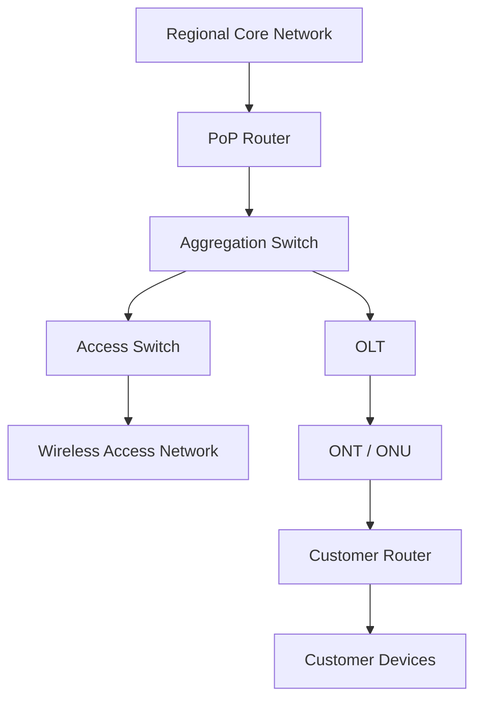
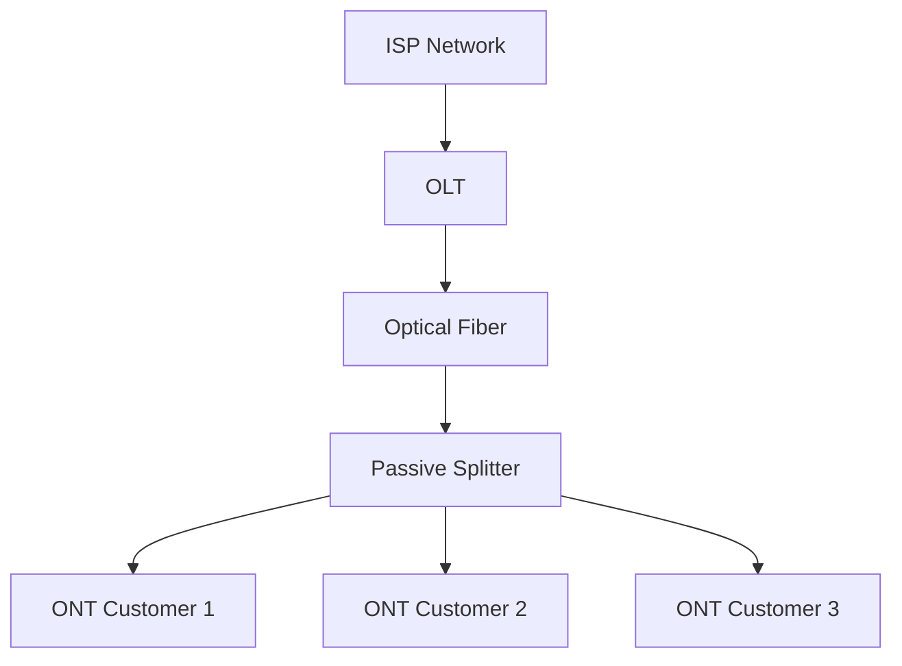
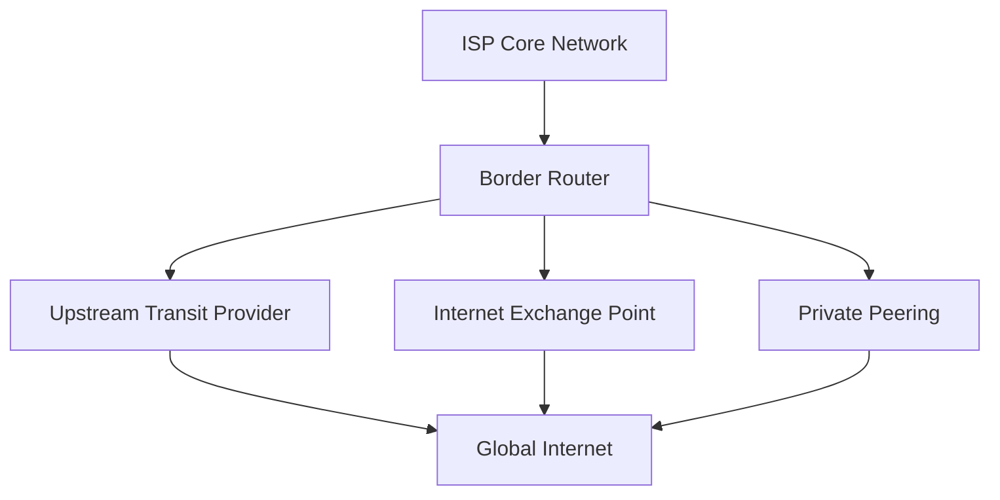
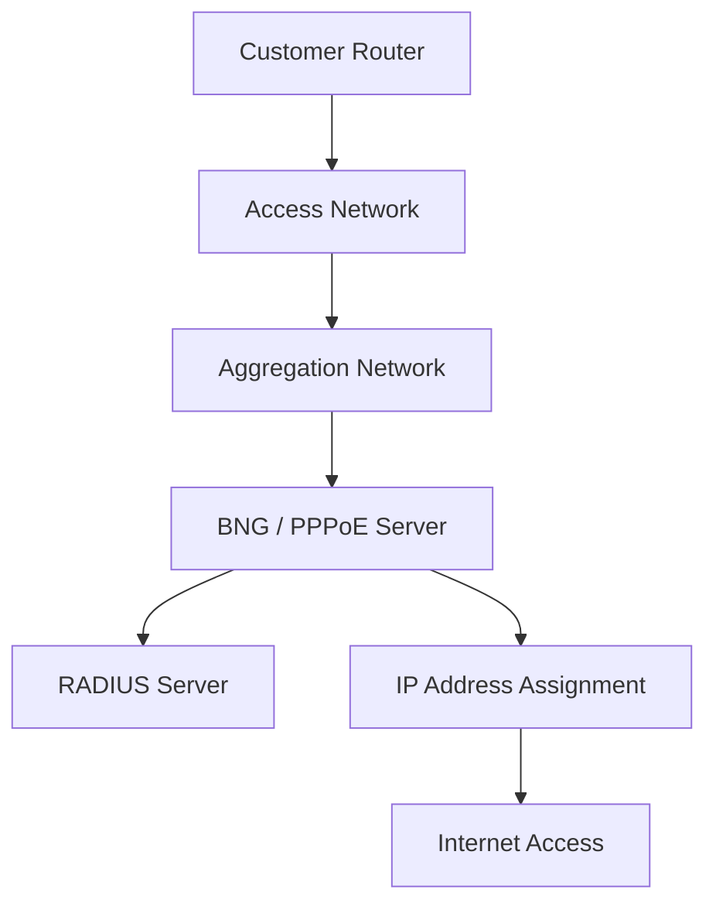
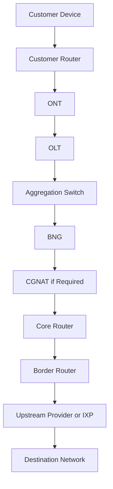
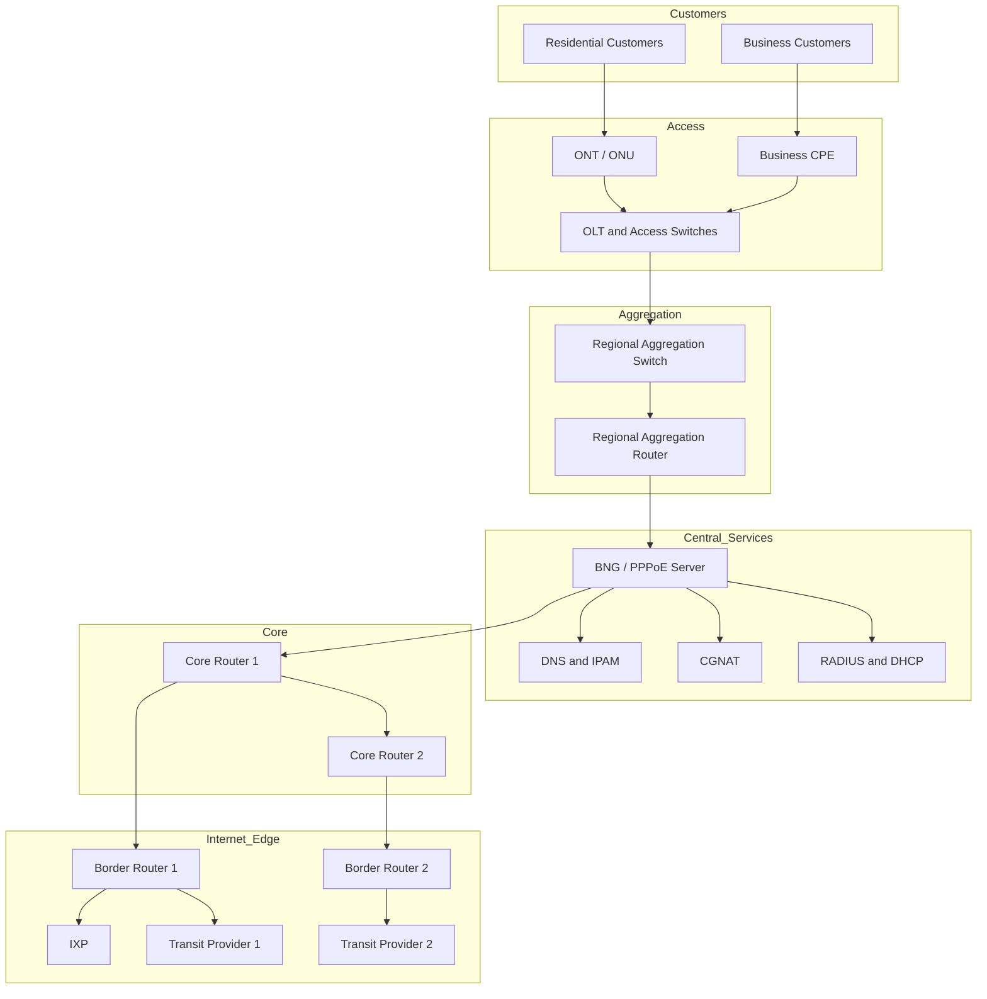
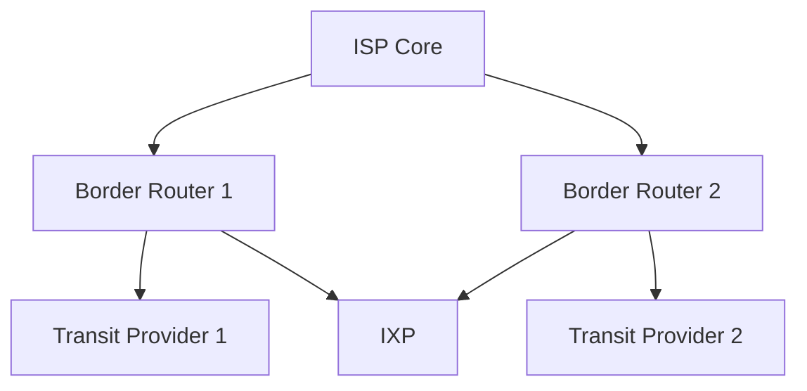

# ISP Network Architecture

ISP (Internet Service Provider) network architecture describes how an ISP designs, connects, operates, and manages the infrastructure required to deliver internet connectivity to customers.

An ISP network typically connects customer premises to an access network, aggregation network, core network, and external networks through upstream providers or Internet Exchange Points (IXPs).

The architecture must support several important requirements:

* Reliable internet connectivity.
* Efficient traffic forwarding.
* Subscriber authentication and management.
* Bandwidth allocation and traffic control.
* Network scalability.
* Redundancy and high availability.
* Network security.
* Monitoring and troubleshooting.

The exact architecture depends on the ISP's size, number of subscribers, geographical coverage, access technology, available infrastructure, and operational requirements.

A small ISP may operate with a relatively simple router-and-switch architecture, while a large ISP may use multiple Points of Presence (PoPs), dedicated core routers, Broadband Network Gateways (BNGs), MPLS, and geographically distributed data centers.

# 🗁 ISP Network Architecture Layers

An ISP network is commonly organized into several functional layers.

### 🖆 Access Layer

The access layer connects customer premises to the ISP's infrastructure.

Typical technologies include:

* GPON and EPON fiber access.
* Active Ethernet.
* DSL.
* DOCSIS cable networks.
* Fixed wireless access.
* Mobile network backhaul.

Customer equipment may include:

* Optical Network Terminal (ONT).
* Optical Network Unit (ONU).
* Customer Premises Equipment (CPE).
* Wireless customer radio.
* Residential router.

### 🖆 Aggregation Layer

The aggregation layer collects traffic from multiple access devices and forwards it toward the ISP's core or subscriber management infrastructure.

Typical devices include:

* Aggregation switches.
* Layer 3 switches.
* Aggregation routers.
* Provider Ethernet devices.

This layer reduces the number of individual connections that must reach the core network.

### 🖆 Core Layer

The core layer provides high-capacity transport between different parts of the ISP network.

Its primary responsibilities include:

* High-speed packet forwarding.
* Connecting regional networks and PoPs.
* Providing redundant paths.
* Supporting internal routing.
* Transporting subscriber and service traffic.

Core networks commonly use high-performance routers and routing protocols such as OSPF, IS-IS, and BGP.

### 🖆 Edge Layer

The edge layer connects the ISP's internal network to external networks and services.

Typical connections include:

* Upstream internet transit providers.
* Internet Exchange Points.
* Other ISPs and network operators.
* Content delivery networks.
* Private peering connections.

Border routers commonly use BGP to exchange routing information with external networks.

### 🖆 Customer Edge

The customer edge represents the equipment and network infrastructure located at the subscriber's premises.

Examples include:

* ONT.
* Customer router.
* Wireless access point.
* Local Ethernet switch.
* Customer firewall.

The customer edge provides the connection between the subscriber's internal network and the ISP access network.

# 🗁 Points of Presence (PoPs)

A Point of Presence (PoP) is a physical location where an ISP installs networking equipment to provide connectivity to customers, other network locations, or external networks.

An ISP may operate multiple PoPs across different cities, regions, or neighborhoods.

A PoP can contain:

* Core or edge routers.
* Aggregation switches.
* Access switches.
* OLT equipment.
* BNG or subscriber management routers.
* Fiber distribution equipment.
* Power backup systems.
* Monitoring and management infrastructure.

### 🖆 Example PoP Architecture

A regional PoP might connect several neighborhood access networks to the ISP's central network.



PoPs help ISPs distribute network infrastructure geographically and reduce the distance between customers and network services.

# 🗁 Access Network

The access network provides the physical or wireless connection between customer premises and the ISP's infrastructure.

It is often the largest geographically distributed part of an ISP network.

### 🖆 Fiber Access Network

Fiber access networks use optical fiber to deliver connectivity to customers.

Common technologies include:

* GPON.
* EPON.
* XGS-PON.
* Active Ethernet.

In a typical Passive Optical Network (PON), the architecture contains:

* OLT at the ISP side.
* Optical distribution network.
* Passive optical splitters.
* ONT or ONU at the customer side.



The OLT manages optical access and communicates with multiple ONTs or ONUs through the PON infrastructure.

### 🖆 Wireless Access Network

Wireless access networks connect customers through radio links.

Common components include:

* Base stations.
* Wireless access points.
* Sector antennas.
* Customer Premises Equipment.
* Point-to-point wireless links.

Wireless access is useful in areas where fiber deployment is expensive, difficult, or unavailable.

### 🖆 Ethernet Access Network

Some ISPs provide connectivity through Ethernet infrastructure.

A customer may connect directly to an access switch through an Ethernet cable or a dedicated fiber connection.

Ethernet access is commonly used in:

* Apartment buildings.
* Business networks.
* Office complexes.
* Campus networks.
* Metropolitan Ethernet services.

### 🖆 Access Network Considerations

When designing an access network, an ISP should consider:

* Customer density.
* Required bandwidth.
* Fiber or wireless capacity.
* Physical distance.
* Equipment capacity.
* Redundancy.
* Future expansion.
* Installation and maintenance costs.

# 🗁 Aggregation Network

The aggregation network collects traffic from multiple access networks and transports it toward the ISP's core or subscriber management infrastructure.

For example, an ISP may have several OLTs and access switches distributed across different neighborhoods. Instead of connecting every access device directly to the core, the ISP connects them through aggregation switches or routers.

### 🖆 Aggregation Responsibilities

The aggregation layer commonly handles:

* Traffic collection.
* VLAN transport.
* QinQ encapsulation.
* Layer 2 switching.
* Layer 3 routing.
* Traffic separation.
* Quality of Service.
* Redundant uplinks.
* Connection to BNG infrastructure.

### 🖆 VLAN-Based Aggregation

VLANs are commonly used to separate subscriber traffic, management traffic, and different services.

Example:

| VLAN ID | Purpose |
| --- | --- |
| 100 | Residential subscribers |
| 200 | Business subscribers |
| 300 | Network management |
| 400 | VoIP services |
| 500 | Infrastructure services |

These VLAN IDs are illustrative. Actual VLAN allocation depends on the ISP's design.

### 🖆 QinQ Aggregation

QinQ (IEEE 802.1ad) allows an ISP to transport customer VLANs inside an additional provider VLAN.

It is useful when an ISP needs to preserve customer VLAN information while carrying multiple customer networks across shared provider infrastructure.

Example:

```text
Customer VLAN: 100
       |
       v
Provider VLAN: 2000
       |
       v
ISP Aggregation Network
```

QinQ can help scale Layer 2 service delivery, but it requires careful VLAN planning and compatible equipment.

# 🗁 Core Network

The core network is the high-capacity backbone that connects different regions, PoPs, data centers, and network services.

It should be designed for high throughput, low forwarding overhead, reliability, and scalability.

### 🖆 Core Network Responsibilities

* Transport traffic between regional networks.
* Connect multiple PoPs.
* Provide redundant forwarding paths.
* Support internal routing.
* Carry subscriber and service traffic.
* Connect to edge and service networks.

### 🖆 Core Routing Protocols

Common routing technologies include:

| Technology | Purpose |
| --- | --- |
| OSPF | Internal dynamic routing |
| IS-IS | Internal routing in service-provider networks |
| BGP | Exchange routing information between autonomous systems |
| ECMP | Distribute traffic across equal-cost paths |
| MPLS | Label-based traffic forwarding |
| Segment Routing | Source-based path control through the network |

An ISP does not necessarily need all these technologies. Smaller networks may operate successfully with conventional Layer 3 routing, while larger networks may require more advanced transport architectures.

### 🖆 Core Network Design

A well-designed core network should avoid unnecessary complexity and minimize single points of failure.

Common design practices include:

* High-capacity router interfaces.
* Redundant core devices.
* Multiple physical paths.
* Dynamic routing.
* ECMP where appropriate.
* Capacity planning.
* Consistent routing policies.

# 🗁 Edge Network

The edge network connects the ISP's internal infrastructure to external networks.

It is the boundary between the ISP's autonomous system and other networks.

### 🖆 Border Routers

Border routers connect the ISP to external networks.

They commonly establish BGP sessions with:

* Upstream transit providers.
* Internet Exchange Points.
* Other autonomous systems.
* Content delivery networks.
* Private peering partners.

### 🖆 Upstream Transit

An upstream transit provider gives an ISP access to the wider internet.

The ISP generally pays for this service according to a commercial agreement.

A transit connection allows the ISP to exchange traffic with networks that are not directly connected through peering.

### 🖆 Internet Exchange Point

An Internet Exchange Point is a physical infrastructure where multiple networks exchange internet traffic.

Connecting to an IXP can help an ISP exchange traffic locally instead of sending all traffic through an international transit provider.

### 🖆 Peering

Peering is an arrangement in which two networks exchange traffic directly.

Peering can be:

* Public peering through an IXP.
* Private peering through a dedicated connection.

Peering may improve latency, reduce transit costs, and provide more efficient traffic paths.

### 🖆 Edge Network Example



# 🗁 Subscriber Management Architecture

Subscriber management is responsible for identifying customers, establishing their network sessions or access authorization, assigning network parameters, and applying service policies.

It is a critical part of broadband ISP operations.

### 🖆 Broadband Network Gateway (BNG)

A Broadband Network Gateway (BNG), historically also called a Broadband Remote Access Server (BRAS), provides subscriber-facing service termination and management.

Its responsibilities may include:

* Subscriber session termination.
* PPPoE session management.
* IP address assignment.
* IPv6 prefix delegation.
* Subscriber authentication.
* Traffic shaping and rate enforcement.
* Access policies.
* Accounting and session monitoring.

A BNG may use PPPoE, IPoE, or other subscriber access models depending on the ISP's architecture.

### 🖆 PPPoE-Based Architecture

In a PPPoE-based network, a subscriber establishes a PPP session over Ethernet.

The ISP can authenticate the subscriber using RADIUS and assign network configuration through the subscriber access infrastructure.



### 🖆 IPoE-Based Architecture

IP over Ethernet (IPoE) provides subscriber connectivity directly over Ethernet without requiring a PPP session.

An ISP may use DHCP, DHCP relay, subscriber identification, VLAN information, or other mechanisms to identify and manage customers.

### 🖆 AAA and RADIUS

AAA stands for:

* Authentication: Verifies the subscriber's identity.
* Authorization: Determines which services and policies the subscriber can use.
* Accounting: Records session activity and usage information.

RADIUS is commonly used to provide centralized AAA services.

For example, when a customer establishes a PPPoE session:

1. The customer router sends a connection request.
2. The ISP access infrastructure forwards the request to the BNG.
3. The BNG communicates with the RADIUS server.
4. RADIUS validates the subscriber credentials.
5. The BNG applies the returned service profile.
6. The subscriber receives network connectivity.

### 🖆 Subscriber Management Components

| Component | Responsibility |
| --- | --- |
| BNG / BRAS | Subscriber session and service management |
| RADIUS | Centralized authentication, authorization, and accounting |
| DHCP Server | Dynamic IP configuration |
| DHCP Relay | Forwards DHCP requests across routed networks |
| IPAM | Manages IP address allocation and tracking |
| DNS Resolver | Resolves domain names for subscribers |
| CGNAT | Shares public IPv4 addresses among subscribers when required |

# 🗁 ISP Traffic Flow

Understanding traffic flow helps explain how packets travel through an ISP network.

Consider a residential customer connected through a fiber access network.

### 🖆 Outbound Traffic Flow

When a customer accesses a website, traffic may follow this path:



The exact order of the BNG, CGNAT, and core functions depends on the ISP's architecture. Some functions may be integrated into the same device or implemented in separate service platforms.

### 🖆 Inbound Traffic Flow

When a response returns from an external website:

1. Traffic reaches the ISP through an upstream provider, IXP, or peering connection.
2. The border router forwards it toward the appropriate internal destination.
3. The core network transports it toward the relevant regional network.
4. Subscriber routing, service policies, and NAT state are applied where required.
5. Traffic reaches the access network.
6. The customer router receives the packet and forwards it to the destination device.

### 🖆 Important Traffic Flow Concepts

* Routing tables determine packet forwarding paths.
* VLANs may separate subscriber and infrastructure traffic.
* BGP exchanges external routing information.
* Internal routing protocols distribute routes within the ISP.
* NAT may translate subscriber addresses.
* QoS policies may control traffic rates and priorities.
* Firewalls and filtering policies may restrict traffic.

# 🗁 Example Medium-Sized ISP Architecture

Consider an ISP providing broadband services to residential and business customers across several neighborhoods.

The ISP operates:

* One central network location.
* Multiple regional PoPs.
* Several OLTs.
* Aggregation switches.
* A subscriber management platform.
* Core and border routers.
* Two upstream transit connections.
* An IXP connection.
* Centralized monitoring and authentication services.

### 🖆 Example Topology



This is a simplified logical representation. A production network would normally include additional physical links, redundant devices, routing adjacencies, service interfaces, and management connections.

### 🖆 Example Network Roles

| Device or System | Example Responsibility |
| --- | --- |
| OLT | Terminates and manages fiber access |
| Access switch | Connects Ethernet subscribers |
| Aggregation switch | Collects access traffic |
| Aggregation router | Routes regional traffic |
| BNG | Manages subscriber sessions |
| RADIUS | Authenticates subscribers |
| DHCP server | Assigns IP configuration |
| CGNAT | Provides shared public IPv4 connectivity |
| Core router | Transports traffic between network regions |
| Border router | Connects the ISP to external networks |
| Monitoring server | Collects operational network information |

# 🗁 Network Redundancy and High Availability

Network redundancy ensures that connectivity can continue when a device, link, or network path fails.

An ISP should identify critical failure points and design alternative paths where service availability requirements justify the additional cost.

### 🖆 Device Redundancy

Important network devices may be deployed in redundant pairs.

Examples include:

* Dual core routers.
* Redundant border routers.
* Multiple aggregation switches.
* Redundant power supplies.
* Backup subscriber management infrastructure.

### 🖆 Link Redundancy

Critical devices may connect through multiple physical links.

Common techniques include:

* Link aggregation.
* ECMP.
* Redundant Layer 3 paths.
* Dual-homed connections.
* Diverse fiber routes.

### 🖆 Upstream Redundancy

An ISP may connect to multiple upstream providers.

For example:



If one upstream connection fails, routing policies and BGP convergence may allow traffic to use another available path.

### 🖆 Physical Path Diversity

Two links are not necessarily independent simply because they use different interfaces or routers.

If both fiber links share the same underground duct, bridge, building entrance, or cable route, a single physical incident may disconnect both.

True path diversity requires careful planning of separate physical routes and infrastructure.

# 🗁 Network Addressing and Services

An ISP requires an organized IP addressing and service architecture.

### 🖆 IPv4 Addressing

ISPs commonly use private IPv4 addresses for internal infrastructure and subscriber networks.

Public IPv4 addresses may be assigned directly to customers or shared through Carrier-Grade NAT.

Common private IPv4 ranges include:

| Range | Address Space |
| --- | --- |
| `10.0.0.0/8` | Private |
| `172.16.0.0/12` | Private |
| `192.168.0.0/16` | Private |

The `100.64.0.0/10` range is reserved for shared address space and is commonly used between subscriber networks and CGNAT infrastructure.

### 🖆 IPv6 Addressing

IPv6 allows ISPs to assign globally unique addresses and prefixes to subscribers.

Common ISP practices include:

* Assigning IPv6 prefixes to infrastructure.
* Providing IPv6 connectivity to subscribers.
* Delegating customer prefixes through DHCPv6 Prefix Delegation.
* Using appropriate routing and filtering policies.

### 🖆 IP Address Management

IP Address Management (IPAM) helps maintain organized records of:

* Public IPv4 allocations.
* Private IPv4 networks.
* IPv6 prefixes.
* Subscriber address assignments.
* Infrastructure addressing.
* Reserved address ranges.

### 🖆 Supporting Network Services

An ISP may operate several centralized or distributed services:

| Service | Purpose |
| --- | --- |
| DNS | Domain name resolution |
| DHCP | Dynamic IP configuration |
| RADIUS | Subscriber authentication and accounting |
| NTP | Time synchronization |
| IPAM | Address allocation management |
| Syslog | Centralized event logging |
| SNMP / Telemetry | Device monitoring |
| CGNAT | Shared IPv4 connectivity |

# 🗁 Network Monitoring and Operations

ISP infrastructure requires continuous monitoring to maintain service availability and performance.

A Network Operations Center (NOC) monitors network health, investigates incidents, and coordinates maintenance activities.

### 🖆 Monitoring Requirements

Important monitoring metrics include:

* Interface utilization.
* CPU and memory usage.
* Packet loss.
* Latency.
* Interface errors and discards.
* Optical signal levels.
* Subscriber session counts.
* BGP session status.
* Routing changes.
* Power and environmental conditions.

### 🖆 Monitoring Technologies

| Technology | Purpose |
| --- | --- |
| SNMP | Device monitoring and statistics |
| Streaming telemetry | Continuous operational measurements |
| Syslog | Event and system logging |
| NetFlow | Network traffic analysis |
| IPFIX | Standardized flow information export |
| ICMP | Basic reachability and latency testing |
| Network monitoring platforms | Centralized dashboards and alerting |

### 🖆 NOC Responsibilities

A NOC commonly handles:

* Monitoring network availability.
* Detecting outages.
* Investigating packet loss and latency.
* Tracking bandwidth utilization.
* Managing incident escalation.
* Coordinating maintenance.
* Monitoring upstream connectivity.
* Recording network events.
* Reporting service performance.

# 🗁 Network Security Architecture

ISP security must protect infrastructure, subscriber traffic, routing operations, and management systems.

### 🖆 Management Plane Security

Management interfaces should be restricted to authorized administrators and management networks.

Recommended practices include:

* Restricting SSH and management access.
* Using centralized authentication where appropriate.
* Applying role-based access control.
* Disabling unused services.
* Maintaining configuration backups.
* Logging administrative activity.
* Using secure management protocols.

### 🖆 Control Plane Protection

The control plane handles routing protocols and network control information.

Security practices include:

* Protecting routing protocol sessions.
* Filtering unauthorized routing updates.
* Applying BGP prefix filters.
* Using RPKI Route Origin Validation where supported.
* Restricting management and routing access.
* Monitoring unexpected route changes.

### 🖆 Subscriber Isolation

Subscriber traffic should be isolated according to the service architecture.

Common techniques include:

* VLAN separation.
* Private VLANs or equivalent isolation mechanisms.
* Layer 3 subscriber separation.
* Firewall policies.
* Access control lists.
* Port isolation where appropriate.

### 🖆 Anti-Spoofing

ISPs should implement source address validation to reduce traffic with forged source addresses.

BCP 38 and related ingress filtering practices help prevent subscribers or network interfaces from sending packets with unauthorized source addresses.

### 🖆 DDoS Protection

Large networks may require dedicated DDoS mitigation capabilities.

Possible techniques include:

* Traffic filtering.
* Rate limiting.
* RTBH (Remote Triggered Black Hole).
* FlowSpec.
* Upstream mitigation.
* Traffic scrubbing services.

# 🗁 Physical vs Logical Network Architecture

Physical architecture and logical architecture describe different aspects of an ISP network.

### 🖆 Physical Architecture

Physical architecture describes the actual infrastructure and connections.

It includes:

* Routers and switches.
* Fiber cables.
* Optical splitters.
* Wireless links.
* Data centers.
* Network racks.
* Power systems.
* Physical connection paths.

### 🖆 Logical Architecture

Logical architecture describes how network traffic and services are organized.

It includes:

* IP subnets.
* VLANs.
* Routing protocols.
* Autonomous Systems.
* BGP sessions.
* PPPoE sessions.
* Subscriber policies.
* NAT.
* VPNs.
* Network segmentation.

### 🖆 Example Comparison

| Physical Architecture | Logical Architecture |
| --- | --- |
| Fiber cable | VLAN |
| Router interface | IP interface |
| Physical switch | Layer 2 forwarding domain |
| Fiber path | Routing path |
| Router device | BGP or OSPF process |
| Physical server | DHCP or RADIUS service |
| Optical splitter | PON access topology |

A single physical network can support multiple logical services. Similarly, a logical service may span multiple physical devices and locations.

# 🗁 Architecture Design Considerations

Before deploying an ISP network, engineers should evaluate several technical and operational requirements.

### 🖆 Scalability

The architecture should support future growth in:

* Subscriber count.
* Bandwidth demand.
* Geographic coverage.
* Number of PoPs.
* Network services.
* Routing table size.

### 🖆 Capacity Planning

Capacity planning should consider:

* Peak-hour traffic.
* Average utilization.
* Subscriber bandwidth profiles.
* Upstream transit capacity.
* Core and aggregation link capacity.
* Growth forecasts.
* Failure scenarios.

### 🖆 Reliability

Critical infrastructure should have appropriate redundancy.

Consider:

* Redundant routers.
* Multiple upstream providers.
* Diverse fiber routes.
* Backup power.
* Spare equipment.
* Tested recovery procedures.

### 🖆 Operational Simplicity

A network should be manageable and understandable.

Good practices include:

* Consistent IP addressing.
* Documented VLAN allocation.
* Standardized configurations.
* Clear routing policies.
* Centralized monitoring.
* Configuration backups.
* Change management procedures.

### 🖆 Cost Efficiency

The ISP should balance performance, availability, and infrastructure costs.

A more complex architecture is not automatically better. The design should match actual traffic demand, business requirements, and operational capabilities.

# 🗁 Summary

ISP network architecture defines how an Internet Service Provider connects customers, transports traffic, manages subscribers, and exchanges traffic with external networks.

A typical ISP network may contain:

* Access networks for customer connectivity.
* Aggregation networks for collecting traffic.
* Core networks for high-capacity transport.
* Edge networks for upstream connectivity and peering.
* BNG infrastructure for subscriber management.
* AAA services for authentication and accounting.
* IP addressing and network services.
* Monitoring and security systems.

Understanding these components provides the foundation for designing, deploying, maintaining, and troubleshooting ISP infrastructure.

# 🗁 References

* [Broadband Forum](https://www.broadband-forum.org/)
* [IETF RFC 4271 — A Border Gateway Protocol 4 (BGP-4)](https://datatracker.ietf.org/doc/html/rfc4271)
* [IETF RFC 4364 — BGP/MPLS IP Virtual Private Networks](https://datatracker.ietf.org/doc/html/rfc4364)
* [IETF RFC 6598 — Shared Address Space](https://datatracker.ietf.org/doc/html/rfc6598)
* [IETF RFC 7454 — BGP Operations and Security](https://datatracker.ietf.org/doc/html/rfc7454)
* [IETF RFC 8415 — Dynamic Host Configuration Protocol for IPv6 (DHCPv6)](https://datatracker.ietf.org/doc/html/rfc8415)
* [IEEE 802.1ad — Provider Bridges](https://standards.ieee.org/standard/802_1ad-2005.html)
* [RIPE NCC](https://www.ripe.net/)
