# Last-Mile Connectivity

Last-mile connectivity is the part of a telecommunications network that connects an Internet Service Provider (ISP) to the end customer.

It is commonly called the last mile because it represents the final segment of the network infrastructure between the service provider's distribution network and the customer's premises.

Despite the name, the physical distance does not necessarily have to be one mile. It may cover a few meters, several kilometers, or a much larger distance depending on the access technology.

Last-mile connectivity is one of the most important parts of ISP infrastructure because it directly affects:

* Customer internet availability.
* Download and upload speeds.
* Latency and packet loss.
* Connection stability.
* Service quality.
* Installation and maintenance costs.
* Network expansion.

ISPs use different technologies to provide last-mile connectivity, including fiber optics, Ethernet, wireless, DSL, and cable broadband.

# 🗁 What Is Last-Mile Connectivity?

Last-mile connectivity is the access connection between the ISP's network and the customer's network.

For example, consider a residential customer receiving fiber internet.

The connection may follow this path:

```text
Internet
   |
   v
ISP Core Network
   |
   v
ISP Aggregation Network
   |
   v
OLT
   |
   v
Optical Distribution Network
   |
   v
Customer ONT
   |
   v
Customer Router
   |
   v
Customer Devices
```

In this example:

* The ISP core network transports traffic across the provider infrastructure.
* The aggregation network collects traffic from multiple access locations.
* The OLT provides the provider-side optical access interface.
* The optical distribution network carries signals toward customer premises.
* The ONT terminates the optical connection at the customer location.
* The customer router distributes connectivity to local devices.

The last-mile portion generally includes the access infrastructure connecting the ISP's distribution point to the customer premises.

The exact boundary depends on the provider's network design and service responsibility.

### 🖆 Last-Mile vs Middle-Mile vs Backbone

| Network Segment | Description |
| --- | --- |
| Last-mile | Connects the ISP access infrastructure to customers |
| Middle-mile | Connects access networks, regional facilities, and aggregation points |
| Backbone | High-capacity infrastructure connecting major network locations and external networks |

These segments work together to deliver end-to-end internet connectivity.

# 🗁 Last-Mile Network Architecture

A last-mile network contains the infrastructure required to distribute connectivity from an ISP's network toward individual customers.

A typical architecture may include:

* ISP Point of Presence (PoP).
* Distribution router or switch.
* OLT or wireless base station.
* Fiber distribution cabinet.
* Optical splitter or distribution equipment.
* Drop cable or wireless subscriber link.
* ONT, ONU, or customer radio.
* Customer router.

### 🖆 Example Fiber Last-Mile Architecture

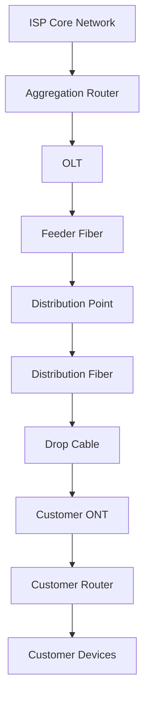

The design changes depending on the access technology.

For example:

* FTTH uses optical fiber to reach individual homes.
* FTTB uses fiber to reach a building, followed by another distribution technology.
* Fixed wireless uses radio links to reach customer premises.
* DSL uses existing telephone copper pairs.
* Cable broadband uses coaxial cable infrastructure.

# 🗁 Fiber-to-the-Home (FTTH)

Fiber-to-the-Home (FTTH) is an access network architecture in which optical fiber extends from the ISP's network to the customer's home.

FTTH is widely used by modern broadband providers because it supports high bandwidth, long transmission distances, and low electromagnetic interference.

### 🖆 FTTH Architecture

A typical FTTH deployment using Passive Optical Network technology contains:

* OLT at the ISP facility.
* Feeder fiber.
* Optical distribution network.
* Passive optical splitters.
* Distribution fiber.
* Drop fiber.
* ONT at the customer's premises.

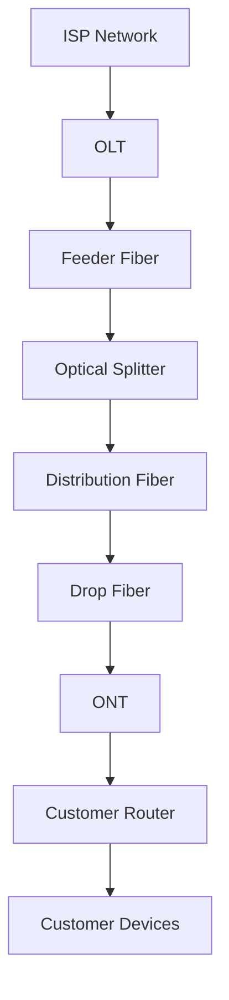

The OLT communicates with multiple ONTs over the optical distribution network.

In a PON deployment, passive optical splitters allow multiple customers to share an optical feeder infrastructure.

### 🖆 FTTH Advantages

* High bandwidth capacity.
* Low signal attenuation compared with many copper access technologies.
* Long reach.
* Resistance to electromagnetic interference.
* Support for modern broadband services.
* Good scalability through suitable PON technologies.

### 🖆 FTTH Challenges

* Initial fiber deployment costs.
* Civil construction requirements.
* Fiber installation complexity.
* Optical connector cleanliness.
* Fiber damage and cable maintenance.
* Need for optical testing equipment.

### 🖆 FTTH Deployment Models

Common FTTH deployment models include:

| Model | Description |
| --- | --- |
| GPON | Gigabit-capable Passive Optical Network |
| EPON | Ethernet Passive Optical Network |
| XGS-PON | Symmetric 10 Gbps PON technology |
| Active Ethernet | Dedicated or switched Ethernet fiber access |

The choice depends on required capacity, equipment availability, subscriber density, and investment strategy.

# 🗁 Fiber-to-the-Building (FTTB)

Fiber-to-the-Building (FTTB) is an architecture where optical fiber reaches a building rather than extending individually to every customer unit.

Inside the building, connectivity is distributed using Ethernet, copper cabling, or another access technology.

FTTB is commonly used in:

* Apartment buildings.
* Office buildings.
* Residential complexes.
* Commercial properties.
* Multi-dwelling units (MDUs).

### 🖆 FTTB Architecture

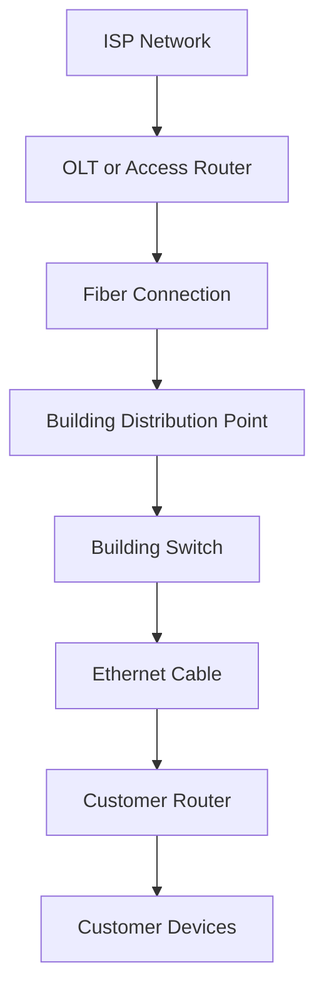

### 🖆 FTTB Advantages

* Lower fiber deployment cost than individual fiber drops to every unit.
* Efficient connectivity for multi-tenant buildings.
* Centralized building distribution.
* Easier expansion within existing building infrastructure.

### 🖆 FTTB Challenges

* Shared building infrastructure.
* Ethernet cable distance limitations.
* Building switch maintenance.
* Potential bandwidth contention.
* Dependence on internal cabling quality.

# 🗁 Active Ethernet

Active Ethernet is a fiber access architecture that uses powered Ethernet switches to connect customers to the ISP network.

Unlike a passive optical network, Active Ethernet does not depend on passive optical splitters to distribute the optical signal.

Each customer or group of customers connects through active switching equipment.

### 🖆 Active Ethernet Architecture

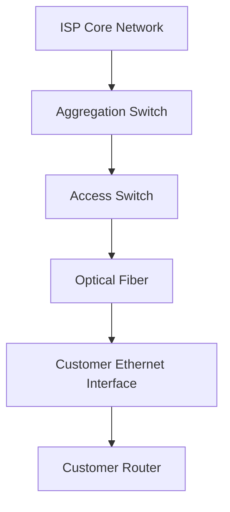

### 🖆 Active Ethernet Characteristics

* Uses standard Ethernet technologies.
* Supports VLAN-based service separation.
* Can provide dedicated bandwidth per customer connection.
* Requires powered switching infrastructure in the access network.
* Requires power backup and equipment maintenance at access locations.

### 🖆 Active Ethernet vs PON

| Feature | Active Ethernet | PON |
| --- | --- | --- |
| Distribution | Powered Ethernet switches | Passive optical splitters |
| Customer connection | Ethernet switching infrastructure | Shared optical medium |
| Field power | Required at active access switches | Not required for passive splitters |
| Bandwidth model | Depends on port and uplink capacity | Shared PON capacity |
| Maintenance | Active equipment maintenance | Passive distribution maintenance |
| Architecture | Point-to-point or switched Ethernet | Point-to-multipoint |

Neither technology is universally better. The appropriate choice depends on deployment cost, subscriber density, bandwidth requirements, and operational capabilities.

# 🗁 Wireless Last-Mile Connectivity

Wireless last-mile connectivity delivers internet access through radio-frequency communication instead of a physical cable reaching every customer.

It is particularly useful in locations where fiber deployment is difficult, expensive, or geographically impractical.

Common wireless access technologies include:

* Fixed wireless access.
* Point-to-point wireless.
* Point-to-multipoint wireless.
* Licensed microwave links.
* Unlicensed-band wireless systems.
* Cellular-based broadband.

### 🖆 Fixed Wireless Access (FWA)

Fixed Wireless Access provides broadband connectivity to a fixed customer location using wireless radio links.

A typical deployment includes:

* ISP wireless base station.
* Sector antenna.
* Customer Premises Equipment.
* Customer router.

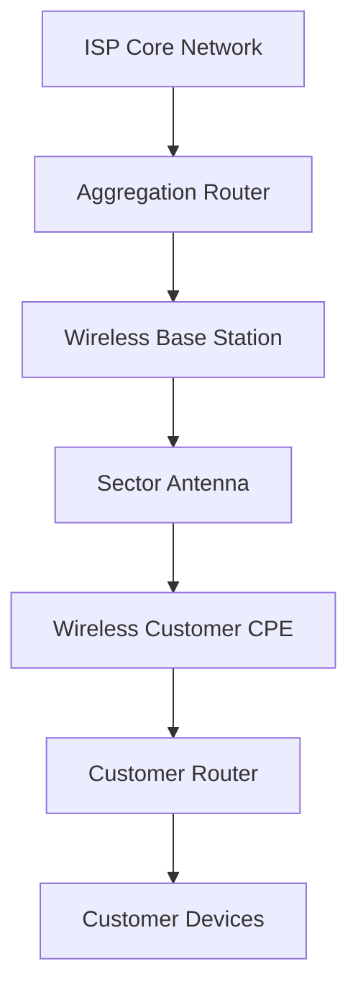

The customer CPE receives the wireless signal and provides an Ethernet connection to the customer's router or local network.

### 🖆 Point-to-Point Wireless

Point-to-Point (PtP) wireless creates a dedicated wireless link between two network locations.

It is commonly used for:

* Connecting remote PoPs.
* Backhauling traffic from access sites.
* Connecting buildings.
* Extending ISP infrastructure where fiber is unavailable.

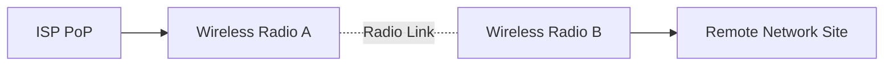

### 🖆 Point-to-Multipoint Wireless

Point-to-Multipoint (PtMP) connects one central wireless access point to multiple customer stations.

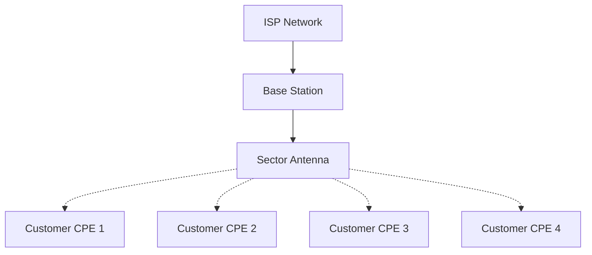

### 🖆 Wireless Deployment Considerations

Wireless performance depends on several factors:

* Frequency band.
* Channel width.
* Signal strength.
* Signal-to-noise ratio.
* Line of sight.
* Fresnel zone clearance.
* Interference.
* Antenna alignment.
* Radio capacity.
* Weather and environmental conditions.

A wireless link may have excellent signal strength but still perform poorly because of interference, insufficient channel capacity, or poor radio configuration.

# 🗁 DSL Last-Mile Connectivity

Digital Subscriber Line (DSL) provides internet connectivity through existing telephone copper wiring.

It allows broadband data transmission over telephone lines.

DSL technologies include:

* ADSL.
* ADSL2+.
* VDSL.
* VDSL2.

### 🖆 DSL Architecture

A typical DSL network contains:

* Customer DSL modem.
* Copper telephone line.
* Distribution point or street cabinet.
* DSLAM (Digital Subscriber Line Access Multiplexer).
* ISP aggregation network.

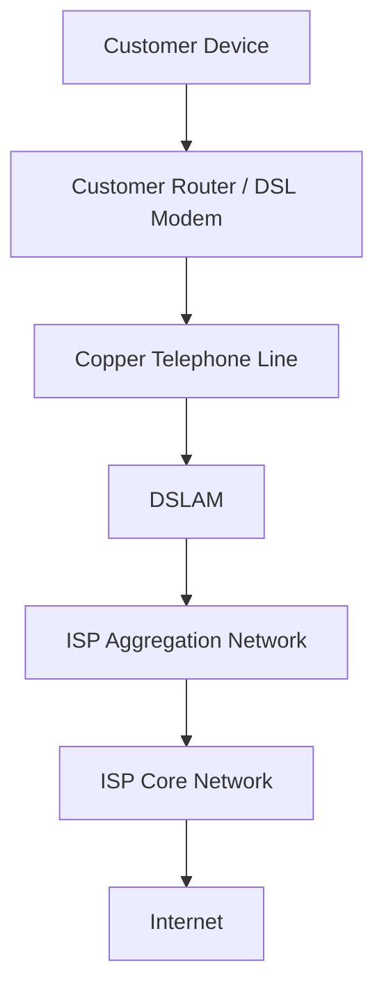

### 🖆 DSLAM

A DSLAM is a network device that terminates multiple DSL subscriber connections and aggregates their traffic toward the ISP network.

It is generally installed in a telephone exchange or a remote street cabinet.

### 🖆 DSL Performance Factors

DSL performance depends on:

* Copper cable distance.
* Copper cable quality.
* Signal attenuation.
* Electrical interference.
* Crosstalk.
* DSL technology.
* Modem compatibility.

Generally, higher DSL speeds are more difficult to achieve over longer copper loops.

# 🗁 Cable Broadband

Cable broadband delivers internet connectivity through coaxial cable infrastructure originally developed for cable television distribution.

Many cable broadband networks use DOCSIS (Data Over Cable Service Interface Specification).

### 🖆 Cable Network Architecture

A typical cable broadband network includes:

* Cable Modem Termination System (CMTS) or Converged Cable Access Platform (CCAP).
* Hybrid Fiber-Coaxial (HFC) infrastructure.
* Optical fiber distribution.
* Coaxial cable distribution.
* Cable modem at the customer premises.

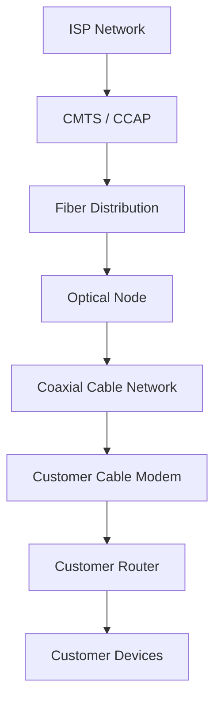

### 🖆 HFC Network

Hybrid Fiber-Coaxial combines fiber-optic infrastructure with coaxial cable distribution.

Fiber carries traffic toward optical nodes, while coaxial cable connects the nodes to customer premises.

### 🖆 DOCSIS

DOCSIS defines communication standards for broadband data transmission over cable television infrastructure.

Different DOCSIS generations provide different capacity and performance capabilities.

# 🗁 Last-Mile Technologies Comparison

The following table summarizes common last-mile technologies.

| Technology | Transmission Medium | Typical Deployment | Key Characteristics |
| --- | --- | --- | --- |
| FTTH | Optical fiber | Residential premises | High capacity and long reach |
| FTTB | Fiber and internal cabling | Multi-tenant buildings | Shared building distribution |
| Active Ethernet | Optical fiber | Business and residential access | Switched Ethernet connectivity |
| GPON | Optical fiber | Residential broadband | Shared passive optical access |
| EPON | Optical fiber | Residential and business access | Ethernet-based passive optical access |
| Fixed Wireless | Radio frequency | Residential and rural access | Wireless customer connectivity |
| Point-to-Point Wireless | Radio frequency | Backhaul and remote links | Dedicated wireless link |
| DSL | Copper telephone line | Existing telephone networks | Distance-sensitive broadband |
| DOCSIS | Coaxial cable and fiber | Cable broadband networks | Shared HFC infrastructure |

# 🗁 Last-Mile Network Design

A reliable last-mile network requires proper planning of infrastructure, capacity, coverage, and customer distribution.

### 🖆 Coverage Planning

Before deployment, an ISP should identify:

* Target service areas.
* Number of potential subscribers.
* Customer density.
* Geographic obstacles.
* Existing infrastructure.
* Fiber routes or wireless coverage.
* Future expansion areas.

### 🖆 Fiber Route Planning

For fiber deployments, engineers should plan:

* Feeder cable routes.
* Distribution cable routes.
* Drop cable routes.
* Fiber distribution cabinets.
* Splice locations.
* Optical splitter locations.
* Available fiber cores.
* Cable protection and maintenance access.

Fiber route documentation should identify cable paths, splice closures, distribution points, and assigned fiber cores.

### 🖆 Optical Splitter Planning

In PON networks, optical splitters divide optical signals among multiple ONTs.

Common split ratios include:

* 1:2.
* 1:4.
* 1:8.
* 1:16.
* 1:32.
* 1:64.

A higher split ratio allows more customers to share one PON port, but it also increases optical power loss and reduces the optical power budget available to each subscriber.

The appropriate split ratio depends on the PON technology, optical class, fiber distance, connector losses, splice losses, and required engineering margin.

### 🖆 Wireless Coverage Planning

Wireless deployments require consideration of:

* Base station locations.
* Antenna height.
* Antenna direction.
* Frequency reuse.
* Channel planning.
* Fresnel zone clearance.
* Interference sources.
* Subscriber distribution.

A coverage map and radio survey can help identify suitable installation locations.

# 🗁 Bandwidth and Capacity Planning

Last-mile capacity planning ensures that the access infrastructure can handle expected subscriber traffic.

An ISP should distinguish between:

* Access interface speed.
* Shared access capacity.
* Uplink capacity.
* Subscriber service rate.
* Aggregate peak traffic.

### 🖆 Oversubscription Ratio

Oversubscription describes the relationship between the total advertised or provisioned subscriber bandwidth and the available shared network capacity.

Formula:

```text
Oversubscription Ratio =
Total Subscriber Bandwidth
--------------------------
Available Network Capacity
```

Example:

An ISP has 100 subscribers, each provisioned with a 100 Mbps service.

Total provisioned bandwidth:

```text
100 × 100 Mbps = 10,000 Mbps
```

Available shared uplink capacity:

```text
2,000 Mbps
```

Oversubscription ratio:

```text
10,000 / 2,000 = 5:1
```

This means the total provisioned bandwidth is five times the available shared capacity.

Oversubscription is not automatically a problem. Its suitability depends on actual traffic patterns, peak-hour utilization, service commitments, and network performance objectives.

### 🖆 Capacity Planning Considerations

Monitor:

* Peak-hour utilization.
* Average utilization.
* Busy-hour traffic.
* Packet loss.
* Interface errors.
* Subscriber growth.
* PON port utilization.
* Wireless sector utilization.
* Aggregation uplink utilization.

Capacity should be expanded before sustained congestion causes customer performance problems.

# 🗁 Common Last-Mile Problems

Last-mile connectivity problems can originate from physical infrastructure, access equipment, transmission quality, or customer premises.

### 🖆 Fiber Problems

Common fiber-related issues include:

* Fiber cuts.
* Excessive optical attenuation.
* Dirty optical connectors.
* Incorrect splicing.
* Damaged drop cables.
* Optical power outside the supported range.
* Faulty ONTs or SFP modules.

### 🖆 Wireless Problems

Common wireless issues include:

* Weak signal strength.
* High interference.
* Poor antenna alignment.
* Fresnel zone obstruction.
* Channel congestion.
* Excessive distance.
* Radio hardware failure.

### 🖆 Ethernet Problems

Common Ethernet access issues include:

* Damaged cables.
* Incorrect termination.
* Duplex mismatch.
* Interface errors.
* Bad connectors.
* Faulty switches.
* Negotiation problems.

### 🖆 DSL Problems

Common DSL issues include:

* Long copper loops.
* Poor cable quality.
* Electrical interference.
* Excessive attenuation.
* Crosstalk.
* Faulty modems.

### 🖆 Customer-Side Problems

Not every internet issue originates in the ISP access network.

Customer-side problems may include:

* Faulty routers.
* Poor Wi-Fi coverage.
* Incorrect IP configuration.
* DNS problems.
* Damaged Ethernet cables.
* Excessive local network traffic.

# 🗁 Last-Mile Troubleshooting

A structured troubleshooting process helps identify the location and cause of access network failures.

### 🖆 Basic Troubleshooting Workflow

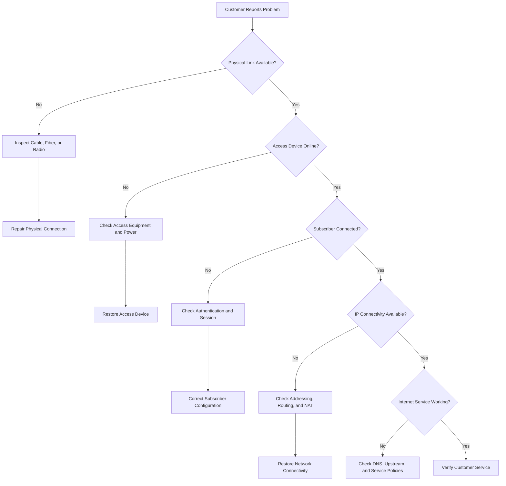

### 🖆 Fiber Troubleshooting

For fiber access, check:

* ONT power status.
* Optical signal level.
* LOS (Loss of Signal) alarms.
* OLT port status.
* Optical connector cleanliness.
* Fiber continuity.
* Splice quality.

Optical power can be measured using an optical power meter. An Optical Time-Domain Reflectometer (OTDR) can help locate fiber breaks, excessive loss, and reflection events.

### 🖆 Wireless Troubleshooting

For wireless access, check:

* RSSI.
* SNR.
* Signal quality.
* Channel utilization.
* Modulation and coding rate.
* Retransmission rate.
* Antenna alignment.
* Interference.
* Ethernet link between CPE and router.

### 🖆 Ethernet Troubleshooting

Useful Linux commands:

Check interface status:

```bash
ip link show
```

Display IP configuration:

```bash
ip addr show
```

Check interface statistics:

```bash
ip -s link show
```

Display negotiated Ethernet speed and duplex:

```bash
sudo ethtool eth0
```

Test connectivity:

```bash
ping -c 5 1.1.1.1
```

Trace the network path:

```bash
traceroute 1.1.1.1
```

### 🖆 MikroTik RouterOS Troubleshooting

Check interface status:

```routeros
/interface print
```

Monitor interface traffic:

```routeros
/interface monitor-traffic ether1
```

Check Ethernet link information:

```routeros
/interface ethernet monitor ether1
```

Inspect optical transceiver information where supported:

```routeros
/interface ethernet monitor sfp-sfpplus1
```

Inspect active PPPoE sessions:

```routeros
/ppp active print
```

Inspect DHCP leases:

```routeros
/ip dhcp-server lease print
```

Inspect interface errors and traffic statistics:

```routeros
/interface print stats
```

The interface names and available monitoring fields depend on the MikroTik device and RouterOS version.

# 🗁 Practical ISP Deployment Example

Consider an ISP planning to provide fiber broadband services to a residential neighborhood.

The deployment requires:

* One upstream connection to the ISP aggregation network.
* One OLT.
* Fiber feeder cable.
* Distribution fiber.
* Optical splitters.
* Drop cables.
* Customer ONTs.
* Customer routers.

### 🖆 Example Deployment Topology

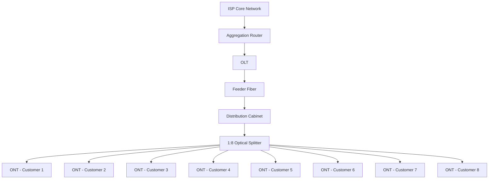

### 🖆 Deployment Steps

**Network planning**

* Identify the target coverage area.
* Estimate potential subscribers.
* Survey existing poles, ducts, and fiber routes.
* Select suitable OLT locations.
* Calculate optical power budgets.

**Infrastructure installation**

* Install feeder fiber.
* Install distribution fiber.
* Deploy optical distribution cabinets.
* Install optical splitters.
* Prepare customer drop cables.

**Equipment configuration**

* Configure OLT uplinks.
* Configure PON ports.
* Register ONTs.
* Configure VLANs.
* Configure subscriber access services.
* Integrate with BNG and RADIUS where required.

**Testing and verification**

* Measure optical power.
* Verify ONT registration.
* Test Ethernet connectivity.
* Verify subscriber authentication.
* Test download and upload throughput.
* Monitor latency and packet loss.

**Service activation**

* Assign the subscriber service profile.
* Configure the customer's router.
* Verify internet connectivity.
* Record installation and equipment details.
* Add the subscriber to the ISP management system.

# 🗁 Summary

Last-mile connectivity is the access segment that connects an ISP's infrastructure to customer premises.

Common technologies include:

* FTTH.
* FTTB.
* Active Ethernet.
* GPON and EPON.
* Fixed wireless access.
* Point-to-point wireless.
* DSL.
* DOCSIS cable broadband.

A successful last-mile deployment requires proper technology selection, infrastructure planning, capacity management, physical installation, and continuous monitoring.

The quality of the last-mile network directly influences the customer's internet experience and the ISP's operational costs.

# 🗁 References

* [Broadband Forum](https://www.broadband-forum.org/)
* [ITU-T Recommendations](https://www.itu.int/rec/T-REC/en)
* [ITU-T G.984 Series — Gigabit-capable Passive Optical Networks](https://www.itu.int/rec/T-REC-G.984/en)
* [ITU-T G.9807.1 — 10-Gigabit-capable Symmetric Passive Optical Network](https://www.itu.int/rec/T-REC-G.9807.1/en)
* [IEEE 802.3 — Ethernet Standards](https://standards.ieee.org/standard/802_3-2022.html)
* [CableLabs — DOCSIS](https://www.cablelabs.com/technologies/docsis)
* [MikroTik Documentation](https://help.mikrotik.com/docs/)
