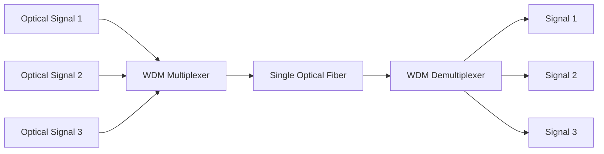
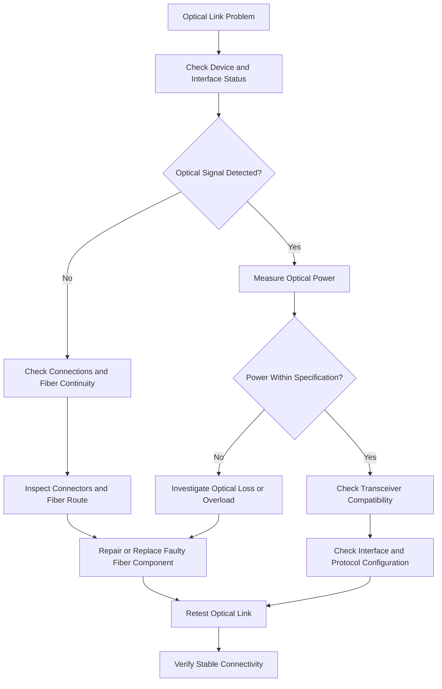

# Fiber Optics Fundamentals

Fiber optics is a communication technology that transmits information using light signals through thin strands of glass or plastic.

It is widely used in telecommunications, ISP networks, data centers, enterprise networks, and long-distance communication systems.

Fiber-optic infrastructure provides several advantages over traditional copper-based transmission:

* High bandwidth capacity.
* Long transmission distances.
* Low signal attenuation.
* Immunity to electromagnetic interference.
* Electrical isolation between connected locations.
* Support for high-speed communication.
* Scalability for future network expansion.

For ISPs, optical fiber is a fundamental technology used in backbone networks, metropolitan networks, access networks, and Fiber-to-the-Home (FTTH) deployments.

# 🗁 What Is Optical Fiber?

Optical fiber is a thin, flexible strand of transparent glass or plastic that carries information as pulses of light.

A typical optical fiber consists of two main optical regions:

* Core: The central region through which light propagates.
* Cladding: The surrounding optical material that helps confine light within the core.

The core and cladding have different refractive indices. This difference allows light to remain guided through the fiber under suitable conditions.

Optical fibers are protected by additional coatings and cable structures to provide mechanical strength and environmental protection.

### 🖆 Basic Optical Fiber Structure

```text
+--------------------------------------+
|              Fiber Cable             |
|                                      |
|    +----------------------------+    |
|    |         Coating            |    |
|    |   +--------------------+   |    |
|    |   |      Cladding      |   |    |
|    |   |   +------------+   |   |    |
|    |   |   |    Core    |   |   |    |
|    |   |   +------------+   |   |    |
|    |   +--------------------+   |    |
|    +----------------------------+    |
+--------------------------------------+
```

The dimensions and materials vary depending on the fiber category and application.

# 🗁 How Fiber Optics Work

Fiber-optic communication converts information into optical signals, transmits those signals through fiber, and converts them back into electrical signals at the receiving end.

A basic fiber-optic communication system contains:

* Transmitter.
* Optical source.
* Optical fiber.
* Receiver.
* Optical detector.

### 🖆 Fiber Optic Communication Process


### 🖆 Optical Transmitter

The transmitter converts electrical information into optical signals.

Common optical sources include:

* LED.
* Laser diode.

Laser diodes are commonly used in modern high-speed and long-distance fiber-optic communication systems.

### 🖆 Optical Fiber

The optical fiber guides light from the transmitter toward the receiver.

The light remains confined within the fiber because of the optical properties of the core and cladding.

### 🖆 Optical Receiver

The receiver detects incoming light and converts it into an electrical signal.

Common optical detectors include:

* PIN photodiodes.
* Avalanche photodiodes (APDs).

### 🖆 Total Internal Reflection

Total internal reflection is an optical phenomenon that occurs when light travels from a medium with a higher refractive index toward a medium with a lower refractive index and reaches the boundary at an angle greater than the critical angle.

In optical fiber, this phenomenon helps confine light within the core.

The refractive index of the core is typically slightly higher than that of the cladding.

This allows optical signals to propagate along the fiber with controlled loss.

# 🗁 Fiber Optic Cable Structure

An optical fiber cable contains more than just the glass fiber.

The cable structure protects the optical fibers from mechanical stress, moisture, temperature changes, and environmental damage.

### 🖆 Main Cable Components

| Component | Purpose |
| --- | --- |
| Core | Carries optical signals |
| Cladding | Confines light within the core |
| Primary coating | Protects the glass fiber |
| Buffer | Provides additional mechanical protection |
| Strength member | Provides tensile strength |
| Outer jacket | Protects the cable from environmental damage |

### 🖆 Primary Coating

The primary coating is applied directly around the glass cladding.

It protects the fiber against:

* Scratches.
* Moisture.
* Microbending.
* Surface damage.

### 🖆 Buffer Protection

Buffer structures provide additional protection around coated optical fibers.

Common constructions include:

* Tight-buffered fiber.
* Loose-tube fiber.

Tight-buffered cables are commonly used in indoor installations and patch cords.

Loose-tube cables are widely used in outdoor telecommunications infrastructure because they help isolate optical fibers from external mechanical and environmental stress.

### 🖆 Strength Members

Strength members help protect the cable from excessive pulling forces.

Common materials include:

* Aramid yarn.
* Fiberglass-reinforced plastic.
* Steel wire.

### 🖆 Outer Jacket

The outer jacket protects the cable from physical damage and environmental conditions.

Cable jackets may be designed for:

* Indoor installation.
* Outdoor installation.
* Underground installation.
* Aerial installation.
* Direct burial.
* Duct installation.

The correct cable construction must be selected according to the installation environment and applicable standards.

# 🗁 Types of Optical Fiber

Optical fiber is commonly classified into two major categories:

* Single-Mode Fiber (SMF).
* Multimode Fiber (MMF).

They differ in core size, light propagation characteristics, supported transmission distances, and typical applications.

### 🖆 Fiber Types Comparison

| Feature | Single-Mode Fiber | Multimode Fiber |
| --- | --- | --- |
| Core diameter | Typically 8–10 µm | Typically 50 µm or 62.5 µm |
| Light propagation | Single spatial mode | Multiple spatial modes |
| Modal dispersion | Very low | More significant |
| Transmission distance | Long-distance applications | Generally shorter-distance applications |
| Typical use | ISP networks and telecom | Data centers and local networks |
| Common wavelength | 1310 nm and 1550 nm | 850 nm and 1300 nm |

# 🗁 Single-Mode Fiber

Single-Mode Fiber is designed to carry light primarily through one spatial propagation mode.

It has a small core, typically around 8–10 micrometers in diameter.

Because it minimizes modal dispersion, single-mode fiber supports high-capacity transmission over long distances.

It is widely used in:

* ISP backbone networks.
* Metropolitan networks.
* FTTH networks.
* Long-distance telecommunications.
* Data center interconnections.
* Enterprise fiber connections.

### 🖆 Single-Mode Fiber Characteristics

* Small core diameter.
* Low modal dispersion.
* Suitable for long-distance communication.
* Supports high transmission capacity.
* Commonly used with laser-based optical transceivers.

### 🖆 Common Single-Mode Fiber Categories

| Category | Description |
| --- | --- |
| OS1 | Single-mode fiber generally used for indoor and controlled cable environments |
| OS2 | Low-attenuation single-mode fiber commonly used for outdoor and long-distance applications |

The actual performance depends on the fiber specification, wavelength, installation quality, and transmission equipment.

# 🗁 Multimode Fiber

Multimode Fiber supports multiple spatial propagation modes.

It has a larger core than single-mode fiber, allowing light to travel through multiple paths.

Different propagation paths can arrive at different times, causing modal dispersion.

This limits the distance and bandwidth performance compared with single-mode fiber in many applications.

Multimode fiber is commonly used in:

* Data centers.
* Server rooms.
* Enterprise LAN infrastructure.
* Short-distance equipment interconnections.

### 🖆 Multimode Fiber Categories

| Category | Core Diameter | Common Application |
| --- | --- | --- |
| OM1 | 62.5 µm | Legacy multimode installations |
| OM2 | 50 µm | Short-distance network connections |
| OM3 | 50 µm | High-speed data center connections |
| OM4 | 50 µm | Higher-performance multimode links |
| OM5 | 50 µm | Wideband multimode applications |

The supported distance depends on the fiber category, optical wavelength, transceiver type, and data rate.

# 🗁 Fiber Optic Transmission

Fiber-optic transmission uses optical wavelengths to carry information.

An optical transmitter converts electrical data into light, and the receiver detects the light and converts it back into electrical information.

### 🖆 Common Transmission Wavelengths

Common optical wavelengths include:

| Wavelength | Common Application |
| --- | --- |
| 850 nm | Multimode optical communication |
| 1310 nm | Single-mode communication |
| 1490 nm | Downstream GPON |
| 1550 nm | Long-distance transmission and optical video distribution |
| 1577 nm | Downstream XGS-PON |

These are common examples rather than an exhaustive list. Actual wavelength assignments depend on the optical standard and transmission system.

### 🖆 Optical Transceiver

An optical transceiver converts electrical signals into optical signals and optical signals back into electrical signals.

Common form factors include:

* SFP.
* SFP+.
* SFP28.
* QSFP+.
* QSFP28.
* QSFP-DD.

Transceivers differ in:

* Supported data rate.
* Optical wavelength.
* Fiber type.
* Connector type.
* Transmission distance.
* Optical transmit power.
* Receiver sensitivity.

### 🖆 Optical Transceiver Example

```text
Router or Switch
       |
       v
+------------------+
| Optical SFP      |
|                  |
| Electrical <--> |
| Optical          |
+------------------+
       |
       v
 Optical Fiber
       |
       v
 Remote Optical SFP
       |
       v
Remote Router or Switch
```

### 🖆 Bidirectional Optical Transmission

Some optical systems use separate fibers for transmission and reception.

Other systems use bidirectional optics, commonly called BiDi, where transmit and receive signals use different wavelengths over a single fiber.

BiDi transceivers must be paired with compatible wavelength combinations.

# 🗁 Wavelengths and Optical Windows

Optical wavelength is an important parameter in fiber-optic communication.

Different wavelengths experience different attenuation characteristics depending on the fiber type and optical system.

The commonly referenced optical windows for telecommunications include:

* Around 850 nm.
* Around 1310 nm.
* Around 1550 nm.

### 🖆 850 nm Window

Commonly used for multimode fiber communication.

It is frequently found in short-distance data center and enterprise applications.

### 🖆 1310 nm Window

Commonly used in single-mode fiber systems.

It provides relatively low chromatic dispersion for many standard single-mode fiber designs around this wavelength.

### 🖆 1550 nm Window

Widely used for long-distance single-mode transmission because standard single-mode fiber generally has low attenuation in this region.

It is also important in optical amplification and wavelength-division multiplexing systems.

### 🖆 Wavelength-Division Multiplexing

Wavelength-Division Multiplexing (WDM) allows multiple optical signals with different wavelengths to travel through the same fiber.

This increases the capacity of an existing fiber infrastructure.

Common forms include:

* CWDM: Coarse Wavelength-Division Multiplexing.
* DWDM: Dense Wavelength-Division Multiplexing.



WDM is especially useful for increasing transmission capacity across backbone and metropolitan fiber infrastructure.

# 🗁 Fiber Optic Components

Fiber-optic networks require different components to transmit, distribute, connect, and manage optical signals.

### 🖆 Optical Transceivers

Optical transceivers provide optical communication interfaces for routers, switches, and transmission equipment.

Examples include:

* 1G SFP.
* 10G SFP+.
* 25G SFP28.
* 40G QSFP+.
* 100G QSFP28.

### 🖆 Optical Splitter

An optical splitter divides an optical signal into multiple output paths.

It is commonly used in Passive Optical Networks.

Common split ratios include:

* 1:2.
* 1:4.
* 1:8.
* 1:16.
* 1:32.
* 1:64.

The splitting process introduces optical insertion loss.

### 🖆 Optical Patch Panel

An optical distribution frame or patch panel provides organized fiber termination and interconnection.

It helps engineers:

* Manage fiber connections.
* Organize optical ports.
* Perform maintenance.
* Identify fiber routes.
* Reduce accidental cable damage.

### 🖆 Fiber Patch Cord

A fiber patch cord is a short optical cable with connectors installed at both ends.

It is used to connect:

* Optical transceivers.
* Patch panels.
* ODF equipment.
* OLT ports.
* Optical test instruments.

### 🖆 Fiber Pigtail

A fiber pigtail is a short optical fiber with a connector at one end and an unterminated fiber at the other end.

The unterminated end is commonly fusion-spliced to a fiber inside a cable.

### 🖆 Optical Attenuator

An optical attenuator reduces optical signal power by a controlled amount.

It may be used when received optical power is higher than the acceptable receiver input range.

### 🖆 Optical Isolator

An optical isolator allows light to travel primarily in one direction and reduces unwanted reflected light toward sensitive optical sources.

# 🗁 Fiber Optic Connectors

Fiber connectors provide removable connections between optical cables and equipment.

Common connector types include:

| Connector | Description |
| --- | --- |
| SC | Square push-pull connector |
| LC | Small-form-factor connector |
| FC | Threaded connector |
| ST | Bayonet-style connector |
| MPO/MTP | Multi-fiber connector system |

### 🖆 SC Connector

SC connectors are widely used in telecommunications and PON installations.

They commonly appear in optical distribution equipment and fiber patch panels.

### 🖆 LC Connector

LC connectors are compact and widely used in optical transceivers and data center infrastructure.

### 🖆 FC Connector

FC connectors use a threaded coupling mechanism and are found in some telecommunications and test environments.

### 🖆 ST Connector

ST connectors use a bayonet-style locking mechanism and are more commonly associated with older fiber installations.

### 🖆 MPO/MTP Connector

MPO/MTP connectors support multiple optical fibers within one connector assembly.

They are commonly used in high-density data center environments.

### 🖆 Connector Polish Types

Connector end-face polish affects optical reflection.

Common types include:

* PC: Physical Contact.
* UPC: Ultra Physical Contact.
* APC: Angled Physical Contact.

UPC connectors generally have a blue body, while APC connectors commonly have a green body.

APC connectors use an angled end face to reduce back reflection.

**Important:** APC and UPC connectors should not be directly mated together because their end-face geometries are different.

# 🗁 Fiber Splicing

Fiber splicing is the process of permanently joining two optical fibers.

It is commonly required during:

* Fiber cable installation.
* Cable repair.
* Distribution network construction.
* Fiber route extension.
* Optical closure installation.

Two common splicing methods are:

* Fusion splicing.
* Mechanical splicing.

### 🖆 Fusion Splicing

Fusion splicing joins two optical fibers by aligning their ends and using an electric arc to melt and fuse them together.

It is widely used in ISP fiber infrastructure because it can provide low-loss, reliable connections when performed correctly.

Typical fusion splicing steps:

* Strip the fiber coating.
* Clean the bare fiber.
* Cleave the fiber ends.
* Place the fibers in the splicing machine.
* Align the fiber ends.
* Perform the fusion process.
* Protect the splice with a splice protector.
* Store the splice in a suitable closure or tray.

### 🖆 Mechanical Splicing

Mechanical splicing aligns two fiber ends using a precision mechanical fixture.

An index-matching material may be used to reduce optical reflection and loss.

Mechanical splicing can be useful for certain repair and installation situations, but its performance depends heavily on the splice design and installation quality.

### 🖆 Fusion vs Mechanical Splicing

| Feature | Fusion Splicing | Mechanical Splicing |
| --- | --- | --- |
| Joining method | Melts and fuses fiber ends | Mechanically aligns fiber ends |
| Typical loss | Generally lower | Generally higher |
| Equipment | Fusion splicer | Mechanical splice fixture |
| Permanence | Permanent joint | Mechanically retained joint |
| Common use | ISP fiber infrastructure | Specific repairs and installations |

# 🗁 Optical Attenuation and Loss

Optical attenuation is the reduction of optical signal power as light travels through fiber and other optical components.

It is normally expressed in decibels per kilometer (dB/km) for fiber attenuation or decibels (dB) for component insertion loss.

### 🖆 Causes of Optical Loss

Common causes include:

* Fiber material absorption.
* Rayleigh scattering.
* Fiber bending.
* Connector insertion loss.
* Fusion splice loss.
* Splitter insertion loss.
* Dirty connectors.
* Damaged fiber.
* Poor installation practices.

### 🖆 Fiber Attenuation

Fiber attenuation depends on the fiber type and operating wavelength.

For example, standard single-mode fiber commonly has lower attenuation around 1550 nm than around 1310 nm.

Actual values should be taken from the fiber manufacturer's specifications.

### 🖆 Connector Loss

Every optical connection may introduce insertion loss.

Poor connector cleaning, damaged end faces, and incorrect mating can significantly increase optical loss.

### 🖆 Splice Loss

A splice introduces loss because of alignment errors, fiber mismatch, cleaving quality, or imperfections in the joining process.

### 🖆 Bending Loss

Excessive fiber bending can cause light to escape from the guided optical path.

Two common bending-related problems are:

* Macrobending: Loss caused by bending the fiber around a radius that is too small.
* Microbending: Small-scale distortions that cause additional optical loss.

### 🖆 Optical Power Budget

An optical power budget determines whether a transmitter provides sufficient optical power for a receiver after accounting for fiber and component losses.

Formula:

```text
Available Optical Budget =
Transmitter Output Power
-
Minimum Receiver Sensitivity
```

The expected received power is:

```text
Received Optical Power =
Transmitter Output Power
-
Total Optical Path Loss
```

Example:

```text
Transmitter Output Power = +3 dBm
Receiver Sensitivity     = -24 dBm

Available Optical Budget:

+3 - (-24) = 27 dB
```

Assume the optical path contains:

```text
Fiber Loss       = 4 dB
Splitter Loss    = 16 dB
Connector Loss   = 1 dB
Splice Loss      = 1 dB
Other Loss       = 1 dB
```

Total path loss:

```text
4 + 16 + 1 + 1 + 1 = 23 dB
```

Received optical power:

```text
+3 - 23 = -20 dBm
```

The received power is above the receiver sensitivity threshold of -24 dBm.

The remaining theoretical margin is:

```text
27 - 23 = 4 dB
```

A real design must also consider engineering margin, minimum and maximum receiver power, optical overload limits, temperature variation, aging, and the applicable equipment specifications.

# 🗁 Optical Power and Measurements

Optical power is commonly measured in dBm.

The dBm unit expresses power relative to one milliwatt.

### 🖆 dBm

The dBm scale is logarithmic.

Examples:

| Optical Power | Meaning |
| --- | --- |
| +3 dBm | Approximately 2 mW |
| 0 dBm | 1 mW |
| -3 dBm | Approximately 0.5 mW |
| -10 dBm | 0.1 mW |
| -20 dBm | 0.01 mW |
| -30 dBm | 0.001 mW |

### 🖆 dB

Decibel (dB) represents a ratio between two power levels.

It is used to describe:

* Optical attenuation.
* Insertion loss.
* Optical power gain.
* Power budget.
* Splice loss.

### 🖆 dBm vs dB

| Unit | Meaning |
| --- | --- |
| dBm | Absolute optical power relative to 1 mW |
| dB | Relative gain or loss between power levels |

For example:

```text
Transmitted Power = +2 dBm
Path Loss         = 5 dB
Received Power    = -3 dBm
```

### 🖆 Optical Power Measurement

An optical power meter measures the optical power received at a particular wavelength.

It is useful for:

* Checking transmitter output.
* Measuring received optical power.
* Verifying fiber connections.
* Testing optical distribution networks.
* Troubleshooting weak optical signals.

The correct measurement wavelength and reference method should be selected for the optical system being tested.

# 🗁 Fiber Optic Testing Tools

Fiber installation and maintenance require specialized testing equipment.

### 🖆 Optical Power Meter

An optical power meter measures optical signal power.

It is commonly used with a suitable optical source to measure insertion loss.

### 🖆 Optical Light Source

An optical light source generates a controlled optical signal at a specified wavelength.

It is used with an optical power meter for optical loss testing.

### 🖆 OTDR

An Optical Time-Domain Reflectometer sends optical pulses into a fiber and analyzes the reflected and backscattered light.

It can help identify:

* Fiber breaks.
* Splice locations.
* Connector events.
* Bending-related losses.
* Distance to faults.
* Reflection events.

OTDR testing requires suitable launch and receive fibers for more accurate characterization of the first and last events.

### 🖆 Visual Fault Locator

A Visual Fault Locator (VFL) injects visible red light into an optical fiber.

It can help identify:

* Fiber continuity.
* Incorrect connections.
* Severe bends.
* Broken fibers.
* Certain connector and splice problems.

It is mainly useful for short-distance visual inspection and is not a substitute for optical power measurement or OTDR testing.

### 🖆 Fiber Inspection Microscope

A fiber inspection microscope is used to examine connector end faces.

It helps identify:

* Dust.
* Oil.
* Scratches.
* Cracks.
* Contamination.

### 🖆 Fiber Cleaver

A fiber cleaver produces a controlled, flat fiber end before fusion splicing.

A poor cleave can increase splice loss.

### 🖆 Fusion Splicer

A fusion splicer aligns and joins two optical fibers using a controlled electric arc.

### 🖆 Fiber Testing Tools Comparison

| Tool | Primary Purpose |
| --- | --- |
| Optical power meter | Measures optical power |
| Optical light source | Generates a test signal |
| OTDR | Locates and characterizes fiber events |
| VFL | Visual continuity and fault checking |
| Inspection microscope | Inspects connector end faces |
| Fiber cleaver | Prepares fiber ends |
| Fusion splicer | Permanently joins optical fibers |

# 🗁 Fiber Installation and Handling

Proper fiber installation practices are essential for reliable network performance.

Optical fibers are sensitive to physical damage, contamination, and excessive mechanical stress.

### 🖆 Cable Installation Practices

* Follow the manufacturer's minimum bend radius.
* Avoid excessive pulling tension.
* Use suitable cable pulling equipment.
* Protect cables from sharp edges.
* Secure cables using appropriate supports.
* Avoid crushing optical cables.
* Use suitable closures and splice trays.
* Label fiber cables and distribution points.
* Document fiber routes and splice locations.

### 🖆 Connector Cleaning

Contaminated connector end faces are a common cause of optical connection problems.

A proper cleaning process should include:

* Inspect the connector.
* Clean using approved fiber cleaning tools.
* Inspect again.
* Connect only when the end face is clean.

The principle is commonly summarized as:

**Inspect, clean, inspect.**

### 🖆 Fiber Identification

Fiber cables should be labeled and documented to simplify maintenance.

Useful information includes:

* Cable identification.
* Fiber core number.
* Origin and destination.
* Splice location.
* Patch panel port.
* Splitter port.
* Customer or service assignment.

### 🖆 Fiber Color Coding

Fiber cables commonly use standardized color identification systems to distinguish individual fibers and tubes.

However, color conventions can vary by region, manufacturer, and cable construction.

Always verify the cable manufacturer's documentation and the applicable local standard before identifying fiber cores by color alone.

# 🗁 Common Fiber Optic Problems

Fiber-optic networks can experience several physical and optical failures.

### 🖆 Loss of Signal

Loss of Signal (LOS) occurs when the receiving equipment cannot detect an acceptable optical signal.

Possible causes include:

* Fiber cut.
* Disconnected patch cord.
* Failed optical transmitter.
* Damaged connector.
* Incorrect fiber connection.
* Severe optical attenuation.

### 🖆 High Optical Attenuation

High attenuation reduces the received optical power below the expected level.

Possible causes include:

* Excessive fiber length.
* Dirty connectors.
* Poor fusion splices.
* Damaged fiber.
* Excessive bending.
* Faulty optical components.

### 🖆 Intermittent Optical Connectivity

Intermittent connectivity may result from:

* Loose connectors.
* Damaged patch cords.
* Unstable optical modules.
* Physical cable movement.
* Environmental conditions.
* Marginal optical power levels.

### 🖆 Optical Overload

Optical overload occurs when the received optical power exceeds the receiver's specified maximum input level.

It can cause communication errors or equipment malfunction.

A suitable optical attenuator may be required when the optical link budget produces excessive received power.

### 🖆 Incorrect Transceiver Compatibility

Optical communication requires compatible transceivers at both ends.

Compatibility considerations include:

* Data rate.
* Wavelength.
* Fiber type.
* Connector type.
* Transmission distance.
* Optical power levels.
* Supported optical standards.

A transceiver may fit physically but still be incompatible with the remote interface or optical link.

# 🗁 Fiber Optic Troubleshooting

A structured troubleshooting process helps locate fiber faults without unnecessarily replacing working equipment.

### 🖆 Basic Troubleshooting Workflow



### 🖆 Troubleshooting Checklist

| Check | What to Verify |
| --- | --- |
| Device status | Router, switch, OLT, and ONT operational status |
| Interface status | Link state and interface errors |
| Transceiver | Correct module and compatibility |
| Fiber connection | Correct port and fiber polarity |
| Connector | Cleanliness and physical condition |
| Optical power | Transmit and receive levels |
| Fiber route | Bends, damage, and continuity |
| Splices | Excessive splice loss |
| OTDR trace | Fault distance and optical events |

### 🖆 MikroTik RouterOS Optical Monitoring

Display Ethernet interfaces:

```routeros
/interface ethernet print
```

Inspect an optical interface:

```routeros
/interface ethernet monitor sfp-sfpplus1
```

Display interface statistics:

```routeros
/interface print stats
```

Monitor traffic:

```routeros
/interface monitor-traffic sfp-sfpplus1
```

Supported optical monitoring fields depend on the router model, transceiver, and driver support.

### 🖆 Linux Optical Monitoring

Display Ethernet interfaces:

```bash
ip link show
```

Inspect transceiver information using `ethtool`:

```bash
sudo ethtool -m eth0
```

Display interface statistics:

```bash
ip -s link show eth0
```

Display link information:

```bash
sudo ethtool eth0
```

The availability of optical diagnostic information depends on the network interface driver and transceiver support.

# 🗁 Practical Fiber Optic Example

Consider an ISP connecting a regional PoP to a neighborhood aggregation site using single-mode fiber.

The connection uses:

* Two network switches.
* Two compatible 10G optical transceivers.
* Single-mode fiber.
* LC connectors.
* One optical patch panel.

### 🖆 Example Topology


### 🖆 Example Link Budget

Assume the following values:

```text
Transmitter Output Power = +1 dBm
Receiver Sensitivity     = -12 dBm

Fiber Length             = 10 km
Fiber Attenuation        = 0.35 dB/km
Connector Loss           = 1.0 dB
Splice Loss              = 0.5 dB
Additional Loss          = 0.5 dB
```

Calculate fiber attenuation:

```text
10 × 0.35 = 3.5 dB
```

Calculate total optical loss:

```text
Fiber Loss       = 3.5 dB
Connector Loss   = 1.0 dB
Splice Loss      = 0.5 dB
Additional Loss  = 0.5 dB

Total Loss       = 5.5 dB
```

Calculate expected received power:

```text
+1 - 5.5 = -4.5 dBm
```

Calculate available optical budget:

```text
+1 - (-12) = 13 dB
```

Calculate remaining margin:

```text
13 - 5.5 = 7.5 dB
```

The theoretical received power is -4.5 dBm, which is above the receiver sensitivity of -12 dBm.

The final design must also verify the receiver's maximum input power, transceiver specifications, actual connector and splice losses, and required engineering margin.

# 🗁 Summary

Fiber optics is a fundamental communication technology used in modern ISP infrastructure.

It transmits information using light signals through optical fiber and supports high-capacity communication over short and long distances.

Important concepts include:

* Single-mode and multimode fiber.
* Optical transmitters and receivers.
* Wavelengths and optical transceivers.
* Fiber connectors and splicing.
* Optical attenuation and power budgets.
* Optical testing equipment.
* Fiber installation and troubleshooting.

Understanding these fundamentals is essential for designing, installing, maintaining, and troubleshooting fiber-optic networks.

# 🗁 References

* [ITU-T Recommendations](https://www.itu.int/rec/T-REC/en)
* [ITU-T G.652 — Characteristics of a Single-Mode Optical Fibre and Cable](https://www.itu.int/rec/T-REC-G.652/en)
* [ITU-T G.657 — Characteristics of a Bending-Loss Insensitive Single-Mode Optical Fibre and Cable](https://www.itu.int/rec/T-REC-G.657/en)
* [ITU-T G.650.1 — Definitions and Test Methods for Linear, Deterministic Attributes of Single-Mode Fibre and Cable](https://www.itu.int/rec/T-REC-G.650.1/en)
* [IEC — International Electrotechnical Commission](https://www.iec.ch/)
* [FOA — The Fiber Optic Association](https://www.thefoa.org/)
* [Corning Optical Communications](https://www.corning.com/optical-communications/worldwide/en/home.html)
* [MikroTik Documentation](https://help.mikrotik.com/docs/)
