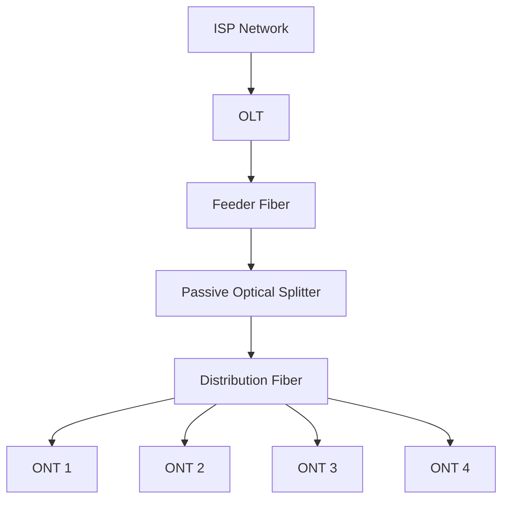
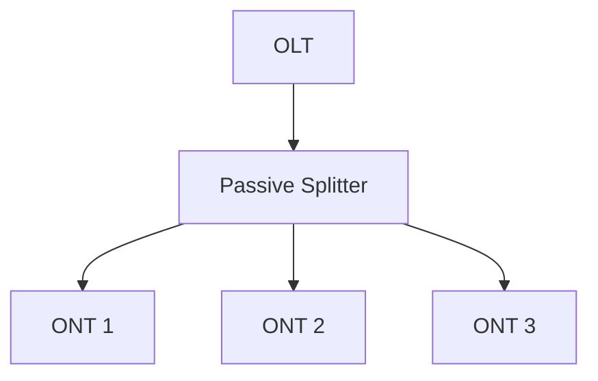
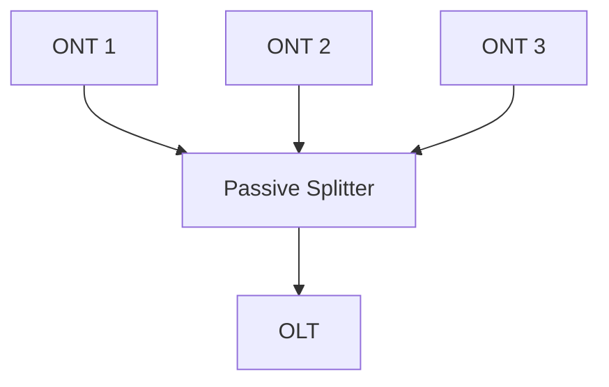
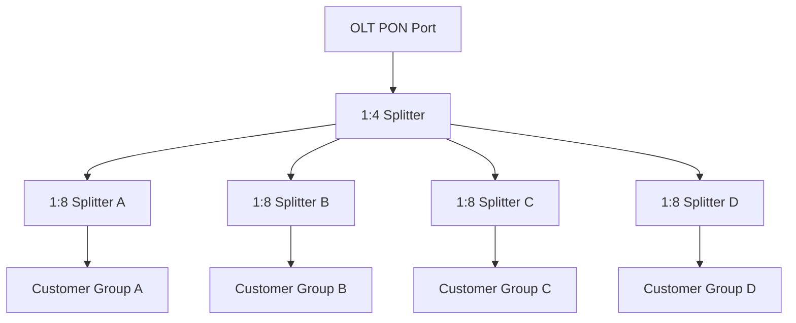
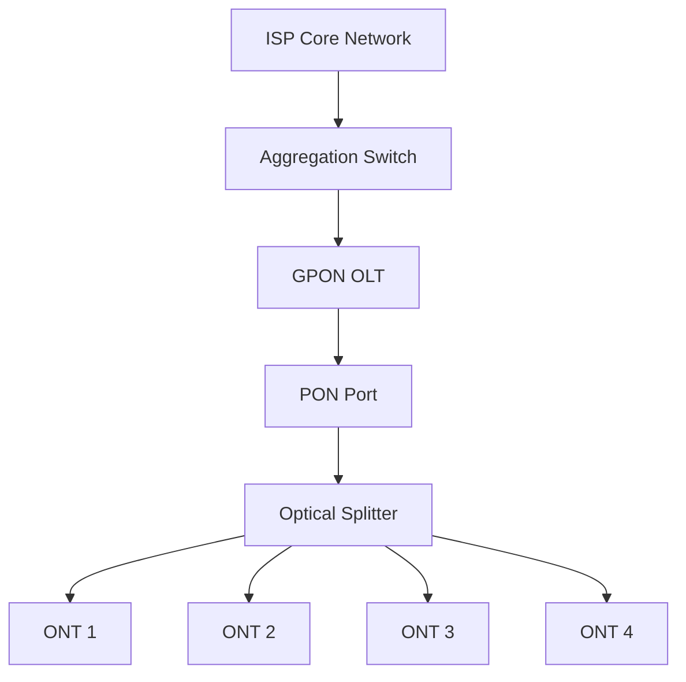
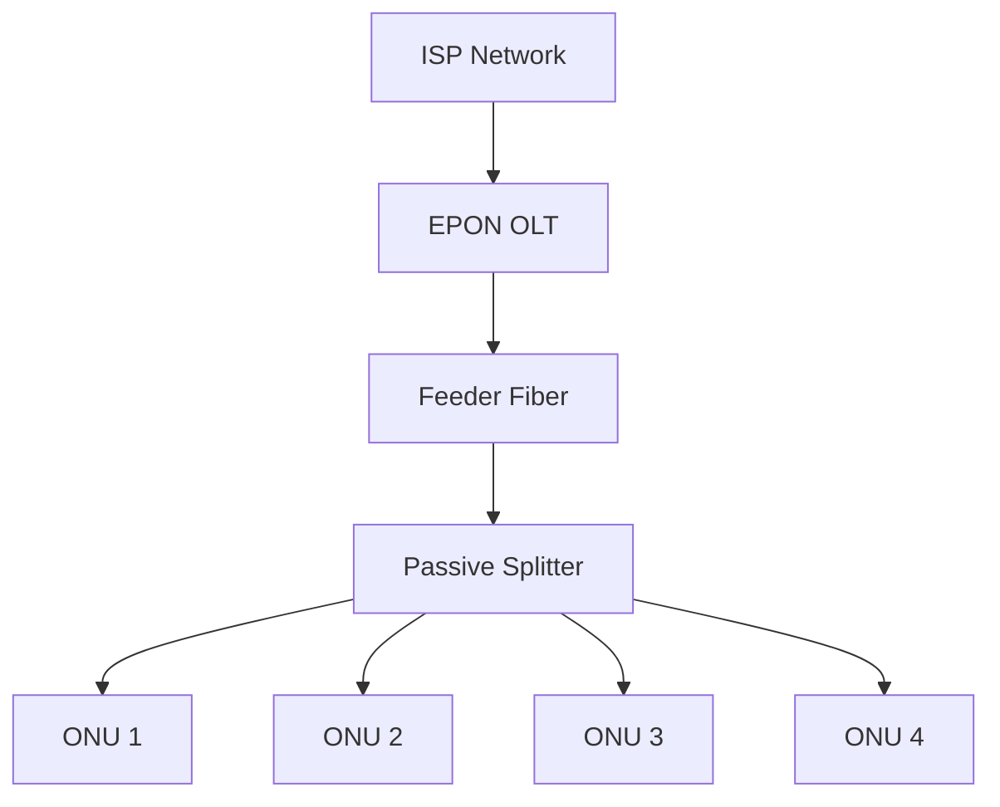
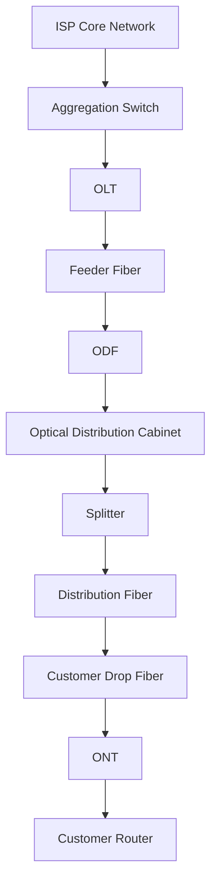
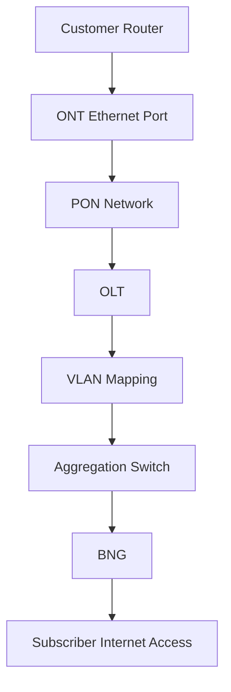
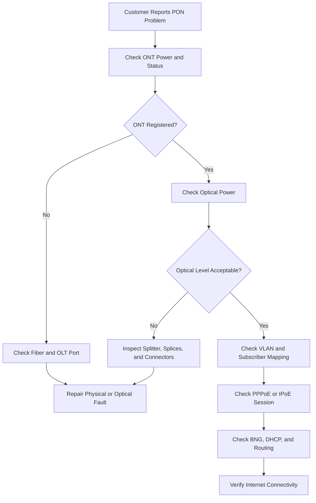
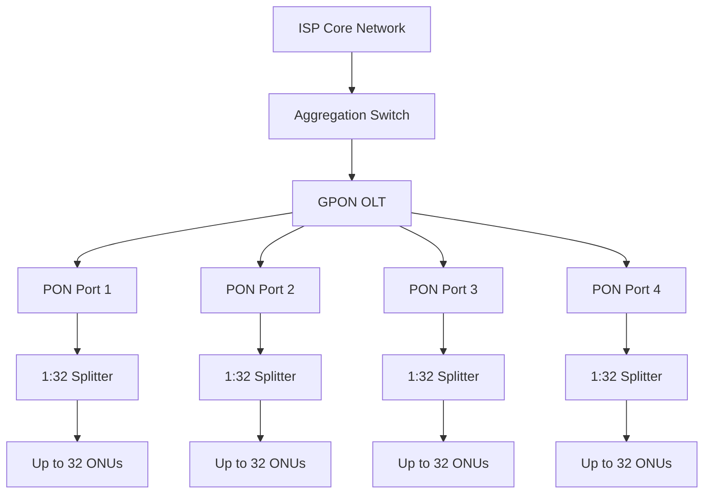

# PON, GPON, and EPON

Passive Optical Network (PON) technology is widely used by Internet Service Providers to deliver fiber broadband connectivity to residential and business customers.

PON allows one optical fiber connection from the provider side to serve multiple customer premises through passive optical splitters.

Unlike Active Ethernet access networks, a traditional PON distribution network does not require powered switching equipment between the OLT and customer optical terminals.

Common PON technologies include:

* GPON (Gigabit-capable Passive Optical Network).
* EPON (Ethernet Passive Optical Network).
* XG-PON (10-Gigabit-capable Passive Optical Network).
* XGS-PON (10-Gigabit-capable Symmetric Passive Optical Network).

PON technology helps ISPs reduce access infrastructure costs while providing scalable fiber connectivity.

# 🗁 What Is Passive Optical Network (PON)?

A Passive Optical Network is a point-to-multipoint optical access architecture that connects one Optical Line Terminal (OLT) to multiple Optical Network Units (ONUs) through passive optical distribution components.

The word *passive* refers to the optical distribution network between the OLT and ONUs.

Passive components do not require electrical power to split or combine optical signals.

A typical PON contains three major parts:

* OLT: Located at the ISP facility.
* ODN: Optical Distribution Network between the OLT and subscribers.
* ONU/ONT: Located at or near customer premises.

### 🖆 Basic PON Architecture



A single OLT PON port can serve multiple ONUs, depending on the technology, optical budget, split ratio, and equipment capabilities.

# 🗁 PON Architecture

A PON network is generally organized into three major functional sections.

### 🖆 Optical Line Terminal (OLT)

The OLT is installed at the ISP's central office, data center, or Point of Presence.

It connects the PON access network to the ISP aggregation and core infrastructure.

Its responsibilities include:

* Managing PON ports.
* Communicating with ONUs.
* Controlling upstream transmission.
* Distributing downstream traffic.
* Managing bandwidth allocation.
* Providing optical access interfaces.
* Supporting subscriber service provisioning.

### 🖆 Optical Distribution Network (ODN)

The ODN is the optical infrastructure between the OLT and ONUs.

It may include:

* Feeder fiber.
* Fiber distribution cabinets.
* Optical splitters.
* Distribution fiber.
* Drop cables.
* Connectors.
* Splice closures.
* Optical distribution frames.

The ODN is passive in a traditional PON deployment.

### 🖆 Optical Network Unit (ONU)

An ONU terminates the optical connection at the subscriber side or at a distribution location.

It converts optical signals into electrical interfaces such as Ethernet.

An ONU may provide:

* Ethernet connectivity.
* Voice interfaces.
* Wi-Fi functionality.
* IPTV interfaces.
* Subscriber-side service separation.

An ONT is a customer-facing form of ONU commonly installed at the subscriber premises.

# 🗁 Main PON Components

Understanding PON components is important for designing and troubleshooting ISP fiber networks.

### 🖆 OLT

The OLT is the provider-side equipment that controls the PON.

It commonly contains:

* PON interface cards.
* Uplink interfaces.
* Control and management modules.
* Power modules.
* Cooling systems.

OLT uplinks connect the access network to aggregation switches or routers.

### 🖆 Optical Splitter

An optical splitter divides optical power from one input into multiple output ports.

It is commonly installed in:

* Fiber distribution cabinets.
* Outdoor closures.
* Building distribution points.
* Optical distribution frames.

### 🖆 Feeder Fiber

Feeder fiber connects the OLT location to a distribution point or splitter location.

It commonly carries the combined optical signal before splitting.

### 🖆 Distribution Fiber

Distribution fiber connects optical distribution points to smaller distribution locations or customer drop points.

### 🖆 Drop Fiber

Drop fiber connects the distribution network to the customer's ONT.

### 🖆 ONT

The ONT is installed at the customer premises.

It receives the optical signal and provides customer-facing interfaces.

### 🖆 ODF

An Optical Distribution Frame provides structured termination and interconnection for fiber cables.

It helps technicians manage fiber connections between OLT equipment, feeder cables, and distribution infrastructure.

# 🗁 How PON Works

PON communication uses a point-to-multipoint architecture.

The OLT communicates with multiple ONUs through a shared optical distribution network.

The communication process differs between downstream and upstream directions.

### 🖆 Downstream Communication

Downstream communication carries traffic from the OLT toward the ONUs.

The OLT transmits downstream optical signals that are distributed to all ONUs connected to the relevant PON segment.

Each ONU processes the traffic intended for it and discards traffic that does not belong to its assigned service.

In GPON, downstream transmission is broadcast across the PON, with traffic protected through mechanisms such as GEM port identification and encryption.

### 🖆 Upstream Communication

Upstream communication carries traffic from ONUs toward the OLT.

Because multiple ONUs share the same upstream optical channel, they must transmit during assigned time slots.

The OLT coordinates upstream transmission to prevent collisions between ONUs.

This process is commonly implemented through Time-Division Multiple Access.

# 🗁 Downstream and Upstream Transmission

PON systems generally use different wavelengths for downstream and upstream communication.

This allows both directions to operate over the same optical fiber.

### 🖆 Downstream Traffic



The downstream signal is distributed to all ONUs on the PON segment.

Each ONU identifies and processes the traffic assigned to it.

### 🖆 Upstream Traffic



Upstream signals from different ONUs are combined by the passive optical distribution network.

The OLT coordinates when each ONU is allowed to transmit.

# 🗁 Time-Division Multiple Access (TDMA)

Time-Division Multiple Access is a technique that allows multiple ONUs to share an upstream communication channel.

Each ONU transmits during an assigned time interval.

The OLT controls transmission timing using ranging and dynamic bandwidth allocation mechanisms.

### 🖆 TDMA Example

```text
Upstream Transmission Timeline

+---------+---------+---------+---------+
|  ONU 1  |  ONU 2  |  ONU 3  |  ONU 4  |
+---------+---------+---------+---------+
    Slot      Slot      Slot      Slot
```

Each ONU transmits only during its assigned transmission opportunity.

This prevents simultaneous upstream transmissions from interfering with one another.

### 🖆 Dynamic Bandwidth Allocation (DBA)

Dynamic Bandwidth Allocation allows the OLT to allocate upstream bandwidth according to traffic demand and service policies.

The OLT can consider:

* ONU traffic requirements.
* Service priority.
* Configured bandwidth profiles.
* Available upstream capacity.
* Quality of Service requirements.

DBA helps use shared upstream capacity efficiently.

# 🗁 Optical Splitters

An optical splitter divides one optical input into multiple optical outputs.

It is a passive device, meaning it does not require electrical power.

### 🖆 Common Split Ratios

| Split Ratio | Number of Outputs |
| --- | ---: |
| 1:2 | 2 |
| 1:4 | 4 |
| 1:8 | 8 |
| 1:16 | 16 |
| 1:32 | 32 |
| 1:64 | 64 |
| 1:128 | 128 |

The supported split ratio depends on the PON standard, OLT and ONU optical characteristics, ODN design, and optical budget.

### 🖆 Splitter Architecture



This example represents a two-stage splitting architecture with a theoretical total split ratio of 1:32 per OLT PON port.

### 🖆 Splitter Insertion Loss

Splitting optical power introduces insertion loss.

An ideal equal splitter has an approximate theoretical splitting loss of:

\[
L = 10\log_{10}(N)
\]

Where:

* \(L\) is the theoretical splitting loss in dB.
* \(N\) is the number of output ports.

Examples:

| Split Ratio | Ideal Splitting Loss |
| --- | ---: |
| 1:2 | 3.01 dB |
| 1:4 | 6.02 dB |
| 1:8 | 9.03 dB |
| 1:16 | 12.04 dB |
| 1:32 | 15.05 dB |
| 1:64 | 18.06 dB |

Actual splitter insertion loss is higher because of manufacturing and excess losses.

When designing a PON network, always use the manufacturer's specified insertion-loss values rather than relying only on theoretical calculations.

# 🗁 GPON

GPON stands for Gigabit-capable Passive Optical Network.

It is standardized by the ITU-T G.984 series and is widely deployed for fiber broadband access.

GPON provides point-to-multipoint optical connectivity between an OLT and multiple ONUs.

### 🖆 GPON Characteristics

* ITU-T standardized PON technology.
* Shared optical access infrastructure.
* Asymmetric downstream and upstream rates.
* Supports multiple service types.
* Uses GEM encapsulation.
* Supports dynamic bandwidth allocation.
* Provides optical encryption for downstream traffic.

### 🖆 GPON Data Rates

The commonly deployed GPON line rates are:

| Direction | Line Rate |
| --- | ---: |
| Downstream | 2.48832 Gbps |
| Upstream | 1.24416 Gbps |

These are aggregate line rates for the PON segment, not guaranteed speeds for each subscriber.

Actual usable capacity is lower because of protocol overhead and service allocation.

### 🖆 GPON Applications

GPON is commonly used for:

* FTTH.
* Residential broadband.
* Business broadband.
* Voice services.
* IPTV.
* Managed Ethernet services.

# 🗁 GPON Architecture and Data Rates

A GPON network uses an OLT to manage multiple ONUs through a passive optical distribution network.

### 🖆 GPON Logical Architecture



### 🖆 GPON Capacity Sharing

Consider a GPON PON port with:

* Downstream line rate: 2.48832 Gbps.
* Upstream line rate: 1.24416 Gbps.
* Split ratio: 1:32.

The optical segment serves up to 32 ONUs in this example.

However, this does not mean every subscriber receives an independent 2.48832 Gbps connection.

All subscribers share the PON's available capacity according to the service configuration and traffic demand.

For example, if several customers simultaneously download large files, they compete for the available downstream capacity.

The actual performance depends on:

* Subscriber activity.
* DBA and traffic scheduling.
* OLT configuration.
* Service profiles.
* Uplink capacity.
* Network congestion.

# 🗁 GPON Wavelengths

GPON uses separate wavelengths for downstream and upstream communication.

Common GPON wavelength assignments are:

| Direction | Wavelength |
| --- | --- |
| Downstream | 1490 nm |
| Upstream | 1310 nm |
| Optional RF video overlay | 1550 nm |

The RF video overlay is optional and depends on the deployed system.

These wavelength assignments allow bidirectional communication over the same optical fiber.

# 🗁 GPON Encapsulation Methods

GPON supports different mechanisms for transporting service traffic.

Two important concepts are:

* GEM (GPON Encapsulation Method).
* T-CONT (Transmission Container).

### 🖆 GPON Encapsulation Method (GEM)

GEM is the primary GPON encapsulation mechanism used to transport user and service traffic.

It provides logical identification and transport of different traffic flows.

GEM ports are used to identify traffic flows within the GPON system.

### 🖆 Transmission Container (T-CONT)

A T-CONT represents an upstream bandwidth allocation entity associated with an ONU.

It allows the OLT to manage upstream transmission resources.

GPON defines five commonly referenced T-CONT types:

| Type | General Purpose |
| --- | --- |
| Type 1 | Fixed bandwidth |
| Type 2 | Assured bandwidth |
| Type 3 | Assured and non-assured bandwidth |
| Type 4 | Best-effort bandwidth |
| Type 5 | Combination of bandwidth allocation types |

The exact service behavior depends on the OLT implementation and configured bandwidth profiles.

# 🗁 EPON

EPON stands for Ethernet Passive Optical Network.

It is based on Ethernet technology and standardized by IEEE 802.3.

EPON provides point-to-multipoint optical access using an OLT, passive optical splitters, and ONUs.

### 🖆 EPON Characteristics

* IEEE Ethernet-based PON technology.
* Uses Ethernet frames for service transport.
* Supports shared optical infrastructure.
* Uses MPCP for multipoint control.
* Supports upstream scheduling.
* Commonly deployed in FTTH networks.

### 🖆 EPON Applications

EPON is used for:

* Residential broadband.
* Enterprise access.
* Ethernet-based services.
* Fiber access networks.
* Metropolitan access infrastructure.

# 🗁 EPON Architecture and Data Rates

A typical EPON architecture contains an OLT connected to multiple ONUs through a passive optical distribution network.

### 🖆 EPON Logical Architecture



### 🖆 Standard EPON Data Rates

Traditional 1G-EPON commonly uses the following nominal line rates:

| Direction | Line Rate |
| --- | ---: |
| Downstream | 1.25 Gbps |
| Upstream | 1.25 Gbps |

The 1.25 Gbps physical line rate carries Ethernet traffic with encoding overhead, so the usable data throughput is lower.

### 🖆 10G-EPON

10G-EPON extends EPON to higher-capacity optical access.

Common variants include:

| Variant | Downstream | Upstream |
| --- | ---: | ---: |
| Symmetric 10G-EPON | 10 Gbps | 10 Gbps |
| Asymmetric 10G-EPON | 10 Gbps | 1 Gbps |

Actual physical line rates and usable throughput depend on the specific IEEE variant and implementation.

# 🗁 EPON vs GPON

GPON and EPON both provide point-to-multipoint optical access, but they differ in standardization, encapsulation, line rates, and protocol mechanisms.

### 🖆 Comparison

| Feature | GPON | EPON |
| --- | --- | --- |
| Standard | ITU-T G.984 | IEEE 802.3 |
| Technology family | ITU-T PON | Ethernet PON |
| Common downstream rate | 2.48832 Gbps | 1.25 Gbps line rate for 1G-EPON |
| Common upstream rate | 1.24416 Gbps | 1.25 Gbps line rate for 1G-EPON |
| Encapsulation | GEM | Ethernet frames |
| Upstream control | DBA and T-CONT mechanisms | MPCP and grant mechanisms |
| Typical application | FTTH | FTTH and Ethernet access |

### 🖆 Which Technology Is Better?

There is no universal answer.

The decision depends on:

* Existing ISP infrastructure.
* OLT availability.
* ONU compatibility.
* Equipment pricing.
* Required bandwidth.
* Subscriber density.
* Vendor ecosystem.
* Upgrade strategy.
* Operational experience.

An ISP should select a technology based on its network requirements and long-term deployment plan rather than comparing only advertised line rates.

# 🗁 XG-PON and XGS-PON

As broadband demand increases, traditional GPON capacity may become insufficient for some access networks.

Higher-capacity PON technologies provide additional bandwidth without requiring a completely new fiber distribution network in many deployments.

### 🖆 XG-PON

XG-PON is a 10-Gigabit-capable Passive Optical Network standardized by ITU-T G.987.

Its commonly specified line rates are:

| Direction | Line Rate |
| --- | ---: |
| Downstream | 9.95328 Gbps |
| Upstream | 2.48832 Gbps |

XG-PON is asymmetric because downstream capacity is higher than upstream capacity.

### 🖆 XGS-PON

XGS-PON is a 10-Gigabit-capable Symmetric Passive Optical Network standardized by ITU-T G.9807.1.

Its commonly specified line rates are:

| Direction | Line Rate |
| --- | ---: |
| Downstream | 9.95328 Gbps |
| Upstream | 9.95328 Gbps |

XGS-PON provides symmetric capacity and is suitable for applications requiring high upload and download bandwidth.

### 🖆 PON Technology Comparison

| Technology | Downstream | Upstream |
| --- | ---: | ---: |
| GPON | 2.48832 Gbps | 1.24416 Gbps |
| XG-PON | 9.95328 Gbps | 2.48832 Gbps |
| XGS-PON | 9.95328 Gbps | 9.95328 Gbps |
| 1G-EPON | 1.25 Gbps line rate | 1.25 Gbps line rate |
| 10G-EPON | 10 Gbps class | 1 Gbps or 10 Gbps class, depending on variant |

These are aggregate PON line rates, not per-subscriber guaranteed throughput.

# 🗁 PON Split Ratios and Optical Budget

PON deployment requires careful optical power budget planning.

The OLT must transmit enough optical power for the signal to reach the ONU while remaining within the receiver's supported input range.

### 🖆 Optical Power Budget

The basic optical budget is calculated using:

```text
Available Optical Budget =
OLT Transmit Power
-
ONU Receiver Sensitivity
```

The expected received power is:

```text
Received Power =
OLT Transmit Power
-
Total Optical Path Loss
```

### 🖆 Example Optical Budget

Assume:

```text
OLT Transmit Power       = +4 dBm
ONU Receiver Sensitivity = -28 dBm
```

Available optical budget:

```text
+4 - (-28) = 32 dB
```

Assume the distribution network has:

```text
Fiber Loss          = 5 dB
1:32 Splitter Loss  = 17 dB
Connector Loss      = 2 dB
Splice Loss         = 1 dB
Other Loss          = 1 dB
```

Total optical path loss:

```text
5 + 17 + 2 + 1 + 1 = 26 dB
```

Expected received power:

```text
+4 - 26 = -22 dBm
```

The remaining theoretical margin is:

```text
32 - 26 = 6 dB
```

The actual design must use the OLT and ONU optical specifications, the splitter's specified insertion loss, and the required engineering margin.

It must also verify the receiver's maximum optical input power to avoid overload.

### 🖆 Split Ratio Selection

A higher split ratio allows more subscribers to share one PON port.

However, it increases splitting loss.

An ISP should consider:

* Maximum supported optical budget.
* Feeder fiber length.
* Distribution fiber length.
* Number of connectors.
* Number of splices.
* Splitter insertion loss.
* Future subscriber expansion.
* Expected bandwidth demand.

A 1:64 split is not automatically better than 1:32. The appropriate design depends on optical performance and capacity requirements.

# 🗁 OLT, ONU, and ONT

OLT, ONU, and ONT are three important terms in PON architecture.

### 🖆 OLT

Optical Line Terminal is the provider-side device that controls the PON network.

It manages optical communication with multiple ONUs.

### 🖆 ONU

Optical Network Unit terminates the optical connection at a subscriber or distribution location.

It converts optical signals into customer-facing interfaces.

### 🖆 ONT

Optical Network Terminal is a customer-facing type of ONU, commonly installed inside or near the customer's premises.

It may provide:

* Ethernet ports.
* Telephone ports.
* Wi-Fi.
* IPTV interfaces.

### 🖆 OLT vs ONU vs ONT

| Device | Location | Responsibility |
| --- | --- | --- |
| OLT | ISP facility or PoP | Controls PON access |
| ONU | Customer or distribution side | Terminates optical access |
| ONT | Customer premises | Provides customer-facing service interfaces |

# 🗁 PON Network Deployment

A practical ISP PON deployment requires planning, equipment installation, optical testing, and subscriber provisioning.

### 🖆 Deployment Architecture



### 🖆 Deployment Planning

Before installation, engineers should identify:

* Target service area.
* Expected subscriber count.
* OLT location.
* Feeder cable routes.
* Distribution cabinet locations.
* Splitter placement.
* Split ratio.
* Optical budget.
* Fiber core allocation.

### 🖆 OLT Installation

The OLT is installed at an appropriate ISP facility.

The installation process may include:

* Rack installation.
* Power connection.
* Management network configuration.
* Uplink configuration.
* PON interface configuration.
* VLAN planning.
* Subscriber service integration.

### 🖆 Optical Distribution Installation

The ODN installation includes:

* Feeder cable deployment.
* Distribution cable deployment.
* Fiber splicing.
* Splitter installation.
* Patch panel termination.
* Drop cable installation.

### 🖆 ONT Installation

At the customer premises:

* Install the ONT.
* Connect the optical drop cable.
* Verify optical signal levels.
* Register or authenticate the ONU.
* Configure customer-facing services.
* Connect the customer router.
* Test internet connectivity.

# 🗁 VLAN and Subscriber Service Design

PON networks commonly use VLANs to transport and separate subscriber services.

The OLT may classify or map traffic using:

* PON port.
* ONU identifier.
* Ethernet port.
* VLAN ID.
* Service profile.
* GEM port or equivalent service mapping.

The exact mapping mechanism depends on the OLT vendor and PON technology.

### 🖆 Example VLAN Design

| VLAN ID | Purpose |
| --- | --- |
| 100 | Residential broadband |
| 200 | Business broadband |
| 300 | Management |
| 400 | Voice services |
| 500 | IPTV services |

These VLAN IDs are illustrative.

### 🖆 Subscriber Traffic Flow



The BNG may authenticate subscribers through PPPoE or manage IPoE subscribers, depending on the ISP's service architecture.

# 🗁 PON Monitoring and Troubleshooting

Continuous monitoring helps identify optical faults, equipment problems, and subscriber connectivity issues.

### 🖆 OLT Monitoring

Important monitoring parameters include:

* PON port status.
* ONU registration status.
* Optical transmit power.
* Optical receive power.
* ONU distance.
* Upstream traffic.
* Downstream traffic.
* Interface errors.
* Alarm history.
* Temperature and power status.

### 🖆 Common PON Problems

| Problem | Possible Cause |
| --- | --- |
| ONU offline | Power failure, fiber cut, or optical signal loss |
| LOS alarm | Missing or insufficient optical signal |
| Low optical power | Excessive attenuation or dirty connectors |
| Frequent ONU disconnection | Marginal optical level or physical instability |
| Slow internet | PON congestion, uplink congestion, or service policy |
| High packet loss | Optical errors, network congestion, or faulty equipment |
| Authentication failure | Incorrect subscriber credentials or service configuration |
| No internet after ONU registration | VLAN, DHCP, PPPoE, routing, or BNG configuration issue |

### 🖆 Troubleshooting Workflow



### 🖆 Optical Power Verification

Compare measured optical power against the supported operating range of the specific OLT and ONU optical interfaces.

Do not apply one universal acceptable dBm range to every PON system.

### 🖆 Subscriber Verification

After confirming the optical connection:

* Verify ONU registration.
* Verify service-port configuration.
* Verify VLAN mapping.
* Verify PPPoE or IPoE service.
* Verify subscriber IP assignment.
* Verify upstream routing.
* Test customer connectivity.

# 🗁 Practical ISP Deployment Example

Consider an ISP deploying GPON broadband for a residential area.

The ISP has:

* One GPON OLT.
* Four GPON PON ports.
* One 1:32 split ratio per PON port.
* Up to 128 ONUs across the four PON ports.
* An aggregation switch.
* A BNG.
* A RADIUS server.
* An upstream internet connection.

### 🖆 Example Topology



### 🖆 Theoretical Subscriber Capacity

```text
Number of PON Ports = 4

Split Ratio = 1:32

Total Subscriber Capacity:

4 × 32 = 128 ONUs
```

This is the theoretical number of ONU connections based on the selected port count and split ratio. Actual service capacity also depends on optical budget, equipment limits, subscriber demand, and uplink capacity.

### 🖆 Example Subscriber Service

Assume a subscriber receives:

```text
Service Profile: Residential
Download Speed: 100 Mbps
Upload Speed: 20 Mbps
Access Technology: GPON
Authentication: PPPoE
```

The service provisioning process may involve:

* Registering the ONU.
* Mapping the customer Ethernet port to the broadband service.
* Applying the subscriber VLAN.
* Configuring the PPPoE service.
* Creating the subscriber account in RADIUS.
* Applying the 100/20 Mbps service profile.
* Testing internet connectivity.

The actual implementation depends on the OLT, BNG, and subscriber management platform.

# 🗁 Summary

Passive Optical Network technology allows ISPs to provide fiber connectivity to multiple subscribers through shared optical infrastructure.

Important concepts include:

* OLT, ONU, and ONT.
* Optical Distribution Network.
* Passive optical splitters.
* Downstream and upstream transmission.
* TDMA and Dynamic Bandwidth Allocation.
* GPON and EPON.
* XG-PON and XGS-PON.
* Optical power budget.
* VLAN and subscriber service mapping.
* PON monitoring and troubleshooting.

Understanding PON technologies is essential for designing, deploying, operating, and maintaining modern FTTH networks.

# 🗁 References

* [ITU-T G.984 Series — Gigabit-capable Passive Optical Networks](https://www.itu.int/rec/T-REC-G.984/en)
* [ITU-T G.987 Series — 10-Gigabit-capable Passive Optical Network](https://www.itu.int/rec/T-REC-G.987/en)
* [ITU-T G.9807.1 — 10-Gigabit-capable Symmetric Passive Optical Network](https://www.itu.int/rec/T-REC-G.9807.1/en)
* [IEEE 802.3 — Ethernet Standards](https://standards.ieee.org/standard/802_3-2022.html)
* [Broadband Forum](https://www.broadband-forum.org/)
* [ITU-T Recommendations](https://www.itu.int/rec/T-REC/en)
* [The Fiber Optic Association](https://www.thefoa.org/)
* [MikroTik Documentation](https://help.mikrotik.com/docs/)
