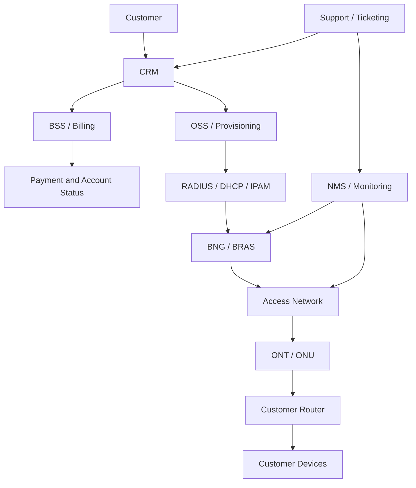
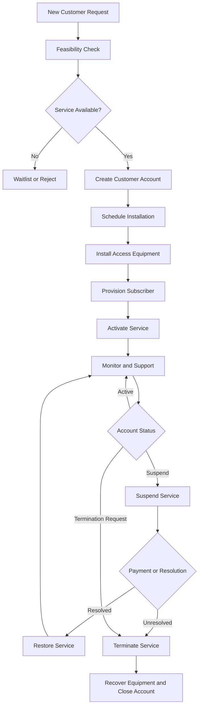
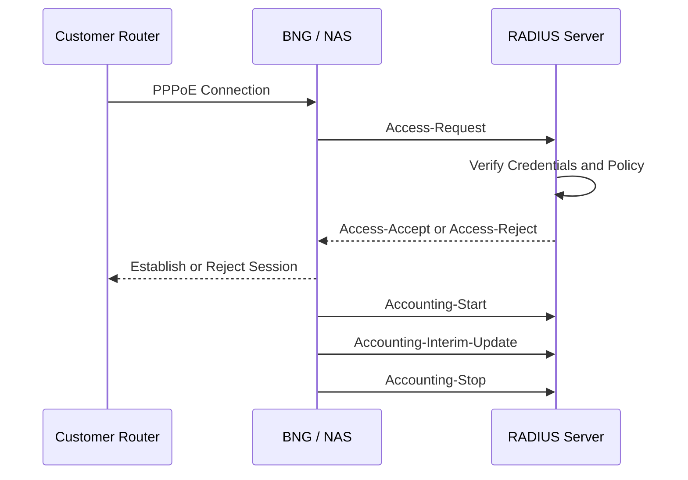
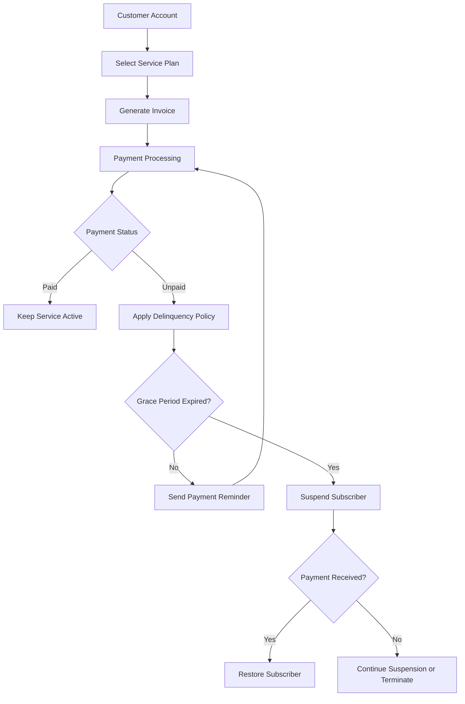
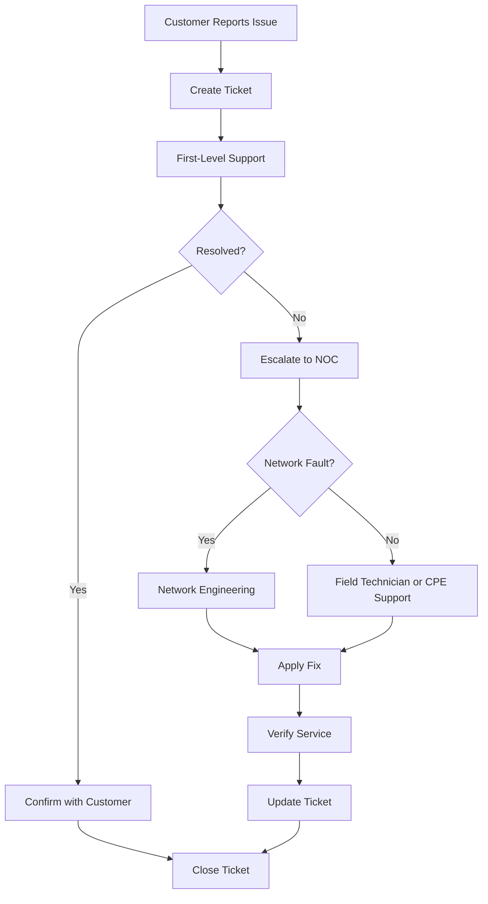
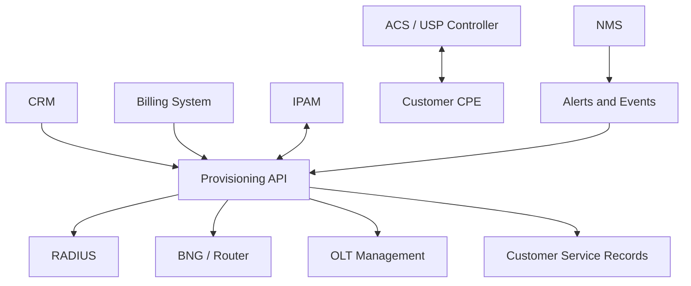

# Customer Network Management

Customer network management is the process of managing subscriber services, customer-premises equipment (CPE), network access, service provisioning, technical support, billing integration, and service lifecycle operations within an Internet Service Provider (ISP).

An effective customer management system connects customer records with the technical infrastructure that delivers internet services. This allows an ISP to identify which network resources serve a customer, provision services consistently, troubleshoot problems efficiently, and maintain accurate operational records.

# 🗁 Objectives of Customer Network Management

The primary objectives include:

* Maintaining accurate customer and service records.
* Managing subscriber installation, activation, modification, suspension, and termination.
* Automating subscriber authentication and authorization.
* Tracking customer-premises equipment and access infrastructure.
* Monitoring subscriber connectivity and service quality.
* Managing customer support requests and technical incidents.
* Integrating CRM, billing, RADIUS, IPAM, and network monitoring systems.
* Protecting customer information and network infrastructure.
* Measuring service performance and operational efficiency.

# 🗁 Customer Management Architecture

Customer management connects business operations with network infrastructure.



The main components are:

| Component | Responsibility |
| --- | --- |
| CRM | Customer profiles, contacts, service requests, and communication |
| BSS | Billing, subscriptions, payments, and commercial service management |
| OSS | Network service provisioning and operational workflows |
| RADIUS | Subscriber authentication, authorization, and accounting |
| BNG / BRAS | Subscriber session termination and policy enforcement |
| DHCP | Dynamic IP address assignment |
| IPAM | IP address allocation and tracking |
| ACS | Remote management of supported customer devices |
| NMS | Network monitoring, alerts, and performance tracking |
| Ticketing | Technical support and incident management |

# 🗁 Customer Lifecycle Management

An ISP should manage customers through a defined service lifecycle.



# 🗁 Customer Registration

When a new customer requests an internet connection, the ISP should create a unique customer record.

A customer record should contain:

| Field | Description |
| --- | --- |
| Customer ID | Unique customer identifier |
| Customer Name | Individual or organization name |
| Contact Number | Primary communication number |
| Email | Customer email address |
| Service Address | Physical installation location |
| Customer Type | Residential, SME, or enterprise |
| Registration Date | Date the customer registered |
| Account Status | Pending, active, suspended, or terminated |
| Billing Cycle | Monthly or another agreed billing period |
| Assigned Sales Agent | Responsible sales representative |
| Service Notes | Additional customer information |

Use a unique customer ID rather than relying on a phone number or customer name. Contact details can change, but the customer identifier should remain stable.

Example:

| Field | Example |
| --- | --- |
| Customer ID | CUST-10025 |
| Customer Name | Example Customer |
| Customer Type | Residential |
| Service Address | Example Road, Gazipur |
| Contact Number | Customer's registered number |
| Account Status | Active |
| Registration Date | 2026-11-01 |

# 🗁 Service Inventory Management

A customer account and an internet service are not necessarily the same thing.

One customer may have multiple services, such as a residential connection, a business connection, or a separate static IP service.

Each service should have its own unique service ID and technical inventory.

| Field | Description |
| --- | --- |
| Service ID | Unique subscriber service identifier |
| Customer ID | Associated customer account |
| Access Technology | FTTH, Ethernet, wireless, or other |
| POP | Point of Presence serving the customer |
| OLT | Optical Line Terminal identifier |
| PON Port | Optical PON interface |
| VLAN | Subscriber service VLAN |
| ONT / ONU Serial | Registered optical device serial |
| CPE Router | Customer router model or identifier |
| PPPoE Username | Subscriber authentication identity |
| RADIUS Profile | Assigned authorization profile |
| IPv4 Address | Assigned IPv4 address or pool |
| IPv6 Prefix | Assigned IPv6 prefix or delegation |
| Public IP | Dedicated public IP, if applicable |
| CGNAT Status | Whether the subscriber uses carrier-grade NAT |
| Installation Date | Service installation date |
| Service Status | Provisioning, active, suspended, or terminated |

Example service inventory:

| Field | Example |
| --- | --- |
| Service ID | SRV-20025 |
| Customer ID | CUST-10025 |
| Access Technology | FTTH |
| POP | POP-GAZ-01 |
| OLT | OLT-01 |
| PON Port | 1/2/3 |
| VLAN | 120 |
| ONT Serial | ABCD12345678 |
| PPPoE Username | cust10025 |
| RADIUS Profile | HOME-30M |
| IPv4 Allocation | CGNAT Pool |
| IPv6 | DHCPv6 Prefix Delegation |
| CGNAT Status | Enabled |
| Service Status | Active |

Keep customer account records, service records, and network inventory synchronized. This makes troubleshooting and infrastructure planning significantly easier.

# 🗁 Service Provisioning

Service provisioning is the process of configuring network infrastructure and subscriber systems to deliver an internet service.

The provisioning workflow typically includes:

* Creating the subscriber service record.
* Assigning a service plan and bandwidth profile.
* Registering the subscriber in RADIUS or the relevant authentication system.
* Configuring VLAN and access-network settings.
* Allocating IPv4 and IPv6 resources.
* Registering the ONT or ONU where applicable.
* Configuring the BNG, BRAS, DHCP, or other access systems.
* Verifying authentication and connectivity.
* Updating the service status to active.

Common subscriber access methods include:

| Method | Description |
| --- | --- |
| PPPoE | Subscriber authentication using PPP over Ethernet |
| IPoE | IP-based subscriber access, commonly using DHCP |
| Static IP | Manually assigned IP configuration |
| DHCP | Automatic IP address configuration |
| RADIUS | Centralized authentication and authorization |

# 🗁 PPPoE Subscriber Provisioning

In a PPPoE-based ISP network, each subscriber usually receives a unique PPPoE username and password.

The ISP configures the subscriber's account in the RADIUS server or another authentication system.

Example subscriber information:

```text
Username: cust10025
Password: ********
Service Profile: HOME-30M
Download: 30 Mbps
Upload: 30 Mbps
Session Limit: 1
IPv4: CGNAT Pool
IPv6: DHCPv6-PD
Status: Active
```

RADIUS can provide attributes such as:

| Attribute | Purpose |
| --- | --- |
| User-Name | Subscriber identity |
| User-Password | Authentication credential |
| Service-Type | Requested service type |
| Framed-IP-Address | Assigned IPv4 address |
| Framed-Pool | Address pool selection |
| Framed-Protocol | Framed protocol information |
| Session-Timeout | Maximum session duration |
| Filter-Id | Policy or service profile identifier |
| Acct-Session-Id | Accounting session identifier |

The actual attributes supported depend on the NAS, RADIUS server, and vendor implementation.

# 🗁 RADIUS-Based Subscriber Management

RADIUS centralizes subscriber authentication, authorization, and accounting.

A typical authentication process:



RADIUS accounting can provide:

* Session start and stop timestamps.
* Subscriber session duration.
* Assigned IP addresses.
* NAS identification.
* Uploaded and downloaded traffic counters.
* Session termination reasons.

These records help with usage reporting, troubleshooting, billing verification, and network capacity planning.

# 🗁 IP Address and IPv6 Management

Subscriber IP allocation should be coordinated with the ISP's IPAM system.

Common allocation models include:

| Allocation Type | Description |
| --- | --- |
| Dynamic Private IPv4 | Assigned from a private address pool |
| CGNAT IPv4 | Shared public IPv4 connectivity through carrier-grade NAT |
| Dedicated Public IPv4 | Public address assigned to one subscriber |
| Static IPv4 | Address remains assigned according to the service agreement |
| Dynamic IPv6 | IPv6 addressing configured through supported mechanisms |
| IPv6 Prefix Delegation | A routed IPv6 prefix delegated to the customer router |

For IPv6-enabled subscribers, an ISP may delegate a prefix using DHCPv6 Prefix Delegation.

The delegated prefix allows the customer's router to provide IPv6 connectivity to devices on the internal network.

Maintain records of:

* Address pools and subnet boundaries.
* Subscriber IPv4 assignments.
* Public IP reservations.
* CGNAT address mappings and logging requirements.
* IPv6 delegated prefixes.
* Prefix delegation size.
* Allocation timestamps.
* Assignment history.

# 🗁 Customer-Premises Equipment Management

Customer-premises equipment (CPE) is the hardware installed at the customer's location to provide network connectivity.

Common CPE devices include:

| Device | Purpose |
| --- | --- |
| ONT | Terminates a fiber-optic PON connection |
| ONU | Optical Network Unit used in optical access networks |
| Router | Routes traffic between the customer LAN and ISP network |
| Wi-Fi Access Point | Provides wireless connectivity |
| Switch | Connects multiple wired devices |
| Media Converter | Converts between supported physical media |

The ISP should maintain an inventory of all supplied equipment.

Recommended CPE inventory fields:

* Device ID.
* Customer ID and service ID.
* Manufacturer and model.
* Serial number.
* MAC address.
* Firmware version.
* Management IP address, if applicable.
* Installation date.
* Configuration profile.
* Warranty information.
* Device status.
* Equipment ownership: ISP-owned or customer-owned.

# 🗁 Remote CPE Management

ISPs may use remote management systems to configure and monitor compatible customer devices.

Common technologies include:

| Technology | Purpose |
| --- | --- |
| TR-069 | CPE WAN Management Protocol |
| TR-369 | User Services Platform (USP) |
| ACS | Auto Configuration Server used with TR-069 |
| SNMP | Monitoring and management of supported network devices |
| SSH | Secure command-line administration |
| Vendor API | Device-specific configuration and monitoring |

Remote management can support:

* Wi-Fi configuration changes.
* Firmware updates.
* Device status monitoring.
* WAN configuration.
* Diagnostics.
* Configuration backup.
* Remote troubleshooting.

Management interfaces should use unique credentials, restricted access, encrypted communication, and appropriate authorization policies.

# 🗁 Customer Installation Workflow

A consistent installation workflow reduces activation errors and repeated field visits.

**Site survey**

* Confirm the customer's physical address.
* Check access-network coverage.
* Identify the nearest POP, OLT, or wireless access point.
* Check available network capacity.
* Determine cable routing and installation requirements.

**Physical installation**

* Install the fiber drop cable or other access medium.
* Verify connector cleanliness and termination quality.
* Check splice quality where applicable.
* Install and power the ONT or ONU.
* Register the optical device with the OLT.
* Connect the customer router.

**Service provisioning**

* Create or verify the customer account.
* Assign the service plan.
* Configure the subscriber VLAN.
* Create the PPPoE or IPoE subscriber profile.
* Configure RADIUS, DHCP, or static addressing.
* Assign IPv4 and IPv6 resources.
* Verify the subscriber session.

**Service testing**

* Confirm optical signal levels where applicable.
* Verify WAN connectivity.
* Test DNS resolution.
* Check latency and packet loss.
* Perform a throughput test using an appropriate test server.
* Verify Wi-Fi coverage and configuration.
* Confirm that the delivered service matches the subscribed plan.

**Customer handover**

* Provide the Wi-Fi SSID and password securely.
* Explain how to restart the equipment.
* Provide support contact information.
* Explain the billing cycle and service plan.
* Record installation completion and customer acceptance.

# 🗁 Installation Checklist

| Task | Status |
| --- | --- |
| Customer address verified | Pending |
| Network feasibility confirmed | Pending |
| Cable route inspected | Pending |
| Drop cable installed | Pending |
| Optical power checked | Pending |
| ONT / ONU registered | Pending |
| Router configured | Pending |
| Subscriber authenticated | Pending |
| IPv4 connectivity tested | Pending |
| IPv6 connectivity tested, if applicable | Pending |
| DNS resolution tested | Pending |
| Speed test completed | Pending |
| Customer handover completed | Pending |
| Inventory updated | Pending |

# 🗁 Optical Signal Verification

For FTTH customers, optical signal quality is an important part of installation and troubleshooting.

The technician should check:

* OLT transmit and receive optical power where available.
* ONT receive optical power.
* Connector cleanliness.
* Fiber bending and physical damage.
* Splice and connector quality.
* Optical alarms and LOS status.

Acceptable optical levels depend on the PON technology, optical class, equipment, and engineering design. Use the manufacturer's specifications and the network's approved optical power budget rather than applying one universal threshold.

# 🗁 Billing and Subscriber Lifecycle Integration

Customer billing systems should be integrated with subscriber provisioning.

A typical billing workflow:



The billing system should communicate with the provisioning system to apply service changes.

Examples:

| Business Event | Network Action |
| --- | --- |
| New subscription | Create subscriber profile |
| Payment confirmed | Activate or retain service |
| Payment overdue | Apply configured suspension policy |
| Payment received after suspension | Restore subscriber |
| Plan upgrade | Apply new bandwidth profile |
| Plan downgrade | Apply reduced bandwidth profile |
| Static IP purchase | Allocate and configure address |
| Service termination | Disable access and release resources |

Avoid directly coupling billing logic to individual router commands. Use a provisioning service or controlled integration layer to validate requests and apply network changes consistently.

# 🗁 Service Plan Management

An ISP may offer different service plans according to customer requirements.

| Plan | Customer Type | Download | Upload | Service Characteristics |
| --- | --- | ---: | ---: | --- |
| HOME-10M | Residential | 10 Mbps | 10 Mbps | Basic internet |
| HOME-30M | Residential | 30 Mbps | 30 Mbps | Standard internet |
| HOME-50M | Residential | 50 Mbps | 50 Mbps | Higher-speed internet |
| SME-100M | Small Business | 100 Mbps | 100 Mbps | Business connectivity |
| ENT-100M | Enterprise | 100 Mbps | 100 Mbps | Contracted service and SLA |

These are illustrative service profiles, not universal ISP offerings.

A service plan may define:

* Download and upload bandwidth.
* Traffic priority.
* Shared or dedicated bandwidth.
* Static or dynamic addressing.
* IPv6 availability.
* CGNAT policy.
* Session limits.
* Fair-use policy, where applicable.
* Support priority.
* Service-level agreement (SLA).

# 🗁 Bandwidth Profile Changes

When a customer upgrades or downgrades a service plan, the ISP must update the subscriber's authorization profile and active session policy.

For RADIUS-based systems, this may involve changing the subscriber's assigned profile and sending a supported Change of Authorization (CoA) request or disconnecting the session so that the subscriber reconnects with the new policy.

For MikroTik RouterOS v7, an ISP can use RADIUS rate-limit attributes or other supported mechanisms to apply subscriber bandwidth policies.

Example PPP profile configuration:

```routeros
/ppp profile
add name=HOME-30M rate-limit=30M/30M

add name=HOME-50M rate-limit=50M/50M
```

The exact rate-limit interpretation and enforcement depend on the RouterOS PPP service and subscriber configuration.

# 🗁 MikroTik Subscriber Monitoring

For a MikroTik-based ISP using PPPoE, administrators can inspect active subscriber sessions.

List active PPP sessions:

```routeros
/ppp active print
```

Inspect a specific subscriber:

```routeros
/ppp active print detail where name="cust10025"
```

Display PPP secrets:

```routeros
/ppp secret print
```

Inspect PPP profiles:

```routeros
/ppp profile print
```

These commands help administrators verify subscriber sessions, assigned addresses, and service profiles.

# 🗁 DHCP Subscriber Monitoring

For IPoE or DHCP-based subscriber networks, administrators can inspect DHCP leases.

```routeros
/ip dhcp-server lease print
```

Inspect lease details:

```routeros
/ip dhcp-server lease print detail
```

Find a lease by MAC address:

```routeros
/ip dhcp-server lease print where mac-address="AA:BB:CC:DD:EE:FF"
```

DHCP lease records can help identify address assignments and client connectivity, but they do not necessarily prove that the subscriber has working internet access.

# 🗁 Customer Support and Ticket Management

Customer support is an essential part of ISP operations.

Every technical complaint should be recorded in a ticketing system. This allows support teams to track incidents, assign responsibility, communicate with customers, and measure resolution performance.

A support ticket should include:

| Field | Description |
| --- | --- |
| Ticket ID | Unique ticket identifier |
| Customer ID | Associated customer |
| Service ID | Affected service |
| Issue Category | Type of reported problem |
| Priority | Incident priority |
| Description | Customer-reported symptoms |
| Assigned Team | Responsible support team |
| Created Time | Ticket creation timestamp |
| Response Time | First meaningful response |
| Resolution Time | Time the issue was resolved |
| Resolution Notes | Diagnosis and corrective action |
| Ticket Status | Current ticket state |

# 🗁 Common ISP Support Categories

| Category | Example |
| --- | --- |
| No Internet | Customer cannot access the internet |
| LOS / Fiber Fault | Optical link disconnected |
| PPPoE Authentication | Incorrect credentials or rejected session |
| Slow Speed | Throughput below expected performance |
| Wi-Fi Problem | Weak wireless signal or interference |
| High Latency | Excessive response time |
| Packet Loss | Packets are being dropped |
| DNS Problem | Domain names fail to resolve |
| IP Assignment | DHCP or address allocation failure |
| Billing Issue | Payment or invoice problem |
| Equipment Fault | ONT, ONU, or router malfunction |
| Planned Maintenance | Scheduled service interruption |

# 🗁 Ticket Priority and Escalation

Ticket priority should reflect customer impact, service criticality, and incident scope.

| Priority | Example | Handling |
| --- | --- | --- |
| Critical | Major POP outage affecting many customers | Immediate NOC escalation |
| High | Enterprise customer service outage | Urgent technical investigation |
| Medium | Individual customer has no internet | Standard technical queue |
| Low | Wi-Fi configuration request | Scheduled support |

An ISP may define different response and resolution targets for residential, SME, and enterprise customers.

An escalation workflow:



# 🗁 Troubleshooting Customer Connectivity

A systematic troubleshooting process helps identify whether a problem originates from the access network, subscriber authentication, customer equipment, or upstream connectivity.

**Check subscriber status**

For PPPoE subscribers:

```routeros
/ppp active print detail where name="cust10025"
```

If the subscriber is not connected, inspect authentication logs and RADIUS responses.

**Check customer IP assignment**

For DHCP-based subscribers:

```routeros
/ip dhcp-server lease print
```

For PPPoE subscribers, inspect the active session's assigned address.

**Check access-network connectivity**

Inspect relevant interfaces:

```routeros
/interface print stats
```

Look for interface errors, drops, link failures, and abnormal traffic levels.

**Check routing and upstream connectivity**

```routeros
/ip route print
```

Test an upstream destination:

```routeros
/ping 1.1.1.1
```

**Check DNS resolution**

```bash
dig example.com
```

**Check packet path**

```bash
traceroute 1.1.1.1
```

**Check customer throughput**

Use an approved throughput test server and compare the result with the subscribed service profile. Ensure that the test endpoint and network path are capable of handling the expected traffic.

# 🗁 Fault Isolation by Network Layer

| Symptom | Possible Cause | Investigation |
| --- | --- | --- |
| ONT LOS alarm | Fiber cut or optical signal loss | Inspect fiber and optical levels |
| ONT online, no internet | VLAN or subscriber provisioning issue | Check service VLAN and subscriber configuration |
| PPPoE authentication failure | Incorrect credentials or RADIUS rejection | Inspect authentication logs |
| DHCP address unavailable | DHCP pool or relay problem | Inspect DHCP server and relay |
| IP connectivity works, domains fail | DNS problem | Test DNS resolution |
| High Wi-Fi latency | Wireless interference or weak signal | Inspect channel and signal quality |
| Wired and wireless both slow | Congestion or upstream issue | Check utilization and packet loss |
| Only one device affected | Customer device or local LAN problem | Test another device |
| Multiple customers affected | Shared network fault | Correlate tickets and network alerts |
| Some connections fail through CGNAT | Port exhaustion or mapping issue | Inspect NAT utilization and logs |

# 🗁 CGNAT Subscriber Management

When subscribers share public IPv4 addresses through Carrier-Grade NAT, the ISP should maintain accurate mapping and logging information.

Important information includes:

* Subscriber private IPv4 address.
* Shared public IPv4 address.
* Source port allocation or mapping.
* Protocol.
* Timestamp with appropriate precision.
* NAT device identifier.
* Subscriber or session identity, where available.

These records help identify which subscriber used a particular translated connection at a particular time.

CGNAT capacity should be monitored for:

* Public address utilization.
* Available source port capacity.
* Concurrent connection counts.
* Port allocation failures.
* Session tracking capacity.
* CPU and memory utilization.

# 🗁 Customer Communication

Customer communication should be consistent and recorded.

Important communication events include:

* Service installation confirmation.
* Activation notification.
* Payment reminders.
* Planned maintenance announcements.
* Outage notifications.
* Ticket status updates.
* Service restoration confirmation.
* Service plan changes.
* Suspension and termination notifications.

For a network outage affecting multiple customers, the ISP should create a parent incident and associate individual customer tickets with that incident. This prevents duplicated investigations and gives the NOC a consolidated view of customer impact.

# 🗁 Customer Segmentation

Customer segmentation helps ISPs organize services, prioritize support, and plan network resources.

| Segment | Typical Requirements |
| --- | --- |
| Residential | Affordable broadband and reliable internet |
| SME | Business connectivity and responsive support |
| Enterprise | Contracted performance, SLA, and escalation |
| Wholesale | Connectivity supplied to another service provider |
| Dedicated Internet | Dedicated bandwidth and agreed service characteristics |

Enterprise and dedicated internet customers may require:

* Static public IP addressing.
* Dedicated access circuits.
* Defined availability targets.
* Service-level agreements.
* Priority incident handling.
* Detailed performance reporting.
* Redundant connectivity.

# 🗁 Subscriber Monitoring and Customer Impact

An ISP should monitor subscribers at both the individual service level and the shared infrastructure level.

Useful monitoring data includes:

* Active and disconnected subscriber sessions.
* PPPoE authentication failures.
* DHCP lease availability.
* ONT optical signal levels.
* OLT PON port status.
* Access interface errors.
* Subscriber bandwidth utilization.
* Packet loss and latency.
* Upstream link utilization.
* CGNAT capacity.
* Network availability.

Customer-impact mapping connects network infrastructure to the affected subscriber records.

For example:

```text
POP-GAZ-01
    |
    +-- OLT-01
          |
          +-- PON 1/1/1
          |     |
          |     +-- SRV-20025
          |     +-- SRV-20026
          |     +-- SRV-20027
          |
          +-- PON 1/1/2
                |
                +-- SRV-20028
                +-- SRV-20029
```

If PON 1/1/1 fails, the ISP can identify the affected services without manually searching every customer record.

# 🗁 Service Suspension and Restoration

Suspension may occur because of:

* Overdue payments.
* Customer-requested temporary suspension.
* Contractual or policy violations.
* Security incidents.
* Administrative requirements.

A suspension workflow should:

* Verify the account and service.
* Confirm the reason for suspension.
* Check applicable business rules.
* Update the customer account status.
* Apply the appropriate network restriction.
* Record the suspension timestamp.
* Notify the customer.
* Preserve the service configuration where restoration is expected.

Restoration should reverse the applicable restrictions after the required condition has been satisfied.

For RADIUS-based systems, an ISP can disable or restrict the subscriber account and use supported CoA or Disconnect messages to update an active session.

Avoid relying only on a billing-system status change. The network provisioning system must confirm that the intended access policy has actually been applied.

# 🗁 Service Termination

When a customer permanently terminates a service, the ISP should complete a controlled closure process.

* Confirm the termination request.
* Verify outstanding billing obligations.
* Disable subscriber authentication.
* Disconnect active sessions.
* Release reserved IP addresses where appropriate.
* Remove or update network configuration.
* Recover ISP-owned equipment.
* Update the ONT or ONU inventory.
* Close the service record.
* Retain required accounting and operational records according to applicable policy.

Do not immediately delete historical service and accounting records. Historical data is useful for billing disputes, network analysis, and operational audits.

# 🗁 Customer Data Security

Customer management systems contain sensitive operational and personal information. Access should be controlled according to job responsibilities.

Recommended practices:

* Use role-based access control.
* Require strong authentication for administrative users.
* Avoid shared administrator accounts.
* Protect customer credentials.
* Restrict access to billing and identity records.
* Encrypt sensitive data in transit and at rest.
* Maintain audit logs for administrative changes.
* Limit access to network management interfaces.
* Use secure backup procedures.
* Establish retention and deletion policies.
* Protect RADIUS shared secrets and API credentials.

Support staff should receive only the information necessary to perform their responsibilities. Network administrators should not expose customer passwords through routine logs or support interfaces.

# 🗁 Automation and System Integration

Automating repetitive operations reduces manual errors and improves service consistency.

A typical ISP integration environment may include:



Useful automation workflows include:

| Trigger | Automated Action |
| --- | --- |
| New customer approved | Create service inventory |
| Installation completed | Provision subscriber |
| Payment confirmed | Activate or restore service |
| Payment overdue | Apply suspension policy |
| Plan upgraded | Update bandwidth profile |
| Plan downgraded | Apply new service profile |
| New ONT registered | Update equipment inventory |
| Network outage detected | Identify affected subscribers |
| Service terminated | Disable access and release resources |

An integration layer should validate requests, maintain transaction logs, handle failures, and support retries without creating duplicate subscriber records.

# 🗁 Operational KPIs

ISPs can use operational KPIs to measure customer service quality and network operations.

| KPI | Meaning |
| --- | --- |
| MTTR | Mean Time to Repair or Restore |
| MTBF | Mean Time Between Failures |
| First Contact Resolution | Percentage of tickets resolved during the first interaction |
| Ticket Rate | Number of support tickets relative to the subscriber base |
| Churn Rate | Percentage of customers who leave during a period |
| ARPU | Average Revenue Per User |
| Installation Lead Time | Time between order confirmation and service activation |
| Service Availability | Percentage of time a service is available |
| Repeat Fault Rate | Percentage of incidents recurring after resolution |
| Collection Rate | Percentage of billed revenue successfully collected |

KPIs should be calculated using consistent definitions and reporting periods. For example, MTTR should clearly define whether its measurement begins at incident detection, ticket creation, or customer notification.

# 🗁 Practical ISP Operations Workflow

Consider an ISP installing a 30 Mbps FTTH connection for a new residential customer.

**Customer registration**

```text
Customer ID: CUST-10025
Customer Type: Residential
Status: Pending
```

**Service creation**

```text
Service ID: SRV-20025
Access Technology: FTTH
Service Plan: HOME-30M
POP: POP-GAZ-01
OLT: OLT-01
PON Port: 1/2/3
VLAN: 120
```

**Subscriber provisioning**

```text
PPPoE Username: cust10025
RADIUS Profile: HOME-30M
IPv4: CGNAT Pool
IPv6: DHCPv6 Prefix Delegation
Session Limit: 1
```

**Installation and testing**

```text
ONT Registration: Successful
Optical Signal: Within Approved Range
PPPoE Authentication: Successful
IPv4 Connectivity: Successful
IPv6 Connectivity: Verified
DNS Resolution: Successful
Speed Test: Within Expected Service Profile
```

**Activation**

```text
Customer Status: Active
Service Status: Active
Installation Status: Completed
Billing Status: Active
```

The customer record, service inventory, billing system, RADIUS database, and network configuration should all reflect the same service state.

# 🗁 Recommended Documentation and Standards

The following references are useful for implementing ISP subscriber management:

| Reference | Subject |
| --- | --- |
| RFC 2865 | RADIUS Authentication |
| RFC 2866 | RADIUS Accounting |
| RFC 2516 | PPP over Ethernet (PPPoE) |
| RFC 2131 | Dynamic Host Configuration Protocol (DHCP) |
| RFC 8415 | DHCPv6 and Prefix Delegation |
| Broadband Forum TR-069 | CPE WAN Management Protocol |
| Broadband Forum TR-369 | User Services Platform |
| ITU-T G.984 | Gigabit-capable Passive Optical Networks (GPON) |
| ITIL Practices | Service management and incident management |

# 🗁 Best Practices

* Maintain a unique customer ID and service ID.
* Keep customer records synchronized with network inventory.
* Use centralized subscriber authentication where appropriate.
* Automate provisioning and suspension through controlled workflows.
* Maintain accurate IPAM and CGNAT records.
* Track ONT, ONU, router, and other CPE equipment.
* Correlate customer tickets with network incidents.
* Monitor subscriber sessions and access-network health.
* Apply consistent installation and troubleshooting procedures.
* Protect customer information and administrative credentials.
* Maintain historical records for auditing and troubleshooting.
* Review operational KPIs regularly.

# 🗁 Summary

Customer network management connects an ISP's customer-facing operations with its technical infrastructure. It covers the complete subscriber lifecycle, from registration and installation to provisioning, monitoring, support, suspension, and termination.

A well-designed system integrates CRM, billing, OSS, RADIUS, IPAM, CPE management, and network monitoring. This integration helps an ISP reduce operational errors, improve troubleshooting efficiency, maintain accurate subscriber records, and deliver consistent internet services.
