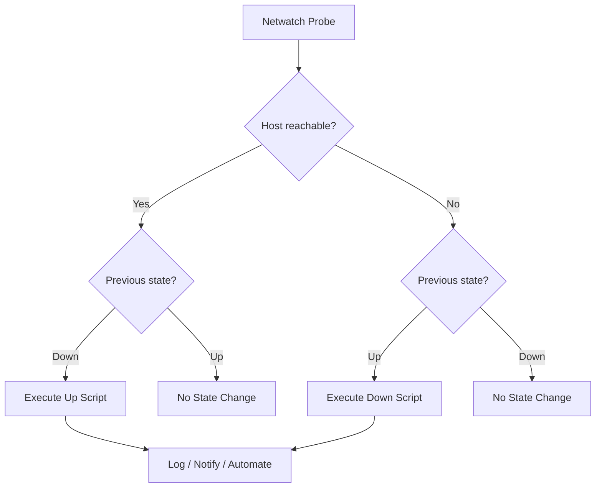
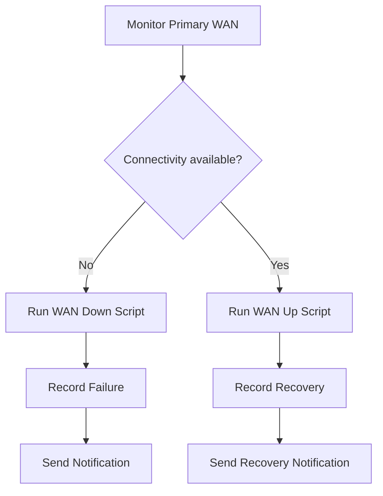

# Netwatch Automation

Netwatch automation uses network monitoring events to trigger scripts and configuration actions automatically. When a monitored host becomes reachable or unreachable, RouterOS can execute an `up-script` or `down-script`.

This makes Netwatch useful for automating operational tasks such as:

* Recording WAN connectivity changes.
* Sending notifications when a link fails or recovers.
* Enabling or disabling selected services.
* Triggering diagnostic scripts.
* Integrating monitoring events with other RouterOS automation.

This document focuses on event-driven automation in RouterOS v7. For basic Netwatch monitoring and probe configuration, see `14-monitoring-and-troubleshooting/06-netwatch.md`.

# 🗁 How Netwatch Automation Works

Netwatch continuously checks a configured destination using a selected probe type.

When the probe detects a state transition, RouterOS executes the corresponding script.



The important distinction is that Netwatch scripts are event-driven. They run when Netwatch detects a relevant state transition, rather than continuously executing at every probe interval.

# 🗁 Creating an Event-Driven Netwatch Entry

The following example monitors an external DNS resolver using ICMP.

```routeros
/tool/netwatch/add host=1.1.1.1 type=icmp interval=30s timeout=2s comment="WAN connectivity automation" up-script=":log info \"WAN connectivity restored\"" down-script=":log warning \"WAN connectivity lost\""
```

This configuration:

* Checks `1.1.1.1` every 30 seconds.
* Uses an ICMP probe.
* Allows up to two seconds for a response.
* Logs a message when connectivity is restored.
* Logs a warning when connectivity is lost.

Inspect the configured entries:

```routeros
/tool/netwatch/print detail
```

# 🗁 Logging Connectivity Events

Logging is one of the simplest and most useful automation actions.

It provides a historical record of connectivity transitions that can help identify intermittent WAN failures.

```routeros
/tool/netwatch/add host=8.8.8.8 type=icmp interval=30s timeout=2s comment="Internet availability log" up-script=":log info \"Internet connection is UP\"" down-script=":log warning \"Internet connection is DOWN\""
```

View recent log entries:

```routeros
/log/print
```

For a more descriptive log entry, include the monitored destination in the message:

```routeros
:log warning "Netwatch: 8.8.8.8 is unreachable"
```

Avoid creating multiple Netwatch entries that monitor the same destination without a clear purpose. Duplicate probes can produce redundant logs and unnecessary monitoring traffic.

# 🗁 Calling Reusable Scripts from Netwatch

For larger automation tasks, keep the operational logic in System Scripts and let Netwatch trigger those scripts.

Create a script for a connectivity failure:

```routeros
/system/script/add name=wan-down source={
    :log warning "WAN failure detected"
    :log warning "Starting WAN failure response"
}
```

Create another script for connectivity recovery:

```routeros
/system/script/add name=wan-up source={
    :log info "WAN connectivity restored"
    :log info "WAN recovery detected"
}
```

Connect these scripts to Netwatch:

```routeros
/tool/netwatch/add host=1.1.1.1 type=icmp interval=30s timeout=2s comment="WAN event automation" up-script="/system/script/run wan-up" down-script="/system/script/run wan-down"
```

This approach separates monitoring configuration from automation logic.

It also makes scripts easier to reuse from other RouterOS components.

**Execution permissions:** Netwatch scripts execute in a restricted policy context. Ensure the Netwatch entry and any called scripts have only the permissions required for their operations. Test script execution in the intended context before relying on it in production.

# 🗁 Automating WAN Failure Notifications

A common use case is notifying an administrator when a WAN connection becomes unavailable or recovers.

The following example demonstrates the event structure using log messages:

```routeros
/system/script/add name=wan-alert-down source={
    :log warning "ALERT: Primary WAN is unavailable"
}

/system/script/add name=wan-alert-up source={
    :log info "ALERT: Primary WAN has recovered"
}
```

Attach the scripts to a Netwatch entry:

```routeros
/tool/netwatch/add host=1.1.1.1 type=icmp interval=30s timeout=2s comment="Primary WAN alert" up-script="/system/script/run wan-alert-up" down-script="/system/script/run wan-alert-down"
```

For actual email or other external notifications, configure the required notification service separately and call its notification script from the Netwatch event.

Keep notification delivery separate from connectivity detection. A failed WAN may also prevent the router from delivering an external notification through that same WAN.

# 🗁 Automating Route State Changes

Netwatch can trigger route-related actions, but route monitoring and routing failover should be designed carefully.

For ordinary WAN failover, RouterOS route monitoring with `check-gateway` and properly configured backup routes is generally preferable to manually enabling and disabling routes through Netwatch.

Netwatch-based route changes may be useful when a failover decision depends on an application-level or remote-host probe rather than gateway reachability.

Before automating route changes:

* Identify the exact route using a stable comment or other reliable selector.
* Ensure the recovery action restores the intended route state.
* Avoid allowing multiple monitoring entries to control the same route.
* Consider route flapping and delayed probe results.
* Test behavior when the monitored destination itself becomes unavailable.

Do not use a public probe destination as the only proof that a particular WAN interface has failed. The destination may be unavailable independently of the WAN connection.

# 🗁 Preventing Unnecessary Automation Triggers

A single failed probe does not always indicate a persistent network failure. Temporary packet loss, congestion, or remote-host filtering can cause short-lived failures.

To reduce unnecessary actions:

* Choose a suitable probe interval and timeout.
* Monitor a reliable destination.
* Use probe thresholds where supported by the selected Netwatch probe type and RouterOS version.
* Avoid triggering disruptive actions for every brief interruption.
* Test both failure and recovery behavior.

For critical services, consider monitoring more than one independent destination. A single remote host can fail while the rest of the internet remains reachable.

# 🗁 Inspecting and Managing Automation Entries

List all Netwatch entries:

```routeros
/tool/netwatch/print
```

Display detailed configuration:

```routeros
/tool/netwatch/print detail
```

Inspect available properties for the installed RouterOS version:

```routeros
/tool/netwatch/add ?
```

Disable a specific entry by its item number:

```routeros
/tool/netwatch/disable 0
```

Enable it again:

```routeros
/tool/netwatch/enable 0
```

Remove an entry:

```routeros
/tool/netwatch/remove 0
```

Use the actual item number shown by the router. Item numbers can change when entries are added or removed, so avoid hardcoding them in reusable automation.

# 🗁 Security and Operational Best Practices

Netwatch automation can modify router behavior, so its scripts should be treated as privileged operational components.

* Grant only the permissions required by each script.
* Keep script names and comments descriptive.
* Validate scripts before attaching them to monitoring events.
* Avoid embedding passwords, API tokens, or other secrets directly in script source.
* Do not let multiple automation systems control the same configuration without coordination.
* Log important state transitions.
* Test recovery behavior, not just failure behavior.
* Keep a manual recovery procedure available.
* Review automation after RouterOS upgrades because supported probe properties and behavior can vary by release.

# 🗁 Practical Automation Scenario

Consider a small office with a primary WAN connection.

The router monitors an external destination. When the destination becomes unreachable, Netwatch records the event and invokes a failure script. When connectivity returns, it invokes a recovery script.

The operational sequence is:



For production deployments, keep the actual routing failover mechanism independent from notification automation unless there is a specific requirement for Netwatch-controlled routing. This reduces the risk of monitoring scripts interfering with the routing system.
