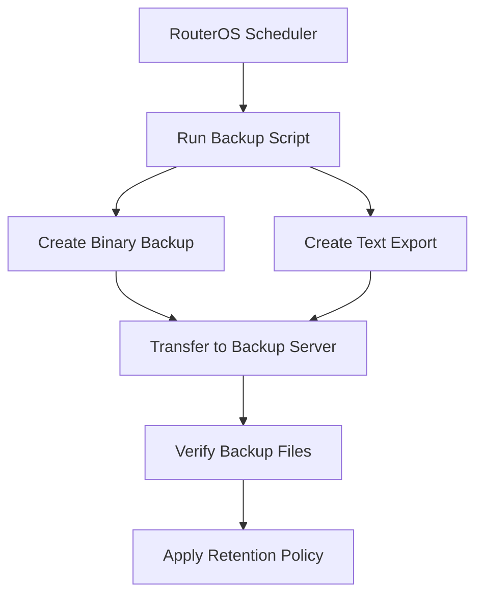

# Automated Backups

Automated backups in MikroTik RouterOS allow administrators to preserve router configurations regularly without manually exporting or downloading files.

A reliable backup strategy helps recover from:

* Accidental configuration changes.
* Incorrect firewall or routing rules.
* RouterOS upgrades that introduce unexpected issues.
* Hardware failures or device replacement.
* Configuration corruption or administrative mistakes.

RouterOS provides two primary configuration backup methods:

* **Binary backup (`.backup`):** Saves router configuration and device-specific information in a binary format.
* **Text export (`.rsc`):** Exports configuration as readable RouterOS commands that can be reviewed and imported.

Both formats serve different recovery purposes. Keeping both provides greater flexibility.

# 🗁 Understanding RouterOS Backup Types

| Feature | Binary Backup | Text Export |
| --- | --- | --- |
| File format | `.backup` | `.rsc` |
| Human-readable | No | Yes |
| Configuration restoration | Binary restore | Command import |
| Device-specific information | May include device-specific data | Primarily configuration commands |
| Editing before restoration | No | Yes |
| Cross-device migration | Limited | More flexible |
| Typical use | Full configuration recovery | Configuration review and migration |

**Binary backup considerations:**

* Binary backups are generally intended for restoration on the same device and compatible RouterOS environment.
* They can contain sensitive configuration information.
* Treat them as confidential files.
* A binary restore can replace the existing configuration and cause a reboot.

**Text export considerations:**

* Text exports are useful for reviewing configuration and tracking changes.
* They can be edited before importing.
* They do not necessarily contain every piece of device state or every setting.
* Some exported commands may depend on interfaces, hardware, packages, or other configuration objects that differ on the destination router.

# 🗁 Creating a Binary Backup

Create a binary backup manually:

```routeros
/system/backup/save name=router-backup
```

The router creates a file named:

```text
router-backup.backup
```

List stored files:

```routeros
/file/print
```

To create a password-protected backup:

```routeros
/system/backup/save name=router-backup password="StrongBackupPassword"
```

Use a strong, unique password and store it securely. Password protection does not replace secure storage and transfer practices.

# 🗁 Creating a Text Configuration Export

Export the router configuration:

```routeros
/export file=router-config
```

This creates:

```text
router-config.rsc
```

For a more complete configuration export, including sensitive values where supported:

```routeros
/export show-sensitive file=router-config-sensitive
```

Sensitive exports can contain credentials, keys, and other confidential configuration values. Protect them accordingly.

To display the configuration directly in the terminal:

```routeros
/export
```

Use text exports when you need to inspect, compare, document, or migrate configuration.

# 🗁 Creating Backups with Timestamps

Timestamped filenames help distinguish backup versions.

The following RouterOS script creates a binary backup and a text export using the router's current date and time.

```routeros
:local date [/system/clock/get date]
:local time [/system/clock/get time]

:local timestamp ([:pick $date 0 3] . [:pick $date 4 6] . [:pick $date 7 11] . "-" . [:pick $time 0 2] . [:pick $time 3 5])

/system/backup/save name=("backup-" . $timestamp)
/export file=("config-" . $timestamp)

:log info ("Automated backup created: " . $timestamp)
```

The exact date representation can vary with RouterOS version and configuration. Validate the generated filename on the target device before deploying this script.

# 🗁 Creating an Automated Backup Script

A reusable script can create both backup formats in one execution.

```routeros
/system/script/add name=automated-backup source={
    :local date [/system/clock/get date]
    :local time [/system/clock/get time]

    :local timestamp ([:pick $date 0 3] . [:pick $date 4 6] . [:pick $date 7 11] . "-" . [:pick $time 0 2] . [:pick $time 3 5])

    :local backupName ("backup-" . $timestamp)
    :local exportName ("config-" . $timestamp)

    /system/backup/save name=$backupName
    /export file=$exportName

    :log info ("Backup completed: " . $timestamp)
}
```

Run the script manually:

```routeros
/system/script/run automated-backup
```

Verify the generated files:

```routeros
/file/print where name~"backup-"
/file/print where name~"config-"
```

Check the system log:

```routeros
/log/print where message~"Backup completed"
```

Ensure the script has the required execution policies and that the router has sufficient storage space.

# 🗁 Scheduling Automated Backups

RouterOS Scheduler can execute the backup script at a regular interval.

For example, schedule a backup every day:

```routeros
/system/scheduler/add name=daily-backup start-time=03:00:00 interval=1d on-event="/system/script/run automated-backup" policy=read,write,policy,test
```

This configuration:

* Creates a scheduler entry named `daily-backup`.
* Starts at 03:00.
* Repeats every 24 hours.
* Executes the `automated-backup` script.

The router clock and time zone should be configured correctly before relying on scheduled execution.

Check the scheduler:

```routeros
/system/scheduler/print detail
```

Check the script:

```routeros
/system/script/print detail where name="automated-backup"
```

Scheduler and script permissions must be sufficient for all operations. Review the required policies rather than granting unnecessary privileges.

# 🗁 Managing Old Backup Files

Automated backups can gradually consume router storage.

A retention policy should define how many local backup generations are kept.

For example, an administrator may retain the latest seven daily backups locally and transfer older generations to external storage.

Before deleting files automatically, verify:

* The file naming convention is consistent.
* The correct files are selected.
* At least one recent known-good backup remains available.
* A separate off-device copy exists.

Avoid deleting backups based only on broad filename matching without testing the selection logic.

For many deployments, managing retention on an external backup server is safer than performing complex file cleanup directly on the router.

# 🗁 Downloading Backups from RouterOS

RouterOS stores generated backup files in its file system.

You can retrieve them using supported management methods:

* WinBox file management.
* WebFig file management.
* SFTP, when the relevant service and access are configured.
* An external management system using an appropriate RouterOS API or file-transfer workflow.

For SFTP access, connect to the router using an authorized account:

```bash
sftp admin@192.168.88.1
```

List available files:

```bash
ls
```

Download a binary backup:

```bash
get backup-example.backup
```

Download a text export:

```bash
get config-example.rsc
```

The address and filenames above are examples. Replace them with the router's management address and actual generated filenames.

Restrict management access to trusted networks and authorized accounts.

# 🗁 Restoring a Binary Backup

A binary backup can restore a router's saved configuration.

Upload the backup file to the target router and inspect the available files:

```routeros
/file/print
```

Restore the backup:

```routeros
/system/backup/load name=router-backup.backup
```

If the backup was protected with a password:

```routeros
/system/backup/load name=router-backup.backup password="StrongBackupPassword"
```

The router restores the backup and reboots.

Before restoring:

* Confirm that the backup belongs to the intended device.
* Verify RouterOS compatibility.
* Ensure you have a recovery method if remote management becomes unavailable.
* Preserve the current configuration if it may be needed for rollback.

A binary restore replaces the active configuration. Do not treat it as a harmless merge operation.

# 🗁 Restoring a Text Export

Text exports can be imported as RouterOS commands.

Upload the `.rsc` file to the router, then execute:

```routeros
/import file-name=router-config.rsc
```

RouterOS processes the commands in the file.

Unlike binary restoration, importing a text export does not simply replace the entire existing configuration. It executes the exported commands against the current configuration.

This means:

* Existing configuration may remain.
* Duplicate or conflicting entries may be created.
* Some commands may fail because dependencies are missing.
* Device-specific interface names may not match.
* Importing a configuration onto an already configured router can produce unexpected results.

For a clean migration, prepare the destination router appropriately and review the export before importing.

# 🗁 Remote Backup Storage

Keeping backups only on the router is insufficient for disaster recovery.

If the router's storage fails or the device is lost, local backups may also become unavailable.

A stronger strategy transfers backups to an external system.

Possible storage destinations include:

* A dedicated Linux backup server.
* An SFTP server.
* A centralized network management system.
* Encrypted organizational storage.

A typical workflow is:



Use encrypted transfer protocols and protect backup files with appropriate access controls.

For larger deployments, centralize backup collection rather than configuring every router to manage its own remote retention policy.

# 🗁 Backup Verification

A successful backup command does not guarantee that the resulting file is usable.

A proper backup process should include verification.

Recommended checks:

* Confirm that the expected files exist.
* Check that their sizes are plausible and non-zero.
* Confirm that the transfer to external storage completed.
* Record the backup timestamp and router identity.
* Periodically test restoration in a controlled environment.
* Maintain a known-good recovery copy.

For text exports, inspect the contents and confirm that the expected configuration sections are present.

For binary backups, perform restoration testing on a suitable compatible device or controlled recovery environment.

# 🗁 Backup Security Best Practices

Router configuration backups may contain sensitive operational information.

Protect them with the same care as other privileged infrastructure data.

* Use strong passwords for password-protected binary backups.
* Restrict access to backup directories and storage servers.
* Encrypt backup storage where appropriate.
* Use SFTP or another secure transfer method.
* Avoid sending sensitive exports through unencrypted channels.
* Keep backup credentials separate from router credentials.
* Maintain off-device and, where appropriate, offline copies.
* Apply a retention policy.
* Test recovery procedures regularly.
* Record which router and configuration version each backup belongs to.

# 🗁 Practical Backup Strategy

A practical small-network backup policy could look like this:

| Backup activity | Suggested frequency |
| --- | --- |
| Binary backup | Daily |
| Text configuration export | Daily |
| External backup transfer | After each backup |
| Retention cleanup | Weekly |
| Restoration test | Periodically |
| Backup verification | After each transfer |

The exact schedule depends on configuration-change frequency, business requirements, storage capacity, and recovery objectives.

The central principle is simple: create backups regularly, transfer them off-device, verify them, and periodically prove that they can be restored.
