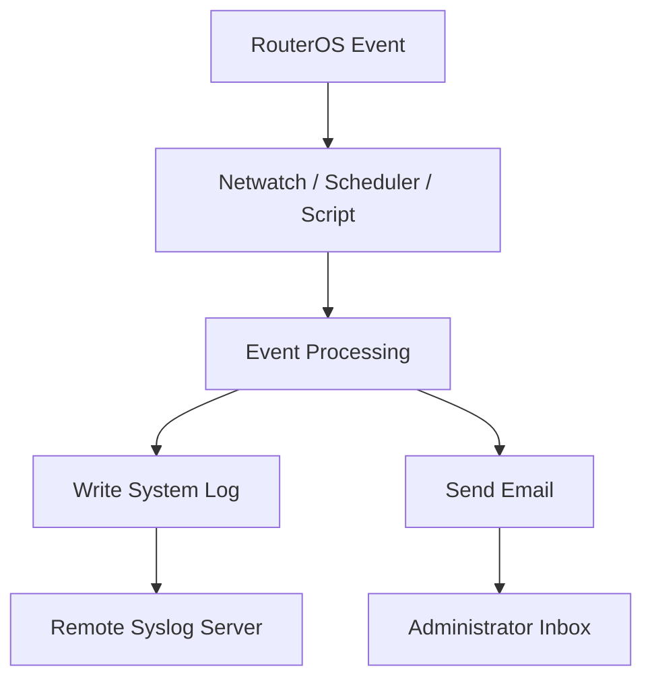

# Email and Notification

Email and notification services allow MikroTik RouterOS to send operational messages to network administrators.

Notifications help administrators identify important network events without continuously monitoring the router.

Common use cases include:

* WAN connectivity failure and recovery.
* Router reboot notifications.
* Backup completion reports.
* High resource utilization alerts.
* Interface state changes.
* Security-related events.
* Scheduled maintenance reports.
* ISP service monitoring.

RouterOS provides email configuration through `/tool/e-mail`. Scripts and other RouterOS features can use this service to send notifications.

# 🗁 Understanding RouterOS Email

RouterOS email configuration requires an SMTP server.

SMTP (Simple Mail Transfer Protocol) is used to send outgoing email messages.

The router acts as an SMTP client and connects to an external mail server.

```text
MikroTik RouterOS
       |
       | SMTP Connection
       |
       v
SMTP Server
       |
       | Email Delivery
       |
       v
Administrator Inbox

```

You generally need:

* SMTP server hostname or IP address.
* SMTP server port.
* Sender email address.
* Recipient email address.
* SMTP authentication credentials, when required.
* TLS configuration appropriate for the mail provider.

# 🗁 Configuring Email Settings

RouterOS email settings are configured through `/tool/e-mail`.

Example configuration:

```routeros
/tool/e-mail/set server=smtp.example.com port=587 from=router@example.com user=router@example.com password="SMTP-APP-PASSWORD" tls=starttls
```

Replace the example values with the SMTP provider's actual settings.

Common SMTP ports:

| Port | Typical purpose |
| --- | --- |
| 25 | SMTP relay, commonly server-to-server |
| 465 | SMTP over implicit TLS |
| 587 | SMTP submission, commonly STARTTLS |

RouterOS supports different TLS modes depending on the installed version. Check the available properties on the target router:

```routeros
/tool/e-mail/set ?
```

Use the TLS mode required by the SMTP provider. Do not assume that every provider supports the same port and encryption combination.

# 🗁 Sending a Test Email

After configuring SMTP settings, send a test message:

```routeros
/tool/e-mail/send to=admin@example.com subject="MikroTik Email Test" body="This is a test email from MikroTik RouterOS."
```

Replace `admin@example.com` with the actual recipient address.

Check the system log for SMTP-related errors:

```routeros
/log/print
```

If the email is not delivered, verify:

* SMTP hostname and port.
* SMTP username and password.
* TLS configuration.
* DNS resolution.
* Router internet connectivity.
* Firewall rules affecting outgoing SMTP traffic.
* Provider restrictions on automated email.

Some providers require application-specific passwords or other SMTP authentication methods rather than the account's normal login password.

# 🗁 Creating a Reusable Email Notification Script

Instead of writing email commands repeatedly, create reusable scripts.

Example:

```routeros
/system/script/add name=send-network-alert source={
    /tool/e-mail/send \
        to="admin@example.com" \
        subject="Network Alert" \
        body="A network event requires administrator attention."

    :log info "Network alert email requested"
}
```

Run the script:

```routeros
/system/script/run send-network-alert
```

The log message indicates that the script reached the email command. It does not independently prove that the recipient received the message.

For operational notifications, use meaningful subjects and message bodies that identify the router and event.

# 🗁 Sending WAN Failure Notifications

Netwatch can invoke email scripts when a monitored destination becomes unavailable or recovers.

Create a failure notification script:

```routeros
/system/script/add name=wan-down-email source={
    /tool/e-mail/send \
        to="admin@example.com" \
        subject="WAN Connection Down" \
        body="The monitored WAN connectivity check has failed."

    :log warning "WAN failure notification triggered"
}
```

Create a recovery notification script:

```routeros
/system/script/add name=wan-up-email source={
    /tool/e-mail/send \
        to="admin@example.com" \
        subject="WAN Connection Restored" \
        body="The monitored WAN connectivity check has recovered."

    :log info "WAN recovery notification triggered"
}
```

Connect the scripts to a Netwatch entry:

```routeros
/tool/netwatch/add host=1.1.1.1 type=icmp interval=30s timeout=2s comment="WAN email notifications" up-script="/system/script/run wan-up-email" down-script="/system/script/run wan-down-email"
```

This creates event-driven email notifications.

For a production network, consider whether the SMTP server remains reachable when the monitored WAN fails. If the same WAN provides internet access, the router may be unable to send the failure notification until connectivity returns.

# 🗁 Sending Router Reboot Notifications

RouterOS can run a startup script when the system starts.

Create a script:

```routeros
/system/script/add name=router-startup-email source={
    :local routerName [/system/identity/get name]

    /tool/e-mail/send \
        to="admin@example.com" \
        subject=("Router Started: " . $routerName) \
        body=("Router " . $routerName . " has started.")
}
```

Create a scheduler entry:

```routeros
/system/scheduler/add name=router-startup-notification start-time=startup on-event="/system/script/run router-startup-email" policy=read,write,policy,test
```

This sends an email when the scheduler executes the startup task.

The notification confirms that the startup script ran; it does not necessarily identify why the router restarted.

For reboot investigation, review system logs and available system health information separately.

# 🗁 Sending Scheduled Backup Notifications

Backup automation can also generate email notifications.

For example, create a script that sends a backup completion message:

```routeros
/system/script/add name=backup-completion-email source={
    :local routerName [/system/identity/get name]
    :local currentDate [/system/clock/get date]
    :local currentTime [/system/clock/get time]

    /tool/e-mail/send \
        to="admin@example.com" \
        subject=("Backup Completed: " . $routerName) \
        body=("Router: " . $routerName . "\nDate: " . $currentDate . "\nTime: " . $currentTime)

    :log info "Backup completion notification triggered"
}
```

Call this notification script from the automated backup script after the backup operations complete.

A notification should be sent only after the backup commands have completed successfully. For stronger verification, check that the expected files exist before sending the message.

Email delivery should not be treated as proof that a backup is valid. Backup verification and restoration testing remain separate responsibilities.

# 🗁 Emailing System Resource Alerts

Administrators may want notifications when CPU or memory usage becomes unusually high.

RouterOS exposes resource information through `/system/resource`.

Inspect current resource information:

```routeros
/system/resource/print
```

Example script that checks CPU utilization:

```routeros
/system/script/add name=cpu-alert source={
    :local cpuLoad [/system/resource/get cpu-load]

    :if ($cpuLoad > 85) do={
        /tool/e-mail/send \
            to="admin@example.com" \
            subject="High CPU Usage Alert" \
            body=("Router CPU utilization is " . $cpuLoad . "%")

        :log warning ("High CPU utilization detected: " . $cpuLoad . "%")
    }
}
```

Schedule the check every five minutes:

```routeros
/system/scheduler/add name=cpu-alert-check start-time=startup interval=5m on-event="/system/script/run cpu-alert" policy=read,write,policy,test
```

This basic example can send repeated emails while CPU utilization remains above the threshold.

For production use, implement alert state tracking or a cooldown mechanism so that an ongoing condition does not generate excessive notifications.

# 🗁 Logging and Notification Integration

RouterOS logging can be used to record important events locally and forward selected messages to a remote logging server.

Inspect current logging configuration:

```routeros
/system/logging/print
```

Create a remote logging action:

```routeros
/system/logging/action/add name=remote-log target=remote remote=192.168.88.10 remote-port=514
```

Forward warning and error messages:

```routeros
/system/logging/add topics=warning,error action=remote-log
```

Replace `192.168.88.10` with the actual syslog server address.

Remote logging and email notifications solve different operational problems:

* Remote logging centralizes event records.
* Email notifications bring selected events to an administrator's attention.

For large networks, a centralized monitoring platform is generally more scalable than sending an email for every router event.

# 🗁 Preventing Notification Spam

Poorly designed alert scripts can overwhelm administrators with repeated messages.

Use the following practices:

* Notify on meaningful state transitions rather than every monitoring interval.
* Introduce cooldown periods for recurring conditions.
* Avoid duplicate notification scripts for the same event.
* Include router identity and event details in every notification.
* Separate critical alerts from informational messages.
* Monitor SMTP delivery failures.
* Keep an event log even when email delivery fails.

For high-availability systems, consider multiple notification channels so that a failure of one delivery mechanism does not silently suppress all alerts.

# 🗁 Email Security Best Practices

SMTP credentials and notification messages must be protected.

* Use TLS for SMTP connections.
* Use application-specific credentials when supported.
* Restrict access to RouterOS management services.
* Avoid exposing SMTP credentials in exported configuration files.
* Use strong passwords and rotate them when necessary.
* Restrict notification recipients to authorized administrators.
* Avoid including sensitive subscriber or infrastructure information unnecessarily.
* Review script and scheduler execution permissions.

Remember that RouterOS configuration exports may contain sensitive values when exported with sensitive information enabled.

# 🗁 Troubleshooting Email Delivery

When RouterOS cannot send email, investigate the complete SMTP connection path.

| Symptom | Possible cause | Investigation |
| --- | --- | --- |
| DNS lookup failure | Incorrect DNS configuration | Check `/ip/dns` |
| Connection timeout | Firewall or routing issue | Check connectivity to SMTP server |
| Authentication failure | Incorrect credentials | Verify SMTP account settings |
| TLS negotiation failure | Incorrect TLS mode or certificate issue | Verify provider requirements |
| Message rejected | Provider policy or sender restrictions | Review SMTP response |
| No email received | Spam filtering or delivery delay | Check recipient mailbox and provider logs |

Useful commands:

```routeros
/ip/dns/print
/ip/route/print
/ip/firewall/filter/print
/tool/e-mail/print
/log/print
```

Test connectivity to the SMTP server where appropriate:

```routeros
/ping smtp.example.com
```

A successful ping does not prove that the SMTP service is accessible. The SMTP port, routing, firewall policy, and TLS negotiation must also work.

# 🗁 Practical Notification Architecture

A simple notification architecture combines Netwatch, RouterOS scripts, email, and centralized logging.



For an ISP or enterprise environment, extend this architecture with centralized monitoring, alert correlation, and escalation policies.

The objective is not to send more notifications. It is to deliver accurate, actionable information to the right administrator at the right time.
