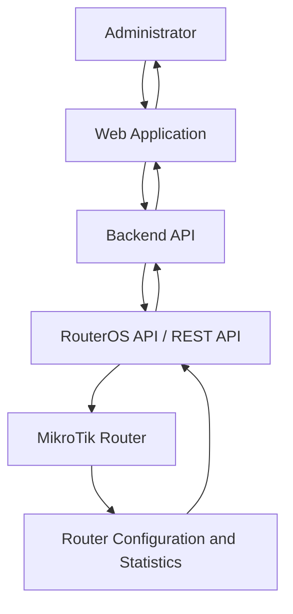
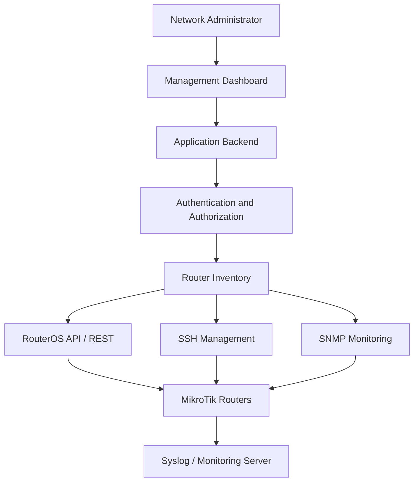

# API and Remote Management

MikroTik RouterOS provides several methods for managing routers remotely and integrating them with external applications.

These capabilities are useful for network administrators, software developers, ISP operators, and automation engineers who need to manage multiple routers programmatically.

Common use cases include:

* Retrieving router status and interface statistics.
* Managing IP addresses, firewall rules, and routes.
* Automating configuration changes.
* Integrating RouterOS with web applications.
* Building centralized network management systems.
* Monitoring multiple MikroTik routers.
* Automating subscriber and ISP operations.

RouterOS supports several remote management methods, including:

* RouterOS API.
* REST API.
* SSH.
* WinBox.
* WebFig.
* SNMP.

Each method has different capabilities and security considerations.

# 🗁 Understanding RouterOS Remote Management Methods

| Method | Protocol | Typical purpose |
| --- | --- | --- |
| RouterOS API | TCP 8728 | Programmatic router management |
| RouterOS API-SSL | TCP 8729 | Encrypted API communication |
| REST API | HTTP/HTTPS | HTTP-based configuration and monitoring |
| SSH | TCP 22 | Secure command-line administration |
| WinBox | TCP 8291 | Graphical router management |
| WebFig | HTTP/HTTPS | Browser-based router management |
| SNMP | UDP 161 | Monitoring and statistics |

The exact services and ports depend on RouterOS configuration.

For application development, the RouterOS API and REST API are particularly useful because they allow external software to communicate with the router programmatically.

# 🗁 Managing RouterOS API Services

RouterOS API allows external applications to execute RouterOS commands and retrieve their results.

The default API service uses TCP port `8728`.

The encrypted API service uses TCP port `8729`.

Inspect the API services:

```routeros
/ip/service/print
```

Enable the API service:

```routeros
/ip/service/enable api
```

Enable API-SSL:

```routeros
/ip/service/enable api-ssl
```

Change the API port if required:

```routeros
/ip/service/set api port=8728
```

The default port is commonly used, but it can be changed to suit the management environment.

**Important:** Enabling an API service does not automatically make it safe to expose over the public internet. Restrict access using service address restrictions and firewall rules.

# 🗁 Creating a Dedicated API User

Avoid using the built-in administrator account for application integrations.

Create a dedicated user with an appropriate group.

For example, create a read-only group:

```routeros
/user/group/add name=api-readonly policy=read,api
```

Create a dedicated API account:

```routeros
/user/add name=api-monitor group=api-readonly password="StrongUniquePassword"
```

This account can perform read-oriented API operations permitted by its group.

For applications that must modify router configuration, create a separate account with only the policies required for those operations.

Inspect users and groups:

```routeros
/user/print
/user/group/print detail
```

Do not grant `full` permissions simply because an application needs API access. Assign the minimum required permissions.

# 🗁 Restricting API Access

RouterOS services can restrict connections based on source addresses.

For example, allow API access only from a management server:

```routeros
/ip/service/set api address=192.168.88.10/32
```

For API-SSL:

```routeros
/ip/service/set api-ssl address=192.168.88.10/32
```

Replace `192.168.88.10` with the actual management server address.

You should also enforce access restrictions through the router firewall.

Example input-chain rule allowing API access from a trusted management host:

```routeros
/ip/firewall/filter/add chain=input action=accept protocol=tcp dst-port=8728 src-address=192.168.88.10 comment="Allow API from management server"
```

A corresponding drop rule can deny API access from other sources:

```routeros
/ip/firewall/filter/add chain=input action=drop protocol=tcp dst-port=8728 comment="Block other API connections"
```

Place these rules carefully in relation to existing input-chain rules. Rule order matters.

For API-SSL, apply equivalent restrictions to TCP port `8729`.

The service address restriction and firewall policy provide complementary access controls.

# 🗁 Understanding RouterOS API Communication

RouterOS API uses a command-and-response protocol.

An API client sends a command to the router, and RouterOS returns one or more response sentences.

A typical interaction includes:

* Connecting to the router.
* Authenticating with a RouterOS account.
* Sending a command.
* Receiving response data.
* Handling completion or error responses.
* Closing the connection.

For example, an application may request:

```text
/system/resource/print
```

RouterOS returns information such as:

* CPU load.
* Free memory.
* Total memory.
* Router uptime.
* RouterOS version.
* Architecture name.

An API client must understand the RouterOS API protocol rather than treating the connection as a normal HTTP request.

# 🗁 Using RouterOS API from Python

Python can communicate with RouterOS through an API client library.

One commonly used library is `librouteros`.

Install it:

```bash
pip install librouteros
```

Example connection:

```python
from librouteros import connect

router = connect(
    host="192.168.88.1",
    username="api-monitor",
    password="StrongUniquePassword",
    port=8728,
)

try:
    resources = list(router("/system/resource/print"))

    for resource in resources:
        print("Router uptime:", resource.get("uptime"))
        print("CPU load:", resource.get("cpu-load"))
        print("Free memory:", resource.get("free-memory"))
        print("RouterOS version:", resource.get("version"))

finally:
    router.close()
```

This example uses the standard API port.

For production applications, use encrypted API communication where supported and configure the client to verify the router's TLS certificate.

Never transmit API credentials over an untrusted network using an unencrypted connection.

# 🗁 Understanding the RouterOS REST API

RouterOS v7 provides a REST API through the router's HTTP-based management interface.

The REST API exposes RouterOS menu operations using HTTP methods.

Common HTTP methods include:

| HTTP method | Typical operation |
| --- | --- |
| GET | Retrieve information |
| PUT | Add a configuration entry |
| PATCH | Update an existing entry |
| DELETE | Remove an entry |
| POST | Execute an operation where supported |

REST API endpoints generally correspond to RouterOS menu paths.

For example:

```text
/rest/system/resource
```

This endpoint provides access to system resource information.

REST API access uses the WebFig HTTP or HTTPS service, depending on the configured service and connection.

# 🗁 Enabling HTTPS for REST API

Inspect the available HTTP services:

```routeros
/ip/service/print
```

Enable HTTPS:

```routeros
/ip/service/enable www-ssl
```

Restrict HTTPS access to a management server:

```routeros
/ip/service/set www-ssl address=192.168.88.10/32
```

For production environments, configure a valid TLS certificate and verify it from the API client.

Avoid using plain HTTP for credentials or management traffic across untrusted networks.

# 🗁 Calling the REST API with cURL

The following example retrieves system resource information.

```bash
curl --user 'api-monitor:StrongUniquePassword' \
  --header 'Accept: application/json' \
  --insecure \
  https://192.168.88.1/rest/system/resource
```

The `--insecure` option disables certificate verification. It is suitable only for controlled testing with a certificate that is not trusted by the client.

For production, configure certificate trust and omit `--insecure`.

A successful response contains JSON data representing the router's resource information.

Example response structure:

```json
[
  {
    "uptime": "2d3h15m",
    "version": "7.x",
    "cpu-load": "12",
    "free-memory": "104857600"
  }
]
```

The values are illustrative, not live router data.

# 🗁 Retrieving Interface Information Through REST API

The following request retrieves interface information:

```bash
curl --user 'api-monitor:StrongUniquePassword' \
  --header 'Accept: application/json' \
  https://192.168.88.1/rest/interface
```

A response may include:

* Interface name.
* Interface type.
* Running state.
* Administrative state.
* MAC address.
* MTU information.

To retrieve a specific interface:

```bash
curl --user 'api-monitor:StrongUniquePassword' \
  --header 'Accept: application/json' \
  https://192.168.88.1/rest/interface/ether1
```

The exact returned fields depend on the interface type and RouterOS version.

# 🗁 Adding an IP Address Through REST API

REST API can also modify router configuration.

For example, add an IP address to an interface:

```bash
curl --user 'api-admin:StrongUniquePassword' \
  --request PUT \
  --header 'Content-Type: application/json' \
  --data '{"address":"192.168.10.1/24","interface":"ether2","comment":"Configured through REST API"}' \
  https://192.168.88.1/rest/ip/address
```

This creates an IP address configuration entry.

Before sending configuration changes, ensure that:

* The target interface exists.
* The address does not conflict with another network.
* The API account has the necessary permissions.
* The application validates input.
* The change will not interrupt the management connection.

For automated configuration management, always verify the result after performing a write operation.

# 🗁 Updating and Removing Configuration Through REST API

Update an existing configuration item using PATCH.

For example, update an existing IP address entry using its RouterOS internal identifier:

```bash
curl --user 'api-admin:StrongUniquePassword' \
  --request PATCH \
  --header 'Content-Type: application/json' \
  --data '{"comment":"Updated through REST API"}' \
  https://192.168.88.1/rest/ip/address/*1
```

Remove an entry using DELETE:

```bash
curl --user 'api-admin:StrongUniquePassword' \
  --request DELETE \
  https://192.168.88.1/rest/ip/address/*1
```

The identifier `*1` is an example. Retrieve the actual identifier from the router before attempting an update or deletion.

Do not assume that an internal identifier remains stable after configuration changes.

# 🗁 Managing RouterOS Through SSH

SSH provides secure command-line access to RouterOS.

Connect to a router:

```bash
ssh admin@192.168.88.1
```

Execute a RouterOS command remotely:

```bash
ssh admin@192.168.88.1 "/system/resource/print"
```

SSH is useful for:

* Remote administration.
* Running scripts.
* Executing diagnostic commands.
* Integrating shell-based automation.
* Transferring files through SFTP.

For automated SSH access, use dedicated accounts and carefully managed SSH keys where supported.

Avoid enabling SSH access from unrestricted public networks.

# 🗁 Integrating RouterOS with Web Applications

A web application can use RouterOS APIs to provide a centralized network management interface.

For example, a web-based management platform might contain:

* Router inventory.
* Router availability status.
* CPU and memory monitoring.
* Interface traffic statistics.
* IP address management.
* Firewall rule management.
* Subscriber management.
* Backup management.
* Configuration auditing.

A typical architecture looks like this:



The backend should communicate with RouterOS. Browser clients should not connect directly to router management services.

This design keeps router credentials on the server side and allows the application to enforce authorization and validation.

# 🗁 Example Backend Integration Architecture

A backend service can expose application-specific endpoints while communicating with RouterOS internally.

For example:

```text
GET /api/routers
GET /api/routers/{id}/resources
GET /api/routers/{id}/interfaces
GET /api/routers/{id}/routes
POST /api/routers/{id}/backups
```

The backend maps these application endpoints to the appropriate RouterOS API or REST API operations.

A typical request flow:

* The frontend requests router information.
* The backend authenticates the application user.
* The backend checks authorization.
* The backend connects to the selected router.
* The backend executes the required RouterOS command.
* The backend validates and transforms the response.
* The frontend receives application-friendly JSON.

This abstraction prevents frontend applications from needing RouterOS-specific protocol knowledge.

# 🗁 Handling Multiple MikroTik Routers

For ISP and enterprise environments, managing multiple routers requires a centralized inventory.

A router inventory may store:

| Field | Description |
| --- | --- |
| Router ID | Internal application identifier |
| Identity | RouterOS system identity |
| Management IP | Router management address |
| API port | API or REST management port |
| Username | Dedicated management account |
| Credential reference | Secure secret-store reference |
| RouterOS version | Installed software version |
| Status | Last known connection state |

Do not store plaintext passwords in ordinary application tables or source code.

Use a secure secret-management mechanism and restrict access to stored credentials.

# 🗁 Monitoring RouterOS with SNMP

SNMP (Simple Network Management Protocol) is commonly used to monitor network devices.

It allows monitoring systems to retrieve information such as:

* Interface traffic counters.
* Interface operational state.
* System uptime.
* Device information.
* Hardware and resource metrics where supported.

Inspect SNMP configuration:

```routeros
/snmp/print
```

Enable SNMP:

```routeros
/snmp/set enabled=yes
```

Configure a community:

```routeros
/snmp/community/add name=monitoring addresses=192.168.88.10/32 read-access=yes
```

Replace the example address with the monitoring server's IP address.

SNMP configuration and supported security features depend on the RouterOS version. Prefer SNMPv3 with authentication and privacy where supported by the deployment.

Avoid exposing SNMP to untrusted networks.

# 🗁 Choosing the Right Management Method

| Requirement | Recommended method |
| --- | --- |
| Programmatic RouterOS commands | RouterOS API |
| HTTP-based application integration | REST API |
| Secure command-line access | SSH |
| Graphical administration | WinBox |
| Browser-based administration | WebFig over HTTPS |
| Centralized performance monitoring | SNMP |
| Remote log collection | Syslog |

The best method depends on the task.

For example, an ISP management platform may use the REST API for configuration operations, SNMP for traffic monitoring, and SSH for controlled administrative tasks.

# 🗁 Security Best Practices

Remote management creates access paths into network infrastructure. Secure them carefully.

* Use dedicated management accounts.
* Apply least-privilege permissions.
* Restrict services to trusted management addresses.
* Prefer encrypted management protocols.
* Validate TLS certificates.
* Store credentials in a secure secret manager.
* Avoid exposing API, SSH, WinBox, or WebFig directly to the public internet.
* Apply firewall restrictions.
* Monitor authentication attempts.
* Log configuration changes.
* Rotate credentials when necessary.
* Use a dedicated management network or VPN.
* Validate and sanitize all application inputs.
* Require application-level authorization before executing router changes.

For production integrations, treat RouterOS API access as privileged infrastructure access rather than an ordinary application connection.

# 🗁 Troubleshooting Remote Management

| Problem | Possible cause | Investigation |
| --- | --- | --- |
| Connection refused | Service disabled or incorrect port | Check `/ip/service/print` |
| Connection timeout | Firewall or routing issue | Check connectivity and firewall rules |
| Authentication failure | Invalid credentials or permissions | Verify account and group |
| API command rejected | Incorrect command or insufficient policy | Inspect API response |
| REST request returns an error | Invalid endpoint or request body | Verify RouterOS REST syntax |
| TLS connection failure | Certificate or TLS configuration problem | Inspect certificate and client trust |
| SSH login failure | Service restrictions or authentication issue | Check SSH service and user settings |

Useful RouterOS commands:

```routeros
/ip/service/print
/user/print
/user/group/print detail
/ip/firewall/filter/print
/log/print
```

Test network connectivity from the management system:

```bash
ping 192.168.88.1
```

Check whether a management port is reachable:

```bash
nc -vz 192.168.88.1 8728
```

Replace the port with the service being tested.

A reachable TCP port does not guarantee successful authentication or permission to execute commands.

# 🗁 Practical Remote Management Architecture

A scalable MikroTik management environment separates application access, management communication, and monitoring.



This architecture supports centralized administration while keeping router access controlled.

As the number of routers grows, introduce connection management, request timeouts, audit logs, retry policies, and background jobs. Avoid making every dashboard request establish an unrestricted new connection to a router.
