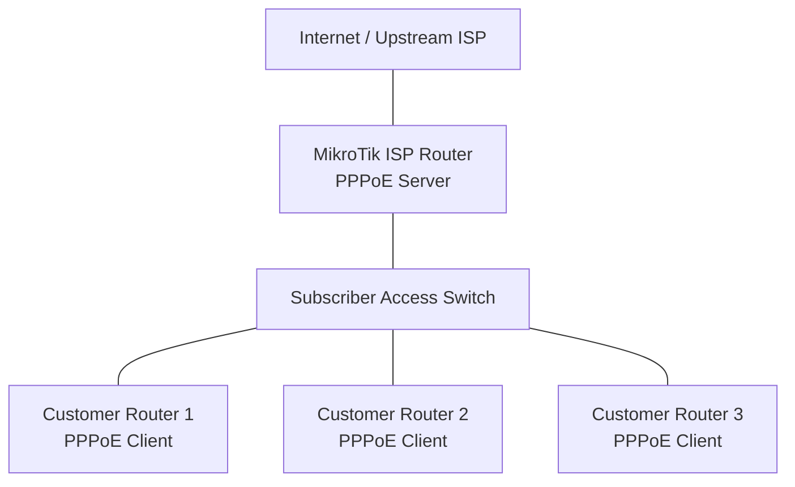

# PPPoE ISP Lab

This practical project demonstrates how to build a small ISP-style Point-to-Point Protocol over Ethernet (PPPoE) network using MikroTik RouterOS v7.

The lab includes:

* A MikroTik router acting as the PPPoE Access Concentrator (server).
* Multiple subscriber routers acting as PPPoE clients.
* IP address pools for subscriber connections.
* PPP profiles for service plans and bandwidth limits.
* Individual PPP secrets for subscriber authentication.
* NAT and firewall configuration for internet access.
* Monitoring and troubleshooting subscriber sessions.

The objective is to understand how an ISP authenticates subscribers, assigns IP addresses, applies service policies, and provides internet connectivity through PPPoE.

# 🗁 Lab Topology

### 🖆 Network diagram



### 🖆 IP addressing plan

| Component | Interface | Address |
| --- | --- | --- |
| ISP upstream | ether1 | 192.0.2.2/24 |
| Upstream gateway | — | 192.0.2.1 |
| PPPoE subscriber network | PPP sessions | 10.10.10.0/24 |
| PPPoE local endpoint | PPP server | 10.10.10.1 |
| Subscriber address pool | Dynamic | 10.10.10.10–10.10.10.200 |
| Customer 1 | PPPoE | Dynamic |
| Customer 2 | PPPoE | Dynamic |
| Customer 3 | PPPoE | Dynamic |

The `192.0.2.0/24` network is reserved for documentation. Replace it with the actual upstream addressing in a real deployment.

# 🗁 ISP Router Configuration

### 🖆 Prepare the interfaces

Assume:

* `ether1` connects to the upstream ISP.
* `ether2` connects to the subscriber access network.

Rename the interfaces for easier administration:

```routeros
/interface ethernet
set [find default-name=ether1] name=WAN
set [find default-name=ether2] name=PPPoE-ACCESS
```

Configure the upstream IP address:

```routeros
/ip address
add address=192.0.2.2/24 interface=WAN comment="Upstream connection"
```

Add the upstream default route:

```routeros
/ip route
add dst-address=0.0.0.0/0 gateway=192.0.2.1
```

Verify connectivity to the upstream gateway:

```routeros
/ping 192.0.2.1
```

If the upstream connection uses DHCP, configure a DHCP client instead of assigning a static address and gateway.

### 🖆 Configure the subscriber address pool

Create a pool for dynamically assigned PPPoE client addresses:

```routeros
/ip pool
add name=pppoe-subscriber-pool ranges=10.10.10.10-10.10.10.200
```

The first address, `10.10.10.1`, will be used as the PPPoE server's local endpoint.

### 🖆 Create a PPP profile

A PPP profile defines common settings for subscriber sessions.

Create a basic service plan:

```routeros
/ppp profile
add name=BRONZE \
    local-address=10.10.10.1 \
    remote-address=pppoe-subscriber-pool \
    rate-limit=5M/20M \
    only-one=yes \
    comment="Bronze subscriber plan"
```

The `rate-limit` values are expressed from the router's perspective:

* First value: upload from the subscriber toward the router.
* Second value: download from the router toward the subscriber.

Therefore, `5M/20M` represents a nominal subscriber plan of 5 Mbps upload and 20 Mbps download.

`only-one=yes` restricts a PPP secret to one simultaneous session. It is useful for basic account control, but it is not a replacement for broader subscriber-session management.

### 🖆 Create additional service plans

An ISP can offer different packages using separate PPP profiles.

```routeros
/ppp profile
add name=SILVER \
    local-address=10.10.10.1 \
    remote-address=pppoe-subscriber-pool \
    rate-limit=10M/40M \
    only-one=yes

add name=GOLD \
    local-address=10.10.10.1 \
    remote-address=pppoe-subscriber-pool \
    rate-limit=20M/80M \
    only-one=yes
```

These examples use nominal upload/download limits. Actual throughput depends on available upstream capacity, queue behavior, and other traffic-management policies.

### 🖆 Create subscriber accounts

Create individual PPP secrets for customers:

```routeros
/ppp secret
add name=customer01 \
    password=StrongPassword01 \
    service=pppoe \
    profile=BRONZE \
    comment="Customer 01"

add name=customer02 \
    password=StrongPassword02 \
    service=pppoe \
    profile=SILVER \
    comment="Customer 02"

add name=customer03 \
    password=StrongPassword03 \
    service=pppoe \
    profile=GOLD \
    comment="Customer 03"
```

Each secret represents an individual subscriber account.

The profile determines the common connection policy, while the secret identifies and authenticates the customer.

Use unique, strong passwords in an actual deployment.

### 🖆 Configure the PPPoE server

Enable the PPPoE server on the subscriber-facing interface:

```routeros
/interface pppoe-server server
add interface=PPPoE-ACCESS \
    service-name=ISP-PPPOE \
    default-profile=BRONZE \
    authentication=pap,chap,mschap1,mschap2 \
    one-session-per-host=yes \
    disabled=no
```

Important settings:

| Parameter | Purpose |
| --- | --- |
| `interface` | Interface receiving subscriber PPPoE discovery traffic |
| `service-name` | Advertised PPPoE service name |
| `default-profile` | Profile used when a secret does not specify another profile |
| `authentication` | Permitted authentication methods |
| `one-session-per-host` | Restricts multiple sessions from the same client MAC address |

For production deployments, choose authentication methods according to client compatibility and security requirements. Prefer stronger supported methods and avoid PAP where possible.

### 🖆 Verify the PPPoE server

Check the configured server:

```routeros
/interface pppoe-server server print detail
```

Check connected subscribers:

```routeros
/ppp active print
```

Check subscriber accounts:

```routeros
/ppp secret print
```

# 🗁 Internet Access Configuration

### 🖆 Configure subscriber NAT

If subscriber addresses are private, use source NAT to translate them to the upstream interface address.

```routeros
/ip firewall nat
add chain=srcnat \
    src-address=10.10.10.0/24 \
    out-interface=WAN \
    action=masquerade \
    comment="NAT for PPPoE subscribers"
```

The masquerade rule translates subscriber traffic leaving through `WAN`.

If the upstream interface has a stable public address, a suitable `src-nat` rule may be preferable.

NAT does not replace firewall filtering. The firewall must separately permit legitimate forwarded traffic.

### 🖆 Configure basic firewall filtering

The following is an illustrative starting policy. Review existing rules before adding it, and adapt management access and upstream requirements to the actual environment.

Allow established and related traffic:

```routeros
/ip firewall filter
add chain=input \
    connection-state=established,related \
    action=accept \
    comment="Allow established and related input"

add chain=forward \
    connection-state=established,related \
    action=accept \
    comment="Allow established and related forwarding"
```

Drop invalid traffic:

```routeros
/ip firewall filter
add chain=input \
    connection-state=invalid \
    action=drop \
    comment="Drop invalid input"

add chain=forward \
    connection-state=invalid \
    action=drop \
    comment="Drop invalid forwarding"
```

Allow management from a trusted management network:

```routeros
/ip firewall filter
add chain=input \
    src-address=192.168.99.0/24 \
    action=accept \
    comment="Allow trusted management network"
```

Allow PPPoE subscribers to access the internet:

```routeros
/ip firewall filter
add chain=forward \
    src-address=10.10.10.0/24 \
    out-interface=WAN \
    action=accept \
    comment="Allow subscriber internet access"
```

Add appropriate return-traffic, WAN input protection, and default-drop policies based on the complete network design. Place rules in the correct order, and ensure the management network retains access before applying restrictive rules.

# 🗁 Customer Router Configuration

### 🖆 Configure the PPPoE client

On each customer router, configure the interface connected to the ISP access network.

For Customer 1:

```routeros
/interface pppoe-client
add name=pppoe-out1 \
    interface=ether1 \
    user=customer01 \
    password=StrongPassword01 \
    service-name=ISP-PPPOE \
    add-default-route=yes \
    use-peer-dns=yes \
    disabled=no
```

For Customer 2, use the second account:

```routeros
/interface pppoe-client
add name=pppoe-out1 \
    interface=ether1 \
    user=customer02 \
    password=StrongPassword02 \
    service-name=ISP-PPPOE \
    add-default-route=yes \
    use-peer-dns=yes \
    disabled=no
```

For Customer 3:

```routeros
/interface pppoe-client
add name=pppoe-out1 \
    interface=ether1 \
    user=customer03 \
    password=StrongPassword03 \
    service-name=ISP-PPPOE \
    add-default-route=yes \
    use-peer-dns=yes \
    disabled=no
```

The `service-name` must match the server's advertised service when explicitly specified. It can also be left blank when service-name matching is not required.

### 🖆 Configure the customer LAN

For a basic customer router, create a LAN bridge:

```routeros
/interface bridge
add name=bridge-LAN
```

Add LAN ports:

```routeros
/interface bridge port
add bridge=bridge-LAN interface=ether2
add bridge=bridge-LAN interface=ether3
```

Assign a LAN address:

```routeros
/ip address
add address=192.168.10.1/24 interface=bridge-LAN
```

Create a DHCP pool:

```routeros
/ip pool
add name=customer-lan-pool ranges=192.168.10.100-192.168.10.200
```

Configure the DHCP server:

```routeros
/ip dhcp-server
add name=customer-dhcp \
    interface=bridge-LAN \
    address-pool=customer-lan-pool \
    disabled=no
```

Configure the DHCP network:

```routeros
/ip dhcp-server network
add address=192.168.10.0/24 \
    gateway=192.168.10.1 \
    dns-server=1.1.1.1,8.8.8.8
```

Add LAN masquerade if the customer router performs NAT for its private LAN:

```routeros
/ip firewall nat
add chain=srcnat \
    out-interface=pppoe-out1 \
    action=masquerade \
    comment="Customer LAN NAT"
```

The customer router now uses the PPPoE interface as its internet-facing connection and provides internet access to devices on its LAN.

# 🗁 Testing and Verification

### 🖆 Verify PPPoE sessions on the ISP router

```routeros
/ppp active print detail
```

Expected information includes:

* Subscriber username.
* Assigned remote IP address.
* Local PPP endpoint.
* Session uptime.
* Calling station ID, typically the client MAC address.

### 🖆 Verify the PPPoE client on the customer router

```routeros
/interface pppoe-client print detail
```

Check whether the interface is running:

```routeros
/interface print
```

Inspect the IP address assigned to the PPPoE interface:

```routeros
/ip address print
```

Inspect the default route:

```routeros
/ip route print
```

### 🖆 Test connectivity

From the customer router, test the ISP-side PPP endpoint:

```routeros
/ping 10.10.10.1
```

Test an external IP address:

```routeros
/ping 1.1.1.1
```

Test DNS resolution:

```routeros
/resolve example.com
```

If these tests succeed, the PPPoE connection and basic internet path are working.

### 🖆 Monitor subscriber bandwidth

Use the active PPP session and interface statistics:

```routeros
/ppp active print stats
```

Inspect traffic on the subscriber-facing interface:

```routeros
/interface monitor-traffic PPPoE-ACCESS
```

For per-subscriber traffic analysis, inspect the dynamic PPP interfaces and associated queues.

# 🗁 Subscriber Management

### 🖆 Change a subscriber's service plan

Update the customer's profile:

```routeros
/ppp secret
set [find name=customer01] profile=SILVER
```

An existing session may need to reconnect before all profile changes take effect.

Disconnect the subscriber when immediate reauthentication is required:

```routeros
/ppp active
remove [find name=customer01]
```

The client can then reconnect using the updated profile.

### 🖆 Disable a subscriber account

```routeros
/ppp secret
set [find name=customer02] disabled=yes
```

Disconnect an already active session separately if immediate termination is required:

```routeros
/ppp active
remove [find name=customer02]
```

### 🖆 Re-enable a subscriber account

```routeros
/ppp secret
set [find name=customer02] disabled=no
```

### 🖆 Inspect active subscriber sessions

```routeros
/ppp active print detail
```

### 🖆 Inspect subscriber account configuration

```routeros
/ppp secret print detail
```

# 🗁 Troubleshooting

### 🖆 PPPoE client cannot discover the server

Possible causes:

* Incorrect physical interface.
* Subscriber and server are not in the same Layer 2 network.
* VLAN tagging is incorrect.
* PPPoE server is disabled.
* Access switch configuration blocks PPPoE discovery frames.

Useful commands:

```routeros
/interface pppoe-server server print detail
/interface print
/interface bridge port print
/tool sniffer quick interface=PPPoE-ACCESS
```

Check whether PPPoE discovery frames reach the server interface.

### 🖆 Authentication failure

Possible causes:

* Incorrect username or password.
* Subscriber secret is disabled.
* Secret uses an incompatible service type.
* Authentication methods do not overlap between client and server.

Check the subscriber account:

```routeros
/ppp secret print detail
```

Inspect logs:

```routeros
/log print where topics~"ppp"
```

### 🖆 PPPoE connects but internet does not work

Check:

* The ISP router has a valid upstream default route.
* Subscriber traffic is permitted by the forward chain.
* Source NAT matches the subscriber network.
* DNS configuration is valid.
* The upstream provider allows the traffic.

Useful commands:

```routeros
/ip route print
/ip firewall nat print
/ip firewall filter print
/ip firewall connection print
```

### 🖆 Subscriber receives no IP address

Check the PPP profile and address pool:

```routeros
/ppp profile print detail
/ip pool print detail
```

Confirm that:

* The profile references the correct pool.
* The pool has available addresses.
* The local address is configured.
* The PPP secret references the intended profile.

### 🖆 Subscriber bandwidth limit is not working

Check:

* The correct profile is assigned to the secret.
* The active session has applied the expected profile.
* Queue entries exist for the PPP session.
* FastTrack is not bypassing the relevant queue processing.
* Other queue rules are not conflicting with the subscriber policy.

Useful commands:

```routeros
/ppp active print detail
/queue simple print stats
/queue tree print stats
```

# 🗁 Practical Exercises

### 🖆 Exercise: Build the PPPoE ISP lab

* [ ] Configure the ISP router's upstream interface.
* [ ] Configure the subscriber-facing interface.
* [ ] Create a subscriber IP pool.
* [ ] Create BRONZE, SILVER, and GOLD profiles.
* [ ] Create three subscriber accounts.
* [ ] Enable the PPPoE server.
* [ ] Configure NAT and firewall forwarding.
* [ ] Configure three customer PPPoE clients.
* [ ] Verify that all customers receive IP addresses.
* [ ] Test internet access from each customer router.

### 🖆 Exercise: Subscriber management

* [ ] Change Customer 1 from BRONZE to SILVER.
* [ ] Disconnect and reconnect Customer 1.
* [ ] Verify the updated bandwidth policy.
* [ ] Disable Customer 2.
* [ ] Confirm that Customer 2 cannot establish a new session.
* [ ] Re-enable Customer 2.

### 🖆 Exercise: Advanced ISP scenarios

* [ ] Create a new package with a different upload/download ratio.
* [ ] Configure a separate subscriber VLAN.
* [ ] Add a second PPPoE server on another subscriber-facing interface or VLAN.
* [ ] Restrict subscriber access to management networks.
* [ ] Monitor simultaneous subscriber sessions.
* [ ] Investigate a deliberately incorrect password.
* [ ] Simulate an exhausted IP pool and troubleshoot it.

# 🗁 Best Practices

* Use individual subscriber credentials rather than shared accounts.
* Maintain a clear naming convention for PPP profiles and subscriber accounts.
* Assign service plans through profiles to simplify account management.
* Use separate VLANs or access networks to organize subscriber traffic.
* Restrict router management access to trusted networks.
* Monitor active sessions, bandwidth usage, and authentication failures.
* Maintain backups before changing production PPPoE configuration.
* Use RADIUS when centralized subscriber authentication and accounting are required.
* Plan address pools carefully to avoid exhaustion and overlapping networks.
* Document subscriber packages, credentials-management procedures, and service policies.

# 🗁 Summary

This project demonstrates a basic ISP-style PPPoE deployment using MikroTik RouterOS v7.

The ISP router authenticates subscribers through PPP secrets, assigns addresses through an IP pool, applies service policies through PPP profiles, and provides internet connectivity through routing, NAT, and firewall rules.

The same architecture can be extended with RADIUS authentication, VLAN-based subscriber separation, centralized accounting, CGNAT, monitoring, and automated subscriber management.
