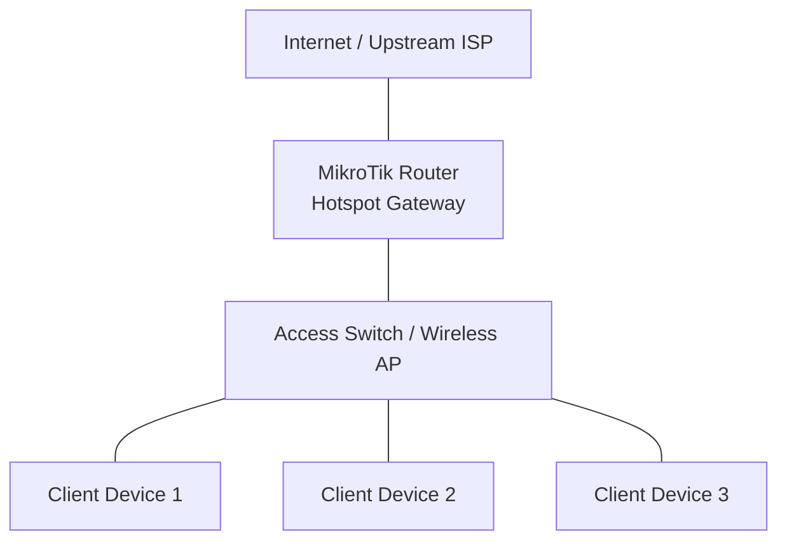

# Hotspot Deployment

A MikroTik Hotspot provides captive-portal authentication for users connecting through a wired or wireless network.

Instead of requiring every user to configure PPPoE credentials, a Hotspot allows users to connect to a network and authenticate through a web browser.

This project demonstrates how to deploy a MikroTik Hotspot using RouterOS v7.

The lab covers:

* Hotspot interface and network configuration.
* DHCP address assignment.
* Captive-portal authentication.
* User profiles and bandwidth limits.
* Individual user accounts.
* Session management.
* Firewall and NAT integration.
* Testing and troubleshooting.

# 🗁 Lab Topology

### 🖆 Network diagram



### 🖆 IP addressing plan

| Component | Interface | Address |
| --- | --- | --- |
| Upstream gateway | WAN | 192.0.2.1 |
| MikroTik WAN | ether1 | 192.0.2.2/24 |
| Hotspot gateway | bridge-HOTSPOT | 10.20.0.1/24 |
| Hotspot network | LAN | 10.20.0.0/24 |
| DHCP pool | Dynamic | 10.20.0.10–10.20.0.250 |
| DNS server | Router | 10.20.0.1 |

The upstream addresses use a documentation-only network. Replace them with the actual upstream configuration in a real deployment.

# 🗁 Router Preparation

### 🖆 Rename interfaces

Assume:

* `ether1` connects to the internet.
* `ether2` connects to the Hotspot access network.

```routeros
/interface ethernet
set [find default-name=ether1] name=WAN
set [find default-name=ether2] name=HOTSPOT-PORT
```

### 🖆 Configure the WAN interface

Assign the upstream address:

```routeros
/ip address
add address=192.0.2.2/24 interface=WAN comment="Upstream WAN"
```

Add the default route:

```routeros
/ip route
add dst-address=0.0.0.0/0 gateway=192.0.2.1
```

Verify upstream connectivity:

```routeros
/ping 192.0.2.1
```

If the upstream provider assigns addresses dynamically, configure a DHCP client instead of using the static configuration above.

### 🖆 Create the Hotspot bridge

Create a bridge for the Hotspot access network:

```routeros
/interface bridge
add name=bridge-HOTSPOT comment="Hotspot access bridge"
```

Add the subscriber-facing interface:

```routeros
/interface bridge port
add bridge=bridge-HOTSPOT interface=HOTSPOT-PORT
```

Additional access ports or an access-point uplink can be added to the same bridge when they belong to the same Hotspot network.

# 🗁 Hotspot Network Configuration

### 🖆 Assign the gateway address

```routeros
/ip address
add address=10.20.0.1/24 \
    interface=bridge-HOTSPOT \
    comment="Hotspot gateway"
```

### 🖆 Create the DHCP address pool

```routeros
/ip pool
add name=hotspot-pool ranges=10.20.0.10-10.20.0.250
```

### 🖆 Configure the DHCP server

```routeros
/ip dhcp-server
add name=hotspot-dhcp \
    interface=bridge-HOTSPOT \
    address-pool=hotspot-pool \
    lease-time=1h \
    disabled=no
```

Configure the DHCP network:

```routeros
/ip dhcp-server network
add address=10.20.0.0/24 \
    gateway=10.20.0.1 \
    dns-server=10.20.0.1
```

### 🖆 Configure router DNS

Enable DNS resolution for clients using the router as their DNS server:

```routeros
/ip dns
set servers=1.1.1.1,8.8.8.8 allow-remote-requests=yes
```

The firewall must permit DNS requests from the Hotspot network while restricting DNS access from untrusted external interfaces.

### 🖆 Configure source NAT

Allow Hotspot client traffic to use the upstream interface:

```routeros
/ip firewall nat
add chain=srcnat \
    src-address=10.20.0.0/24 \
    out-interface=WAN \
    action=masquerade \
    comment="Hotspot internet NAT"
```

NAT provides address translation; it does not replace the firewall's forwarding policy.

# 🗁 Hotspot Server Configuration

### 🖆 Run the Hotspot setup wizard

RouterOS provides a setup wizard that configures the basic Hotspot service.

Start it:

```routeros
/ip hotspot setup
```

Follow the prompts using these values:

| Prompt | Example value |
| --- | --- |
| Hotspot interface | bridge-HOTSPOT |
| Local address | 10.20.0.1/24 |
| Address pool | 10.20.0.10-10.20.0.250 |
| Certificate | none for this basic lab |
| SMTP server | 0.0.0.0 |
| DNS servers | 1.1.1.1, 8.8.8.8 |
| DNS name | login.example.test |
| Local Hotspot user | labadmin |
| Password | Use a strong lab password |

The wizard creates the Hotspot server, associated profile, address pool, and related configuration.

The DNS name is an example. A production captive portal should use a domain that you control and a properly configured certificate for HTTPS authentication.

### 🖆 Verify the Hotspot server

```routeros
/ip hotspot print detail
```

Inspect the server profile:

```routeros
/ip hotspot profile print detail
```

Inspect the generated server settings:

```routeros
/ip hotspot server print detail
```

# 🗁 User Management

### 🖆 Create a basic Hotspot user

Create an individual account:

```routeros
/ip hotspot user
add name=user01 \
    password=StrongPassword01 \
    profile=default \
    comment="Hotspot subscriber 01"
```

Create another user:

```routeros
/ip hotspot user
add name=user02 \
    password=StrongPassword02 \
    profile=default \
    comment="Hotspot subscriber 02"
```

Each user authenticates through the captive portal using their username and password.

### 🖆 Create Hotspot user profiles

User profiles define shared session policies, including bandwidth limits and session timeouts.

Create a basic package:

```routeros
/ip hotspot user profile
add name=BASIC \
    rate-limit=2M/5M \
    session-timeout=2h \
    shared-users=1 \
    idle-timeout=10m
```

Create a premium package:

```routeros
/ip hotspot user profile
add name=PREMIUM \
    rate-limit=5M/15M \
    session-timeout=8h \
    shared-users=1 \
    idle-timeout=15m
```

The `rate-limit` values are expressed from the router's perspective:

* First value: upload from the client.
* Second value: download to the client.

### 🖆 Assign users to profiles

Create users with different service packages:

```routeros
/ip hotspot user
add name=basic01 \
    password=BasicPassword01 \
    profile=BASIC

add name=premium01 \
    password=PremiumPassword01 \
    profile=PREMIUM
```

A profile centralizes service policies so that multiple accounts can share the same configuration.

### 🖆 Configure session limits

The profile's `session-timeout` controls the maximum duration of an authenticated session.

The `idle-timeout` disconnects a session after the configured idle period.

For example:

```routeros
/ip hotspot user profile
set BASIC session-timeout=1h idle-timeout=5m
```

A session timeout is not the same as an account expiration date. Time-based voucher expiration and paid-access validity require additional management logic or an external authentication and billing system.

# 🗁 Captive Portal Testing

### 🖆 Connect a client device

Connect a laptop or mobile device to the Hotspot access network.

The client should receive:

* An IP address from `10.20.0.0/24`.
* Gateway `10.20.0.1`.
* DNS server `10.20.0.1`.

Check the DHCP leases:

```routeros
/ip dhcp-server lease print
```

### 🖆 Open the captive portal

Open a browser and visit an HTTP website.

The Hotspot should redirect unauthenticated clients to the login page.

Enter a configured username and password.

After successful authentication, the client should be able to access permitted internet resources.

### 🖆 Verify active users

```routeros
/ip hotspot active print detail
```

This command displays authenticated sessions, including usernames, assigned addresses, MAC addresses, and session information.

### 🖆 Verify Hotspot hosts

```routeros
/ip hotspot host print detail
```

The host table provides information about devices detected by the Hotspot, including devices that may not yet be authenticated.

# 🗁 Firewall and Access Control

### 🖆 Understand Hotspot-generated firewall rules

The Hotspot service dynamically creates and manages firewall-related rules for captive-portal processing.

Inspect the current configuration:

```routeros
/ip firewall filter print
/ip firewall nat print
/ip firewall raw print
```

Avoid blindly adding duplicate rules or removing dynamically managed Hotspot rules.

### 🖆 Restrict access to internal networks

A public Hotspot should generally prevent clients from reaching private management and infrastructure networks.

Create an address list for protected networks:

```routeros
/ip firewall address-list
add list=protected-networks address=10.0.0.0/8
add list=protected-networks address=172.16.0.0/12
add list=protected-networks address=192.168.0.0/16
```

Add a forward-chain restriction before broad subscriber forwarding permissions:

```routeros
/ip firewall filter
add chain=forward \
    src-address=10.20.0.0/24 \
    dst-address-list=protected-networks \
    action=drop \
    comment="Block Hotspot access to private networks"
```

Adapt this policy if the Hotspot must access specific internal services. Add explicit exceptions before the drop rule.

### 🖆 Protect router management services

Do not expose WinBox, SSH, API, or WebFig to the public Hotspot network unless there is a specific operational requirement.

Restrict management services to trusted addresses:

```routeros
/ip service
set winbox address=192.168.99.0/24
set ssh address=192.168.99.0/24
set www address=192.168.99.0/24
set api address=192.168.99.0/24
```

Disable unused services:

```routeros
/ip service
disable telnet
disable ftp
disable www-ssl
disable api-ssl
```

Only disable services that are not required by the existing management design.

# 🗁 Walled Garden

### 🖆 Understand the Walled Garden

The Walled Garden allows selected destinations to remain accessible without Hotspot authentication.

Typical use cases include:

* Payment portals.
* Voucher purchase websites.
* Service-provider information pages.
* Account registration pages.
* Customer support portals.

### 🖆 Add an allowed website

For example, allow a payment website:

```routeros
/ip hotspot walled-garden
add dst-host=payment.example.com \
    action=allow \
    comment="Allow payment portal"
```

For a destination that requires HTTPS, ensure the related DNS resolution and certificate behavior are correct.

A Walled Garden entry should be as specific as possible. Avoid broad wildcard rules that unintentionally bypass authentication for unrelated websites.

### 🖆 Inspect Walled Garden entries

```routeros
/ip hotspot walled-garden print detail
```

# 🗁 Bypassing Hotspot Authentication

### 🖆 Understand IP binding

IP binding can provide special handling for specific devices.

Common types include:

| Type | Purpose |
| --- | --- |
| regular | Binds a host to a particular address or MAC |
| bypassed | Allows the host to bypass Hotspot authentication |
| blocked | Blocks the host |

### 🖆 Create a bypass entry

For a trusted device:

```routeros
/ip hotspot ip-binding
add mac-address=AA:BB:CC:DD:EE:FF \
    type=bypassed \
    comment="Trusted infrastructure device"
```

Replace the example MAC address with the actual device address.

Use bypass entries sparingly. A bypassed device does not follow the normal user-authentication workflow.

### 🖆 Block a device

```routeros
/ip hotspot ip-binding
add mac-address=11:22:33:44:55:66 \
    type=blocked \
    comment="Blocked device"
```

# 🗁 Session Management

### 🖆 Disconnect a user

Inspect active sessions:

```routeros
/ip hotspot active print
```

Remove a specific active session:

```routeros
/ip hotspot active
remove [find user=user01]
```

The user can reconnect if the account remains enabled and valid.

### 🖆 Disable a user account

```routeros
/ip hotspot user
set [find name=user01] disabled=yes
```

### 🖆 Re-enable a user account

```routeros
/ip hotspot user
set [find name=user01] disabled=no
```

### 🖆 Inspect user traffic statistics

```routeros
/ip hotspot active print stats
```

This provides session traffic counters that can help with operational monitoring.

# 🗁 Troubleshooting

### 🖆 Captive portal does not appear

Possible causes:

* The client did not receive a DHCP address.
* DNS is not working.
* The Hotspot server is attached to the wrong interface.
* The client is already authenticated.
* The browser or operating system did not trigger captive-portal detection.
* HTTPS redirection behavior is being misunderstood.

Check:

```routeros
/ip dhcp-server lease print
/ip hotspot host print
/ip hotspot active print
/ip hotspot print detail
/ip dns print
```

Try visiting a plain HTTP website to trigger the captive portal.

### 🖆 User cannot authenticate

Possible causes:

* Incorrect username or password.
* Account is disabled.
* User profile configuration is incorrect.
* The user has reached the allowed simultaneous-session limit.
* Authentication traffic is being blocked.

Check:

```routeros
/ip hotspot user print detail
/ip hotspot user profile print detail
/ip hotspot active print
/log print where topics~"hotspot"
```

### 🖆 User authenticates but has no internet access

Check:

* The router has an upstream default route.
* DNS resolution works.
* The source NAT rule matches Hotspot traffic.
* Forward-chain rules permit internet access.
* The upstream connection is working.

Useful commands:

```routeros
/ip route print
/ip firewall nat print
/ip firewall filter print
/ping 1.1.1.1
/resolve example.com
```

### 🖆 DHCP address is not assigned

Check:

```routeros
/ip address print
/ip pool print detail
/ip dhcp-server print detail
/ip dhcp-server network print
/interface bridge port print
```

Confirm that the DHCP server is enabled and attached to the correct Hotspot bridge.

### 🖆 User is disconnected unexpectedly

Check:

* `session-timeout`.
* `idle-timeout`.
* `keepalive-timeout`.
* User profile settings.
* Wireless signal quality.
* Client device connectivity.
* Router logs.

Useful commands:

```routeros
/ip hotspot active print detail
/ip hotspot user profile print detail
/log print where topics~"hotspot"
```

# 🗁 Practical Exercises

### 🖆 Exercise: Deploy a basic Hotspot

* [ ] Configure the WAN interface.
* [ ] Create the Hotspot bridge.
* [ ] Assign the Hotspot gateway address.
* [ ] Configure the DHCP pool and server.
* [ ] Configure router DNS.
* [ ] Configure source NAT.
* [ ] Run the Hotspot setup wizard.
* [ ] Connect a client device.
* [ ] Verify captive-portal redirection.
* [ ] Authenticate using a local Hotspot account.

### 🖆 Exercise: Create service packages

* [ ] Create BASIC and PREMIUM profiles.
* [ ] Configure different bandwidth limits.
* [ ] Configure session timeouts.
* [ ] Create individual subscriber accounts.
* [ ] Assign accounts to the appropriate profiles.
* [ ] Verify the bandwidth policies.

### 🖆 Exercise: Access control

* [ ] Create a Walled Garden entry.
* [ ] Add a trusted device bypass entry.
* [ ] Block a test device.
* [ ] Restrict access to internal networks.
* [ ] Restrict router management services.
* [ ] Verify that authenticated users cannot access protected management networks.

### 🖆 Exercise: Subscriber management

* [ ] Inspect active sessions.
* [ ] Disconnect an authenticated user.
* [ ] Disable a subscriber account.
* [ ] Re-enable the account.
* [ ] Inspect session traffic counters.
* [ ] Investigate a failed authentication attempt.

# 🗁 Best Practices

* Use separate VLANs for public Hotspot traffic and internal management.
* Use HTTPS with a valid certificate for the captive portal.
* Create individual user accounts instead of sharing credentials.
* Apply appropriate session and bandwidth limits.
* Restrict access to internal infrastructure.
* Keep management services inaccessible from public client networks.
* Use specific Walled Garden entries.
* Monitor active sessions and authentication failures.
* Maintain backups before modifying production firewall or Hotspot configuration.
* Use RADIUS for centralized authentication, accounting, and subscriber management at larger scale.

# 🗁 Summary

This project demonstrates how to deploy a MikroTik Hotspot using RouterOS v7.

The Hotspot provides captive-portal authentication, while DHCP assigns client addresses, user profiles apply access policies, and firewall/NAT configuration controls internet connectivity.

For larger ISP and public Wi-Fi deployments, the local-user model can be extended with RADIUS, voucher management, centralized accounting, and automated billing integration.
