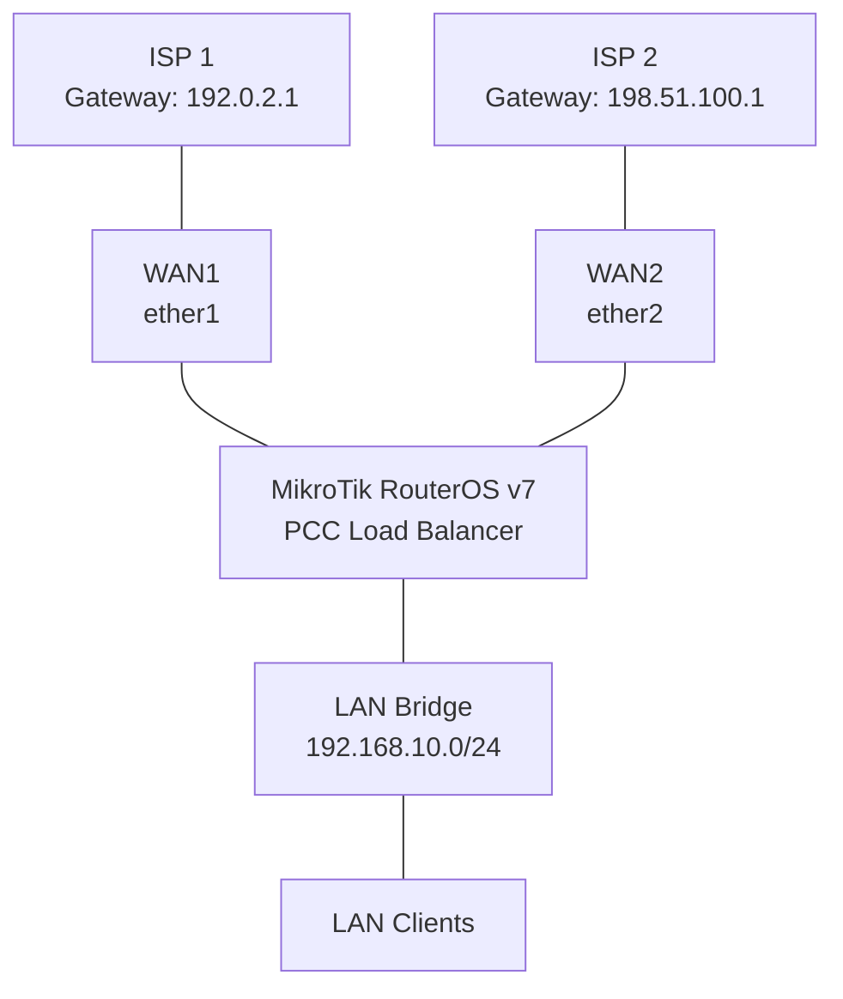

# PCC Load Balancing

Per Connection Classifier (PCC) is a MikroTik RouterOS load-balancing technique that distributes network connections across multiple WAN links.

PCC classifies connections using selected address and port fields, then assigns each connection to a routing path using connection marks and routing marks.

Unlike simple failover, which uses a backup WAN when the primary connection becomes unavailable, PCC allows multiple WAN links to carry traffic simultaneously.

This project demonstrates a two-WAN PCC configuration using MikroTik RouterOS v7.

The lab covers:

* Dual-WAN configuration.
* Custom routing tables.
* PCC connection classification.
* Connection and routing marks.
* WAN-specific source NAT.
* Routing and failover behavior.
* Testing and troubleshooting.

# 🗁 Lab Topology

### 🖆 Network diagram



### 🖆 IP addressing plan

| Component | Interface | Address |
| --- | --- | --- |
| ISP 1 gateway | — | 192.0.2.1 |
| MikroTik WAN 1 | ether1 | 192.0.2.2/24 |
| ISP 2 gateway | — | 198.51.100.1 |
| MikroTik WAN 2 | ether2 | 198.51.100.2/24 |
| LAN gateway | bridge-LAN | 192.168.10.1/24 |
| LAN network | — | 192.168.10.0/24 |

Both WAN networks use documentation-only addresses. Replace them with actual ISP addresses and gateways.

# 🗁 Router Interface Configuration

### 🖆 Rename WAN interfaces

```routeros
/interface ethernet
set [find default-name=ether1] name=WAN1
set [find default-name=ether2] name=WAN2
set [find default-name=ether3] name=LAN-PORT
```

### 🖆 Configure WAN addresses

```routeros
/ip address
add address=192.0.2.2/24 interface=WAN1 comment="ISP 1"
add address=198.51.100.2/24 interface=WAN2 comment="ISP 2"
```

### 🖆 Configure the LAN bridge

```routeros
/interface bridge
add name=bridge-LAN comment="Local network"

/interface bridge port
add bridge=bridge-LAN interface=LAN-PORT

/ip address
add address=192.168.10.1/24 interface=bridge-LAN
```

Additional LAN ports can be added to the bridge as required.

# 🗁 LAN DHCP Configuration

### 🖆 Create an address pool

```routeros
/ip pool
add name=lan-pool ranges=192.168.10.100-192.168.10.200
```

### 🖆 Configure the DHCP server

```routeros
/ip dhcp-server
add name=lan-dhcp \
    interface=bridge-LAN \
    address-pool=lan-pool \
    disabled=no
```

Configure the DHCP network:

```routeros
/ip dhcp-server network
add address=192.168.10.0/24 \
    gateway=192.168.10.1 \
    dns-server=1.1.1.1,8.8.8.8
```

# 🗁 Routing Table Configuration

### 🖆 Understand RouterOS v7 routing tables

RouterOS v7 uses routing tables to separate routing decisions.

For this project, create two custom tables:

* `to_WAN1`: traffic routed through ISP 1.
* `to_WAN2`: traffic routed through ISP 2.

Create the tables:

```routeros
/routing table
add name=to_WAN1 fib
add name=to_WAN2 fib
```

The `fib` property enables the table to participate in forwarding decisions.

### 🖆 Configure WAN-specific default routes

Add a default route to the first custom table:

```routeros
/ip route
add dst-address=0.0.0.0/0 \
    gateway=192.0.2.1@main \
    routing-table=to_WAN1 \
    distance=1 \
    comment="WAN1 default route"
```

Add a default route to the second custom table:

```routeros
/ip route
add dst-address=0.0.0.0/0 \
    gateway=198.51.100.1@main \
    routing-table=to_WAN2 \
    distance=1 \
    comment="WAN2 default route"
```

The `@main` notation allows gateway resolution through the main routing table.

Add a main-table default route for router-originated traffic and general routing:

```routeros
/ip route
add dst-address=0.0.0.0/0 \
    gateway=192.0.2.1 \
    distance=1 \
    comment="Primary WAN1 default"

add dst-address=0.0.0.0/0 \
    gateway=198.51.100.1 \
    distance=2 \
    comment="Backup WAN2 default"
```

These main-table routes provide basic primary/backup behavior for traffic using the main table. They do not automatically provide health-checked failover inside the custom tables.

# 🗁 PCC Load Balancing Configuration

### 🖆 Understand PCC

PCC divides connections into groups using a hash of selected connection fields.

For a two-WAN setup, the classifier uses:

```text
both-addresses-and-ports:2/0
both-addresses-and-ports:2/1
```

The values mean:

* `2`: divide matching connections into two groups.
* `0`: assign the first group to WAN 1.
* `1`: assign the second group to WAN 2.

PCC distributes connections, not individual packets. A single connection normally stays on one WAN, which helps preserve connection consistency.

### 🖆 Create an address list for internal networks

PCC should not classify traffic destined for internal networks as internet-bound traffic.

Create an address list:

```routeros
/ip firewall address-list
add list=LOCAL-NETWORKS address=192.168.10.0/24
add list=LOCAL-NETWORKS address=192.168.0.0/16
add list=LOCAL-NETWORKS address=10.0.0.0/8
add list=LOCAL-NETWORKS address=172.16.0.0/12
```

Add other internal, VPN, and management networks used by the environment.

### 🖆 Create connection marks

First, mark new LAN-originated connections assigned to WAN 1:

```routeros
/ip firewall mangle
add chain=prerouting \
    in-interface=bridge-LAN \
    dst-address-type=!local \
    dst-address-list=!LOCAL-NETWORKS \
    connection-mark=no-mark \
    connection-state=new \
    per-connection-classifier=both-addresses-and-ports:2/0 \
    action=mark-connection \
    new-connection-mark=WAN1_conn \
    passthrough=yes \
    comment="PCC connection assignment WAN1"
```

Mark the connections assigned to WAN 2:

```routeros
/ip firewall mangle
add chain=prerouting \
    in-interface=bridge-LAN \
    dst-address-type=!local \
    dst-address-list=!LOCAL-NETWORKS \
    connection-mark=no-mark \
    connection-state=new \
    per-connection-classifier=both-addresses-and-ports:2/1 \
    action=mark-connection \
    new-connection-mark=WAN2_conn \
    passthrough=yes \
    comment="PCC connection assignment WAN2"
```

These rules classify new LAN connections into two groups.

The `dst-address-type=!local` condition excludes destinations belonging to the router itself. The address-list condition separately excludes other internal networks.

### 🖆 Apply routing marks

Mark traffic belonging to WAN 1 connections:

```routeros
/ip firewall mangle
add chain=prerouting \
    in-interface=bridge-LAN \
    connection-mark=WAN1_conn \
    action=mark-routing \
    new-routing-mark=to_WAN1 \
    passthrough=no \
    comment="Route LAN traffic through WAN1"
```

Mark traffic belonging to WAN 2 connections:

```routeros
/ip firewall mangle
add chain=prerouting \
    in-interface=bridge-LAN \
    connection-mark=WAN2_conn \
    action=mark-routing \
    new-routing-mark=to_WAN2 \
    passthrough=no \
    comment="Route LAN traffic through WAN2"
```

The connection mark identifies the selected WAN. The routing mark directs packets belonging to that connection into the corresponding routing table.

# 🗁 NAT Configuration

### 🖆 Configure WAN-specific masquerade

Create a source NAT rule for WAN 1:

```routeros
/ip firewall nat
add chain=srcnat \
    out-interface=WAN1 \
    action=masquerade \
    comment="NAT through WAN1"
```

Create a source NAT rule for WAN 2:

```routeros
/ip firewall nat
add chain=srcnat \
    out-interface=WAN2 \
    action=masquerade \
    comment="NAT through WAN2"
```

The routing decision determines the egress interface. The matching NAT rule then translates the source address for that WAN.

NAT does not perform load balancing.

# 🗁 Firewall Configuration

### 🖆 Understand traffic flow

RouterOS firewall chains have different purposes:

| Chain | Purpose |
| --- | --- |
| input | Traffic destined for the router |
| forward | Traffic passing through the router |
| output | Traffic generated by the router |

PCC primarily marks LAN-originated connections in `prerouting`.

A production firewall should include appropriate established/related handling, invalid-traffic drops, trusted management access, and WAN input restrictions.

### 🖆 Permit established and related traffic

If these rules do not already exist, add them in the appropriate position:

```routeros
/ip firewall filter
add chain=input \
    connection-state=established,related \
    action=accept \
    comment="Accept established and related input"

add chain=forward \
    connection-state=established,related \
    action=accept \
    comment="Accept established and related forwarding"
```

Drop invalid traffic:

```routeros
/ip firewall filter
add chain=input \
    connection-state=invalid \
    action=drop \
    comment="Drop invalid input"

add chain=forward \
    connection-state=invalid \
    action=drop \
    comment="Drop invalid forwarding"
```

Allow LAN clients to access the internet:

```routeros
/ip firewall filter
add chain=forward \
    in-interface=bridge-LAN \
    out-interface-list=WAN \
    action=accept \
    comment="Allow LAN internet traffic"
```

This example assumes a WAN interface list exists and contains both WAN interfaces. Otherwise, create the list or specify the WAN interfaces individually.

Do not add broad forwarding rules without reviewing the existing firewall policy and rule order.

# 🗁 Interface Lists

### 🖆 Create WAN and LAN lists

Interface lists simplify firewall configuration:

```routeros
/interface list
add name=WAN
add name=LAN
```

Add the WAN interfaces:

```routeros
/interface list member
add list=WAN interface=WAN1
add list=WAN interface=WAN2
add list=LAN interface=bridge-LAN
```

The WAN interface list can now be referenced by firewall rules.

# 🗁 Testing and Verification

### 🖆 Inspect routing tables

```routeros
/routing table print
```

Inspect the routes:

```routeros
/ip route print detail
```

Confirm that both custom routing tables contain their intended default routes.

### 🖆 Inspect Mangle rules

```routeros
/ip firewall mangle print stats
```

The packet and byte counters should increase when LAN clients generate traffic.

### 🖆 Inspect connection tracking

```routeros
/ip firewall connection print
```

Inspect connection marks to determine which WAN has been assigned to each connection.

### 🖆 Test both WAN links

Test the first WAN gateway:

```routeros
/ping 192.0.2.1
```

Test the second WAN gateway:

```routeros
/ping 198.51.100.1
```

Test external connectivity:

```routeros
/ping 1.1.1.1
```

For more meaningful verification, generate multiple independent connections from LAN clients and observe traffic on both WAN interfaces.

### 🖆 Monitor WAN traffic

```routeros
/interface monitor-traffic WAN1
```

```routeros
/interface monitor-traffic WAN2
```

Alternatively, use Torch:

```routeros
/tool torch interface=WAN1
```

```routeros
/tool torch interface=WAN2
```

### 🖆 Verify NAT counters

```routeros
/ip firewall nat print stats
```

Both WAN-specific NAT rules should show activity when connections are distributed across the two links.

# 🗁 Router-Originated Traffic

### 🖆 Understand the output chain

The PCC rules in this project classify traffic entering through `bridge-LAN`.

Traffic generated by the MikroTik router itself does not enter through the LAN `prerouting` chain. It follows the `output` chain.

Examples include:

* Router DNS queries.
* NTP requests.
* Package downloads.
* Router-originated pings.
* Monitoring and update traffic.

The main routing table determines the path for this traffic unless additional output-chain policy routing is configured.

For many basic deployments, keeping router-originated traffic on the primary WAN is sufficient.

# 🗁 Failover Considerations

### 🖆 Understand the limitation of basic PCC

The basic configuration distributes connections between two WANs, but it does not automatically detect every type of upstream failure.

A WAN interface can remain physically connected while the ISP's upstream network is unavailable.

Furthermore, a default route in the main table does not automatically provide a backup route inside each custom routing table.

### 🖆 Add backup routes to custom tables

For a basic route-level backup example, add the second WAN as a higher-distance route in the first table:

```routeros
/ip route
add dst-address=0.0.0.0/0 \
    gateway=198.51.100.1@main \
    routing-table=to_WAN1 \
    distance=2 \
    comment="WAN2 backup for WAN1 table"
```

Add the first WAN as a backup in the second table:

```routeros
/ip route
add dst-address=0.0.0.0/0 \
    gateway=192.0.2.1@main \
    routing-table=to_WAN2 \
    distance=2 \
    comment="WAN1 backup for WAN2 table"
```

These routes provide an alternate path when the preferred route becomes inactive according to RouterOS route resolution.

They do not, by themselves, guarantee detection of an upstream outage beyond the gateway.

### 🖆 Use recursive gateway monitoring

For production deployments, consider recursive routing or another reliable WAN health-check mechanism.

A typical design includes:

* Dedicated monitoring destinations for each ISP.
* Host routes that resolve through the intended WAN.
* Recursive default routes.
* Appropriate route scopes and target scopes.
* Backup routes in each policy-routing table.
* Monitoring destinations that are independent of the WAN being tested.

The recursive route design must be consistent with the routing-table and gateway-resolution behavior of RouterOS v7.

# 🗁 Troubleshooting

### 🖆 Only one WAN receives traffic

Possible causes:

* PCC rules are disabled.
* Mangle rules are ordered incorrectly.
* One routing table has no active default route.
* One ISP gateway is unreachable.
* Connection marks are not being assigned.
* Existing connections are using old connection marks.

Check:

```routeros
/ip firewall mangle print stats
/ip firewall connection print
/ip route print detail
```

Generate new connections after changing PCC rules. Existing connection tracking entries may retain their previous assignments.

### 🖆 LAN clients have no internet access

Check:

* WAN gateway reachability.
* Main and custom routing tables.
* Routing marks.
* NAT rules.
* Forward-chain firewall rules.
* Upstream ISP connectivity.

Useful commands:

```routeros
/ip route print detail
/ip firewall mangle print stats
/ip firewall nat print stats
/ip firewall filter print stats
/ping 1.1.1.1
```

### 🖆 Traffic exits through the wrong WAN

Possible causes:

* Incorrect PCC classifier.
* Incorrect connection-mark assignment.
* Routing-mark rules in the wrong order.
* Missing internal-network exclusions.
* Conflicting policy-routing rules.
* Existing connection-tracking entries.

Inspect:

```routeros
/ip firewall mangle print detail
/ip firewall connection print detail
/routing rule print detail
```

### 🖆 Websites intermittently fail

Possible causes:

* Asymmetric routing.
* Inbound connections returning through a different WAN.
* ISP source-address filtering.
* Connection tracking inconsistencies.
* Incorrect NAT behavior.
* FastTrack bypassing required Mangle processing.

Review connection marks, routing marks, and return-path behavior.

### 🖆 PCC does not distribute bandwidth evenly

PCC distributes connections, not bandwidth.

A single large download can consume substantial capacity on one WAN while the other WAN remains lightly utilized.

The `both-addresses-and-ports` classifier can produce a varied distribution across many connections, but it cannot guarantee an exact bandwidth ratio.

# 🗁 Practical Exercises

### 🖆 Exercise: Configure two-WAN PCC

* [ ] Configure WAN 1.
* [ ] Configure WAN 2.
* [ ] Configure the LAN bridge.
* [ ] Configure DHCP for LAN clients.
* [ ] Create custom routing tables.
* [ ] Add WAN-specific default routes.
* [ ] Create the internal-network address list.
* [ ] Configure PCC connection marking.
* [ ] Configure routing marking.
* [ ] Configure WAN-specific NAT.
* [ ] Verify traffic on both WAN interfaces.

### 🖆 Exercise: Test connection distribution

* [ ] Generate multiple independent connections.
* [ ] Inspect connection marks.
* [ ] Monitor WAN 1 traffic.
* [ ] Monitor WAN 2 traffic.
* [ ] Compare connection distribution.
* [ ] Test with multiple client devices.

### 🖆 Exercise: Add failover

* [ ] Add backup routes to both custom routing tables.
* [ ] Verify route distances.
* [ ] Disconnect WAN 1.
* [ ] Test traffic assigned to the WAN 1 table.
* [ ] Restore WAN 1.
* [ ] Disconnect WAN 2.
* [ ] Verify the alternate path.
* [ ] Implement recursive gateway monitoring.

### 🖆 Exercise: Advanced PCC scenarios

* [ ] Configure a 3-WAN PCC topology.
* [ ] Implement weighted PCC distribution.
* [ ] Exclude additional VPN and management networks.
* [ ] Test router-originated traffic behavior.
* [ ] Investigate asymmetric routing.
* [ ] Evaluate FastTrack interaction with PCC.
* [ ] Monitor connection and traffic distribution under load.

# 🗁 Best Practices

* Use connection marking to maintain consistent WAN selection.
* Use routing tables dedicated to policy-routing paths.
* Exclude internal, management, and VPN destinations from internet PCC classification.
* Configure separate NAT rules for each WAN.
* Provide backup routes for policy-routing tables when failover is required.
* Use reliable gateway monitoring instead of relying exclusively on physical interface status.
* Review FastTrack rules because FastTrack can bypass Mangle processing and interfere with policy routing.
* Account for router-originated traffic separately.
* Test return-path symmetry for inbound services.
* Remember that PCC distributes connections rather than guaranteeing equal bandwidth utilization.
* Keep firewall, routing, and NAT rules organized and documented.

# 🗁 Summary

This project demonstrates a two-WAN PCC load-balancing configuration using MikroTik RouterOS v7.

PCC classifies new connections, connection marks preserve WAN assignments, routing marks select custom routing tables, and WAN-specific NAT rules translate outgoing traffic.

The basic configuration provides connection-based load distribution. A production deployment should additionally implement reliable WAN health checks, backup routes in custom tables, and appropriate handling of router-originated and inbound traffic.
