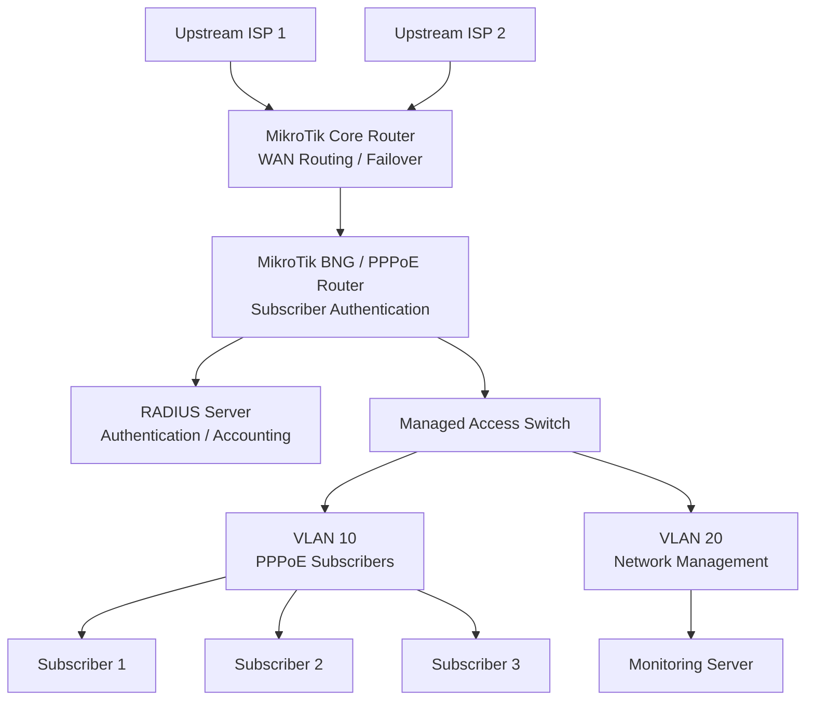

# Complete ISP Network

This project combines the major MikroTik RouterOS v7 concepts into a complete small-scale Internet Service Provider (ISP) network.

The goal is to build an ISP infrastructure that can provide internet services to multiple subscribers through centralized routing, subscriber authentication, address management, bandwidth control, and network security.

The project integrates:

* Upstream internet connectivity.
* Core and subscriber network segmentation.
* VLAN-based subscriber access.
* PPPoE authentication.
* RADIUS-based centralized authentication.
* IP address pools and subscriber profiles.
* Internet routing and source NAT.
* CGNAT for private subscriber addressing.
* Dual-WAN failover and load balancing.
* Firewall security.
* Monitoring and troubleshooting.

This is a reference lab architecture. A production ISP requires additional capacity planning, redundancy, operational monitoring, security controls, and provider-specific integration.

# 🗁 Network Architecture

### 🖆 High-level topology



### 🖆 Network roles

| Component | Responsibility |
| --- | --- |
| Upstream ISP 1 | Primary internet connectivity |
| Upstream ISP 2 | Secondary internet connectivity |
| Core router | Upstream routing, failover, and load balancing |
| BNG / PPPoE router | Subscriber termination and authentication |
| Access switch | Subscriber VLAN distribution |
| RADIUS server | Centralized authentication and accounting |
| Monitoring server | Infrastructure and service monitoring |
| Subscriber devices | Customer routers connecting through PPPoE |

The Broadband Network Gateway (BNG), also commonly called a Broadband Remote Access Server (BRAS), terminates subscriber sessions and applies access policies.

# 🗁 IP Addressing Plan

### 🖆 Infrastructure addressing

| Network | Purpose | Example |
| --- | --- | --- |
| WAN 1 | Primary upstream | 192.0.2.0/24 |
| WAN 2 | Secondary upstream | 198.51.100.0/24 |
| Core-to-BNG | Routed transit | 10.255.0.0/30 |
| Management | Network management | 10.99.0.0/24 |
| RADIUS | Authentication service | 10.99.0.10 |
| Monitoring | Monitoring server | 10.99.0.20 |

### 🖆 Subscriber addressing

| Address range | Purpose |
| --- | --- |
| 100.64.0.0/10 | Shared address space for CGNAT |
| 100.64.0.0/16 | Example subscriber allocation |
| 10.10.10.0/24 | Example PPPoE lab pool |
| Public IPv4 pool | Publicly assigned subscriber addresses |

The `192.0.2.0/24` and `198.51.100.0/24` ranges are documentation-only networks. Replace them with real upstream addresses in an operational network.

The `100.64.0.0/10` block is shared address space reserved for carrier-grade NAT deployments.

# 🗁 Core Router Configuration

### 🖆 Prepare WAN interfaces

Assume:

* `ether1` connects to upstream ISP 1.
* `ether2` connects to upstream ISP 2.
* `ether3` connects to the BNG router.

Rename interfaces:

```routeros
/interface ethernet
set [find default-name=ether1] name=WAN1
set [find default-name=ether2] name=WAN2
set [find default-name=ether3] name=TO-BNG
```

### 🖆 Configure upstream addresses

```routeros
/ip address
add address=192.0.2.2/24 interface=WAN1 comment="Primary upstream"
add address=198.51.100.2/24 interface=WAN2 comment="Secondary upstream"
add address=10.255.0.1/30 interface=TO-BNG comment="BNG transit"
```

### 🖆 Configure the BNG transit address

On the BNG router:

```routeros
/ip address
add address=10.255.0.2/30 interface=ether1 comment="Core transit"
```

The core and BNG routers now have a directly connected Layer 3 transit network.

### 🖆 Configure default routing

For a basic primary/backup design:

```routeros
/ip route
add dst-address=0.0.0.0/0 \
    gateway=192.0.2.1 \
    distance=1 \
    comment="Primary upstream"

add dst-address=0.0.0.0/0 \
    gateway=198.51.100.1 \
    distance=2 \
    comment="Secondary upstream"
```

This provides route-level preference. Production failover should use reliable upstream reachability monitoring, such as recursive gateway checks.

### 🖆 Configure routes to subscriber networks

The core router needs a route to the subscriber address space through the BNG.

For the example subscriber pool:

```routeros
/ip route
add dst-address=100.64.0.0/16 \
    gateway=10.255.0.2 \
    comment="Subscriber network via BNG"
```

If the BNG performs CGNAT, the core router may instead need routes to the public NAT address pool or other translated networks, depending on the architecture.

# 🗁 BNG Router Configuration

### 🖆 Prepare interfaces

Assume:

* `ether1` connects to the core router.
* `ether2` connects to the subscriber access switch.
* `ether3` connects to the management network.

Rename interfaces:

```routeros
/interface ethernet
set [find default-name=ether1] name=TO-CORE
set [find default-name=ether2] name=TO-ACCESS
set [find default-name=ether3] name=MGMT-PORT
```

Configure the transit address:

```routeros
/ip address
add address=10.255.0.2/30 interface=TO-CORE
```

### 🖆 Configure management networking

Create a management bridge:

```routeros
/interface bridge
add name=bridge-MGMT
```

Add the management interface:

```routeros
/interface bridge port
add bridge=bridge-MGMT interface=MGMT-PORT
```

Assign a management address:

```routeros
/ip address
add address=10.99.0.1/24 interface=bridge-MGMT
```

Configure the RADIUS and monitoring servers with addresses in this management subnet.

### 🖆 Configure a subscriber VLAN

Create a bridge for the subscriber access network:

```routeros
/interface bridge
add name=bridge-SUBSCRIBERS \
    vlan-filtering=no \
    comment="Subscriber access bridge"
```

Add the access-switch uplink:

```routeros
/interface bridge port
add bridge=bridge-SUBSCRIBERS \
    interface=TO-ACCESS \
    frame-types=admit-only-vlan-tagged
```

Add a VLAN interface for subscriber traffic:

```routeros
/interface vlan
add name=VLAN10-SUBSCRIBERS \
    interface=bridge-SUBSCRIBERS \
    vlan-id=10
```

Enable VLAN filtering and configure the bridge VLAN table:

```routeros
/interface bridge vlan
add bridge=bridge-SUBSCRIBERS \
    vlan-ids=10 \
    tagged=bridge-SUBSCRIBERS,TO-ACCESS
```

```routeros
/interface bridge
set bridge-SUBSCRIBERS vlan-filtering=yes
```

The bridge itself must be a tagged member because the router CPU needs access to the VLAN interface.

The access switch must also be configured to carry VLAN 10 tagged on its uplink. Subscriber-facing switch ports should be configured according to the intended access-port design.

# 🗁 PPPoE Subscriber Configuration

### 🖆 Create a subscriber address pool

Use a dedicated private subscriber range:

```routeros
/ip pool
add name=PPPOE-POOL ranges=100.64.0.10-100.64.255.254
```

This pool is within the carrier-grade NAT shared address space.

### 🖆 Create subscriber service profiles

Create a basic service package:

```routeros
/ppp profile
add name=PLAN-10M \
    local-address=100.64.0.1 \
    remote-address=PPPOE-POOL \
    rate-limit=10M/10M \
    only-one=yes
```

Create a higher-speed package:

```routeros
/ppp profile
add name=PLAN-20M \
    local-address=100.64.0.1 \
    remote-address=PPPOE-POOL \
    rate-limit=20M/20M \
    only-one=yes
```

The first `rate-limit` value represents subscriber upload from the router's perspective; the second represents download to the subscriber.

### 🖆 Enable the PPPoE server

```routeros
/interface pppoe-server server
add interface=VLAN10-SUBSCRIBERS \
    service-name=ISP-PPPOE \
    default-profile=PLAN-10M \
    authentication=chap,mschap1,mschap2 \
    one-session-per-host=yes \
    disabled=no
```

The PPPoE server receives subscriber discovery traffic on VLAN 10.

### 🖆 Create a local test subscriber

For a basic lab without RADIUS:

```routeros
/ppp secret
add name=test-customer \
    password=StrongTestPassword \
    service=pppoe \
    profile=PLAN-10M
```

This local account allows the PPPoE service to be tested before integrating centralized authentication.

# 🗁 RADIUS Integration

### 🖆 Understand RADIUS

RADIUS centralizes authentication, authorization, and accounting.

In an ISP environment, it can be used to:

* Authenticate subscriber credentials.
* Assign service profiles.
* Apply bandwidth policies.
* Record session start and stop events.
* Track subscriber session duration.
* Support centralized billing integration.

The RADIUS server and MikroTik BNG communicate over the management network.

### 🖆 Configure the RADIUS client

On the BNG router:

```routeros
/radius
add service=ppp \
    address=10.99.0.10 \
    secret=ReplaceWithStrongSharedSecret \
    authentication-port=1812 \
    accounting-port=1813 \
    timeout=3s \
    comment="ISP RADIUS server"
```

The shared secret must match the client configuration on the RADIUS server.

### 🖆 Enable RADIUS for PPP authentication

```routeros
/ppp aaa
set use-radius=yes accounting=yes interim-update=5m
```

The BNG can now send PPP authentication and accounting requests to the configured RADIUS server.

### 🖆 Understand subscriber authorization

A RADIUS server can return attributes that influence the subscriber session, including:

* Framed-IP-Address.
* Framed-Pool.
* Mikrotik-Rate-Limit.
* Session-Timeout.
* Idle-Timeout.
* Acct-Interim-Interval.

The RADIUS server must be configured to return attributes supported by the installed RouterOS version and the chosen authentication workflow.

### 🖆 Verify RADIUS communication

Inspect the configuration:

```routeros
/radius print detail
```

Check logs:

```routeros
/log print where topics~"radius"
```

Check active subscriber sessions:

```routeros
/ppp active print detail
```

# 🗁 Subscriber Internet Routing

### 🖆 Configure the BNG default route

The BNG should send internet-bound traffic to the core router:

```routeros
/ip route
add dst-address=0.0.0.0/0 \
    gateway=10.255.0.1 \
    comment="Default route to core"
```

### 🖆 Configure the core return route

The core router needs a route back to subscriber addresses:

```routeros
/ip route
add dst-address=100.64.0.0/16 \
    gateway=10.255.0.2
```

These routes establish the basic subscriber-to-core routing path.

### 🖆 Decide where NAT belongs

A scalable ISP design should define a clear NAT boundary.

Common options include:

* CGNAT on the core router.
* CGNAT on a dedicated NAT gateway.
* Public IPv4 assignment for selected subscribers.
* A combination of public addressing and shared IPv4 addressing.

For this project, the core router will perform CGNAT.

The BNG routes subscriber traffic to the core without translating it.

# 🗁 CGNAT Configuration

### 🖆 Understand CGNAT

Carrier-Grade NAT allows multiple subscribers using private or shared IPv4 addresses to share a smaller pool of public IPv4 addresses.

The shared address space `100.64.0.0/10` is specifically reserved for this purpose.

A simplified traffic flow is:

```text
Subscriber address
      |
      v
100.64.0.10
      |
      v
BNG Router
      |
      v
Core Router / CGNAT
      |
      v
Public IPv4 address
      |
      v
Internet
```

### 🖆 Configure source NAT on the core router

For a small lab, use masquerade on the upstream interfaces:

```routeros
/ip firewall nat
add chain=srcnat \
    src-address=100.64.0.0/16 \
    out-interface=WAN1 \
    action=masquerade \
    comment="Subscriber NAT through WAN1"

add chain=srcnat \
    src-address=100.64.0.0/16 \
    out-interface=WAN2 \
    action=masquerade \
    comment="Subscriber NAT through WAN2"
```

This is suitable for a basic functional lab, not a complete production CGNAT implementation.

### 🖆 Understand production CGNAT requirements

A production CGNAT platform requires careful planning for:

* Public IPv4 address allocation.
* Subscriber-to-public-address mapping.
* Port allocation and collision prevention.
* Concurrent connection capacity.
* Connection tracking table capacity.
* Logging and subscriber traceability.
* Lawful and regulatory requirements.
* Port exhaustion monitoring.
* High availability and redundancy.

A large ISP should evaluate dedicated CGNAT systems or purpose-built platforms rather than assuming a basic masquerade configuration provides carrier-scale capacity.

# 🗁 Dual-WAN Failover

### 🖆 Configure upstream WAN routing

The core router already has two default routes with different distances.

For better failure detection, implement recursive gateway monitoring.

A simplified architecture is:

```text
             Core Router
             /         \
          WAN1         WAN2
           |             |
      ISP 1 path     ISP 2 path
           |             |
       Internet       Internet
```

Each WAN should have an independent health-check target and a route that resolves through the intended upstream.

### 🖆 Understand policy-routing requirements

If PCC load balancing is added, each custom routing table must have:

* Its preferred WAN route.
* A backup WAN route where failover is required.
* Correct gateway resolution.
* Appropriate connection and routing marks.
* Return-path handling for inbound connections.

A default route in the main table alone does not guarantee failover for traffic using custom routing tables.

# 🗁 Firewall Security

### 🖆 Configure interface lists

On the core router:

```routeros
/interface list
add name=WAN
add name=LAN

/interface list member
add list=WAN interface=WAN1
add list=WAN interface=WAN2
add list=LAN interface=TO-BNG
```

On the BNG router, use separate lists for subscriber and management interfaces as appropriate.

### 🖆 Protect the core router

A basic starting point:

```routeros
/ip firewall filter
add chain=input \
    connection-state=established,related \
    action=accept \
    comment="Accept established and related input"

add chain=input \
    connection-state=invalid \
    action=drop \
    comment="Drop invalid input"

add chain=input \
    in-interface-list=WAN \
    action=drop \
    comment="Drop unsolicited WAN input"
```

This example assumes required management access is provided through a trusted interface and permitted by rules placed before the final WAN drop.

### 🖆 Protect the BNG router

The BNG should distinguish between:

* Subscriber traffic.
* Core transit traffic.
* Management traffic.
* RADIUS traffic.

Allow management access only from trusted infrastructure networks.

Do not expose administrative services to subscriber VLANs.

### 🖆 Restrict subscriber access

Subscriber traffic should not be able to reach:

* Router management addresses.
* RADIUS infrastructure.
* Monitoring systems.
* Other subscribers' private networks, unless explicitly required.

Use firewall rules and network segmentation to enforce these boundaries.

# 🗁 Monitoring and Operations

### 🖆 Monitor PPPoE sessions

```routeros
/ppp active print detail
```

This provides information about authenticated subscribers and their active sessions.

### 🖆 Monitor PPPoE server configuration

```routeros
/interface pppoe-server server print detail
```

### 🖆 Monitor interface traffic

```routeros
/interface monitor-traffic WAN1
/interface monitor-traffic WAN2
/interface monitor-traffic TO-BNG
```

### 🖆 Monitor system resources

```routeros
/system resource print
```

Monitor:

* CPU utilization.
* Memory usage.
* Free storage.
* Interface throughput.
* Connection tracking usage.
* PPPoE session count.

### 🖆 Inspect firewall counters

```routeros
/ip firewall filter print stats
/ip firewall nat print stats
```

### 🖆 Inspect logs

```routeros
/log print
```

Filter PPP and RADIUS-related messages:

```routeros
/log print where topics~"ppp"
/log print where topics~"radius"
```

### 🖆 Back up the configuration

Create a binary backup:

```routeros
/system backup save name=isp-router-backup
```

Export the configuration as text:

```routeros
/export file=isp-router-export
```

Store backups securely and transfer them to a separate management system. A backup stored only on the router does not protect against router hardware failure.

# 🗁 Subscriber Operations

### 🖆 Add a subscriber

For a local authentication lab:

```routeros
/ppp secret
add name=customer100 \
    password=UseAUniqueStrongPassword \
    service=pppoe \
    profile=PLAN-10M \
    comment="Customer 100"
```

For a RADIUS-based deployment, create the subscriber account in the centralized RADIUS system instead.

### 🖆 Change a subscriber package

```routeros
/ppp secret
set [find name=customer100] profile=PLAN-20M
```

For an active session, disconnect and reconnect the subscriber if necessary to apply the new profile immediately.

### 🖆 Disconnect a subscriber

```routeros
/ppp active
remove [find name=customer100]
```

### 🖆 Disable a subscriber

```routeros
/ppp secret
set [find name=customer100] disabled=yes
```

In a RADIUS-based deployment, account suspension should also be handled in the central authentication system.

# 🗁 Troubleshooting

### 🖆 Subscriber cannot establish a PPPoE session

Check:

* VLAN tagging between the access switch and BNG.
* PPPoE server interface.
* Subscriber Layer 2 connectivity.
* PPPoE account status.
* RADIUS reachability when centralized authentication is enabled.

Commands:

```routeros
/interface bridge vlan print detail
/interface pppoe-server server print detail
/ppp secret print detail
/ppp active print detail
/log print where topics~"ppp"
```

### 🖆 RADIUS authentication fails

Check:

* RADIUS server address.
* Shared secret.
* UDP ports 1812 and 1813.
* Routing between BNG and RADIUS.
* Firewall rules.
* RADIUS user attributes.
* Server logs.

Commands:

```routeros
/radius print detail
/ping 10.99.0.10
/log print where topics~"radius"
```

### 🖆 Subscriber connects but has no internet

Check:

* Subscriber IP address.
* BNG default route.
* Core route to subscriber networks.
* Core upstream default routes.
* CGNAT rules.
* Firewall forwarding policies.

Commands:

```routeros
/ppp active print detail
/ip route print detail
/ip firewall nat print stats
/ip firewall filter print stats
```

### 🖆 Subscriber bandwidth policy is not applied

Check:

* The subscriber's assigned profile.
* RADIUS authorization attributes.
* Active PPP session information.
* Queue configuration.
* FastTrack behavior.
* Conflicting queue policies.

Commands:

```routeros
/ppp active print detail
/ppp profile print detail
/queue simple print stats
/queue tree print stats
```

### 🖆 CGNAT subscribers cannot reach the internet

Check:

* Subscriber source address range.
* Route from BNG to core.
* Route from core to upstream.
* Source NAT rule counters.
* Connection tracking.
* Upstream provider restrictions.

Commands:

```routeros
/ip route print detail
/ip firewall nat print stats
/ip firewall connection print
```

# 🗁 Practical Exercises

### 🖆 Exercise: Build the complete ISP lab

* [ ] Configure the core router.
* [ ] Configure both upstream WAN links.
* [ ] Configure the core-to-BNG transit network.
* [ ] Configure the BNG management network.
* [ ] Configure subscriber VLAN 10.
* [ ] Configure the access switch trunk.
* [ ] Configure the PPPoE server.
* [ ] Create subscriber profiles.
* [ ] Connect a customer PPPoE router.
* [ ] Verify subscriber connectivity.

### 🖆 Exercise: Centralized authentication

* [ ] Deploy a RADIUS server.
* [ ] Configure the MikroTik RADIUS client.
* [ ] Enable PPP RADIUS authentication and accounting.
* [ ] Create a subscriber account in RADIUS.
* [ ] Authenticate a PPPoE client.
* [ ] Verify accounting records.
* [ ] Change a subscriber's service profile.

### 🖆 Exercise: Internet and CGNAT

* [ ] Configure BNG default routing.
* [ ] Configure core subscriber routes.
* [ ] Configure CGNAT.
* [ ] Verify subscriber internet access.
* [ ] Inspect NAT connection entries.
* [ ] Test multiple subscribers simultaneously.
* [ ] Monitor connection tracking usage.

### 🖆 Exercise: Redundancy and load balancing

* [ ] Configure primary and secondary upstream routes.
* [ ] Implement recursive gateway monitoring.
* [ ] Test upstream failure.
* [ ] Restore the primary WAN.
* [ ] Configure PCC if required.
* [ ] Configure backup routes in custom routing tables.
* [ ] Test traffic distribution and failover.

### 🖆 Exercise: ISP operations

* [ ] Monitor active subscriber sessions.
* [ ] Inspect interface throughput.
* [ ] Configure centralized logging.
* [ ] Configure automated backups.
* [ ] Document subscriber provisioning procedures.
* [ ] Test account suspension and reactivation.
* [ ] Prepare an operational troubleshooting checklist.

# 🗁 Production Design Considerations

### 🖆 Capacity planning

Before deploying an ISP network, estimate:

* Total subscribers.
* Peak concurrent sessions.
* Expected aggregate bandwidth.
* PPPoE session capacity.
* CPU and memory requirements.
* Connection tracking capacity.
* CGNAT port and public IP requirements.
* RADIUS request volume.
* Monitoring and logging storage.

A router's maximum interface speed does not guarantee that it can process the same throughput with all required firewall, NAT, routing, and subscriber services enabled.

### 🖆 Redundancy

Consider redundancy at multiple layers:

* Multiple upstream providers.
* Redundant core routers.
* Redundant BNG devices.
* Redundant access switches.
* RADIUS server redundancy.
* Backup power.
* Independent monitoring.

Avoid single points of failure in critical infrastructure.

### 🖆 Address management

Maintain a documented address allocation plan for:

* Infrastructure.
* Management.
* Subscriber pools.
* CGNAT.
* Public IPv4.
* IPv6.
* VPN and transit networks.

Plan IPv6 deployment alongside IPv4 services rather than treating it as an afterthought.

### 🖆 Security and operational controls

* Restrict management access to trusted networks.
* Use unique administrative credentials.
* Apply least-privilege access.
* Maintain configuration backups.
* Monitor authentication failures.
* Record subscriber session accounting.
* Protect RADIUS shared secrets.
* Keep RouterOS and infrastructure software maintained.
* Document changes and rollback procedures.

# 🗁 Summary

This project brings together the major components of a MikroTik-based ISP network.

The core router handles upstream connectivity and routing, while the BNG terminates PPPoE subscriber sessions. RADIUS provides centralized authentication and accounting, and CGNAT enables shared IPv4 internet access.

VLAN segmentation, firewall policies, monitoring, and backup routing provide the foundation for a more manageable ISP infrastructure.

The lab can be extended with IPv6 subscriber services, dynamic routing, redundant BNG architecture, advanced CGNAT, centralized billing, and automated provisioning.
