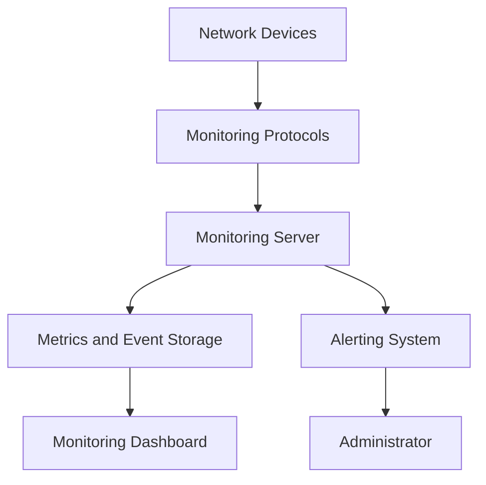

# Monitoring Fundamentals

Network monitoring is the continuous process of observing, measuring, and analyzing network devices, links, services, and traffic to understand their operational health and performance.

It helps administrators detect failures, identify performance degradation, investigate unusual activity, and maintain network availability.

Monitoring is important in environments ranging from small office networks to enterprise infrastructures, data centers, and Internet Service Providers (ISPs).

# 🗁 Objectives of Network Monitoring

The primary objectives of network monitoring include:

* **Availability:** Determine whether devices, links, and services are operational.
* **Performance:** Measure bandwidth utilization, throughput, latency, jitter, and packet loss.
* **Fault detection:** Identify device failures, interface errors, link interruptions, and service outages.
* **Capacity planning:** Understand resource consumption and predict future infrastructure requirements.
* **Traffic analysis:** Identify traffic patterns, top talkers, and unusual bandwidth consumption.
* **Security visibility:** Detect unexpected connections, abnormal traffic patterns, and suspicious behavior.
* **Troubleshooting:** Collect historical and real-time data to investigate network problems.
* **Reporting:** Generate operational reports, uptime statistics, and performance trends.

# 🗁 What Should Be Monitored?

A useful monitoring system observes multiple layers of network infrastructure.

| Category | Monitoring targets | Important metrics |
| --- | --- | --- |
| Network devices | Routers, switches, firewalls, access points | Availability, CPU, memory |
| Interfaces | Ethernet, fiber, wireless, VLAN interfaces | Traffic, errors, drops, utilization |
| Network links | WAN, LAN, VPN, fiber connections | Availability, latency, packet loss |
| IP services | DNS, DHCP, NTP | Response time, availability |
| Routing | Static routes, OSPF, BGP | Neighbor state, route changes |
| Wireless | Access points and wireless clients | Signal strength, noise, retries |
| Servers | DNS, web, application, database servers | CPU, memory, disk, service health |
| Security | Firewalls and security gateways | Denied traffic, connection counts |
| Traffic | Network flows and packets | Top talkers, protocols, bandwidth |

Monitoring should focus on operationally important resources rather than collecting every available metric without a clear purpose.

# 🗁 Types of Network Monitoring

**Availability Monitoring**

Checks whether a device, interface, or service is reachable.

Common techniques include:

* ICMP Echo requests.
* TCP connection checks.
* HTTP and HTTPS requests.
* DNS resolution tests.
* Application-specific health checks.

Example:

```bash
ping -c 5 192.168.1.1
```

A successful ping indicates that ICMP communication is working between the source and destination. It does not necessarily prove that every service on the destination is healthy.

**Performance Monitoring**

Measures how efficiently the network and its devices operate.

Common metrics include:

* Bandwidth utilization.
* Throughput.
* Latency.
* Jitter.
* Packet loss.
* CPU utilization.
* Memory utilization.
* Interface errors and drops.

**Traffic Monitoring**

Examines how network bandwidth is being consumed.

It can identify:

* Top source and destination IP addresses.
* Most frequently used protocols.
* High-bandwidth applications.
* Traffic distribution between interfaces.
* Unexpected traffic patterns.

Common technologies include NetFlow, IPFIX, sFlow, and packet capture.

**Configuration and Fault Monitoring**

Tracks device configuration changes and operational events.

Examples include:

* Interface state changes.
* Routing neighbor failures.
* Configuration modifications.
* Device reboots.
* Power supply failures.
* Hardware alarms.

**Security Monitoring**

Observes network activity to identify potentially suspicious behavior.

Examples include:

* Repeated authentication failures.
* Unexpected inbound connections.
* Unusual outbound traffic.
* Port scanning activity.
* Firewall policy violations.
* Abnormal traffic volume.

# 🗁 Important Network Performance Metrics

**Bandwidth**

Bandwidth represents the maximum theoretical data-transfer capacity of a communication link.

It is commonly expressed in bits per second.

Examples:

* 100 Mbps
* 1 Gbps
* 10 Gbps

**Throughput**

Throughput is the actual amount of data successfully transferred over a network during a given period.

A 1 Gbps interface does not guarantee 1 Gbps of application throughput. Protocol overhead, congestion, hardware limitations, and other factors can reduce actual performance.

**Latency**

Latency measures the time required for data to travel between two endpoints.

It is commonly measured in milliseconds (ms).

For example, a round-trip time (RTT) of 25 ms means a probe took approximately 25 milliseconds to travel to the destination and return.

**Jitter**

Jitter refers to variation in packet delay.

It is particularly important for real-time applications such as:

* VoIP.
* Video conferencing.
* Live streaming.
* Online gaming.

**Packet Loss**

Packet loss occurs when transmitted packets fail to reach their intended destination.

Possible causes include:

* Network congestion.
* Faulty cables or interfaces.
* Wireless interference.
* Hardware problems.
* Routing issues.
* Queue overflow.

**Interface Utilization**

Interface utilization represents the proportion of an interface's available capacity being used.

A simplified calculation is:

\[
\text{Utilization} =
\frac{\text{Current Traffic Rate}}{\text{Interface Capacity}}
\times 100
\]

For example, if a 1 Gbps interface is transmitting 400 Mbps:

\[
\frac{400}{1000}\times100=40\%
\]

The transmit and receive directions should generally be monitored separately.

**CPU and Memory Utilization**

Network devices have limited processing and memory resources.

High CPU utilization can indicate:

* Excessive traffic processing.
* Routing protocol activity.
* Firewall connection processing.
* Control-plane attacks.
* Software issues.

High memory utilization can indicate resource exhaustion, excessive connection tracking, memory leaks, or insufficient hardware capacity.

# 🗁 Monitoring Architecture

A typical centralized monitoring architecture contains several components.

* **Monitored devices:** Routers, switches, servers, firewalls, and other infrastructure.
* **Monitoring protocols:** SNMP, ICMP, HTTP, SSH, APIs, and streaming telemetry.
* **Monitoring server:** Collects and processes monitoring information.
* **Database or time-series storage:** Stores historical measurements and events.
* **Visualization dashboard:** Displays metrics, device status, and trends.
* **Alerting system:** Notifies administrators when defined conditions occur.



In a centralized architecture, multiple devices send monitoring information to a common platform. This makes it easier to observe the entire infrastructure from one location.

# 🗁 Active and Passive Monitoring

**Active Monitoring**

Active monitoring generates test traffic to evaluate network or service behavior.

Examples:

* ICMP ping probes.
* TCP connection tests.
* HTTP requests.
* DNS queries.
* Synthetic application transactions.

Advantages:

* Measures reachability and response time.
* Can test specific services.
* Helps identify problems before users report them.

Limitations:

* Generates additional traffic.
* Results may not represent actual user experience.
* Firewalls or rate limits may affect probe results.

**Passive Monitoring**

Passive monitoring observes existing network traffic, device counters, or events without generating separate test transactions.

Examples:

* SNMP interface counters.
* NetFlow and IPFIX exports.
* sFlow sampling.
* Syslog messages.
* Packet capture.
* Device telemetry.

Advantages:

* Provides visibility into real network activity.
* Helps identify traffic patterns.
* Can support detailed troubleshooting.

Limitations:

* Visibility depends on where data is collected.
* Some techniques require additional storage and processing.
* Encrypted traffic limits application-level inspection.

A mature monitoring environment commonly combines active and passive monitoring.

# 🗁 Monitoring Intervals and Data Collection

Monitoring systems collect information at configured intervals.

For example:

| Monitoring interval | Typical purpose |
| --- | --- |
| 10–30 seconds | Critical service or infrastructure checks |
| 1 minute | Operational performance monitoring |
| 5 minutes | General device and interface monitoring |
| 15–60 minutes | Long-term trends and capacity reporting |

These are illustrative intervals, not universal requirements. The appropriate interval depends on the metric, monitoring protocol, infrastructure size, and operational requirements.

Shorter intervals provide more detailed visibility but increase polling traffic, processing requirements, and storage consumption.

A monitoring system should balance:

* Data collection frequency.
* Detection requirements.
* Network overhead.
* Storage capacity.
* Historical retention.

# 🗁 Establishing Performance Baselines

A baseline represents the normal operating behavior of a network or device under typical conditions.

Baselines help administrators distinguish normal variations from abnormal behavior.

For example, consider a router with the following typical metrics:

| Metric | Normal baseline |
| --- | ---: |
| CPU utilization | 15–30% |
| Memory utilization | 40–55% |
| WAN utilization | 20–45% |
| Average latency | 15–25 ms |
| Packet loss | 0% |

These values are hypothetical examples. Actual baselines must be established from measurements collected in the target environment.

Baselines should account for:

* Business hours and off-peak periods.
* Daily and weekly traffic patterns.
* Scheduled backups.
* Software updates.
* Seasonal traffic changes.
* Planned maintenance.

Monitoring systems can compare current measurements against historical baselines to identify unusual changes.

# 🗁 Thresholds and Monitoring Alerts

A threshold defines a condition that triggers an alert when a monitored metric crosses a configured value.

Example:

| Metric | Warning threshold | Critical threshold |
| --- | ---: | ---: |
| CPU utilization | 70% | 90% |
| Memory utilization | 80% | 95% |
| Interface utilization | 70% | 90% |
| Packet loss | 1% | 5% |
| Latency | 100 ms | 200 ms |

These thresholds are examples, not recommended universal values. Production thresholds should reflect the network's baseline and service requirements.

A good alerting system should consider:

* **Warning:** A condition requires attention.
* **Critical:** A condition requires immediate investigation.
* **Recovery:** The monitored condition has returned to normal.

Use sustained conditions instead of triggering an alert for every temporary spike.

For example, an alert might trigger when CPU utilization remains above 90% for five consecutive minutes rather than when a single measurement reaches 90%.

# 🗁 Monitoring Tools

Several tools can be used to monitor network infrastructure.

| Tool | Primary purpose |
| --- | --- |
| Zabbix | Infrastructure monitoring, SNMP, alerts, and dashboards |
| LibreNMS | Network device discovery and SNMP monitoring |
| Prometheus | Metrics collection and time-series monitoring |
| Grafana | Metrics visualization and dashboards |
| Nagios | Host and service availability monitoring |
| PRTG | Network and infrastructure monitoring |
| Observium | Network device monitoring and performance graphs |
| ntopng | Network traffic visibility and analysis |
| Wireshark | Packet capture and protocol analysis |
| Smokeping | Latency and packet-loss measurement |

Different tools solve different monitoring problems. For example, Grafana is primarily a visualization platform, while Wireshark is designed for packet-level analysis.

A monitoring architecture may combine several tools to provide complete operational visibility.

# 🗁 Practical Lab: Basic Network Availability Monitoring

This lab demonstrates how to check whether a gateway and external destination are reachable from Ubuntu.

**Check the default gateway**

```bash
ip route
```

Example output:

```text
default via 192.168.1.1 dev enp0s3
192.168.1.0/24 dev enp0s3 proto kernel scope link
```

The default gateway in this example is `192.168.1.1`.

**Test gateway availability**

```bash
ping -c 5 192.168.1.1
```

**Test external IP connectivity**

```bash
ping -c 5 1.1.1.1
```

**Test DNS resolution**

```bash
dig google.com
```

**Check the route to a destination**

```bash
traceroute 1.1.1.1
```

If `traceroute` is not installed:

```bash
sudo apt update
sudo apt install traceroute
```

**Check TCP connectivity**

```bash
nc -vz google.com 443
```

This checks whether a TCP connection can be established to the destination's HTTPS port.

**Interpret the results**

| Observation | Possible interpretation |
| --- | --- |
| Gateway unreachable | Local network, interface, or gateway problem |
| Gateway reachable, external IP unreachable | WAN, routing, firewall, or upstream problem |
| External IP reachable, domain fails | Possible DNS resolution problem |
| TCP port unavailable | Service unavailable or traffic filtered |
| High RTT | Possible congestion, routing changes, or long network path |
| Packet loss | Possible congestion, link problems, or probe filtering |

These tests provide initial diagnostic evidence. Further investigation may be required to identify the actual cause.

# 🗁 Monitoring Best Practices

* Monitor critical network devices and services centrally.
* Use SNMPv3 with authentication and privacy for production SNMP monitoring.
* Synchronize device and monitoring server clocks using NTP.
* Establish performance baselines before defining alert thresholds.
* Monitor both transmit and receive interface utilization.
* Track interface errors, discards, and link-state changes.
* Use active and passive monitoring together.
* Configure alert deduplication to prevent notification floods.
* Define escalation procedures for critical incidents.
* Maintain appropriate historical data retention.
* Restrict access to monitoring dashboards and management interfaces.
* Protect monitoring credentials and telemetry traffic.
* Review monitoring coverage whenever infrastructure changes.
* Test alert delivery and recovery notifications regularly.

# 🗁 Summary

Network monitoring provides continuous visibility into infrastructure availability, performance, traffic behavior, and operational events.

A practical monitoring strategy combines device monitoring, service checks, traffic analysis, performance measurements, historical baselines, and actionable alerts.

Understanding these fundamentals provides the foundation for more specialized monitoring technologies such as SNMP, Syslog, NetFlow, and network alerting.
