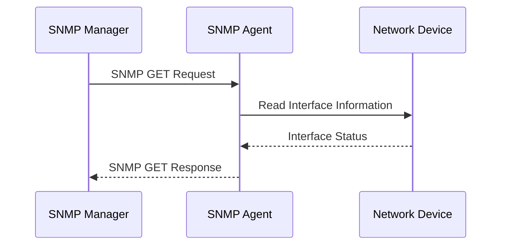
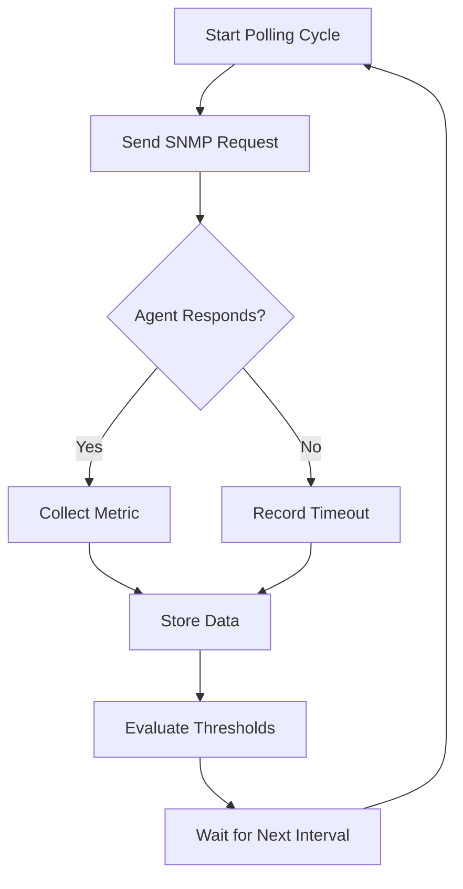

# SNMP Monitoring

SNMP (Simple Network Management Protocol) is an application-layer protocol used to monitor and manage network devices over IP networks.

It allows network administrators to collect operational information from routers, switches, firewalls, servers, printers, wireless access points, and other SNMP-compatible devices.

SNMP is commonly used to monitor:

* Device availability and uptime.
* CPU and memory utilization.
* Interface status.
* Interface bandwidth utilization.
* Packet counters and traffic statistics.
* Interface errors and discarded packets.
* Temperature, voltage, and hardware health.
* Routing and system information.

SNMP is widely used in network monitoring platforms such as Zabbix, LibreNMS, PRTG, and Observium.

# 🗁 SNMP Architecture

SNMP monitoring uses three primary components.

**SNMP Manager**

The SNMP manager is the monitoring system that communicates with network devices.

Its responsibilities include:

* Requesting information from SNMP agents.
* Collecting device metrics.
* Processing responses.
* Receiving asynchronous notifications.
* Presenting monitoring information through dashboards.

Examples include Zabbix, LibreNMS, and PRTG.

**SNMP Agent**

The SNMP agent is software running on a monitored device.

Its responsibilities include:

* Collecting device information.
* Maintaining accessible management information.
* Responding to SNMP requests.
* Sending notifications when configured events occur.

**Managed Device**

A managed device is any SNMP-compatible device being monitored.

Examples include:

* MikroTik routers.
* Cisco switches.
* Linux servers.
* Firewalls.
* Wireless access points.
* Network printers.

# 🗁 How SNMP Works

SNMP communication generally follows a manager-agent model.

The manager sends requests to an agent, and the agent returns the requested information.

For example, a monitoring server may request the current operational status of a router interface.



The monitoring server can repeat this process at configured intervals to collect historical performance data.

SNMP also supports notifications initiated by agents, allowing devices to report certain events without waiting for a manager request.

# 🗁 SNMP Versions

SNMP has three commonly discussed protocol versions.

| Feature | SNMPv1 | SNMPv2c | SNMPv3 |
| --- | --- | --- | --- |
| Community-based access | Yes | Yes | No |
| Authentication | Community string | Community string | User-based |
| Encryption | No | No | Available |
| GetBulk operation | No | Yes | Yes |
| Security | Weak | Weak | Stronger |
| Production recommendation | Avoid | Restricted environments | Preferred |

**SNMPv1**

The original SNMP version.

Characteristics:

* Uses community strings.
* Supports basic monitoring operations.
* Does not encrypt management traffic.
* Has limited functionality compared with later versions.

**SNMPv2c**

An enhanced community-based version.

Improvements include:

* GetBulk operations for efficient data collection.
* Improved error handling.
* Additional protocol operations.
* Better support for large data retrieval.

However, community strings are transmitted without encryption.

**SNMPv3**

SNMPv3 introduces a stronger security model using User-based Security Model (USM).

Its security features include:

* Authentication.
* Message integrity.
* Encryption.
* Access control through configured security policies.

SNMPv3 security levels:

| Security level | Authentication | Encryption |
| --- | --- | --- |
| noAuthNoPriv | No | No |
| authNoPriv | Yes | No |
| authPriv | Yes | Yes |

For production monitoring, `authPriv` is generally preferred because it provides both authentication and privacy.

# 🗁 SNMP Ports

SNMP commonly uses UDP.

| Port | Protocol | Purpose |
| --- | --- | --- |
| UDP 161 | SNMP | Manager requests and agent responses |
| UDP 162 | SNMP Trap/Inform | Notifications sent to the manager |

Typical communication:

```text
SNMP Manager
    |
    | UDP 161
    v
SNMP Agent

SNMP Agent
    |
    | UDP 162
    v
SNMP Manager
```

UDP 161 is used for normal SNMP polling.

UDP 162 is the standard destination port for traps and informs received by a monitoring system.

# 🗁 SNMP Operations

SNMP defines several operations for retrieving and modifying management information.

| Operation | Description |
| --- | --- |
| GET | Retrieves a specific object value |
| GETNEXT | Retrieves the next object in the MIB hierarchy |
| GETBULK | Retrieves multiple values efficiently |
| SET | Modifies an object value when permitted |
| RESPONSE | Returns the result of a request |
| TRAP | Sends an asynchronous notification |
| INFORM | Sends a notification that expects acknowledgment |

**GET**

The manager requests a specific OID from an agent.

Example:

```text
Manager → Agent: GET sysName.0
Agent → Manager: RESPONSE "Router-01"
```

**GETNEXT**

Retrieves the next accessible object in the MIB tree.

It is commonly used to walk through a sequence of management objects.

**GETBULK**

Retrieves multiple objects in a single request.

It is particularly useful for collecting large tables, such as interface information.

**SET**

Allows a manager to modify a managed object's value if the agent supports the object and permits write access.

For security and operational reasons, monitoring systems should generally use read-only access unless configuration changes are explicitly required.

**TRAP**

An agent sends a notification to the manager without expecting a protocol-level acknowledgment.

**INFORM**

An agent sends a notification and expects an acknowledgment from the receiver.

An INFORM can be useful when reliable notification delivery is important, although application-level monitoring and retry behavior still matter.

# 🗁 MIB and OID

SNMP uses a structured information model to identify and describe managed objects.

Two important concepts are MIB and OID.

**MIB (Management Information Base)**

A MIB defines managed objects that an SNMP agent can expose.

It describes:

* Object names.
* Object identifiers.
* Data types.
* Object descriptions.
* Access permissions.
* Relationships between objects.

MIB definitions are commonly provided in text files using a standardized notation.

**OID (Object Identifier)**

An OID uniquely identifies an object within the management information hierarchy.

For example:

```text
1.3.6.1.2.1.1.5.0
```

This OID identifies `sysName.0`, which represents the system name of an SNMP-managed device.

Some commonly used standard OIDs:

| Object | OID | Description |
| --- | --- | --- |
| sysDescr.0 | 1.3.6.1.2.1.1.1.0 | System description |
| sysObjectID.0 | 1.3.6.1.2.1.1.2.0 | Device object identifier |
| sysUpTime.0 | 1.3.6.1.2.1.1.3.0 | System uptime |
| sysName.0 | 1.3.6.1.2.1.1.5.0 | Device name |
| ifNumber.0 | 1.3.6.1.2.1.2.1.0 | Number of interfaces |

These are standard MIB-II objects. Vendor-specific features may use enterprise OIDs, and support for individual objects can vary between devices.

# 🗁 Important Interface OIDs

Interface monitoring is one of the most common uses of SNMP.

The IF-MIB provides information about network interfaces.

Important interface objects include:

| Object | OID | Description |
| --- | --- | --- |
| ifDescr | 1.3.6.1.2.1.2.2.1.2 | Interface description |
| ifType | 1.3.6.1.2.1.2.2.1.3 | Interface type |
| ifMtu | 1.3.6.1.2.1.2.2.1.4 | Interface MTU |
| ifSpeed | 1.3.6.1.2.1.2.2.1.5 | Interface speed |
| ifPhysAddress | 1.3.6.1.2.1.2.2.1.6 | Interface physical address |
| ifAdminStatus | 1.3.6.1.2.1.2.2.1.7 | Administrative status |
| ifOperStatus | 1.3.6.1.2.1.2.2.1.8 | Operational status |
| ifInOctets | 1.3.6.1.2.1.2.2.1.10 | Received octets |
| ifInErrors | 1.3.6.1.2.1.2.2.1.14 | Inbound errors |
| ifOutOctets | 1.3.6.1.2.1.2.2.1.16 | Transmitted octets |
| ifOutErrors | 1.3.6.1.2.1.2.2.1.20 | Outbound errors |

These older 32-bit interface counters can wrap quickly on high-speed interfaces.

For modern devices, monitoring systems should prefer the 64-bit counters provided by IF-MIB where supported.

Important 64-bit counters include:

* `ifHCInOctets`
* `ifHCOutOctets`
* `ifHCInUcastPkts`
* `ifHCOutUcastPkts`

Their corresponding OID subtree is:

```text
1.3.6.1.2.1.31.1.1.1
```

# 🗁 SNMP Polling

Polling is the process through which an SNMP manager periodically requests information from managed devices.

Example polling workflow:



Common polling intervals include:

* 30 seconds for selected critical metrics.
* 1 minute for frequently monitored infrastructure.
* 5 minutes for general device monitoring.
* Longer intervals for less frequently changing information.

The interval should be selected according to operational requirements and monitoring capacity.

# 🗁 Calculating Bandwidth from SNMP Counters

SNMP interface counters typically report cumulative byte counts.

To calculate bandwidth, the monitoring system compares counter values across two polling intervals.

Formula:

\[
\text{Bandwidth (bps)} =
\frac{(\text{Counter}_{new}-\text{Counter}_{old})\times8}
{\text{Elapsed Seconds}}
\]

Example:

Suppose an interface receives:

* Previous counter: 10,000,000 bytes.
* Current counter: 15,000,000 bytes.
* Elapsed time: 10 seconds.

Calculation:

\[
\frac{(15,000,000-10,000,000)\times8}{10}
=4,000,000\text{ bps}
\]

The average receive bandwidth is 4 Mbps.

To calculate interface utilization:

\[
\text{Utilization (\%)} =
\frac{\text{Measured Bandwidth}}{\text{Interface Speed}}
\times100
\]

If the interface speed is 100 Mbps:

\[
\frac{4}{100}\times100=4\%
\]

Monitoring systems should account for counter resets, device reboots, counter wraparound, interface speed changes, and polling delays.

# 🗁 SNMP Traps and Notifications

Polling is manager-initiated, whereas traps and informs are agent-initiated notifications.

A network device may send a notification when:

* An interface goes down.
* An interface comes back up.
* A device restarts.
* A hardware component reports an error.
* A configured threshold is exceeded.

Example:

```text
Router-01
    |
    | Interface state changed
    |
    | SNMP Trap
    v
Monitoring Server
    |
    v
Generate Alert
```

Traps are useful for event-driven monitoring because the manager does not need to wait until its next polling interval to discover an event.

However, traps can be lost because UDP does not provide delivery guarantees. Important events should also be verified through polling or another reliable monitoring mechanism.

# 🗁 SNMP Monitoring on Ubuntu

Ubuntu can be used to test SNMP communication and collect information from network devices.

**Install SNMP utilities**

```bash
sudo apt update
sudo apt install snmp snmp-mibs-downloader
```

The `snmp` package provides command-line utilities such as `snmpget`, `snmpwalk`, and `snmpset`.

MIB downloading and automatic MIB name resolution depend on the distribution's package configuration and available repositories.

**Check device system information**

For an SNMPv2c device:

```bash
snmpget -v2c -c COMMUNITY_STRING 192.168.1.1 1.3.6.1.2.1.1.5.0
```

Replace:

* `COMMUNITY_STRING` with the configured community.
* `192.168.1.1` with the target device IP.

**Retrieve system uptime**

```bash
snmpget -v2c -c COMMUNITY_STRING 192.168.1.1 1.3.6.1.2.1.1.3.0
```

**Walk through system information**

```bash
snmpwalk -v2c -c COMMUNITY_STRING 192.168.1.1 1.3.6.1.2.1.1
```

**Retrieve interface information**

```bash
snmpwalk -v2c -c COMMUNITY_STRING 192.168.1.1 1.3.6.1.2.1.2.2.1
```

These examples use SNMPv2c for basic protocol testing. Use SNMPv3 for production environments.

# 🗁 SNMPv3 Command Examples

An SNMPv3 request using authentication and privacy can be performed with `snmpget`.

Example using SHA authentication and AES privacy:

```bash
snmpget -v3 \
  -l authPriv \
  -u monitoring-user \
  -a SHA \
  -A 'AUTH_PASSWORD' \
  -x AES \
  -X 'PRIVACY_PASSWORD' \
  192.168.1.1 \
  1.3.6.1.2.1.1.5.0
```

The security parameters must match the SNMPv3 user configuration on the target device.

For production scripts, avoid placing passwords directly in shell history or exposed command-line arguments. Use an appropriately protected secrets-management mechanism.

# 🗁 MikroTik RouterOS v7 SNMP Configuration

MikroTik RouterOS supports SNMP monitoring.

SNMP can be enabled through the RouterOS CLI.

**Enable SNMP**

```routeros
/snmp set enabled=yes
```

**Configure the SNMP contact and location**

```routeros
/snmp set contact="Network Administrator" location="Main Office"
```

**Create a restricted SNMP community**

For a basic SNMPv2c lab:

```routeros
/snmp community add \
    name="monitoring-community" \
    addresses=192.168.1.10/32 \
    read-access=yes \
    write-access=no
```

Here:

* `192.168.1.10` is the monitoring server.
* Read access is enabled.
* Write access is disabled.

Restrict SNMP access to trusted monitoring hosts and protect the management network. For production deployments, prefer SNMPv3 where supported by the device and monitoring platform.

**Verify SNMP configuration**

```routeros
/snmp print
/snmp community print
```

**Check SNMP service**

```routeros
/ip service print
```

The SNMP service is controlled through the SNMP configuration rather than being an ordinary entry in the RouterOS IP services list.

# 🗁 Configuring SNMPv3 on MikroTik RouterOS v7

RouterOS v7 supports SNMPv3 user configuration.

Example:

```routeros
/snmp set enabled=yes

/snmp community add \
    name="v3-monitoring" \
    security=private \
    authentication-protocol=SHA1 \
    authentication-password="AUTH_PASSWORD" \
    encryption-protocol=AES \
    encryption-password="PRIVACY_PASSWORD" \
    addresses=192.168.1.10/32 \
    read-access=yes \
    write-access=no
```

The SNMPv3 user and security settings must match the monitoring server's configuration.

Use strong, unique credentials and restrict access to the monitoring server's IP address.

# 🗁 SNMP Security Best Practices

SNMP provides valuable operational visibility, but it must be configured securely.

* Prefer SNMPv3 with `authPriv`.
* Use strong authentication and privacy passwords.
* Restrict SNMP access to trusted monitoring servers.
* Use read-only permissions for monitoring wherever possible.
* Avoid default community strings such as `public` and `private`.
* Disable SNMP when it is not required.
* Avoid exposing UDP 161 and UDP 162 directly to the public Internet.
* Use management VLANs or dedicated management networks.
* Apply firewall rules to restrict SNMP traffic.
* Monitor authentication failures and unexpected SNMP requests.
* Keep device firmware and monitoring software updated.
* Protect monitoring credentials and configuration backups.

# 🗁 Troubleshooting SNMP

Common SNMP problems and their possible causes:

| Problem | Possible cause | Troubleshooting |
| --- | --- | --- |
| Timeout | Firewall blocking UDP 161 | Check firewall and routing |
| Authentication failure | Incorrect community or credentials | Verify security settings |
| No response from device | SNMP disabled | Check agent configuration |
| Missing OID | Unsupported object | Verify MIB and device support |
| Incorrect interface traffic | Counter or polling issue | Check counter type and interval |
| Traps not received | UDP 162 blocked | Check notification destination and firewall |
| SNMPv3 authentication error | Security parameters mismatch | Verify username, authentication, and privacy settings |
| High polling load | Excessive request frequency | Optimize polling intervals and requests |

**Test UDP connectivity**

```bash
nc -vzu 192.168.1.1 161
```

UDP connectivity tests do not prove that the SNMP agent is responding correctly. A valid SNMP request is a better end-to-end test.

**Test with SNMP GET**

```bash
snmpget -v2c -c COMMUNITY_STRING -t 3 -r 1 \
  192.168.1.1 \
  1.3.6.1.2.1.1.1.0
```

This command uses a three-second timeout and one retry.

# 🗁 Summary

SNMP is one of the most widely used protocols for network infrastructure monitoring.

Its manager-agent architecture allows centralized systems to collect device metrics, monitor interface performance, and receive event notifications.

Important concepts include:

* SNMP managers and agents.
* SNMPv1, SNMPv2c, and SNMPv3.
* GET, GETNEXT, GETBULK, SET, TRAP, and INFORM.
* MIBs and OIDs.
* Interface counters and bandwidth calculations.
* Polling and event notifications.
* SNMP security and troubleshooting.

Understanding SNMP provides the foundation for building centralized network monitoring systems.
