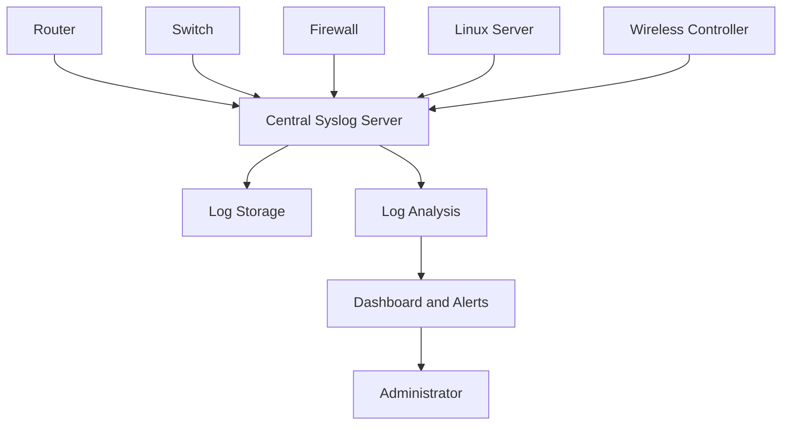

# Syslog and Centralized Logging

Syslog is a standard mechanism for transmitting and storing log messages generated by network devices, operating systems, applications, and security systems.

It provides administrators with visibility into events occurring throughout an IT infrastructure.

Network devices generate logs for events such as:

* Interface state changes.
* Device startup and shutdown.
* Authentication attempts.
* Firewall rule matches.
* Routing protocol changes.
* VPN connection events.
* Configuration modifications.
* Hardware failures.
* System errors.

Instead of checking logs individually on every device, administrators can use a centralized logging server to collect and analyze messages from multiple systems.

# 🗁 What Is a Log Message?

A log message is a recorded event generated by a device or application.

A typical log entry contains information such as:

* Timestamp.
* Hostname.
* Application or process name.
* Process ID, when available.
* Severity level.
* Facility.
* Event description.

Example:

```text
Nov 11 10:25:30 router-01 firewall: Connection blocked from 203.0.113.10
```

This message indicates that a firewall event was recorded on `router-01`.

The exact format depends on the device, logging implementation, and configured output format.

# 🗁 Syslog Architecture

A typical Syslog environment consists of three components.

**Syslog Sender**

A sender generates log messages and forwards them to a logging destination.

Examples:

* Routers.
* Switches.
* Firewalls.
* Linux servers.
* Applications.
* Wireless controllers.

**Syslog Receiver**

A receiver accepts incoming log messages from senders.

It may store messages locally, process them, or forward them to another logging system.

**Centralized Logging Server**

A centralized logging server collects messages from multiple devices and provides a common location for searching, analyzing, and retaining logs.

Common logging platforms include:

* rsyslog.
* syslog-ng.
* Graylog.
* Elasticsearch-based logging stacks.
* Splunk.
* Loki.

# 🗁 Centralized Logging Architecture

The following diagram illustrates a basic centralized logging environment.



Each device forwards its logs to the central server.

The logging server stores and processes the messages so administrators can investigate events across the entire infrastructure.

# 🗁 Syslog Severity Levels

Syslog defines eight severity levels.

A lower numerical value represents a more severe condition.

| Numerical code | Severity | Description |
| ---: | --- | --- |
| 0 | Emergency | System is unusable |
| 1 | Alert | Immediate action required |
| 2 | Critical | Critical condition |
| 3 | Error | Error condition |
| 4 | Warning | Warning condition |
| 5 | Notice | Normal but significant event |
| 6 | Informational | Informational message |
| 7 | Debug | Detailed debugging information |

Example:

```text
0 = Emergency
1 = Alert
2 = Critical
3 = Error
4 = Warning
5 = Notice
6 = Informational
7 = Debug
```

A logging system configured to collect severity level `warning` and more severe events generally collects levels 0 through 4.

Debug-level logging can generate a large volume of messages and should be enabled selectively.

# 🗁 Syslog Facilities

A facility identifies the category or source associated with a Syslog message.

Common standard facilities include:

| Facility code | Facility |
| ---: | --- |
| 0 | kern |
| 1 | user |
| 2 | mail |
| 3 | daemon |
| 4 | auth |
| 5 | syslog |
| 6 | lpr |
| 7 | news |
| 8 | uucp |
| 9 | cron |
| 10 | authpriv |
| 11 | ftp |
| 16–23 | local0–local7 |

Facilities help organize messages by their source or purpose.

For example, an administrator may route authentication-related logs to a separate file from general system messages.

# 🗁 Syslog Message Format

Modern Syslog message formatting is standardized by RFC 5424.

A simplified representation is:

```text
<PRI>VERSION TIMESTAMP HOSTNAME APP-NAME PROCID MSGID STRUCTURED-DATA MESSAGE
```

Important fields:

* **PRI:** Encodes facility and severity.
* **VERSION:** Syslog message format version.
* **TIMESTAMP:** Time when the event occurred.
* **HOSTNAME:** Device or system generating the message.
* **APP-NAME:** Application or process name.
* **PROCID:** Process identifier.
* **MSGID:** Message identifier.
* **STRUCTURED-DATA:** Optional structured metadata.
* **MESSAGE:** Human-readable event information.

The priority value is calculated as:

\[
PRI = (Facility \times 8) + Severity
\]

For example, if the facility is `local0` (16) and severity is `warning` (4):

\[
PRI = (16 \times 8) + 4 = 132
\]

Therefore, the priority value is 132.

# 🗁 Syslog Transport Protocols and Ports

Syslog can be transported over different protocols.

| Transport | Port | Description |
| --- | ---: | --- |
| UDP | 514 | Traditional Syslog transport |
| TCP | 514 | Reliable stream transport when configured |
| TLS over TCP | 6514 | Common secure Syslog transport |

**UDP 514**

Traditional Syslog commonly uses UDP port 514.

Advantages:

* Low overhead.
* Simple configuration.
* Widely supported.

Limitations:

* No delivery acknowledgment.
* Messages can be lost.
* No built-in encryption.
* No guaranteed ordering.

**TCP 514**

Syslog can also be transported over TCP.

TCP provides reliable byte-stream delivery between endpoints, but the application must still handle connection failures and message processing.

**TLS over TCP 6514**

Syslog over TLS protects log messages in transit using encryption and server authentication, with client authentication available when configured.

For production environments, secure transport is particularly important when logs contain sensitive operational or security information.

# 🗁 Linux Logging Architecture

Linux systems commonly use systemd-journald and a Syslog-compatible logging service such as rsyslog.

**systemd-journald**

`systemd-journald` collects and stores system logs.

It records events from:

* Kernel messages.
* System services.
* Applications using the systemd journal interface.
* Standard output and standard error from managed services.

View logs using:

```bash
journalctl
```

View recent logs:

```bash
journalctl -n 50
```

Follow logs in real time:

```bash
journalctl -f
```

View logs for a particular service:

```bash
journalctl -u ssh
```

View logs since the beginning of the current boot:

```bash
journalctl -b
```

View kernel messages:

```bash
journalctl -k
```

**rsyslog**

rsyslog is a Syslog implementation commonly used on Linux systems.

It can:

* Receive local log messages.
* Collect logs from remote systems.
* Forward messages to other logging servers.
* Filter messages by facility and severity.
* Store messages in separate files.
* Use TCP, UDP, and TLS transports.

# 🗁 Installing rsyslog on Ubuntu

Install the package:

```bash
sudo apt update
sudo apt install rsyslog
```

Check its service status:

```bash
sudo systemctl status rsyslog
```

Enable the service at startup:

```bash
sudo systemctl enable --now rsyslog
```

Verify that it is running:

```bash
sudo systemctl is-active rsyslog
```

# 🗁 Understanding rsyslog Configuration

The main configuration file is:

```text
/etc/rsyslog.conf
```

Additional configuration files are commonly stored in:

```text
/etc/rsyslog.d/
```

A basic configuration rule follows this structure:

```text
facility.priority    action
```

Example:

```text
authpriv.*    /var/log/auth.log
```

This sends messages from the `authpriv` facility at all severity levels to the specified log file, subject to the logging configuration and available message sources.

Another example:

```text
*.warning    /var/log/warnings.log
```

This matches messages from all facilities with warning severity or greater severity.

# 🗁 Configuring rsyslog as a Centralized Logging Server

This lab configures an Ubuntu machine to receive remote Syslog messages over UDP 514.

**Install rsyslog**

```bash
sudo apt update
sudo apt install rsyslog
```

**Create a remote logging configuration**

```bash
sudo nano /etc/rsyslog.d/10-remote-logging.conf
```

Add:

```text
module(load="imudp")

input(
    type="imudp"
    port="514"
)

template(
    name="RemoteLogs"
    type="string"
    string="/var/log/remote/%HOSTNAME%/%PROGRAMNAME%.log"
)

*.* ?RemoteLogs
```

This configuration:

* Loads the UDP input module.
* Listens on UDP port 514.
* Creates log paths based on hostname and program name.
* Stores incoming messages in the remote log directory structure.

Ensure the logging directory exists:

```bash
sudo mkdir -p /var/log/remote
```

**Validate the configuration**

```bash
sudo rsyslogd -N1
```

**Restart rsyslog**

```bash
sudo systemctl restart rsyslog
```

**Verify the listening socket**

```bash
sudo ss -lunp | grep ':514'
```

The output should show rsyslog listening on UDP port 514.

**Allow the firewall traffic**

If UFW is enabled, allow Syslog traffic only from the trusted device or management network.

For a specific sender:

```bash
sudo ufw allow from 192.168.1.20 to any port 514 proto udp
```

For a management subnet:

```bash
sudo ufw allow from 192.168.1.0/24 to any port 514 proto udp
```

# 🗁 Configuring a Linux Client to Forward Logs

A Linux client can forward its logs to the centralized Syslog server.

Create a configuration file:

```bash
sudo nano /etc/rsyslog.d/90-remote-forwarding.conf
```

For UDP forwarding:

```text
*.* @192.168.1.100:514
```

For TCP forwarding:

```text
*.* @@192.168.1.100:514
```

The symbols have different meanings:

* `@` represents UDP.
* `@@` represents TCP.

Replace `192.168.1.100` with the actual logging server address.

Restart rsyslog:

```bash
sudo systemctl restart rsyslog
```

Check service status:

```bash
sudo systemctl status rsyslog
```

Generate a test message:

```bash
logger "Test message from Linux client"
```

Check the corresponding remote log file on the server.

# 🗁 Configuring Syslog on MikroTik RouterOS v7

MikroTik RouterOS supports remote logging through its system logging configuration.

Suppose:

* Router IP: `192.168.1.1`
* Syslog server IP: `192.168.1.100`

**Add a remote logging action**

```routeros
/system logging action add \
    name=remote-syslog \
    target=remote \
    remote=192.168.1.100 \
    remote-port=514 \
    bsd-syslog=yes \
    syslog-facility=local0 \
    syslog-severity=auto
```

**Forward selected log topics**

For general system information:

```routeros
/system logging add \
    topics=system \
    action=remote-syslog
```

For firewall events:

```routeros
/system logging add \
    topics=firewall \
    action=remote-syslog
```

For interface events:

```routeros
/system logging add \
    topics=interface \
    action=remote-syslog
```

**Verify logging configuration**

```routeros
/system logging action print
/system logging print
```

The remote server must be configured to receive messages from the router.

Protect the logging server with appropriate firewall rules and management-network restrictions.

# 🗁 Searching and Analyzing Logs

Centralized logging is most useful when administrators can quickly find relevant events.

On an Ubuntu server, search for a particular IP address:

```bash
grep -R "192.168.1.20" /var/log/remote/
```

Search for authentication failures:

```bash
grep -Ri "failed" /var/log/remote/
```

Follow a specific log file:

```bash
tail -f /var/log/remote/router-01/firewall.log
```

Search logs by time using the system journal:

```bash
journalctl --since "1 hour ago"
```

View messages generated by a specific service:

```bash
journalctl -u ssh --since today
```

The exact search method depends on whether messages are stored in ordinary text files, the systemd journal, or a dedicated logging platform.

# 🗁 Log Rotation and Retention

Logs can grow rapidly, particularly on busy routers, firewalls, and servers.

Log rotation helps control disk usage by:

* Creating new log files periodically.
* Compressing older logs.
* Retaining a configured number of historical files.
* Removing logs after their retention period.

Linux systems commonly use `logrotate`.

Check the configuration:

```bash
cat /etc/logrotate.conf
```

List application-specific rotation rules:

```bash
ls /etc/logrotate.d/
```

Run a configuration test:

```bash
sudo logrotate -d /etc/logrotate.conf
```

The `-d` option performs a debug run without making changes.

Retention requirements should be defined according to operational, security, compliance, and storage requirements.

# 🗁 Centralized Logging Security

Logs can contain sensitive information, including IP addresses, usernames, authentication events, and infrastructure details.

A secure logging architecture should include:

* Restricting log access to authorized administrators.
* Using TLS for remote log transport where supported.
* Limiting sender access through firewall rules.
* Protecting log storage against unauthorized modification.
* Synchronizing timestamps using NTP.
* Separating logging infrastructure from ordinary user networks.
* Applying appropriate retention and deletion policies.
* Monitoring logging server availability.
* Protecting credentials and encryption keys.
* Avoiding unnecessary collection of passwords, tokens, or other secrets.

Centralized logs should also be protected against tampering because they may be important during security investigations.

# 🗁 Troubleshooting Syslog

| Problem | Possible cause | Troubleshooting |
| --- | --- | --- |
| No messages received | Sender not forwarding logs | Check sender configuration |
| UDP 514 unavailable | Firewall blocking traffic | Review firewall rules |
| TCP connection fails | Incorrect listener or routing | Check TCP listener and connectivity |
| Logs stored in unexpected paths | Template configuration issue | Review rsyslog templates |
| Missing log messages | Severity or facility filter | Review filtering rules |
| Incorrect timestamps | Time synchronization problem | Check NTP configuration |
| High disk usage | Excessive logging or missing rotation | Review retention and logrotate |
| Duplicate messages | Overlapping forwarding rules | Inspect rsyslog configuration |
| Remote host not identified | Missing or incorrect hostname metadata | Inspect incoming message format |

Useful diagnostic commands:

```bash
sudo systemctl status rsyslog
```

```bash
sudo journalctl -u rsyslog -n 100
```

```bash
sudo ss -lunp | grep ':514'
```

```bash
sudo ss -ltnp | grep ':514'
```

Capture incoming UDP Syslog traffic:

```bash
sudo tcpdump -ni any udp port 514
```

Capture TCP Syslog traffic:

```bash
sudo tcpdump -ni any tcp port 514
```

These commands help distinguish transport problems from configuration and message-processing problems.

# 🗁 Summary

Syslog provides a standardized mechanism for collecting and forwarding operational events from network devices and servers.

Centralized logging makes it possible to investigate events across multiple systems from one location.

Important concepts include:

* Syslog senders and receivers.
* Severity levels and facilities.
* Syslog message structure.
* UDP, TCP, and TLS transport.
* Linux logging with journald and rsyslog.
* Centralized logging server configuration.
* MikroTik remote logging.
* Log searching, rotation, retention, and security.

Centralized logging is an essential part of network monitoring, troubleshooting, auditing, and security operations.
