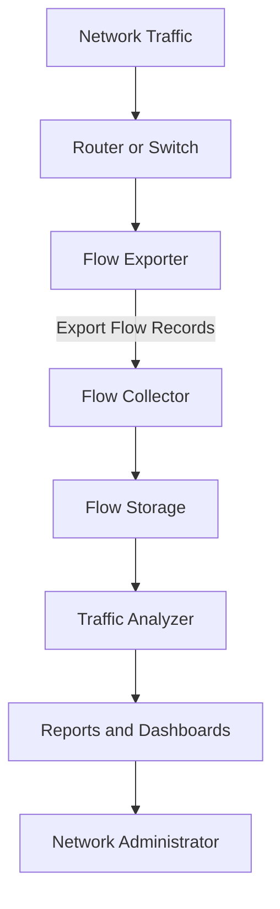

# NetFlow and Traffic Analysis

NetFlow is a network traffic monitoring technology that collects information about IP traffic flowing through network devices.

It provides visibility into communication patterns without requiring administrators to capture and inspect every packet.

Network administrators use NetFlow and related technologies to understand:

* Which devices generate the most traffic.
* Which destinations receive the most traffic.
* Which applications and protocols consume bandwidth.
* How traffic moves through the network.
* When traffic volume increases unexpectedly.
* Whether unusual communication patterns exist.
* How bandwidth is distributed across network links.

NetFlow is especially useful in enterprise networks, data centers, ISP environments, and networks with multiple WAN connections.

# 🗁 What Is a Network Flow?

A network flow represents a sequence of packets sharing common characteristics during a communication period.

A traditional NetFlow implementation commonly identifies a flow using fields such as:

* Source IP address.
* Destination IP address.
* Source port.
* Destination port.
* IP protocol.
* Type of Service (ToS) or Differentiated Services Code Point (DSCP).
* Input interface.

The exact fields depend on the NetFlow version and exporter configuration.

For example, packets belonging to the same TCP connection between two endpoints may be represented by a flow record.

```text
Source IP:       192.168.1.10
Destination IP:  203.0.113.20
Source Port:     51524
Destination Port: 443
Protocol:        TCP
```

A flow record summarizes traffic characteristics rather than storing the complete packet contents.

# 🗁 How NetFlow Works

NetFlow monitoring generally involves three components.

**Flow Exporter**

The exporter is a network device that observes traffic and generates flow records.

Examples:

* Routers.
* Layer 3 switches.
* Firewalls.
* Network appliances.

**Flow Collector**

The collector receives exported flow records from network devices.

Its responsibilities include:

* Receiving flow data.
* Decoding flow records.
* Organizing traffic information.
* Storing historical records.
* Making data available for analysis.

**Flow Analyzer**

The analyzer processes collected flow information and presents useful reports, dashboards, and traffic statistics.

It helps administrators identify top talkers, traffic distribution, protocol usage, and unusual patterns.

# 🗁 NetFlow Architecture



The network device observes traffic and generates flow records. The collector receives and stores those records, while the analyzer converts them into useful traffic information.

# 🗁 Flow Export Process

A simplified flow export process consists of the following stages:

* **Traffic observation:** The exporter observes packets passing through an interface.
* **Flow identification:** Packets are classified into flows according to configured flow keys.
* **Flow accounting:** Packet and byte counters are updated.
* **Flow expiration:** Inactive or completed flows are exported according to timeout and protocol behavior.
* **Flow export:** Records are transmitted to a collector.
* **Flow analysis:** The collector and analyzer process the records.

Flow records may be exported periodically while a long-lived flow is still active.

Common flow expiration conditions include:

* Inactive timeout: No packets have been observed for a configured period.
* Active timeout: A long-running flow has reached its periodic export interval.
* TCP termination: A connection has ended, commonly indicated by FIN or RST flags.
* Resource pressure: The exporter needs to free flow-cache resources.

# 🗁 NetFlow Versions

Different NetFlow versions provide different export formats and capabilities.

| Version | Description |
| --- | --- |
| NetFlow v1 | Original format with limited functionality |
| NetFlow v5 | Fixed-format export with commonly used flow fields |
| NetFlow v9 | Template-based and extensible export format |
| IPFIX | IETF-standardized flow information export protocol |

**NetFlow v5**

NetFlow v5 is a widely supported fixed-format version.

Characteristics:

* Uses predefined record structures.
* Includes common IPv4 flow information.
* Supports packet and byte counters.
* Includes source and destination addresses.
* Provides interface and routing-related information.

Its fixed structure makes it straightforward to implement, but less flexible than template-based formats.

**NetFlow v9**

NetFlow v9 uses templates to describe the structure of exported records.

Characteristics:

* Template-based format.
* Supports extensible flow information.
* Can represent IPv4 and IPv6 traffic.
* Supports additional information beyond traditional flow fields.
* Allows vendors to define supported fields.

The collector must receive and understand the relevant templates before interpreting corresponding data records.

**IPFIX**

IPFIX (IP Flow Information Export) is an IETF-standardized protocol based on the template-driven approach.

It provides a standardized way to export flow information from network devices to collectors.

IPFIX is designed to support extensible information elements and interoperability between implementations.

# 🗁 NetFlow vs IPFIX vs sFlow

NetFlow, IPFIX, and sFlow are related traffic visibility technologies, but they do not collect information in exactly the same way.

| Feature | NetFlow | IPFIX | sFlow |
| --- | --- | --- | --- |
| Primary approach | Flow-based | Flow-based | Packet sampling and interface counters |
| Standardization | Vendor-originated technology | IETF standard | sFlow standard |
| Data representation | Version-dependent | Template-based | Sample-based |
| Traffic visibility | Flow summaries | Flow summaries | Sampled packet headers and counters |
| Sampling | Optional, implementation-dependent | Optional, implementation-dependent | Core design feature |
| Typical use | Traffic accounting | Interoperable flow export | High-volume traffic visibility |

**NetFlow**

Collects summarized traffic information from network devices.

**IPFIX**

Provides a standardized and extensible flow export format.

**sFlow**

Uses statistical sampling of packets and periodic interface-counter sampling to provide traffic visibility.

Because sFlow samples packets, it generally does not provide a complete record of every packet or every individual flow.

# 🗁 Understanding Flow Records

A flow record contains information describing observed network traffic.

Common fields include:

| Field | Description |
| --- | --- |
| Source IP | Address that originated the traffic |
| Destination IP | Address receiving the traffic |
| Source port | Transport-layer source port |
| Destination port | Transport-layer destination port |
| Protocol | IP protocol number |
| Packet count | Number of packets represented |
| Byte count | Total bytes represented |
| Start time | Flow observation start time |
| End time | Flow observation end time |
| Input interface | Interface where traffic entered |
| Output interface | Interface where traffic exited, when available |
| TCP flags | TCP control flags observed |
| DSCP | Traffic classification information |

These fields allow monitoring systems to summarize traffic by source, destination, protocol, application port, and interface.

# 🗁 Understanding Top Talkers

A top talker is a host or endpoint that generates or receives a large amount of network traffic during a selected period.

Top-talker reports help administrators identify bandwidth-heavy systems.

Example:

| Source IP | Destination IP | Protocol | Traffic |
| --- | --- | --- | ---: |
| 192.168.1.10 | 203.0.113.20 | TCP | 2.5 GB |
| 192.168.1.25 | 198.51.100.15 | UDP | 1.8 GB |
| 192.168.1.30 | 203.0.113.50 | TCP | 950 MB |
| 192.168.1.40 | 192.0.2.10 | TCP | 600 MB |

These example records show how a traffic analyzer can identify hosts responsible for high data consumption.

Top-talker analysis is useful for:

* Finding bandwidth-intensive users.
* Identifying backup traffic.
* Investigating large downloads.
* Detecting unexpected data transfers.
* Planning bandwidth upgrades.

# 🗁 Protocol and Application Analysis

Flow data can reveal which protocols and transport ports are consuming bandwidth.

Common examples:

| Protocol or service | Common port | Typical purpose |
| --- | ---: | --- |
| HTTP | TCP 80 | Web traffic |
| HTTPS | TCP 443 | Encrypted web traffic |
| DNS | UDP/TCP 53 | Name resolution |
| SSH | TCP 22 | Secure remote administration |
| SMTP | TCP 25 | Email transfer |
| RDP | TCP 3389 | Remote desktop |
| NTP | UDP 123 | Time synchronization |

Port numbers provide useful clues about traffic, but they do not reliably identify every application. Applications can use non-standard ports, dynamic ports, or encrypted tunnels.

# 🗁 Bandwidth Analysis

Flow monitoring helps administrators understand how bandwidth is distributed across network links.

For example, an ISP may observe the following traffic distribution:

| Traffic category | Bandwidth |
| --- | ---: |
| Video streaming | 350 Mbps |
| Web browsing | 180 Mbps |
| File downloads | 120 Mbps |
| Online gaming | 60 Mbps |
| Other traffic | 90 Mbps |
| Total | 800 Mbps |

A traffic analyzer can use this information to identify major traffic categories and evaluate capacity requirements.

Bandwidth reports should account for the exporter observation point, sampling configuration, flow timeouts, and direction of traffic.

# 🗁 Traffic Direction and Monitoring Points

The location where traffic is observed determines what information the monitoring system can collect.

For example, monitoring a WAN-facing router interface provides visibility into traffic crossing that interface.

Monitoring a LAN-facing interface provides visibility into traffic crossing the internal network boundary.

Consider these monitoring points:

```text
             Internet
                |
                |
          [Edge Router]
                |
          WAN Interface
                |
          LAN Interface
                |
          [Core Switch]
             /     \
            /       \
       [Server]   [Clients]
```

Administrators should carefully select monitoring interfaces to avoid missing traffic or unintentionally counting the same traffic multiple times.

For bidirectional traffic analysis, ingress and egress observations should be interpreted consistently.

# 🗁 Traffic Sampling

Sampling reduces the amount of traffic information an exporter must process and export.

Instead of examining every packet, a device may inspect a selected subset.

For example, a 1:1000 sampling ratio means approximately one packet is selected for every 1,000 packets under the configured sampling method.

Sampling can reduce:

* Exporter processing overhead.
* Export bandwidth.
* Collector processing requirements.
* Storage consumption.

However, sampling introduces estimation uncertainty.

Small or short-lived flows may be missed, and traffic statistics may differ from complete packet-level accounting.

The sampling method and rate should be considered when interpreting reports.

# 🗁 NetFlow and Packet Capture

NetFlow and packet capture provide different levels of visibility.

| Feature | NetFlow/IPFIX | Packet Capture |
| --- | --- | --- |
| Data collected | Flow summaries | Individual packets |
| Packet payload | Not normally included | May be included |
| Storage requirements | Generally lower | Generally higher |
| Traffic statistics | Excellent for flow analysis | Can be calculated from captured packets |
| Protocol troubleshooting | Limited to exported fields | Detailed protocol inspection |
| Typical tools | nfdump, ntopng, flow collectors | Wireshark, tcpdump |

NetFlow is useful for understanding traffic patterns across an entire network.

Packet capture is useful for detailed troubleshooting of specific communication problems.

A common operational approach is to use flow data to identify suspicious or problematic traffic and then capture packets at the relevant network location for deeper investigation.

# 🗁 Installing Traffic Analysis Tools on Ubuntu

Several open-source tools can help analyze flow data.

**nfdump**

`nfdump` is a collection of command-line tools for processing NetFlow and IPFIX data.

It can be used to:

* Read flow data.
* Filter records.
* Generate traffic statistics.
* Identify top talkers.
* Analyze communication between endpoints.

Install it:

```bash
sudo apt update
sudo apt install nfdump
```

Package availability and supported export formats depend on the Ubuntu release and repository version.

**ntopng**

ntopng provides network traffic visibility through a web-based interface.

It can help administrators analyze:

* Network hosts.
* Traffic protocols.
* Bandwidth consumption.
* Network conversations.
* Application-related traffic information.

Install it using the official installation instructions for the target Ubuntu release.

**Wireshark and tcpdump**

These tools are useful for packet-level analysis rather than acting as substitutes for a flow collector.

Install them:

```bash
sudo apt update
sudo apt install wireshark tcpdump
```

Capture traffic on an interface:

```bash
sudo tcpdump -ni enp0s3
```

Capture traffic for a specific host:

```bash
sudo tcpdump -ni enp0s3 host 192.168.1.10
```

Capture traffic for HTTPS:

```bash
sudo tcpdump -ni enp0s3 tcp port 443
```

# 🗁 MikroTik RouterOS v7 Traffic Analysis

MikroTik RouterOS provides several tools for observing traffic.

**Torch**

Torch displays real-time traffic information for a selected interface.

Run:

```routeros
/tool torch interface=ether1
```

Torch can display information such as:

* Source address.
* Destination address.
* Source port.
* Destination port.
* Protocol.
* Transmit rate.
* Receive rate.

Filter traffic by source address:

```routeros
/tool torch interface=ether1 src-address=192.168.1.10
```

Filter TCP traffic:

```routeros
/tool torch interface=ether1 ip-protocol=tcp
```

Torch is useful for real-time traffic investigation, but it is not a historical NetFlow collector.

**Interface Traffic Statistics**

View interface traffic counters:

```routeros
/interface print stats
```

View a specific interface:

```routeros
/interface monitor-traffic ether1
```

These commands provide interface-level statistics and real-time traffic rates.

# 🗁 Configuring Traffic Flow Export on MikroTik RouterOS v7

RouterOS includes Traffic Flow functionality for exporting traffic information to a collector.

Suppose:

* Router address: `192.168.1.1`
* Monitoring collector: `192.168.1.100`
* Export destination port: `2055`
* Monitored interface: `ether1`

**Enable Traffic Flow**

```routeros
/ip traffic-flow set enabled=yes
```

**Configure the monitored interface**

```routeros
/ip traffic-flow set interfaces=ether1
```

**Configure the collector**

```routeros
/ip traffic-flow target add \
    dst-address=192.168.1.100 \
    port=2055 \
    version=9
```

**Verify configuration**

```routeros
/ip traffic-flow print
/ip traffic-flow target print
```

The collector must support the exported format and be configured to listen on the destination address and port.

The router and collector must also have network connectivity, and firewall rules must permit the export traffic.

RouterOS Traffic Flow capabilities and supported fields depend on the RouterOS version and device configuration. Validate the exported records using the selected collector.

# 🗁 Flow Collector Configuration Concepts

A flow collector must be configured to receive and interpret exported records.

Important configuration parameters include:

* **Listen address:** IP address on which the collector receives flow exports.
* **Listen port:** UDP or other supported transport port.
* **Flow format:** NetFlow v5, NetFlow v9, IPFIX, or another supported format.
* **Templates:** Required by template-based formats such as NetFlow v9 and IPFIX.
* **Storage:** Location and retention period for collected data.
* **Time synchronization:** Consistent timestamps across exporters and collectors.

A common deployment uses a dedicated monitoring server with a collector process and a traffic analysis interface.

# 🗁 Troubleshooting NetFlow

| Problem | Possible cause | Troubleshooting |
| --- | --- | --- |
| No flow records received | Exporter not configured | Verify flow export settings |
| Collector receives no traffic | Firewall or routing issue | Check connectivity and firewall rules |
| Unsupported flow format | Collector format mismatch | Verify exporter and collector compatibility |
| Missing traffic information | Incorrect observation interface | Review monitored interfaces |
| Incorrect bandwidth reports | Sampling or counter interpretation | Check sampling configuration |
| Missing long-lived flows | Active timeout too long | Review exporter timeout settings |
| Incomplete records | Template not received or expired | Verify template export and collector support |
| High collector resource usage | Excessive flow volume | Optimize collection and retention |
| Duplicate traffic reports | Multiple observation points | Review exporter placement and flow direction |

**Check exported traffic**

On the collector, capture UDP traffic on the configured port:

```bash
sudo tcpdump -ni any udp port 2055
```

**Check collector listening sockets**

```bash
sudo ss -lunp
```

**Check routing to the collector**

```bash
ip route get 192.168.1.100
```

**Check firewall rules**

```bash
sudo ufw status verbose
```

Packet arrival confirms that traffic reaches the collector host, but it does not prove that the collector successfully decodes or stores the flow records.

# 🗁 Practical Lab: Identify Top Talkers

This lab demonstrates a basic traffic analysis workflow.

**Prepare the monitoring environment**

* Configure a router to export flow records.
* Install a compatible flow collector.
* Configure the collector to receive the export format.
* Verify that the exporter can reach the collector.

**Generate network traffic**

From a test client, generate traffic to a destination:

```bash
curl -I https://example.com
```

Generate a larger download if a suitable test file is available:

```bash
wget -O /dev/null https://example.com/test-file
```

The example URL must be replaced with a valid test resource when necessary.

**Inspect flow records**

Use the collector's dashboard or command-line tools to inspect:

* Source IP addresses.
* Destination IP addresses.
* Protocols.
* Source and destination ports.
* Packet counts.
* Byte counts.
* Flow start and end times.

**Identify the top talker**

Sort traffic statistics by byte count.

Determine:

* Which host generated the most traffic?
* Which destination received the most traffic?
* Which protocols consumed the most bandwidth?
* Did traffic increase during the test?

**Document the results**

Record the traffic observations and compare them with interface-level bandwidth statistics.

Differences may occur because flow export can be sampled, delayed, or aggregated.

# 🗁 NetFlow Security and Best Practices

* Restrict flow export traffic to trusted collector addresses.
* Use a dedicated management or monitoring network where possible.
* Protect collector interfaces from unauthorized access.
* Avoid exposing flow collection ports to the public Internet.
* Synchronize exporter and collector clocks using NTP.
* Monitor collector availability and storage consumption.
* Configure appropriate flow expiration intervals.
* Use 64-bit counters where available for high-speed interfaces.
* Understand sampling ratios before interpreting traffic estimates.
* Monitor both ingress and egress traffic where required.
* Define data retention policies.
* Protect exported metadata because it may reveal internal network communication patterns.
* Regularly verify that exporters are sending records and collectors are processing them.

# 🗁 Summary

NetFlow and related flow technologies provide visibility into network traffic without requiring complete packet capture.

They help administrators identify top talkers, understand protocol usage, investigate bandwidth consumption, and plan network capacity.

Important concepts include:

* Network flows and flow records.
* Exporters, collectors, and analyzers.
* NetFlow v5 and v9.
* IPFIX and sFlow.
* Traffic sampling.
* Top-talker analysis.
* Bandwidth and protocol analysis.
* MikroTik Traffic Flow.
* Flow collection and troubleshooting.

Flow monitoring is an important component of network performance analysis and operational visibility.
