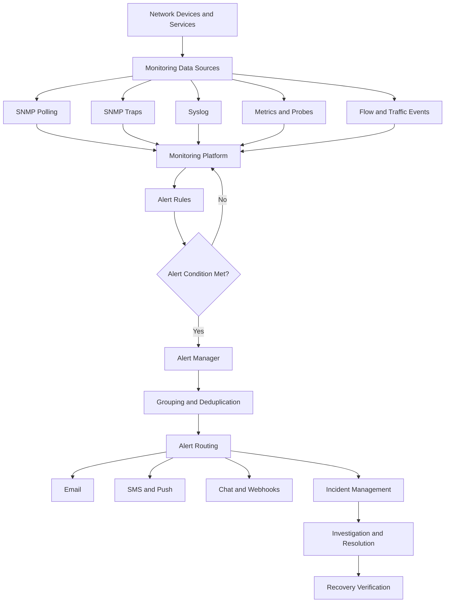

# Network Alerting

Network alerting is the process of detecting abnormal network conditions and notifying the responsible people or systems so that problems can be investigated and resolved.

Monitoring collects and analyzes network data. Alerting evaluates that data against defined conditions and generates notifications when something requires attention.

Effective alerting helps network administrators identify outages, performance degradation, capacity problems, and security-related events before they significantly affect users or services.

# 🗁 Purpose of Network Alerting

Network alerting helps administrators:

* Detect network outages and service interruptions.
* Identify performance degradation.
* Monitor bandwidth utilization and capacity.
* Detect interface errors, packet loss, and latency spikes.
* Identify routing protocol failures.
* Detect hardware and infrastructure failures.
* Monitor security-related events.
* Meet availability and service-level objectives (SLOs).
* Reduce the time required to identify and resolve incidents.

# 🗁 Monitoring vs Alerting

Monitoring and alerting are related but serve different purposes.

| Monitoring | Alerting |
| --- | --- |
| Collects network metrics and events | Evaluates conditions and generates notifications |
| Provides historical and real-time visibility | Draws attention to abnormal conditions |
| Helps identify trends | Helps identify incidents |
| Usually runs continuously | Activates when configured conditions are met |
| Supports investigation and analysis | Supports incident response |

For example:

* Monitoring records that an interface is using 95% of its available bandwidth.
* Alerting detects that utilization has remained above 90% for five minutes and sends a notification.

# 🗁 Alert Lifecycle

An alert typically passes through several stages.

* **Detection:** A monitoring system collects a metric or event that matches an alert condition.
* **Evaluation:** The system evaluates the configured rule.
* **Firing:** The condition remains valid and the alert becomes active.
* **Notification:** The alert is delivered to the responsible person or system.
* **Acknowledgment:** An administrator confirms that the incident is being handled.
* **Investigation:** The responsible team identifies the cause.
* **Resolution:** The underlying problem is corrected.
* **Recovery:** The alert condition clears and the alert returns to a resolved state.

Not every monitoring platform implements these stages identically. Some systems combine acknowledgment, investigation, and resolution into a single incident workflow.

# 🗁 Types of Network Alerts

Network alerts can be categorized according to the conditions they detect.

**Availability Alerts**

Detect whether a device, interface, or service is reachable.

Examples:

* Router becomes unreachable.
* Switch stops responding to SNMP polling.
* A critical server stops responding to TCP checks.
* An internet connection becomes unavailable.

**Performance Alerts**

Detect performance degradation.

Examples:

* High network latency.
* Excessive packet loss.
* High interface utilization.
* Increased interface errors.
* Abnormal CPU or memory utilization.

**Capacity Alerts**

Identify resources approaching their operational limits.

Examples:

* WAN bandwidth consistently approaches capacity.
* Disk space on a monitoring server is running low.
* A switch reaches its interface capacity.
* DHCP address pools approach exhaustion.

**Fault Alerts**

Detect equipment or network component failures.

Examples:

* Interface changes to a down state.
* Power supply failure.
* High device temperature.
* Routing neighbor becomes unavailable.
* Hardware health sensor reports a failure.

**Security Alerts**

Identify potentially suspicious or unauthorized activity.

Examples:

* Repeated authentication failures.
* Unexpected configuration changes.
* Suspicious traffic patterns.
* Firewall detects repeated connection attempts.
* Unauthorized device appears on a network.

**Service and SLA Alerts**

Monitor the availability and performance of services against defined service objectives.

Examples:

* Internet service availability falls below its target.
* VPN connectivity becomes unstable.
* DNS resolution time exceeds an acceptable threshold.
* Application response time exceeds the agreed service level.

# 🗁 Alert Conditions and Thresholds

An alert condition defines when a monitoring system should generate an alert.

A threshold is a configured boundary used to identify abnormal behavior.

For example, an administrator may define these interface utilization thresholds:

| Utilization | Severity |
| --- | --- |
| Below 70% | Normal |
| 70%–85% | Warning |
| 85%–95% | High |
| Above 95% | Critical |

These values are examples, not universal standards. Thresholds should be based on network capacity, traffic patterns, and operational requirements.

**Static Thresholds**

Static thresholds use predefined values.

Example:

```text
IF CPU utilization > 90%
THEN generate an alert
```

Advantages:

* Simple to configure.
* Easy to understand.
* Predictable behavior.

Limitations:

* May generate unnecessary alerts during normal traffic peaks.
* May not adapt to changing network usage.
* Requires periodic threshold adjustment.

**Dynamic Thresholds**

Dynamic thresholds adapt to changing conditions using historical data or statistical models.

For example, a monitoring system may detect that bandwidth utilization is significantly higher than the normal usage pattern for the same time of day.

Dynamic thresholds are useful for identifying unusual behavior when fixed thresholds are insufficient.

**Baseline-Based Alerts**

Baseline-based alerting compares current measurements against established normal operating behavior.

Example:

```text
Normal DNS response time: 20–40 ms
Current DNS response time: 250 ms
```

Even if the response time is below a fixed critical threshold, it may represent a significant deviation from the established baseline.

# 🗁 Warning and Critical Thresholds

Using multiple severity levels helps administrators prioritize incidents.

Example:

```text
CPU utilization:

Warning:
Above 75% for 5 minutes

Critical:
Above 90% for 3 minutes
```

A warning indicates that a condition requires attention.

A critical alert indicates that the condition may be causing or is likely to cause significant service impact.

Avoid assigning critical severity to every abnormal measurement. Severity should reflect the potential impact of the condition.

# 🗁 Alert Duration and Hysteresis

Network metrics frequently fluctuate. Generating an alert immediately after a single abnormal measurement can create unnecessary notifications.

**Alert Duration**

An alert duration requires a condition to remain true for a specified period before the alert fires.

Example:

```text
IF packet loss > 10%
FOR 5 minutes
THEN generate an alert
```

This helps prevent short-lived spikes from generating unnecessary alerts.

**Hysteresis**

Hysteresis uses different activation and recovery thresholds to prevent alerts from repeatedly switching between firing and resolved states.

Example:

```text
Alert activates:
CPU utilization >= 90%

Alert recovers:
CPU utilization < 80%
```

Without hysteresis, utilization fluctuating around 90% could repeatedly trigger and resolve the same alert.

**Flapping**

Flapping occurs when a monitored condition repeatedly changes between normal and abnormal states.

Common causes include:

* Unstable network connectivity.
* Intermittent packet loss.
* Unstable power supply.
* Poorly configured thresholds.
* Monitoring intervals that are too frequent.
* Insufficient recovery thresholds.

# 🗁 Alert Severity and Priority

Severity describes the seriousness of an incident. Priority determines how urgently the incident should be handled.

A typical severity model:

| Severity | Description | Example |
| --- | --- | --- |
| Critical | Major service impact or outage | Core router unavailable |
| High | Significant degradation | Main WAN link unavailable with degraded redundancy |
| Medium | Limited service impact | High interface error rate |
| Low | Minor abnormal condition | Non-critical device temperature warning |
| Informational | Event worth recording | Configuration change notification |

Severity and priority are related but not identical.

For example, a critical alert affecting a redundant backup device may have lower operational priority than a high-severity alert affecting the only production internet connection.

Priority should consider:

* Business impact.
* Number of affected users.
* Service criticality.
* Availability of redundancy.
* Security implications.
* Required response time.

# 🗁 Alert Rules

An alert rule defines the conditions and behavior required to generate an alert.

A typical alert rule includes:

| Component | Purpose |
| --- | --- |
| Metric or event | Data being monitored |
| Condition | Threshold or expression |
| Evaluation interval | How frequently the condition is checked |
| Duration | How long the condition must remain true |
| Severity | Importance of the alert |
| Labels | Classification and routing information |
| Annotations | Human-readable descriptions |
| Notification route | Where the alert should be delivered |

Example:

```text
Alert: High WAN Utilization

Metric:
WAN interface utilization

Condition:
Utilization > 90%

Duration:
5 minutes

Severity:
Warning

Notification:
Network Operations Team
```

# 🗁 Prometheus Alerting

Prometheus supports metric-based alerting through alerting rules.

An alert rule evaluates a PromQL expression and activates when the expression returns matching results.

Prometheus can send active alerts to Alertmanager, which handles notification routing, grouping, silencing, and inhibition.

**Example Alert Rule**

```yaml
groups:
  - name: network-alerts
    rules:
      - alert: HighInterfaceUtilization
        expr: interface_utilization_percent > 90
        for: 5m
        labels:
          severity: critical
        annotations:
          summary: "High interface utilization"
          description: "Interface utilization has remained above 90% for 5 minutes."
```

The metric `interface_utilization_percent` is illustrative. It must be replaced with a metric exposed by the actual network exporter.

**Important Fields**

* `alert`: Name of the alert.
* `expr`: PromQL expression evaluated by Prometheus.
* `for`: Duration the condition must remain active before firing.
* `labels`: Metadata used for classification and routing.
* `annotations`: Human-readable information displayed in notifications.

**Alertmanager**

Alertmanager receives alerts from Prometheus and manages notification delivery.

Its major capabilities include:

* Routing alerts to appropriate teams.
* Grouping related alerts.
* Deduplicating repeated notifications.
* Silencing alerts during maintenance.
* Inhibiting lower-priority alerts when a related higher-priority alert is active.
* Sending notifications to supported receivers.

Example routing configuration:

```yaml
route:
  receiver: default-team
  group_by:
    - alertname
    - instance
  group_wait: 30s
  group_interval: 5m
  repeat_interval: 4h

receivers:
  - name: default-team
    email_configs:
      - to: network-team@example.com
```

This is a basic configuration example. A working deployment also needs valid SMTP settings and the appropriate Prometheus and Alertmanager configuration.

# 🗁 Alert Routing and Notification Management

Alert routing determines which team or notification channel receives an alert.

For example:

```text
Network Monitoring System
          |
          v
      Alert Rules
          |
          v
      Alert Router
          |
          +----------------------+
          |                      |
          v                      v
    Network Team           Security Team
          |                      |
          v                      v
        Email                  Chat
          |                      |
          v                      v
      Investigation           Investigation
```

Routing can be based on:

* Alert severity.
* Device or service name.
* Network location.
* Department or team ownership.
* Environment, such as production or development.
* Alert category.

Correct routing reduces response time and prevents unrelated teams from receiving unnecessary notifications.

# 🗁 Alert Grouping and Deduplication

A single network failure can generate many related alerts.

For example, if a core router becomes unavailable, multiple downstream devices may also become unreachable.

Without grouping, the monitoring system may generate dozens of notifications for one underlying incident.

**Alert Grouping**

Groups related alerts into a single notification.

Example:

```text
Incident: Core Router Unavailable

Related alerts:
- Router unreachable
- Distribution switch unreachable
- Multiple access switches unreachable
- Downstream monitoring probes failed
```

**Deduplication**

Prevents repeated notifications for the same alert or incident.

**Inhibition**

Suppresses lower-level alerts when a related higher-level alert already explains the underlying failure.

For example, when a core router is confirmed unavailable, downstream device-unreachable alerts may be inhibited to reduce notification noise.

# 🗁 Notification Channels

Notification channels determine how alerts are delivered.

Common channels include:

| Channel | Typical Usage |
| --- | --- |
| Email | General notifications and reports |
| SMS | Urgent notifications |
| Chat platforms | Team collaboration |
| Webhooks | Integration with external systems |
| Mobile push notifications | On-call notifications |
| Pager systems | Critical incident escalation |
| Ticketing systems | Incident tracking and assignment |

A notification should contain enough information for the recipient to understand the incident.

Recommended notification details:

* Alert name.
* Device or service.
* Severity.
* Detection time.
* Current metric value.
* Alert condition.
* Affected interface or service.
* Monitoring dashboard link.
* Relevant troubleshooting runbook.

Example:

```text
[CRITICAL] WAN Interface Utilization

Device: edge-router-01
Interface: ether1
Current Utilization: 97%
Threshold: 90%
Duration: 5 minutes
Status: FIRING

Action:
Investigate bandwidth usage and identify traffic sources.
```

# 🗁 Acknowledgment and Escalation

Acknowledgment indicates that a responsible person has accepted an alert for investigation.

It does not necessarily mean that the underlying problem has been resolved.

An escalation policy defines what happens when an alert is not acknowledged or resolved within the expected time.

Example:

```text
Critical Alert
      |
      v
Notify On-Call Engineer
      |
      v
Acknowledged?
   /       \
 Yes        No
  |          |
  v          v
Investigate  Escalate to
             Senior Engineer
                  |
                  v
             Notify Manager
```

Escalation policies may consider:

* Severity.
* Time without acknowledgment.
* Time without resolution.
* Business impact.
* On-call schedules.
* Service ownership.

# 🗁 Alert Fatigue and Noise Reduction

Alert fatigue occurs when administrators receive too many notifications, including alerts that are repetitive, irrelevant, or not actionable.

Over time, excessive notifications can cause important incidents to be overlooked.

Common causes:

* Thresholds that are too sensitive.
* Repeated notifications for the same incident.
* Alerts for insignificant conditions.
* Incorrect dependencies between devices.
* Poorly configured monitoring intervals.
* Missing maintenance windows.
* Lack of alert ownership.
* Notifications without actionable information.

Ways to reduce alert fatigue:

* Set meaningful thresholds.
* Use alert durations and hysteresis.
* Group related alerts.
* Configure deduplication.
* Use dependency-aware suppression.
* Apply maintenance windows.
* Route alerts to the responsible teams.
* Review recurring false positives.
* Remove obsolete alert rules.
* Prioritize service-impacting conditions.

The goal is not to generate fewer alerts at any cost. The goal is to generate fewer unnecessary alerts while preserving visibility into important incidents.

# 🗁 Alerting from SNMP

SNMP can provide both polling-based monitoring and event-driven notifications.

**SNMP Traps**

Traps are asynchronous notifications sent by an SNMP agent to a monitoring manager.

Common examples:

* Interface state changes.
* Device reboot notifications.
* Hardware failures.
* Power supply events.
* Environmental alarms.

SNMP traps commonly use UDP port 162.

Unlike polling, traps allow a device to report an event without waiting for the next monitoring interval.

However, traps sent over UDP do not guarantee delivery.

**SNMP Informs**

SNMP informs are acknowledged notifications. They provide delivery acknowledgment between the sender and receiver, unlike unacknowledged traps.

The manager can use these events to trigger alerts based on configured rules.

# 🗁 Alerting from Syslog

Syslog messages can be evaluated for specific event patterns and severity levels.

Examples:

* Repeated authentication failures.
* Interface state changes.
* Routing neighbor transitions.
* Firewall deny events.
* Device reboot messages.
* Configuration changes.

Example Linux log message:

```bash
logger -p user.warning "WAN interface utilization is above threshold"
```

Inspect recent journal entries:

```bash
journalctl -n 50
```

Follow new journal messages:

```bash
journalctl -f
```

A centralized logging platform can process these messages and generate alerts when matching conditions are detected.

Syslog severity levels range from 0 (Emergency) to 7 (Debug). Lower numerical values indicate higher severity.

# 🗁 MikroTik RouterOS Alert Sources

MikroTik RouterOS v7 provides several mechanisms that can act as alert sources.

**Netwatch**

Netwatch monitors the reachability of a specified host and can execute configured actions when its state changes.

Example:

```routeros
/tool netwatch add host=1.1.1.1 type=icmp interval=10s timeout=2s
```

This creates an ICMP reachability monitor for the specified host.

Netwatch can be used to detect:

* Gateway reachability changes.
* Upstream connectivity failures.
* Remote server availability changes.
* VPN endpoint reachability changes.

Netwatch is useful for simple connectivity monitoring, but it is not a complete centralized alert-management platform.

**RouterOS Logging**

RouterOS logging can record system events and forward logs to a remote syslog server.

Inspect logging configuration:

```routeros
/system logging print
```

Inspect available logging topics:

```routeros
/system logging topics print
```

Example remote logging configuration:

```routeros
/system logging action add name=remote-syslog target=remote remote=192.168.10.20 remote-port=514
```

Add a logging rule:

```routeros
/system logging add topics=warning action=remote-syslog
```

Replace `192.168.10.20` with the address of the actual syslog server.

A centralized monitoring platform can evaluate these messages and generate notifications based on configured rules.

# 🗁 Alerting in Zabbix and LibreNMS

Many network monitoring platforms provide built-in alerting functionality.

**Zabbix**

Zabbix uses triggers to evaluate monitored conditions.

A typical alert workflow includes:

* Collect metrics from devices.
* Define trigger expressions.
* Assign severity levels.
* Configure actions and notification conditions.
* Deliver notifications through configured media types.
* Track events and acknowledgment status.

Example trigger concept:

```text
CPU utilization remains above 90%
```

When the trigger condition becomes true, the configured action can notify the responsible administrator.

**LibreNMS**

LibreNMS supports alert rules based on monitored network data.

Administrators can configure:

* Alert rules.
* Severity levels.
* Notification transports.
* Device and service conditions.
* Alert suppression and recovery behavior.

Example alert conditions include high interface utilization, device availability failures, and abnormal interface errors.

Exact rule syntax and notification options depend on the platform version and configuration.

# 🗁 Common Network Metrics to Alert On

A practical network alerting system should monitor important infrastructure and service indicators.

| Metric | Example Alert Condition |
| --- | --- |
| Device availability | Device unreachable |
| Interface status | Critical interface goes down |
| Bandwidth utilization | Utilization remains above 90% |
| Packet loss | Packet loss exceeds 5% |
| Latency | RTT remains above baseline |
| Interface errors | Error rate increases significantly |
| CPU utilization | CPU remains above 90% |
| Memory utilization | Available memory becomes critically low |
| Temperature | Hardware temperature exceeds its limit |
| BGP neighbor state | BGP session becomes unavailable |
| OSPF neighbor state | Expected adjacency is lost |
| VPN availability | Tunnel becomes unavailable |
| DHCP pool usage | Available addresses approach exhaustion |
| DNS response time | Resolution time exceeds its target |

Alert conditions should be selected according to device capabilities and service requirements.

# 🗁 Maintenance Windows and Alert Suppression

Planned maintenance can generate expected alerts.

Examples:

* Router firmware upgrades.
* Switch replacement.
* Firewall configuration changes.
* Network cabling work.
* Planned WAN maintenance.
* Server migrations.

A maintenance window temporarily suppresses or changes notifications for selected devices or services.

Good maintenance procedures include:

* Defining the maintenance period.
* Identifying affected devices and services.
* Informing responsible teams.
* Suppressing only expected alerts.
* Keeping monitoring data collection active when possible.
* Verifying service recovery after maintenance.
* Removing suppression when maintenance ends.

Do not disable all monitoring simply because maintenance is scheduled. Retaining monitoring data helps verify the operation and identify unexpected failures.

# 🗁 Alert Testing and Validation

Alert rules must be tested before being relied upon in production.

A useful testing process includes:

* Verify that the monitored metric is being collected.
* Confirm that the alert expression evaluates correctly.
* Generate a controlled test condition.
* Verify that the alert enters the firing state.
* Confirm notification delivery.
* Verify the correct team receives the alert.
* Test acknowledgment and escalation.
* Restore normal conditions.
* Confirm that the alert resolves.
* Review logs for notification failures.

Test both firing and recovery behavior.

**Common Alerting Problems**

| Problem | Possible Cause |
| --- | --- |
| Alert never fires | Incorrect expression or missing metric |
| Alert fires continuously | Threshold too sensitive |
| Notification not delivered | SMTP, webhook, or receiver configuration issue |
| Wrong team receives alert | Incorrect routing labels |
| Repeated notifications | Missing grouping or deduplication |
| Alert repeatedly changes state | Flapping or insufficient hysteresis |
| Alert does not recover | Incorrect recovery condition |
| Too many related alerts | Missing dependency or inhibition configuration |

# 🗁 Alert Security

Alerting systems frequently integrate with email providers, messaging services, and external APIs. Their credentials and communication channels must be protected.

Recommended practices:

* Store notification credentials securely.
* Restrict access to alert-management interfaces.
* Use HTTPS for webhook integrations.
* Validate webhook destinations and requests.
* Rotate API tokens and passwords.
* Use least-privilege service accounts.
* Avoid exposing sensitive network information in notifications.
* Restrict access to alert history and incident records.
* Audit changes to alert rules and notification settings.

Avoid placing passwords, API tokens, or other secrets directly inside publicly accessible configuration files or source repositories.

# 🗁 Runbooks and Incident Response

An alert should ideally include a link to a runbook containing the steps required to investigate and resolve the condition.

A runbook is an operational document that describes how to handle a particular incident.

Example runbook for a WAN interface outage:

```text
Incident:
WAN Interface Down

Initial Checks:
- Verify interface status.
- Check physical connectivity.
- Inspect interface logs.
- Verify upstream equipment.
- Check ISP service status.

Troubleshooting:
- Inspect interface counters.
- Check routing table.
- Verify gateway reachability.
- Test external connectivity.

Recovery:
- Restore physical or logical connectivity.
- Verify routing convergence.
- Confirm internet access.

Validation:
- Check packet loss.
- Check latency.
- Confirm monitoring returns to normal.
- Close the incident after verification.
```

Runbooks make incident response more consistent and reduce dependency on individual administrators.

# 🗁 Alerting Best Practices

A reliable alerting strategy should follow these principles:

* Monitor business-critical network services.
* Establish normal operating baselines.
* Use meaningful warning and critical thresholds.
* Require sustained conditions for unstable metrics.
* Configure hysteresis to reduce flapping.
* Assign every alert a responsible owner.
* Route alerts according to severity and ownership.
* Group and deduplicate related notifications.
* Use escalation policies for critical incidents.
* Suppress expected notifications during planned maintenance.
* Include actionable information in notifications.
* Link alerts to dashboards and runbooks.
* Test notification delivery and recovery behavior.
* Review false positives and missed incidents.
* Secure all notification integrations.
* Review alert rules periodically as the network changes.

# 🗁 Practical Alerting Architecture

A typical network alerting architecture combines multiple monitoring sources and notification systems.



This architecture separates data collection, condition evaluation, alert management, notification delivery, and incident response.

# 🗁 Summary

Network alerting transforms monitoring data into actionable notifications.

A well-designed alerting system should:

* Detect meaningful network conditions.
* Distinguish between warning and critical incidents.
* Avoid unnecessary notifications.
* Deliver alerts to the correct people.
* Support acknowledgment and escalation.
* Provide useful troubleshooting information.
* Verify recovery after incidents.
* Integrate with monitoring dashboards and operational runbooks.

The objective is not simply to notify administrators whenever something changes. It is to ensure that important network problems are detected, understood, prioritized, and resolved efficiently.
