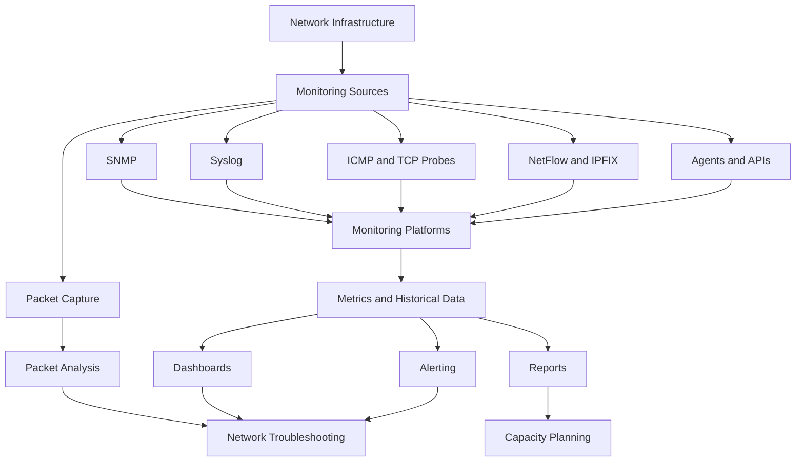

# Network Monitoring Tools

Network monitoring tools are software applications and utilities used to observe, measure, analyze, and troubleshoot network infrastructure.

They help administrators monitor routers, switches, firewalls, servers, wireless access points, network interfaces, and services.

A monitoring solution can collect information through SNMP, ICMP, SSH, APIs, flow protocols, agents, and other monitoring mechanisms.

The collected information is presented through dashboards, graphs, reports, logs, and alerts.

# 🗁 Purpose of Network Monitoring Tools

Network monitoring tools help administrators:

* Monitor device availability and connectivity.
* Track bandwidth utilization.
* Analyze network traffic.
* Monitor CPU, memory, and hardware health.
* Detect interface errors and packet loss.
* Monitor routing protocols and network services.
* Identify performance degradation.
* Generate alerts when abnormal conditions occur.
* Maintain historical performance records.
* Troubleshoot network problems.
* Plan infrastructure capacity.
* Monitor service availability and SLA performance.

# 🗁 Categories of Network Monitoring Tools

Network monitoring tools can be classified according to their primary functionality.

| Category | Purpose |
| --- | --- |
| Network monitoring platforms | Monitor devices, interfaces, and services |
| SNMP monitoring tools | Collect device metrics using SNMP |
| Traffic analysis tools | Analyze bandwidth usage and traffic flows |
| Packet analyzers | Inspect individual network packets |
| Network discovery tools | Discover devices and network topology |
| Availability monitoring tools | Monitor device and service reachability |
| Logging platforms | Collect and analyze network logs |
| Performance monitoring tools | Measure latency, jitter, and packet loss |
| Configuration management tools | Track and manage network configurations |

Many platforms provide several of these capabilities in one application.

# 🗁 Zabbix

<badge color="success">Open source</badge>

<AsyncImage query="Zabbix network monitoring dashboard latest interface" aspectRatio="16:9" width="100%"/>

<Entity value="Zabbix" category="software" disambig="Open-source infrastructure monitoring platform"/> is an enterprise-grade monitoring platform used to monitor networks, servers, applications, and infrastructure.

It supports agent-based and agentless monitoring.

**Key Features**

* SNMP monitoring.
* Agent-based monitoring.
* ICMP availability checks.
* CPU and memory monitoring.
* Interface traffic monitoring.
* Trigger-based alerting.
* Network discovery.
* Dashboards and graphs.
* Historical data collection.
* Notification and escalation actions.
* Templates for common devices and services.

**Monitoring Methods**

Zabbix supports multiple monitoring methods:

* SNMP polling.
* Zabbix agents.
* SNMP traps.
* ICMP checks.
* HTTP checks.
* SSH and other supported checks.

**Common Use Cases**

* Monitoring MikroTik routers and switches.
* Monitoring Linux and Windows servers.
* Tracking interface utilization.
* Monitoring WAN connectivity.
* Detecting device failures.
* Monitoring ISP infrastructure.

**Example Architecture**

```text
Network Devices
      |
      | SNMP / ICMP / Agent
      |
      v
Zabbix Server
      |
      +------> Database
      |
      +------> Web Interface
      |
      +------> Alerting
```

Official website: <https://www.zabbix.com/>

# 🗁 LibreNMS

<badge color="success">Open source</badge>

<AsyncImage query="LibreNMS network monitoring dashboard interface" aspectRatio="16:9" width="100%"/>

<Entity value="LibreNMS" category="software" disambig="Open-source network monitoring system"/> is an automatically discovering network monitoring platform primarily focused on SNMP-based infrastructure monitoring.

It is widely used for monitoring routers, switches, firewalls, servers, and other network devices.

**Key Features**

* Automatic network device discovery.
* SNMP-based monitoring.
* Interface traffic graphs.
* CPU and memory monitoring.
* Hardware sensor monitoring.
* Alert rules and notifications.
* Network device inventory.
* Service monitoring.
* Historical performance graphs.
* API integration.
* Distributed polling support.

**Common Use Cases**

* Monitoring MikroTik routers.
* Monitoring Cisco and Juniper devices.
* Tracking interface bandwidth.
* Monitoring network hardware health.
* Managing multiple network devices.
* Building centralized network visibility.

**Monitoring Workflow**

```text
Network Devices
      |
      | SNMP
      |
      v
LibreNMS
      |
      +------> Device Discovery
      |
      +------> Metrics Collection
      |
      +------> Graphs and Dashboards
      |
      +------> Alerting
```

Official website: <https://www.librenms.org/>

# 🗁 Prometheus

<badge color="success">Open source</badge>

<AsyncImage query="Prometheus monitoring expression browser dashboard interface" aspectRatio="16:9" width="100%"/>

<Entity value="Prometheus" category="software" disambig="Open-source metrics monitoring and time-series database"/> is a monitoring and alerting toolkit designed for collecting and querying time-series metrics.

It is commonly used in modern infrastructure, cloud environments, container platforms, and network monitoring deployments.

**Key Features**

* Time-series metrics collection.
* PromQL query language.
* Pull-based metrics scraping.
* Service discovery.
* Exporter integration.
* Alert rule evaluation.
* Alertmanager integration.
* Historical metrics storage.
* HTTP-based metrics endpoints.

**Important Components**

| Component | Responsibility |
| --- | --- |
| Prometheus Server | Scrapes and stores metrics |
| Exporters | Expose metrics from monitored systems |
| PromQL | Queries and analyzes metrics |
| Alerting Rules | Evaluate alert conditions |
| Alertmanager | Routes and manages notifications |

**Network Monitoring with Exporters**

Prometheus does not natively understand every network device's management interface. Exporters expose metrics in a format Prometheus can scrape.

Common exporters include:

* `snmp_exporter`: Collects metrics from SNMP-enabled network devices.
* `blackbox_exporter`: Performs HTTP, HTTPS, DNS, TCP, and ICMP-related probes.
* `node_exporter`: Exposes Linux system metrics.

**Example Architecture**

```text
Network Devices
      |
      v
SNMP Exporter
      |
      v
Prometheus Server
      |
      +------> PromQL
      |
      +------> Alert Rules
      |
      +------> Alertmanager
```

Official website: <https://prometheus.io/>

# 🗁 Grafana

<badge color="success">Open source</badge>

<AsyncImage query="Grafana network monitoring dashboard interface graphs" aspectRatio="16:9" width="100%"/>

<Entity value="Grafana" category="software" disambig="Observability dashboards and visualization platform"/> is a visualization and observability platform used to create dashboards from different data sources.

It is frequently deployed alongside Prometheus, but it also supports many other data sources.

**Key Features**

* Custom dashboards.
* Time-series graphs.
* Metrics visualization.
* Logs visualization.
* Dashboard variables.
* Alerting capabilities.
* Data source integration.
* Historical performance analysis.
* User and access management.

**Common Data Sources**

* Prometheus.
* InfluxDB.
* Elasticsearch.
* Loki.
* PostgreSQL.
* MySQL.
* Graphite.

**Prometheus and Grafana**

Prometheus collects and stores metrics. Grafana queries those metrics and presents them through dashboards.

```text
Network Devices
      |
      v
Exporters
      |
      v
Prometheus
      |
      v
Grafana
      |
      v
Network Dashboards
```

Grafana is primarily a visualization and observability platform. It does not replace the need for appropriate data collectors and storage systems.

Official website: <https://grafana.com/>

# 🗁 PRTG Network Monitor

<badge color="info">Commercial</badge>

<AsyncImage query="Paessler PRTG Network Monitor dashboard interface" aspectRatio="16:9" width="100%"/>

<Entity value="PRTG Network Monitor" category="software" disambig="Commercial network monitoring software by Paessler"/> is a commercial network monitoring platform developed by Paessler.

It provides centralized monitoring for network devices, infrastructure, and services.

**Key Features**

* SNMP monitoring.
* Bandwidth monitoring.
* Packet sniffing sensors.
* Flow monitoring.
* WMI monitoring.
* Ping monitoring.
* Application monitoring.
* Maps and dashboards.
* Alert notifications.
* Historical reporting.

PRTG uses sensors to monitor individual metrics or services.

Examples include:

* Ping sensor.
* SNMP traffic sensor.
* CPU load sensor.
* HTTP sensor.
* DNS sensor.
* NetFlow sensor.

**Common Use Cases**

* Small and medium business networks.
* Enterprise network monitoring.
* Server and application monitoring.
* Bandwidth monitoring.
* Centralized infrastructure visibility.

Official website: <https://www.paessler.com/prtg>

# 🗁 Nagios

<badge color="success">Open source core</badge>

<AsyncImage query="Nagios Core monitoring dashboard interface" aspectRatio="16:9" width="100%"/>

<Entity value="Nagios" category="software" disambig="Infrastructure monitoring software and platform"/> is an established monitoring system used to monitor network services, hosts, applications, and infrastructure.

Nagios Core provides a foundation for monitoring through plugins and configuration files.

**Key Features**

* Host availability monitoring.
* Service monitoring.
* Plugin-based checks.
* Alert notifications.
* Event handlers.
* Monitoring dependencies.
* Performance data collection.
* Extensible monitoring capabilities.

**Common Monitoring Checks**

* ICMP ping.
* HTTP availability.
* DNS resolution.
* SSH availability.
* TCP port availability.
* CPU and memory utilization through suitable plugins.
* Disk usage.

Nagios is highly extensible because administrators can create or install plugins for specific monitoring requirements.

Official website: <https://www.nagios.org/>

# 🗁 Observium

<badge color="info">Community and commercial editions</badge>

<AsyncImage query="Observium network monitoring dashboard interface" aspectRatio="16:9" width="100%"/>

<Entity value="Observium" category="software" disambig="Network monitoring and observability platform"/> is a network monitoring platform designed to provide automatic discovery, device monitoring, and performance graphs.

**Key Features**

* SNMP-based device monitoring.
* Automatic device discovery.
* Interface traffic graphs.
* Hardware sensor monitoring.
* Network device inventory.
* Performance graphs.
* Alerting capabilities.
* Multi-vendor device support.

It is useful for administrators who need centralized visibility into network hardware and interface performance.

Official website: <https://www.observium.org/>

# 🗁 ntopng

<badge color="success">Open source core</badge>

<AsyncImage query="ntopng network traffic analysis dashboard interface" aspectRatio="16:9" width="100%"/>

<Entity value="ntopng" category="software" disambig="Network traffic monitoring and analysis platform"/> is a network traffic analysis platform that provides visibility into traffic flows, hosts, applications, and network conversations.

It helps administrators understand how bandwidth is being consumed.

**Key Features**

* Real-time traffic visibility.
* Host-level traffic statistics.
* Application protocol identification.
* Traffic classification.
* Network conversation analysis.
* Flow collection and analysis.
* Historical traffic reporting.
* Network usage investigation.

**Common Use Cases**

* Identifying high-bandwidth hosts.
* Analyzing application traffic.
* Investigating unusual traffic patterns.
* Monitoring ISP traffic.
* Understanding network utilization.

Official website: <https://www.ntop.org/>

# 🗁 Wireshark

<badge color="success">Open source</badge>

<AsyncImage query="Wireshark packet analyzer interface packet details" aspectRatio="16:9" width="100%"/>

<Entity value="Wireshark" category="software" disambig="Network protocol analyzer and packet capture tool"/> is a packet analysis tool used to capture and inspect network traffic.

Unlike SNMP monitoring platforms that primarily collect counters and metrics, Wireshark allows administrators to examine individual packets and protocol exchanges.

**Key Features**

* Live packet capture.
* Offline packet analysis.
* Protocol decoding.
* Display filters.
* TCP stream analysis.
* DNS troubleshooting.
* HTTP and TLS analysis.
* Packet timing analysis.
* Exporting packet captures.

**Common Use Cases**

* Troubleshooting DNS problems.
* Investigating TCP retransmissions.
* Analyzing DHCP exchanges.
* Inspecting ARP traffic.
* Troubleshooting application connectivity.
* Investigating protocol-level issues.

**Example Capture Filters**

Capture traffic on a specific host:

```text
host 192.168.10.10
```

Capture TCP traffic:

```text
tcp
```

Capture DNS traffic:

```text
port 53
```

**Example Display Filters**

Show DNS packets:

```text
dns
```

Show TCP retransmissions:

```text
tcp.analysis.retransmission
```

Show traffic involving a particular IP:

```text
ip.addr == 192.168.10.10
```

Show ICMP traffic:

```text
icmp
```

Official website: <https://www.wireshark.org/>

# 🗁 Smokeping

<badge color="success">Open source</badge>

<AsyncImage query="SmokePing network latency monitoring graph interface" aspectRatio="16:9" width="100%"/>

<Entity value="Smokeping" category="software" disambig="Network latency and packet loss monitoring tool"/> is a latency monitoring tool designed to measure network response times and visualize latency trends over time.

It is particularly useful for identifying intermittent connectivity problems.

**Key Features**

* Continuous latency measurement.
* Packet loss visualization.
* Historical latency graphs.
* Multiple monitoring targets.
* Latency distribution analysis.
* Network performance comparison.

**Common Use Cases**

* Monitoring ISP connectivity.
* Measuring WAN latency.
* Detecting intermittent packet loss.
* Comparing multiple upstream providers.
* Monitoring remote network locations.

Official website: <https://oss.oetiker.ch/smokeping/>

# 🗁 Nmap

<badge color="success">Open source</badge>

<AsyncImage query="Nmap Zenmap network discovery scan interface" aspectRatio="16:9" width="100%"/>

<Entity value="Nmap" category="software" disambig="Network discovery and security auditing tool"/> is a network discovery and security auditing utility.

It is primarily used to discover hosts, identify open ports, and determine which services are running on network systems.

**Key Features**

* Host discovery.
* Port scanning.
* Service detection.
* Operating system detection.
* Network inventory.
* Network mapping.
* NSE scripting engine.

**Common Use Cases**

* Discovering active network devices.
* Identifying open TCP ports.
* Checking service availability.
* Building network inventories.
* Verifying firewall rules.

**Example Commands**

Discover active hosts in a subnet:

```bash
nmap -sn 192.168.10.0/24
```

Scan common TCP ports:

```bash
nmap 192.168.10.1
```

Detect services and versions:

```bash
nmap -sV 192.168.10.1
```

Scan selected TCP ports:

```bash
nmap -p 22,53,80,443 192.168.10.1
```

Nmap is primarily a discovery and diagnostic tool rather than a continuous monitoring platform.

Official website: <https://nmap.org/>

# 🗁 Linux Network Diagnostic Utilities

Linux includes several command-line utilities that help administrators inspect network connectivity and diagnose problems.

These tools are especially useful when troubleshooting servers, routers, and monitoring infrastructure.

**Ping**

Tests IP connectivity and measures round-trip time.

```bash
ping -c 5 1.1.1.1
```

**Traceroute**

Displays the network path toward a destination.

```bash
traceroute 1.1.1.1
```

On Ubuntu, install it if necessary:

```bash
sudo apt update
sudo apt install traceroute
```

**MTR**

Combines continuous ping measurements with route tracing.

```bash
mtr 1.1.1.1
```

**IP**

Displays and manages network interfaces, addresses, and routes.

```bash
ip address
ip route
ip link
```

**SS**

Displays socket and connection information.

```bash
ss -tulnp
```

**Tcpdump**

Captures and analyzes packets from the command line.

```bash
sudo tcpdump -i eth0
```

Capture DNS traffic:

```bash
sudo tcpdump -i eth0 port 53
```

Capture traffic from a particular host:

```bash
sudo tcpdump -i eth0 host 192.168.10.10
```

**Et​​htool**

Displays and manages Ethernet interface information.

```bash
sudo ethtool eth0
```

Display interface statistics:

```bash
sudo ethtool -S eth0
```

**Curl**

Tests HTTP and HTTPS services.

```bash
curl -I https://example.com
```

**Dig**

Performs DNS queries and displays DNS response information.

```bash
dig example.com
```

These utilities complement monitoring platforms by allowing administrators to investigate individual network problems.

# 🗁 MikroTik RouterOS Monitoring Tools

MikroTik RouterOS v7 provides built-in utilities for monitoring and troubleshooting network infrastructure.

**WinBox**

<AsyncImage query="MikroTik WinBox RouterOS interface dashboard resources interfaces" aspectRatio="16:9" width="100%"/>

<Entity value="WinBox" category="software" disambig="MikroTik graphical router management application"/> is a graphical management utility for configuring and monitoring MikroTik routers.

Common monitoring capabilities:

* Interface traffic monitoring.
* CPU and memory utilization.
* Router resource information.
* Firewall and connection tracking.
* Routing table inspection.
* Wireless monitoring.
* Queue statistics.
* Log inspection.

**CLI Monitoring**

RouterOS CLI provides commands for inspecting device health and network activity.

Check system resources:

```routeros
/system resource print
```

Check interface status:

```routeros
/interface print
```

Monitor interface traffic:

```routeros
/interface monitor-traffic ether1
```

Display interface statistics:

```routeros
/interface print stats
```

Inspect active connections:

```routeros
/ip firewall connection print
```

Inspect routing information:

```routeros
/ip route print
```

Inspect system logs:

```routeros
/log print
```

**Torch**

<AsyncImage query="MikroTik RouterOS Torch real time traffic monitoring interface" aspectRatio="16:9" width="100%"/>

Torch provides real-time traffic analysis for a selected interface.

It can display traffic information such as:

* Source addresses.
* Destination addresses.
* Protocols.
* Source and destination ports.
* Transmission and reception rates.

Example:

```routeros
/tool torch interface=ether1
```

Torch is particularly useful for identifying hosts and traffic types consuming bandwidth.

**Packet Sniffer**

<AsyncImage query="MikroTik RouterOS packet sniffer configuration interface" aspectRatio="16:9" width="100%"/>

RouterOS Packet Sniffer captures packets for troubleshooting and traffic analysis.

Example:

```routeros
/tool sniffer start interface=ether1
```

Stop packet capture:

```routeros
/tool sniffer stop
```

Packet capture options and export methods can be configured according to the investigation requirements.

**Netwatch**

Netwatch monitors the reachability of remote hosts.

Example:

```routeros
/tool netwatch add host=1.1.1.1 type=icmp interval=10s timeout=2s
```

It can help identify upstream connectivity changes and trigger configured actions.

**Graphing**

RouterOS includes graphing capabilities for collecting and displaying selected resource and interface information.

Inspect graphing configuration:

```routeros
/tool graphing print
```

RouterOS monitoring tools are useful for direct troubleshooting, but centralized monitoring becomes increasingly important as the number of routers and network locations grows.

Official documentation: <https://help.mikrotik.com/docs/>

# 🗁 Network Monitoring Tools Comparison

The following comparison summarizes the primary strengths of commonly used tools.

| Tool | Primary Purpose | Monitoring Method |
| --- | --- | --- |
| Zabbix | Infrastructure monitoring | SNMP, agents, checks |
| LibreNMS | Network device monitoring | Primarily SNMP |
| Prometheus | Metrics collection and alerting | Exporters and scraping |
| Grafana | Visualization and observability | Data source integrations |
| PRTG | Integrated network monitoring | Sensors and multiple protocols |
| Nagios | Host and service monitoring | Plugins and checks |
| Observium | Network monitoring | Primarily SNMP |
| ntopng | Traffic analysis | Packet and flow visibility |
| Wireshark | Packet analysis | Packet capture |
| Smokeping | Latency and packet loss | Active probes |
| Nmap | Network discovery and auditing | Active scanning |

No single tool is ideal for every monitoring requirement.

A production environment may combine several tools to cover availability, performance, traffic analysis, packet inspection, and centralized alerting.

# 🗁 Choosing the Right Monitoring Tool

Selecting a monitoring platform depends on infrastructure size, technical requirements, operational complexity, and budget.

**Small Networks**

A small office or home lab may need:

* RouterOS built-in monitoring.
* LibreNMS or Zabbix.
* Ping and traceroute.
* Wireshark for troubleshooting.

**Medium Networks**

A medium-sized organization may benefit from:

* Zabbix or LibreNMS for device monitoring.
* Grafana for dashboards.
* Prometheus for application and infrastructure metrics.
* ntopng for traffic analysis.
* Centralized Syslog.

**Enterprise Networks**

Large environments may require:

* Distributed monitoring servers.
* High-availability monitoring infrastructure.
* Centralized logging.
* Network flow analysis.
* Alert management and escalation.
* Long-term metric retention.
* Role-based access control.
* Integration with incident management systems.

**ISP Networks**

An ISP may need:

* LibreNMS or Zabbix for network device monitoring.
* Prometheus and Grafana for custom metrics.
* NetFlow or IPFIX analysis.
* RouterOS monitoring and automation.
* BGP session monitoring.
* Latency and packet loss monitoring.
* Centralized Syslog.
* Subscriber and service availability monitoring.

# 🗁 Practical Monitoring Architecture

A monitoring environment can combine different tools according to their strengths.



This architecture separates continuous monitoring from detailed packet-level investigation.

# 🗁 Hands-On Practice

The following exercises help develop practical experience with network monitoring tools.

**Exercise: Monitor a Network Device with SNMP**

* Install LibreNMS or Zabbix.
* Enable SNMPv3 on a supported network device.
* Configure the monitoring platform to communicate with the device.
* Add the device to the monitoring system.
* Verify device discovery.
* Inspect interface traffic graphs.
* Review CPU and memory metrics.

**Exercise: Monitor Network Metrics with Prometheus and Grafana**

* Install Prometheus.
* Install Node Exporter on an Ubuntu server.
* Configure Prometheus to scrape the exporter.
* Connect Prometheus to Grafana.
* Create a dashboard for CPU, memory, and network interface traffic.
* Configure a basic alert rule.

**Exercise: Analyze Network Traffic**

* Install Wireshark or tcpdump.
* Capture traffic from a network interface.
* Generate DNS and HTTP/HTTPS requests.
* Inspect packet headers.
* Identify source and destination addresses.
* Examine TCP connection establishment.
* Investigate DNS query and response behavior.

**Exercise: Monitor MikroTik Traffic**

* Connect to a MikroTik RouterOS v7 device using WinBox.
* Inspect system resources.
* Open interface monitoring.
* Use Torch to identify active traffic sources.
* Inspect firewall connection tracking.
* Review system logs.
* Configure Netwatch to monitor an upstream destination.

**Exercise: Monitor Latency and Packet Loss**

* Install Smokeping or MTR.
* Configure monitoring for multiple destinations.
* Observe latency over time.
* Compare packet loss across destinations.
* Identify intermittent connectivity problems.
* Compare the results with ordinary ping measurements.

# 🗁 Best Practices

A reliable network monitoring environment should follow these practices:

* Monitor all critical network devices and services.
* Use SNMPv3 where supported.
* Synchronize device clocks using NTP.
* Secure monitoring interfaces and credentials.
* Establish performance baselines.
* Retain historical monitoring data.
* Configure actionable alerts.
* Monitor the monitoring infrastructure itself.
* Use redundant monitoring where availability requirements justify it.
* Separate monitoring traffic from untrusted networks.
* Document device inventory and monitoring dependencies.
* Review dashboards and alert rules periodically.
* Test monitoring and notification recovery after configuration changes.

# 🗁 Summary

Network monitoring tools provide visibility into infrastructure availability, performance, traffic, and operational health.

Different tools serve different purposes:

* Zabbix and LibreNMS provide centralized infrastructure and network monitoring.
* Prometheus collects and evaluates time-series metrics.
* Grafana visualizes metrics and other observability data.
* PRTG and Nagios provide integrated monitoring capabilities.
* ntopng analyzes network traffic.
* Wireshark and tcpdump inspect individual packets.
* Smokeping monitors latency and packet loss.
* Nmap discovers hosts and services.
* MikroTik RouterOS provides built-in monitoring and troubleshooting utilities.

Combining appropriate tools creates a monitoring environment capable of detecting failures, analyzing performance, and supporting efficient network operations.
