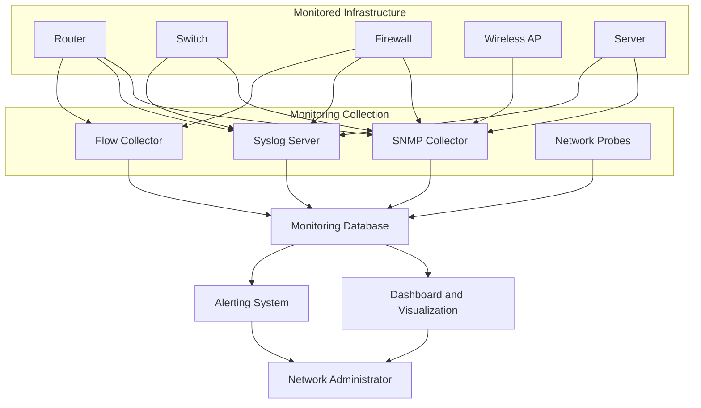

# Network Monitoring

Network monitoring is the process of continuously observing network devices, services, interfaces, traffic, and performance to maintain network availability, reliability, and security.

It helps network administrators understand what is happening across an infrastructure, identify abnormal behavior, detect failures, and troubleshoot performance problems before they significantly affect users.

Network monitoring is essential for:

* Enterprise networks.
* Internet Service Providers (ISPs).
* Data centers.
* Cloud infrastructure.
* Wireless networks.
* Distributed network environments.

This section covers network monitoring fundamentals, monitoring protocols, centralized logging, traffic analysis, performance monitoring, alerting, and commonly used monitoring tools.

# 🗁 Learning Objectives

After completing this section, you should be able to:

* Understand network monitoring concepts and architectures.
* Identify important network performance metrics.
* Monitor devices using SNMP.
* Collect and analyze network logs using Syslog.
* Understand NetFlow and traffic analysis.
* Measure latency, jitter, packet loss, and availability.
* Configure network monitoring alerts.
* Select appropriate monitoring tools for different environments.
* Design a basic centralized network monitoring system.

# 🗁 Network Monitoring Architecture

### 🖆 Centralized monitoring architecture

A centralized monitoring system collects information from multiple network devices and presents it through a common platform.

### 🖆 Monitoring components

| Component         | Responsibility                                   |
| ----------------- | ------------------------------------------------ |
| Monitored devices | Generate operational and performance information |
| SNMP collector    | Retrieves device metrics                         |
| Syslog server     | Receives and stores system logs                  |
| Flow collector    | Analyzes network traffic flows                   |
| Network probes    | Measure reachability and performance             |
| Database          | Stores monitoring data                           |
| Dashboard         | Visualizes metrics and trends                    |
| Alerting system   | Notifies administrators about detected problems  |

# 🗁 Monitoring Best Practices

* Maintain an inventory of monitored devices.
* Define performance baselines for normal network behavior.
* Monitor critical links and infrastructure services.
* Use centralized monitoring and logging where practical.
* Synchronize device clocks using NTP.
* Configure alerts based on meaningful thresholds and conditions.
* Monitor trends instead of relying only on current values.
* Protect monitoring systems and their credentials.
* Restrict SNMP access to trusted monitoring systems.
* Retain logs and historical metrics according to operational requirements.
* Regularly test alert delivery and monitoring coverage.
* Document monitoring architecture and escalation procedures.

# 🗁 Practical Learning Path

* Understand monitoring fundamentals and performance metrics.
* Learn SNMP architecture, versions, and monitoring operations.
* Configure centralized Syslog collection.
* Understand NetFlow, IPFIX, and sFlow.
* Measure latency, jitter, packet loss, and availability.
* Design useful network alerts.
* Explore common monitoring platforms.
* Build a centralized monitoring environment in a virtual lab.

# 🗁 Expected Outcome

After completing this section, you should understand how to observe network health, collect operational information, analyze traffic, identify performance problems, and build a centralized monitoring solution for an enterprise or ISP environment.
