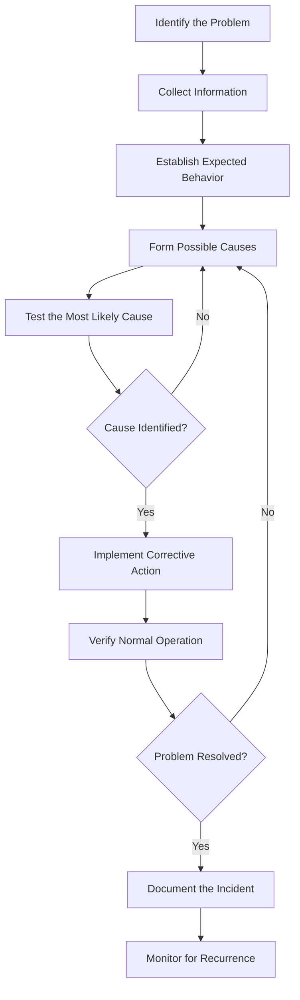

# Troubleshooting Methodology

Network troubleshooting methodology is a structured approach to identifying, isolating, diagnosing, and resolving network problems.

Instead of randomly changing configurations or restarting devices, administrators follow a systematic process based on observable evidence.

A good troubleshooting methodology reduces downtime, prevents unnecessary configuration changes, and helps identify the actual root cause of an incident.

# 🗁 Why a Troubleshooting Methodology Matters

Network problems can originate from multiple layers and components.

For example, a user may report that a website is unavailable. Possible causes include:

* Physical cable disconnection.
* Switch port failure.
* Incorrect VLAN assignment.
* IP address configuration problems.
* Default gateway failure.
* DNS resolution failure.
* Routing problems.
* Firewall restrictions.
* NAT configuration errors.
* Remote server failure.

These problems can produce similar symptoms but require different solutions.

A structured methodology helps administrators distinguish between symptoms and root causes.

# 🗁 The Troubleshooting Process

A commonly used troubleshooting methodology follows these stages:

* Identify the problem.
* Collect information.
* Establish the expected behavior.
* Consider possible causes.
* Test the most likely causes.
* Identify the root cause.
* Implement a corrective action.
* Verify normal operation.
* Document the incident.



# 🗁 Identify the Problem

The first step is to understand exactly what is failing.

Do not immediately assume that the reported symptom describes the actual fault.

For example:

```text
User Report:
Internet is not working.
```

This statement is too broad to identify a root cause.

Collect more specific information:

* Is the problem affecting one user or multiple users?
* Is the entire network affected?
* Can the user access local network resources?
* Can the user reach the default gateway?
* Can the user reach an external IP address?
* Can the user access websites using IP addresses?
* Does the problem occur continuously or intermittently?
* When did the problem begin?
* Were any network changes made recently?

A more useful problem description might be:

```text
Problem:
Users in VLAN 20 cannot access external websites.

Observations:
- Local devices can communicate.
- The default gateway responds to ping.
- External IP connectivity fails.
- Users in VLAN 10 have normal internet access.

Affected Network:
192.168.20.0/24
```

This information narrows the investigation toward routing, firewall, NAT, or upstream connectivity affecting VLAN 20.

# 🗁 Collect Information

Collect evidence before making configuration changes.

Useful information includes:

**Network Configuration**

* IP address.
* Subnet mask or prefix length.
* Default gateway.
* DNS server addresses.
* VLAN assignment.
* Routing information.
* DHCP lease information.

**Device Information**

* Device model.
* Operating system.
* Interface status.
* Firmware or software version.
* CPU and memory utilization.
* Device uptime.

**Network Evidence**

* Ping results.
* Traceroute output.
* ARP or neighbor table.
* Interface counters.
* Routing table.
* Firewall logs.
* System logs.
* Packet captures.

**Linux Commands**

Display interface addresses:

```bash
ip address
```

Display routing information:

```bash
ip route
```

Display neighbor entries:

```bash
ip neigh
```

Display interface status:

```bash
ip link
```

Display active sockets:

```bash
ss -tulnp
```

Check DNS resolution:

```bash
dig example.com
```

Check system logs:

```bash
journalctl -n 100
```

**MikroTik RouterOS v7 Commands**

Display IP addresses:

```routeros
/ip address print
```

Display interfaces:

```routeros
/interface print
```

Display routes:

```routeros
/ip route print
```

Display ARP entries:

```routeros
/ip arp print
```

Display active connections:

```routeros
/ip firewall connection print
```

Display recent logs:

```routeros
/log print
```

# 🗁 Establish Expected Behavior

Before diagnosing a problem, determine what normal operation should look like.

For example, consider a small office network:

```text
LAN Network:       192.168.10.0/24
Default Gateway:   192.168.10.1
DNS Server:        1.1.1.1
DHCP Range:        192.168.10.100-192.168.10.200
WAN Interface:     ether1
LAN Interface:     bridge
```

Expected behavior:

* Clients receive valid DHCP leases.
* Clients communicate with the default gateway.
* The router has a valid upstream route.
* NAT allows permitted LAN traffic to reach the internet.
* DNS queries resolve domain names.
* Firewall rules permit required traffic.

Comparing actual behavior with expected behavior helps identify where the failure occurs.

# 🗁 Form Possible Causes

After collecting information, create a list of possible causes.

Avoid selecting a root cause based only on assumptions.

Example:

```text
Problem:
A client cannot access the internet.

Possible Causes:

- Incorrect IP configuration.
- Missing default gateway.
- DNS server unavailable.
- Router has no default route.
- WAN interface is down.
- Firewall blocks outgoing traffic.
- NAT is incorrectly configured.
- ISP connectivity is unavailable.
```

Prioritize causes according to the available evidence.

A useful approach is to begin with the simplest and most likely explanations before investigating more complex possibilities.

# 🗁 Use the OSI Model for Fault Isolation

The OSI model provides a useful framework for organizing troubleshooting activities.

| OSI Layer | Troubleshooting Focus | Common Problems |
| --- | --- | --- |
| Layer 1 - Physical | Cables, connectors, signals | Cable damage, interface down |
| Layer 2 - Data Link | Ethernet, MAC, VLANs | VLAN mismatch, MAC learning failure |
| Layer 3 - Network | IP addressing and routing | Wrong gateway, missing route |
| Layer 4 - Transport | TCP and UDP | Blocked ports, connection failures |
| Layer 5 - Session | Session establishment | Session interruption |
| Layer 6 - Presentation | Data representation and encryption | TLS or encoding issues |
| Layer 7 - Application | DNS, HTTP, DHCP, application services | DNS failure, application errors |

Troubleshooting often begins at the lower layers and moves upward.

However, the starting point should depend on the symptoms and available evidence. A known DNS error, for example, may justify starting directly at the application layer.

# 🗁 Troubleshoot from Known Good to Unknown

Compare a working device or network path with the affected one.

For example:

```text
Working Client:
IP:      192.168.10.110
Gateway: 192.168.10.1
DNS:     1.1.1.1

Affected Client:
IP:      192.168.10.120
Gateway: 192.168.10.254
DNS:     1.1.1.1
```

The affected client has an unexpected default gateway.

This provides a strong indication that the problem may be related to incorrect DHCP configuration or manual IP configuration.

Comparisons are especially useful when:

* Only one device is affected.
* Only one VLAN is affected.
* Only one wireless network is affected.
* Some applications work while others fail.
* One WAN connection works while another does not.

# 🗁 Divide and Conquer

Divide and conquer is a troubleshooting technique that isolates a failure by testing different sections of a network.

Consider this network:

```text
Client
  |
  v
Access Switch
  |
  v
Core Switch
  |
  v
Router
  |
  v
ISP
  |
  v
Internet
```

If the client cannot access the internet, test connectivity at different points.

* Client to access switch.
* Client to default gateway.
* Router to ISP gateway.
* Router to external IP address.
* Client to external IP address.

The results help identify the section where communication fails.

For example:

| Test | Result |
| --- | --- |
| Client to gateway | Successful |
| Router to ISP gateway | Successful |
| Router to external IP | Successful |
| Client to external IP | Failed |

This suggests that the issue may be related to forwarding, firewall, NAT, or return traffic handling rather than basic WAN connectivity.

# 🗁 Test One Variable at a Time

Changing several network settings simultaneously makes it difficult to identify which change corrected the problem.

Use controlled testing.

Example:

```text
Problem:
Client cannot communicate with the gateway.

Investigation:

- Check client IP configuration.
- Verify subnet mask.
- Verify default gateway.
- Inspect switch VLAN assignment.
- Check ARP resolution.
- Inspect router interface status.
```

If the client has an incorrect subnet mask, correct that setting and test again before making unrelated changes.

This approach preserves diagnostic clarity and reduces the risk of introducing additional problems.

# 🗁 Implement the Corrective Action

After identifying the root cause, apply the smallest appropriate change.

Examples:

| Root Cause | Corrective Action |
| --- | --- |
| Damaged Ethernet cable | Replace the cable |
| Incorrect IP address | Correct the IP configuration |
| Wrong VLAN assignment | Assign the correct VLAN |
| Missing default route | Configure the appropriate route |
| DNS server unavailable | Restore or replace the DNS resolver |
| Incorrect NAT rule | Correct the NAT configuration |
| Firewall blocks required traffic | Adjust the relevant firewall policy |
| VPN encryption mismatch | Correct the VPN configuration |

Before changing production infrastructure:

* Back up the current configuration.
* Understand the expected impact.
* Use an approved maintenance window when necessary.
* Record the original and new settings.
* Prepare a rollback procedure for high-impact changes.

# 🗁 Verify the Solution

A successful configuration change does not automatically mean the problem is resolved.

Verify that the original issue is no longer present.

For example, if a client could not access the internet:

* Confirm that the client has a valid IP address.
* Confirm that the default gateway is reachable.
* Test external IP connectivity.
* Test DNS resolution.
* Open the affected application or website.
* Confirm that other network services still work.
* Monitor the network for recurring failures.

Linux connectivity checks:

```bash
ping -c 5 192.168.10.1
ping -c 5 1.1.1.1
dig example.com
curl -I https://example.com
```

MikroTik RouterOS v7 connectivity checks:

```routeros
/ping 192.168.10.1 count=5
/ping 1.1.1.1 count=5
/tool traceroute 1.1.1.1
```

Verification should cover the actual service affected by the incident, not just one successful ping.

# 🗁 Document the Incident

Documenting network incidents helps administrators recognize recurring problems and build operational knowledge.

A useful incident record includes:

| Field | Description |
| --- | --- |
| Incident ID | Unique incident reference |
| Date and time | When the problem occurred |
| Affected devices | Routers, switches, servers, or clients |
| Symptoms | Observable problem behavior |
| Impact | Users, services, or locations affected |
| Evidence | Logs, commands, and packet captures |
| Root cause | Actual source of the problem |
| Corrective action | Changes made to resolve it |
| Verification | Tests confirming recovery |
| Follow-up | Preventive actions or improvements |

Example:

```text
Incident:
INC-2026-001

Problem:
Office users cannot access the internet.

Affected Network:
192.168.20.0/24

Symptoms:
- Local gateway is reachable.
- External IP connectivity fails.
- DNS resolution is unavailable.

Root Cause:
Incorrect NAT source network configuration.

Resolution:
Corrected the source address list used by the NAT rule.

Verification:
- External IP connectivity restored.
- DNS resolution successful.
- HTTPS access confirmed.

Status:
Resolved.
```

# 🗁 Troubleshooting Methodologies and Techniques

Several established techniques can improve diagnostic efficiency.

**Top-Down Troubleshooting**

Start at the application layer and move toward the physical layer.

Useful when:

* An application reports a specific error.
* DNS or HTTP behavior is suspicious.
* The network connection appears functional.

**Bottom-Up Troubleshooting**

Start at the physical layer and move toward the application layer.

Useful when:

* A device has no connectivity.
* An interface is down.
* Physical or switching problems are suspected.

**Divide-and-Conquer Troubleshooting**

Test a point between the source and destination to narrow down the failure location.

Useful when:

* A network contains multiple routers and switches.
* The failure location is unknown.
* End-to-end connectivity is unavailable.

**Follow-the-Path Troubleshooting**

Trace the actual packet path and inspect each relevant network component.

Useful when:

* Routing is complex.
* Multiple firewalls or NAT devices exist.
* Asymmetric routing is suspected.

**Comparison-Based Troubleshooting**

Compare a working connection with a failing connection.

Useful when:

* Only certain users are affected.
* A specific VLAN or subnet has problems.
* Configuration differences may explain the failure.

# 🗁 Common Troubleshooting Mistakes

Avoid these common mistakes:

* Restarting devices before collecting evidence.
* Changing multiple configurations simultaneously.
* Assuming every connectivity problem is caused by DNS.
* Ignoring physical-layer problems.
* Treating ping success as proof that an application works.
* Ignoring firewall and routing behavior.
* Disabling firewall rules without understanding their purpose.
* Forgetting to verify the return path.
* Making production changes without a backup.
* Failing to document the actual root cause.
* Closing incidents without checking for recurrence.

# 🗁 Practical Troubleshooting Scenario

**Scenario: A Client Cannot Access the Internet**

Network topology:

```text
Client
192.168.10.100
     |
     v
MikroTik Router
192.168.10.1
     |
     v
WAN Interface
     |
     v
ISP Gateway
     |
     v
Internet
```

Perform the investigation in a structured sequence.

**Check Client Configuration**

Linux:

```bash
ip address
ip route
ip neigh
```

Windows:

```powershell
ipconfig /all
route print
arp -a
```

Verify the IP address, subnet, gateway, and DNS settings.

**Test the Default Gateway**

```bash
ping -c 5 192.168.10.1
```

If this fails, investigate local connectivity, VLAN assignment, ARP resolution, and the router's LAN interface.

**Test External IP Connectivity**

```bash
ping -c 5 1.1.1.1
```

If the gateway responds but external connectivity fails, investigate routing, firewall, NAT, and upstream connectivity.

**Test DNS Resolution**

```bash
dig example.com
```

If external IP connectivity works but DNS resolution fails, investigate DNS server availability and resolver configuration.

**Inspect MikroTik Routing**

```routeros
/ip route print
```

Verify that an appropriate active default route exists.

**Inspect NAT Rules**

```routeros
/ip firewall nat print
```

Verify that the intended LAN traffic is translated correctly when source NAT is required.

**Inspect Firewall Rules**

```routeros
/ip firewall filter print
```

Review rule order, matching conditions, connection states, and counters.

**Verify Application Connectivity**

```bash
curl -I https://example.com
```

Confirm that the original service works rather than relying exclusively on ICMP tests.

**Document the Root Cause**

Record the actual failure, supporting evidence, corrective action, and verification results.

# 🗁 Key Principles

* Troubleshoot systematically rather than randomly.
* Collect evidence before changing configurations.
* Understand expected behavior.
* Use the OSI model to organize investigation.
* Isolate the failure domain.
* Test one variable at a time.
* Apply minimal corrective changes.
* Verify end-to-end service functionality.
* Document root causes and resolutions.
* Monitor after recovery to identify recurring problems.

# 🗁 Summary

A structured troubleshooting methodology turns network problem-solving into a repeatable engineering process.

The most important skills are not simply knowing diagnostic commands, but understanding what those commands reveal and how their results narrow down possible causes.

By following a consistent process, network administrators can resolve incidents more efficiently, minimize unnecessary changes, and maintain reliable network infrastructure.
