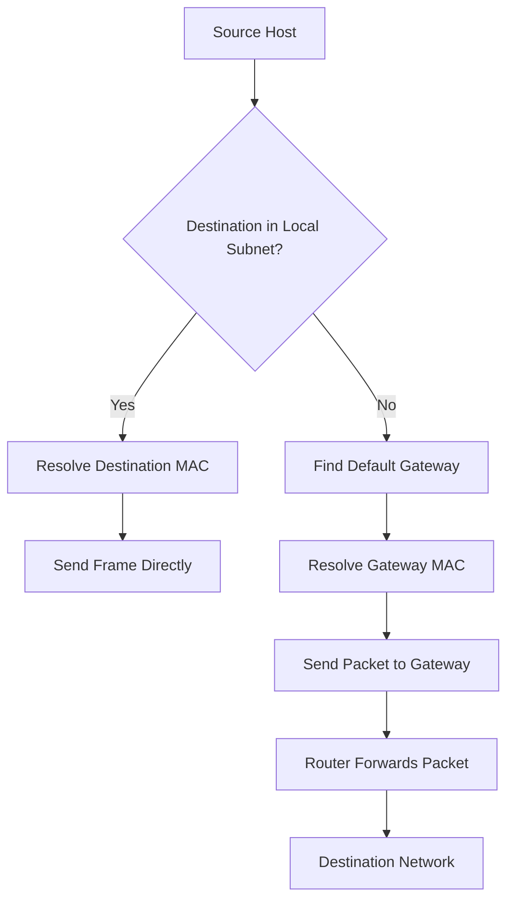

# IP Connectivity Issues

IP connectivity is the ability of network devices to communicate using Internet Protocol (IP). It involves IP addressing, subnet masks, routing, gateways, and packet forwarding.

An IP connectivity problem occurs when a device cannot successfully communicate with another device using its IP address.

Common symptoms include:

* A device cannot communicate with its default gateway.
* Devices on the same subnet cannot communicate.
* Local network communication works, but internet access fails.
* Remote networks are unreachable.
* Packet loss or intermittent connectivity occurs.
* An interface has an IP address but cannot reach other devices.
* Communication works in one direction but fails in the other.

IP connectivity troubleshooting should begin with the local network interface and progress toward the destination.

# 🗁 Understanding the IP Connectivity Path

When a host communicates with another IP address, it determines whether the destination belongs to its local subnet.

If the destination is local, the host attempts to communicate directly using the destination's MAC address.

If the destination is remote, the host sends the packet to its default gateway.

A simplified communication path is:



A failure at any point in this process can prevent successful communication.

# 🗁 Common IP Connectivity Problems

### 🖆 Incorrect IP Address

An incorrect IP address can prevent a device from communicating with other devices.

Example:

```text
IP Address:      192.168.10.50
Subnet Mask:     255.255.255.0
Default Gateway: 192.168.20.1
```

The gateway belongs to a different subnet. Unless a special network configuration exists, the host cannot directly reach that gateway.

A typical configuration might be:

```text
IP Address:      192.168.10.50
Subnet Mask:     255.255.255.0
Default Gateway: 192.168.10.1
```

Verify that the IP address, subnet mask, and gateway match the intended network design.

### 🖆 Incorrect Subnet Mask

The subnet mask determines which IP addresses a host considers local.

For example:

```text
IP Address: 192.168.10.50
Mask:       255.255.255.0
```

The host considers addresses in `192.168.10.0/24` part of its local subnet.

If the subnet mask is incorrectly configured as `255.255.0.0`, the host may consider addresses in a much larger range local.

This can cause the host to attempt direct communication instead of forwarding traffic through its gateway.

### 🖆 Missing Default Gateway

A default gateway provides the next hop for destinations that do not match a more specific route.

Without a default gateway, a host may communicate with devices on its local subnet but fail to reach remote networks.

Check whether the default route exists and points to the correct gateway.

### 🖆 Duplicate IP Address

A duplicate IP address occurs when two devices use the same address on the same network.

Possible symptoms include:

* Intermittent connectivity.
* Unexpected communication failures.
* ARP entries changing between different MAC addresses.
* Duplicate address notifications from operating systems.
* One device losing connectivity when another becomes active.

Check DHCP reservations, static IP assignments, and address-management records.

### 🖆 IP Address Conflict Between Subnets

Incorrect subnet allocation can cause overlapping IP address ranges.

For example:

```text
Network A: 192.168.10.0/24
Network B: 192.168.10.128/25
```

Network B overlaps with part of Network A.

Overlapping address ranges can create routing ambiguity and prevent reliable communication between networks.

Use a consistent IP addressing plan and avoid unintended subnet overlap.

### 🖆 Missing or Incorrect Routes

Routers use routing tables to determine where packets should be forwarded.

A missing route can prevent traffic from reaching a remote network.

An incorrect route can send traffic toward an invalid next hop or the wrong interface.

Routing problems can also cause asymmetric paths, where outgoing and return traffic follow different routes.

# 🗁 Troubleshooting on Linux

Linux provides several commands for inspecting addresses, routes, neighbors, and connectivity.

### 🖆 Inspect IP Addresses

```bash
ip addr show
```

Inspect a specific interface:

```bash
ip addr show dev enp3s0
```

Check:

* Assigned IPv4 and IPv6 addresses.
* Prefix length.
* Interface state.
* Whether the expected address is present.

### 🖆 Inspect Interface State

```bash
ip link show
```

An interface should be administratively enabled and have an active physical link when using Ethernet.

Enable an interface if it is intentionally disabled:

```bash
sudo ip link set enp3s0 up
```

### 🖆 Inspect the Routing Table

```bash
ip route show
```

Example:

```text
default via 192.168.10.1 dev enp3s0
192.168.10.0/24 dev enp3s0 proto kernel scope link src 192.168.10.50
```

The default route sends unmatched destinations through `192.168.10.1`.

Inspect IPv6 routes:

```bash
ip -6 route show
```

### 🖆 Inspect the Default Gateway

```bash
ip route show default
```

Expected example:

```text
default via 192.168.10.1 dev enp3s0
```

Verify that the gateway is reachable:

```bash
ping -c 4 192.168.10.1
```

### 🖆 Inspect Neighbor and ARP Entries

Linux maintains a neighbor table containing mappings between IP addresses and link-layer addresses.

```bash
ip neigh show
```

Inspect a specific neighbor:

```bash
ip neigh show 192.168.10.1
```

Common neighbor states include:

| State | Meaning |
| --- | --- |
| REACHABLE | Neighbor was recently confirmed reachable |
| STALE | Entry exists but has not recently been confirmed |
| DELAY | Reachability confirmation is being delayed |
| PROBE | Neighbor reachability is being actively checked |
| FAILED | Neighbor resolution failed |
| INCOMPLETE | Address resolution is still in progress |

An unresolved gateway neighbor may indicate a local Layer 2 connectivity problem, incorrect subnet configuration, or an unavailable gateway.

### 🖆 Test Connectivity with Ping

Test the local loopback interface:

```bash
ping -c 4 127.0.0.1
```

Test the local gateway:

```bash
ping -c 4 192.168.10.1
```

Test another host on the local network:

```bash
ping -c 4 192.168.10.20
```

Test a remote IP address:

```bash
ping -c 4 1.1.1.1
```

Ping uses ICMP Echo Request and Echo Reply messages. A failed ping does not always prove that a destination is unreachable because ICMP traffic may be filtered or rate-limited.

### 🖆 Inspect the Route to a Destination

```bash
ip route get 1.1.1.1
```

This displays the route Linux would use to reach the destination.

Example:

```text
1.1.1.1 via 192.168.10.1 dev enp3s0 src 192.168.10.50
```

This helps identify the selected gateway, interface, and source address.

### 🖆 Trace the Network Path

Install traceroute:

```bash
sudo apt install traceroute
```

Trace a destination:

```bash
traceroute 1.1.1.1
```

Alternatively, use:

```bash
tracepath 1.1.1.1
```

These tools help identify where packets stop receiving responses along a network path.

Some routers do not respond to traceroute probes, so missing hops do not necessarily indicate a forwarding failure.

# 🗁 Troubleshooting on MikroTik RouterOS v7

RouterOS provides commands for inspecting IP addressing, routes, ARP entries, and connectivity.

### 🖆 Inspect IP Addresses

```routeros
/ip address print
```

Verify that the expected IP address and network prefix are assigned to the correct interface.

### 🖆 Inspect the Routing Table

```routeros
/ip route print
```

Look for:

* Active routes.
* Default routes.
* Correct destination prefixes.
* Valid gateways.
* Unexpected or conflicting routes.

Inspect the active routing table:

```routeros
/routing route print
```

### 🖆 Inspect ARP Entries

```routeros
/ip arp print
```

Check whether the expected IP address has a corresponding MAC address.

An unresolved or incorrect ARP entry can indicate a local connectivity problem.

### 🖆 Test Connectivity

Ping the default gateway:

```routeros
/ping 192.168.10.1 count=4
```

Ping a remote IP address:

```routeros
/ping 1.1.1.1 count=4
```

Specify a source address when diagnosing routing or return-path problems:

```routeros
/ping 1.1.1.1 src-address=192.168.10.2 count=4
```

Use a source address assigned to the router.

### 🖆 Trace the Network Path

```routeros
/tool traceroute 1.1.1.1
```

Review the responding hops and identify where responses stop.

### 🖆 Inspect Interface Addresses and Status

```routeros
/interface print
```

Verify that the relevant interface is enabled and operational.

### 🖆 Inspect Firewall Rules

A router may have valid IP addressing and routes but still block traffic through firewall rules.

Inspect IPv4 filter rules:

```routeros
/ip firewall filter print
```

Inspect NAT rules:

```routeros
/ip firewall nat print
```

Review rule order, matching conditions, connection states, and counters. Do not disable firewall rules indiscriminately during troubleshooting.

# 🗁 Troubleshooting on Cisco IOS

Cisco IOS provides commands for inspecting Layer 3 interfaces and routing information.

### 🖆 Inspect Interface IP Configuration

```cisco
show ip interface brief
```

Verify:

* Interface IP address.
* Interface status.
* Line protocol status.

### 🖆 Inspect Interface Details

```cisco
show interfaces
```

Check interface errors, packet counters, and operational status.

### 🖆 Inspect the Routing Table

```cisco
show ip route
```

Look for:

* Connected routes.
* Static routes.
* Dynamic routing entries.
* Default route.
* Next-hop addresses.

### 🖆 Inspect ARP Entries

```cisco
show ip arp
```

Verify that local IP addresses resolve to the expected MAC addresses.

### 🖆 Test Connectivity

```cisco
ping 192.168.10.1
```

Test a remote destination:

```cisco
ping 1.1.1.1
```

### 🖆 Trace the Network Path

```cisco
traceroute 1.1.1.1
```

This helps identify routing problems between the source and destination.

# 🗁 A Systematic Troubleshooting Process

Follow a consistent sequence to isolate IP connectivity problems.

### 🖆 Verify the Local Interface

Check:

* Is the interface enabled?
* Is the physical link active?
* Is the expected IP address assigned?
* Is the interface connected to the correct VLAN or network?

### 🖆 Verify the IP Configuration

Check:

* IP address.
* Subnet mask or prefix length.
* Default gateway.
* Duplicate IP addresses.
* DHCP configuration, if applicable.

### 🖆 Test the Local Network

Test the loopback address:

```bash
ping -c 4 127.0.0.1
```

Test the assigned IP address:

```bash
ip addr show
```

Test the default gateway:

```bash
ping -c 4 192.168.10.1
```

If the gateway is unreachable, investigate local addressing, VLAN membership, ARP resolution, and physical connectivity.

### 🖆 Test Remote IP Connectivity

If the gateway responds, test a remote IP address:

```bash
ping -c 4 1.1.1.1
```

If remote IP connectivity fails, investigate:

* Default route.
* Upstream router.
* Routing policies.
* Firewall rules.
* NAT configuration, where required.
* Return routing.

### 🖆 Check DNS Separately

If remote IP connectivity works but domain names do not resolve, investigate DNS rather than assuming an IP routing failure.

For example:

```bash
ping -c 4 1.1.1.1
```

Then test DNS resolution:

```bash
getent hosts example.com
```

This separates basic IP connectivity from name-resolution problems.

### 🖆 Trace the Destination Path

```bash
traceroute 1.1.1.1
```

Use the results to investigate the forwarding path and identify possible routing boundaries.

### 🖆 Verify the Return Path

Successful outbound forwarding does not guarantee successful communication.

The destination or an intermediate network must have a valid route back to the source.

Check both directions when possible, especially in networks with multiple gateways, policy-based routing, or redundant WAN connections.

# 🗁 Practical Troubleshooting Scenarios

### 🖆 Scenario: Host Cannot Reach Its Default Gateway

**Symptoms:**

* The host has an IP address.
* The interface is active.
* The gateway does not respond to ping.

**Possible causes:**

* Incorrect subnet mask.
* Wrong gateway address.
* Incorrect VLAN assignment.
* Gateway interface is down.
* ARP resolution failure.
* Physical connectivity problem.

**Troubleshooting:**

```bash
ip addr show
ip route show
ip neigh show
ping -c 4 192.168.10.1
```

Verify the host's address, subnet, gateway, and neighbor entry.

### 🖆 Scenario: Local Network Works but Internet Does Not

**Symptoms:**

* Hosts can communicate with devices on the local subnet.
* The default gateway responds.
* Remote IP addresses are unreachable.

**Possible causes:**

* Missing default route on the router.
* WAN interface is down.
* Upstream connectivity failure.
* Firewall blocks forwarding.
* NAT is missing or incorrectly configured when required.
* Return route is missing.

**Troubleshooting:**

Check the router's routing table, WAN connectivity, firewall rules, and upstream gateway.

Test connectivity from the router itself to separate router-originated traffic from forwarded host traffic.

### 🖆 Scenario: One Host Cannot Communicate with Another Host

**Symptoms:**

* Other devices communicate normally.
* One source or destination experiences connectivity problems.

**Possible causes:**

* Duplicate IP address.
* Incorrect subnet configuration.
* Host firewall restrictions.
* Incorrect VLAN assignment.
* Invalid ARP entry.
* Interface or cable problem.

**Troubleshooting:**

Compare the IP configuration of both hosts and inspect their ARP or neighbor entries.

Test connectivity from both directions where possible.

### 🖆 Scenario: Communication Works in One Direction Only

**Symptoms:**

* Host A can reach Host B.
* Host B cannot initiate communication with Host A.
* Some applications fail even though basic connectivity appears available.

**Possible causes:**

* Host firewall rules.
* Missing return route.
* Asymmetric routing.
* Stateful firewall behavior.
* NAT configuration.
* Application-specific access restrictions.

**Troubleshooting:**

Inspect routes on both sides, verify firewall policies, and capture traffic to determine whether requests and responses are following the expected paths.

### 🖆 Scenario: Duplicate IP Address

**Symptoms:**

* Intermittent connectivity.
* ARP entries unexpectedly change.
* Devices report address conflicts.

**Possible causes:**

* Static address overlaps with DHCP allocation.
* Duplicate static configuration.
* Incorrect DHCP scope.
* A device configured with an outdated address.

**Troubleshooting:**

Inspect the DHCP lease table, static assignments, and ARP entries. Identify the devices using the conflicting address and correct the address allocation.

# 🗁 Packet-Level Verification

When interface configuration and routing appear correct, packet capture can help identify where communication fails.

### 🖆 Capture ICMP Traffic

```bash
sudo tcpdump -ni enp3s0 icmp
```

Generate test traffic in another terminal:

```bash
ping -c 4 1.1.1.1
```

Observe whether Echo Requests leave the interface and whether Echo Replies return.

### 🖆 Capture ARP Traffic

```bash
sudo tcpdump -ni enp3s0 arp
```

This helps identify ARP requests and replies.

For example, repeated ARP requests without replies may indicate that a local destination or gateway is not responding to address resolution.

### 🖆 Capture Traffic for a Specific Host

```bash
sudo tcpdump -ni enp3s0 host 192.168.10.20
```

Packet captures help distinguish between:

* Traffic not being generated.
* Traffic not leaving the source interface.
* Traffic being dropped along the path.
* Replies not returning.
* Communication reaching the destination but being rejected.

# 🗁 Best Practices

* Maintain a documented IP addressing plan.
* Use consistent subnet masks and prefix lengths.
* Avoid overlapping IP subnets.
* Reserve addresses for infrastructure devices.
* Prevent static IP addresses from conflicting with DHCP pools.
* Configure the correct default gateway.
* Maintain accurate routing tables.
* Monitor duplicate IP address events.
* Document VLAN-to-subnet relationships.
* Verify both forward and return routing paths.
* Use packet captures when command-line checks are insufficient.
* Keep firewall and NAT policies organized and documented.

# 🗁 Troubleshooting Checklist

* [ ] Verify the physical interface is operational.
* [ ] Confirm the expected IP address and prefix length.
* [ ] Verify the subnet mask.
* [ ] Check the default gateway.
* [ ] Look for duplicate IP addresses.
* [ ] Inspect the routing table.
* [ ] Inspect ARP or neighbor entries.
* [ ] Test communication with the default gateway.
* [ ] Test remote IP connectivity.
* [ ] Verify firewall and NAT configuration where applicable.
* [ ] Check DNS separately from IP connectivity.
* [ ] Trace the route to the destination.
* [ ] Verify the return path.
* [ ] Capture packets if the failure remains unclear.
* [ ] Document the root cause and corrective action.

# 🗁 Summary

IP connectivity troubleshooting focuses on identifying failures in addressing, subnet configuration, gateway selection, routing, neighbor resolution, and packet forwarding.

A reliable troubleshooting sequence begins with the local interface, verifies IP configuration, tests the default gateway, checks remote connectivity, and then investigates routing and firewall behavior.

Separating local network problems from remote routing and DNS problems makes troubleshooting faster and more accurate.
