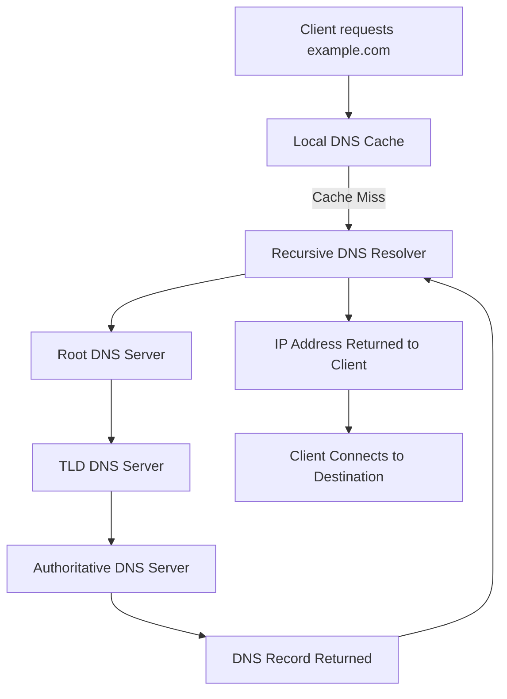

# DNS Troubleshooting

The Domain Name System (DNS) translates human-readable domain names into IP addresses and provides other information about network services.

For example:

```text
Domain:     example.com
IPv4:       93.184.216.34
```

When a user visits `https://example.com`, the operating system or application typically needs to resolve the hostname before establishing a connection to the destination server.

DNS problems can prevent users from accessing websites, applications, email services, and other network resources even when IP connectivity is working correctly.

Common DNS troubleshooting symptoms include:

* Websites cannot be accessed using domain names.
* Websites work using IP addresses but not hostnames.
* DNS queries time out.
* Domain names resolve to unexpected IP addresses.
* Some domains resolve while others fail.
* Internal domain names cannot be resolved.
* DNS resolution works on one device but fails on another.
* DNS resolution is slow or inconsistent.

# 🗁 How DNS Resolution Works

A typical DNS resolution process involves several components:

* Stub resolver: The DNS client on the user's device.
* Recursive resolver: Receives queries and performs resolution on behalf of clients.
* Root DNS server: Directs queries toward the appropriate top-level domain servers.
* TLD DNS server: Provides information about authoritative name servers for a domain.
* Authoritative DNS server: Provides the actual DNS records for the domain.

A simplified resolution process:



In practice, a recursive resolver may already have the answer cached, so it does not need to contact every DNS server for every query.

# 🗁 DNS Query Types

DNS supports several query types.

| Query type | Purpose |
| --- | --- |
| A | Resolves a hostname to an IPv4 address |
| AAAA | Resolves a hostname to an IPv6 address |
| CNAME | Provides an alias for another hostname |
| MX | Identifies mail servers for a domain |
| NS | Identifies authoritative name servers |
| TXT | Stores text information, often used for domain verification and email security |
| PTR | Performs reverse DNS lookup |
| SOA | Provides authoritative zone information |
| SRV | Identifies service locations and ports |

Example:

```text
example.com A     93.184.216.34
example.com AAAA  2606:2800:220:1:248:1893:25c8:1946
```

A missing or incorrect record can cause a specific service or hostname to fail even when the DNS server itself is functioning.

# 🗁 Common DNS Problems

**Incorrect DNS Server**

A device may be configured to use an unavailable, unreachable, or incorrectly configured DNS server.

Check the configured DNS server addresses and verify that the client can reach them.

**DNS Server Unavailable**

The DNS resolver may be offline, overloaded, or unable to process queries.

Possible causes include:

* DNS service stopped.
* Server hardware failure.
* Network connectivity problems.
* Firewall blocking DNS traffic.
* Incorrect DNS server configuration.

**Incorrect DNS Records**

A domain may resolve to an incorrect IP address because of an outdated or misconfigured DNS record.

For example:

```text
www.example.com A 192.168.10.100
```

If the actual web server is at another address, clients may connect to the wrong destination.

**DNS Cache Problems**

Resolvers and client devices cache DNS responses to reduce lookup time.

If a DNS record changes, clients may continue using an older cached response until its TTL expires or the cache is cleared.

**DNS Propagation and TTL**

DNS changes do not necessarily become visible everywhere immediately.

Resolvers may retain previously cached records until their Time to Live (TTL) expires.

**Firewall Blocking DNS**

DNS commonly uses:

* UDP port 53 for standard queries and responses.
* TCP port 53 for larger responses, zone transfers, and other DNS operations.

Blocking either transport where it is required can cause DNS failures.

**Incorrect DNS Search Domain**

A client may append a configured search domain to short hostnames.

For example:

```text
Hostname: server01
Search domain: example.local
```

The resolver may attempt:

```text
server01.example.local
```

An incorrect search domain can cause internal hostname resolution to fail.

# 🗁 DNS Troubleshooting Methodology

Use a systematic process to isolate DNS failures.

Start by determining whether the problem affects one hostname, multiple hostnames, one client, or the entire network.

Then verify:

* Physical and IP connectivity.
* Configured DNS server addresses.
* DNS server reachability.
* DNS query and response behavior.
* DNS records and authoritative information.
* Client and resolver caches.
* Firewall policies.
* DNS service availability.

Avoid changing DNS server configurations before identifying where resolution fails.

# 🗁 Troubleshooting on Linux

Linux provides several utilities for inspecting DNS configuration and testing DNS resolution.

**Inspect DNS Configuration**

```bash
resolvectl status
```

On systems using systemd-resolved, this displays DNS configuration for network interfaces.

Inspect the resolver configuration file:

```bash
cat /etc/resolv.conf
```

Example:

```text
nameserver 1.1.1.1
nameserver 8.8.8.8
```

The actual configuration depends on the Linux distribution and network-management service. On systems using a local DNS stub resolver, `/etc/resolv.conf` may point to a local address such as `127.0.0.53`.

**Test DNS Resolution**

```bash
getent hosts example.com
```

This tests hostname resolution through the system's configured name-service mechanism.

**Use nslookup**

Install DNS utilities on Ubuntu:

```bash
sudo apt update
sudo apt install dnsutils
```

Query a hostname:

```bash
nslookup example.com
```

Query a specific DNS server:

```bash
nslookup example.com 1.1.1.1
```

Query an IPv4 record:

```bash
nslookup -type=A example.com
```

Query an IPv6 record:

```bash
nslookup -type=AAAA example.com
```

**Use dig**

`dig` provides detailed DNS query and response information.

Basic query:

```bash
dig example.com
```

Query a specific resolver:

```bash
dig @1.1.1.1 example.com
```

Query an A record:

```bash
dig example.com A
```

Query an AAAA record:

```bash
dig example.com AAAA
```

Query MX records:

```bash
dig example.com MX
```

Query authoritative name servers:

```bash
dig example.com NS
```

Query TXT records:

```bash
dig example.com TXT
```

Perform a reverse DNS lookup:

```bash
dig -x 8.8.8.8
```

**Understand dig Output**

Example:

```text
;; ->>HEADER<<- opcode: QUERY, status: NOERROR, id: 12345

;; flags: qr rd ra

;; QUESTION SECTION:
;example.com.              IN      A

;; ANSWER SECTION:
example.com.       300     IN      A       93.184.216.34

;; Query time: 25 msec
;; SERVER: 1.1.1.1#53
```

Important fields:

| Field | Meaning |
| --- | --- |
| status | DNS response status |
| QUESTION SECTION | Requested DNS record |
| ANSWER SECTION | Returned DNS records |
| TTL | Remaining cache lifetime in seconds |
| Query time | Time taken to receive the response |
| SERVER | DNS server that answered the query |

Common DNS response codes:

| Response code | Meaning |
| --- | --- |
| NOERROR | Query completed successfully |
| NXDOMAIN | Requested domain name does not exist |
| SERVFAIL | Server failed to complete the query |
| REFUSED | Server refused the query |
| FORMERR | DNS query format error |
| NOTIMP | Requested operation is not implemented |

An answer with `NOERROR` can still contain no records of the requested type. This is commonly called NODATA.

**Trace DNS Delegation**

```bash
dig +trace example.com
```

This follows the DNS delegation hierarchy, starting from the root servers and continuing toward the authoritative servers.

It is useful when investigating:

* Incorrect delegation.
* Missing name-server records.
* DNS propagation problems.
* Authoritative server failures.

**Test DNS over TCP**

```bash
dig +tcp example.com
```

This is useful when investigating situations where UDP queries work but TCP-based DNS communication fails.

# 🗁 Flush DNS Cache on Linux

DNS caching behavior depends on the resolver service.

For systems using systemd-resolved:

```bash
sudo resolvectl flush-caches
```

Inspect resolver statistics:

```bash
resolvectl statistics
```

For systems using `nscd`, restart its service if applicable:

```bash
sudo systemctl restart nscd
```

Do not assume every Linux distribution uses the same DNS caching service.

# 🗁 Troubleshooting DNS with Packet Capture

Packet capture helps determine whether DNS queries leave the client and whether responses return.

Capture standard DNS traffic:

```bash
sudo tcpdump -ni any port 53
```

Capture UDP DNS traffic:

```bash
sudo tcpdump -ni any udp port 53
```

Capture TCP DNS traffic:

```bash
sudo tcpdump -ni any tcp port 53
```

Generate a DNS query in another terminal:

```bash
dig example.com
```

Observe:

* Whether the client sends a DNS query.
* Which DNS server receives it.
* Whether a response returns.
* Whether the response contains an error.
* Whether queries are repeatedly retransmitted.

# 🗁 Troubleshooting on MikroTik RouterOS v7

RouterOS can operate as a DNS cache and resolver for connected clients.

**Inspect DNS Configuration**

```routeros
/ip dns print
```

Review:

* Configured DNS servers.
* Dynamic DNS servers.
* Cache size.
* Allow Remote Requests setting.

**Inspect DNS Cache**

```routeros
/ip dns cache print
```

This displays cached DNS records.

**Clear DNS Cache**

```routeros
/ip dns cache flush
```

This forces subsequent requests to obtain fresh DNS responses.

**Configure DNS Servers**

```routeros
/ip dns set servers=1.1.1.1,8.8.8.8
```

These are example public DNS resolvers. Use DNS servers appropriate for your network.

**Enable DNS Service for LAN Clients**

If MikroTik should answer DNS requests from local clients:

```routeros
/ip dns set allow-remote-requests=yes
```

Restrict DNS access through firewall policies so that only trusted networks can use the router as a resolver.

**Configure DHCP to Advertise the Router as DNS**

```routeros
/ip dhcp-server network set [find address=192.168.10.0/24] dns-server=192.168.10.1
```

This example assumes the router has the address `192.168.10.1` on the LAN.

Clients receiving DHCP configuration will use the router as their DNS server.

**Test DNS Resolution from MikroTik**

```routeros
:put [:resolve "example.com"]
```

This attempts to resolve the hostname using the router's DNS configuration.

**Inspect Firewall Rules**

```routeros
/ip firewall filter print
```

Verify that DNS requests and responses are not being blocked.

For a typical LAN DNS service, permit UDP and TCP port 53 from trusted LAN clients to the router's LAN address. Avoid exposing recursive DNS service to untrusted WAN networks.

# 🗁 Troubleshooting on Cisco IOS

Cisco IOS devices can use DNS for hostname resolution and can also provide DNS-related services depending on platform and configuration.

**Inspect DNS Configuration**

```cisco
show running-config | include ip name-server
```

Inspect configured DNS servers:

```cisco
show hosts
```

**Configure DNS Servers**

```cisco
configure terminal
ip name-server 1.1.1.1
ip name-server 8.8.8.8
end
```

**Test DNS Resolution**

```cisco
ping example.com
```

If hostname resolution is enabled and configured, the device attempts to resolve the hostname before sending ICMP traffic.

**Inspect DNS Lookup Configuration**

```cisco
show running-config | include ip domain
```

Configuration and command availability can vary by Cisco IOS platform and software version.

# 🗁 Troubleshooting DNS with Windows

Windows provides several built-in tools for DNS diagnosis.

**Inspect DNS Configuration**

```powershell
ipconfig /all
```

Find the DNS Servers section for the relevant network adapter.

**Test DNS Resolution**

```powershell
nslookup example.com
```

Query a specific DNS server:

```powershell
nslookup example.com 1.1.1.1
```

**Use Resolve-DnsName**

```powershell
Resolve-DnsName example.com
```

Query a specific record type:

```powershell
Resolve-DnsName example.com -Type MX
```

**Flush DNS Cache**

```powershell
ipconfig /flushdns
```

Inspect cached DNS records:

```powershell
ipconfig /displaydns
```

**Inspect Network Configuration**

```powershell
Get-DnsClientServerAddress
```

# 🗁 Scenario: Websites Work by IP but Not by Domain Name

**Symptoms:**

* Remote IP addresses are reachable.
* Websites cannot be accessed using domain names.
* DNS queries fail.

**Possible causes:**

* Incorrect DNS server configuration.
* DNS server unavailable.
* Firewall blocking DNS.
* Incorrect DNS records.
* Resolver cache problems.

**Troubleshooting:**

```bash
ping -c 4 1.1.1.1
dig example.com
dig @1.1.1.1 example.com
```

Interpretation:

* If the IP connectivity test fails, investigate routing and connectivity first.
* If the IP test works but the configured resolver fails, investigate the DNS server and its network path.
* If the configured resolver fails but the direct query to `1.1.1.1` works, investigate the configured resolver.

# 🗁 Scenario: DNS Queries Return NXDOMAIN

**Symptoms:**

```text
status: NXDOMAIN
```

**Possible causes:**

* Incorrect hostname.
* Domain does not exist.
* Missing DNS record.
* Incorrect DNS zone configuration.
* Stale or incorrect authoritative information.

**Troubleshooting:**

```bash
dig example.com
dig example.com A
dig example.com NS
dig +trace example.com
```

Verify the domain spelling, record configuration, and authoritative DNS delegation.

# 🗁 Scenario: DNS Queries Time Out

**Symptoms:**

* DNS queries take too long.
* `dig` reports a timeout.
* Applications cannot resolve hostnames.

**Possible causes:**

* DNS server unavailable.
* Routing failure.
* Firewall blocking UDP or TCP port 53.
* Resolver overload.
* Incorrect DNS server address.

**Troubleshooting:**

```bash
dig @1.1.1.1 example.com
```

Test the DNS server's network reachability:

```bash
ping -c 4 1.1.1.1
```

A successful ping does not prove that DNS service is available. Check DNS traffic directly if necessary.

# 🗁 Scenario: Internal Hostnames Cannot Be Resolved

**Symptoms:**

* Public websites resolve normally.
* Internal server names fail.
* Internal applications cannot locate required services.

**Possible causes:**

* Internal DNS server unavailable.
* Missing internal DNS records.
* Incorrect DNS search domain.
* Client using public DNS instead of internal DNS.
* Incorrect split-DNS configuration.

**Troubleshooting:**

```bash
resolvectl status
```

Query the internal DNS server directly:

```bash
dig @192.168.10.10 server01.example.local
```

Verify that the internal DNS zone contains the expected records and that clients use the appropriate resolver.

# 🗁 Scenario: DNS Returns an Unexpected IP Address

**Symptoms:**

* A hostname resolves successfully.
* The returned address is not the expected server.
* Users reach the wrong service or an unavailable destination.

**Possible causes:**

* Incorrect A or AAAA record.
* Stale cache.
* Incorrect CNAME target.
* Split-horizon DNS.
* DNS load balancing.
* Geo-based DNS responses.

**Troubleshooting:**

```bash
dig example.com A
dig example.com AAAA
dig example.com CNAME
```

Compare responses from different resolvers and query the authoritative name server directly.

Different answers are not automatically incorrect; DNS policies may intentionally return different addresses.

# 🗁 Scenario: DNS Resolution Is Slow

**Symptoms:**

* Applications take longer to establish connections.
* DNS lookup time is high.
* Queries sometimes time out before succeeding.

**Possible causes:**

* Slow or overloaded recursive resolver.
* Packet loss.
* Unreachable DNS server.
* Long resolver timeout and retry behavior.
* Broken IPv6 connectivity affecting DNS transport or subsequent connections.
* DNS delegation problems.

**Troubleshooting:**

```bash
dig example.com
dig @1.1.1.1 example.com
dig @8.8.8.8 example.com
```

Compare query times and response codes.

Investigate the network path and resolver performance rather than assuming that the domain's authoritative server is slow.

# 🗁 Scenario: DNS Works on One Device but Fails on Another

**Symptoms:**

* Multiple devices use the same network.
* One device resolves hostnames successfully.
* Another device cannot resolve the same names.

**Possible causes:**

* Different DNS server configuration.
* Stale local DNS cache.
* VPN DNS settings.
* Incorrect static network configuration.
* Local firewall restrictions.
* Different DNS search domains.

**Troubleshooting:**

Compare:

```bash
resolvectl status
ip route show
```

Then query the same DNS server from both devices:

```bash
dig @192.168.10.1 example.com
```

This helps determine whether the problem is specific to the client or the DNS infrastructure.

# 🗁 Scenario: DNS Works but an Application Cannot Connect

**Symptoms:**

* Domain resolution succeeds.
* The correct IP address is returned.
* The application still cannot connect.

**Possible causes:**

* Destination server unavailable.
* TCP or UDP port blocked.
* Incorrect service configuration.
* TLS certificate problems.
* Reverse proxy or load balancer failure.
* Application-layer errors.

**Troubleshooting:**

Verify DNS first:

```bash
dig example.com
```

Then test the service port:

```bash
nc -vz example.com 443
```

For HTTPS:

```bash
curl -Iv https://example.com
```

Successful DNS resolution only confirms that a name was resolved. It does not confirm that the destination application is healthy.

# 🗁 Scenario: DNS Changes Are Not Visible Immediately

**Symptoms:**

* A DNS record has been updated.
* Some clients receive the new address.
* Other clients continue receiving the old address.

**Possible causes:**

* Cached DNS responses.
* High TTL values.
* Different recursive resolvers.
* Incorrect authoritative records.
* DNS delegation or zone synchronization problems.

**Troubleshooting:**

Check the authoritative response:

```bash
dig @AUTHORITATIVE_DNS_SERVER example.com A
```

Inspect the TTL:

```bash
dig example.com A
```

Flush local caches where appropriate and allow previously cached records to expire.

# 🗁 Scenario: DNS Works over UDP but Fails over TCP

**Symptoms:**

* Ordinary DNS lookups appear to work.
* Some large DNS responses or specific operations fail.
* TCP-based DNS queries time out.

**Possible causes:**

* Firewall blocking TCP port 53.
* Incorrect firewall state handling.
* Network path problems.
* DNS server TCP service problems.

**Troubleshooting:**

```bash
dig example.com
dig +tcp example.com
```

Verify that both UDP and TCP DNS traffic are permitted wherever required.

# 🗁 DNS Troubleshooting Checklist

* [ ] Confirm the client has valid IP connectivity.
* [ ] Inspect configured DNS server addresses.
* [ ] Verify DNS server reachability.
* [ ] Test hostname resolution with `dig` or `nslookup`.
* [ ] Compare responses from multiple resolvers.
* [ ] Check A, AAAA, CNAME, MX, and other relevant records.
* [ ] Inspect DNS response codes.
* [ ] Verify authoritative name-server configuration.
* [ ] Inspect DNS delegation and TTL values.
* [ ] Check local and recursive DNS caches.
* [ ] Verify firewall policies for UDP and TCP port 53.
* [ ] Inspect internal DNS and search-domain configuration.
* [ ] Capture DNS packets if the failure remains unclear.
* [ ] Test the application separately after DNS resolution succeeds.
* [ ] Document the root cause and corrective action.

# 🗁 Best Practices

* Use reliable recursive DNS resolvers.
* Maintain accurate DNS records.
* Keep internal and external DNS zones properly organized.
* Use appropriate TTL values.
* Monitor DNS availability and query response times.
* Restrict recursive DNS access to trusted clients.
* Permit UDP and TCP DNS traffic where required.
* Use DNSSEC validation where supported and appropriate.
* Maintain redundant DNS infrastructure.
* Document DNS servers, zones, records, and delegation.
* Monitor DNS errors and unusual query patterns.
* Keep DNS configuration consistent across network clients.

# 🗁 Summary

DNS troubleshooting focuses on identifying failures in name resolution, DNS server availability, record configuration, caching, delegation, and network communication.

A reliable troubleshooting process separates IP connectivity from DNS resolution and application availability.

Tools such as `dig`, `nslookup`, `resolvectl`, `tcpdump`, RouterOS DNS commands, and Windows DNS utilities provide the information needed to isolate DNS problems systematically.
