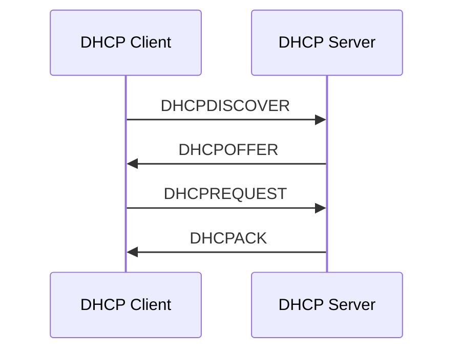

# DHCP Troubleshooting

Dynamic Host Configuration Protocol (DHCP) automatically provides network configuration to client devices.

Instead of manually configuring an IP address, subnet mask, default gateway, and DNS servers on every device, a DHCP client obtains these settings from a DHCP server.

DHCP is commonly used in:

* Home networks.
* Office networks.
* Enterprise networks.
* Wireless networks.
* ISP customer networks.
* Virtualized environments.

Common DHCP troubleshooting symptoms include:

* A client cannot obtain an IP address.
* A client receives an APIPA address.
* Devices receive an incorrect gateway.
* Clients receive incorrect DNS servers.
* Some devices obtain addresses while others fail.
* DHCP leases are exhausted.
* Clients receive addresses from an unexpected DHCP server.
* Devices lose connectivity when their leases expire.

# 🗁 DHCP Architecture

DHCP uses a client-server architecture.

The main components are:

* DHCP Client: Requests network configuration.
* DHCP Server: Allocates IP addresses and provides configuration options.
* DHCP Relay Agent: Forwards DHCP messages between clients and servers on different subnets.
* DHCP Lease: Defines how long a client may use an assigned IP address.

DHCP for IPv4 normally uses UDP port 67 on the server side and UDP port 68 on the client side.

# 🗁 DHCP DORA Process

The initial DHCP address allocation process is commonly called DORA:

* Discover: Client searches for available DHCP servers.
* Offer: Server offers an IP address and configuration.
* Request: Client requests the offered address.
* Acknowledgment: Server confirms the allocation.



During initial address acquisition, clients commonly use broadcast communication because they may not yet have a usable IP address.

The actual message delivery behavior can vary depending on the client's state, network configuration, and whether a DHCP relay is involved.

# 🗁 DHCP Lease Lifecycle

A DHCP address is normally assigned for a limited period called a lease.

The client attempts to renew its lease before it expires.

Common renewal stages include:

* T1: The client normally attempts renewal with the original DHCP server.
* T2: If renewal fails, the client attempts rebinding, potentially contacting any available DHCP server.
* Lease expiration: The client must stop using the address if it cannot renew or obtain a valid lease.

By default, T1 is commonly 50% of the lease duration and T2 is commonly 87.5%, unless different values are configured.

# 🗁 DHCP Options

DHCP provides configuration options beyond IP addresses.

Common options include:

| Option | Purpose |
| --- | --- |
| 1 | Subnet Mask |
| 3 | Router / Default Gateway |
| 6 | DNS Servers |
| 12 | Hostname |
| 15 | Domain Name |
| 42 | NTP Servers |
| 51 | IP Address Lease Time |
| 54 | DHCP Server Identifier |
| 66 | TFTP Server Name |
| 67 | Bootfile Name |

Incorrect DHCP options can cause connectivity problems even when a client successfully receives an IP address.

# 🗁 Common DHCP Problems

**DHCP Server Unavailable**

The DHCP server may be offline, unreachable, or incorrectly configured.

Possible causes:

* DHCP service stopped.
* Server interface disconnected.
* Firewall blocking DHCP traffic.
* Incorrect VLAN assignment.
* DHCP relay misconfiguration.

**DHCP Scope Exhaustion**

A DHCP scope contains the range of addresses available for allocation.

When all usable addresses are assigned or reserved, new clients cannot obtain an address.

Example:

```text
Network:       192.168.10.0/24
Gateway:       192.168.10.1
DHCP Pool:     192.168.10.100 - 192.168.10.110
Usable Pool:   11 addresses
```

Only eleven addresses are available in this example.

If all eleven are leased or otherwise unavailable, new clients may fail to obtain an address.

**Incorrect DHCP Scope**

A DHCP scope may contain incorrect:

* Network prefix.
* Subnet mask.
* Address range.
* Default gateway.
* DNS server addresses.
* Lease duration.

**Multiple DHCP Servers**

Two or more DHCP servers may respond to the same client request.

If both servers are not intentionally coordinated, clients may receive different network configurations depending on which offer they accept.

This can result in intermittent connectivity and inconsistent gateway or DNS settings.

**DHCP Relay Failure**

DHCP broadcasts normally do not cross IP routers.

When the DHCP server is located on another subnet, a DHCP relay agent must forward the requests.

Incorrect relay configuration can prevent clients from obtaining addresses.

**VLAN Misconfiguration**

A DHCP server or relay may be correctly configured, but clients may belong to the wrong VLAN.

The client then reaches an incorrect DHCP service or cannot reach the intended one.

**Incorrect Lease or Reservation**

A client may receive an address that conflicts with a manually configured address or an incorrectly maintained reservation.

This can cause intermittent connectivity or duplicate IP address problems.

# 🗁 Understanding APIPA Addresses

Automatic Private IP Addressing (APIPA) allows some IPv4 clients to assign themselves an address when DHCP configuration is unavailable.

The APIPA address range is:

```text
169.254.0.0/16
```

For example:

```text
IP Address: 169.254.25.100
Mask:       255.255.0.0
```

An APIPA address generally indicates that the client did not obtain its expected DHCP configuration.

APIPA can support limited local-link communication, but it does not automatically provide normal routed network connectivity.

An APIPA address is a useful troubleshooting clue, not proof that the DHCP server itself is defective.

# 🗁 DHCP Troubleshooting Methodology

Follow a systematic process:

* Inspect the client's IP configuration.
* Determine whether the client received an address from DHCP.
* Verify the DHCP server's availability.
* Check the DHCP scope and lease pool.
* Inspect DHCP messages.
* Verify VLAN membership.
* Check DHCP relay configuration where applicable.
* Inspect firewall rules.
* Verify DHCP options and reservations.

First determine whether the failure affects one client, one VLAN, or the entire network.

# 🗁 Troubleshooting on Linux

Linux provides several commands for inspecting DHCP client configuration and network connectivity.

**Inspect IP Configuration**

```bash
ip addr show
```

Check the assigned address and interface.

An address in `169.254.0.0/16` may indicate that normal DHCP configuration was not obtained.

**Inspect Routing Configuration**

```bash
ip route show
```

Verify that the expected default gateway is installed.

**Inspect DNS Configuration**

```bash
resolvectl status
```

Check which DNS servers were configured for the interface.

**Inspect NetworkManager Connections**

```bash
nmcli device status
```

Inspect the active connection:

```bash
nmcli connection show --active
```

Display the DHCP-related configuration:

```bash
nmcli device show enp3s0
```

Look for DHCP-provided information such as:

* IP address.
* Gateway.
* DNS servers.
* Search domains.

**Renew a DHCP Lease with NetworkManager**

Disconnect and reconnect the device through NetworkManager:

```bash
sudo nmcli device disconnect enp3s0
sudo nmcli device connect enp3s0
```

This can trigger a new DHCP configuration process.

**Renew a Lease with dhclient**

On systems using ISC DHCP client:

```bash
sudo dhclient -r enp3s0
sudo dhclient -v enp3s0
```

The first command releases the current lease, and the second requests configuration again.

The `dhclient` utility may not be installed or used by every Linux distribution. NetworkManager and systemd-networkd can manage DHCP independently.

**Inspect DHCP Client Logs**

```bash
sudo journalctl -u NetworkManager
```

For kernel and general network events:

```bash
sudo journalctl -k
```

Look for DHCP timeouts, failed address configuration, and interface state changes.

# 🗁 Capture DHCP Traffic on Linux

Packet capture is especially useful when a client cannot obtain an address.

Install tcpdump:

```bash
sudo apt update
sudo apt install tcpdump
```

Capture DHCPv4 traffic:

```bash
sudo tcpdump -ni enp3s0 -vvv 'udp port 67 or udp port 68'
```

Observe the DHCP exchange:

```text
DHCPDISCOVER
DHCPOFFER
DHCPREQUEST
DHCPACK
```

Interpretation:

| Observed traffic | Possible problem |
| --- | --- |
| Discover only | No offer is returning to the client |
| Discover and Offer | Client may not receive or accept the offer |
| Discover, Offer, Request | Acknowledgment may be missing |
| Full DORA exchange | Initial DHCP allocation appears successful |
| Repeated Discover | Client is not completing address acquisition |

A full DORA exchange does not guarantee that all network settings are correct. Verify the assigned address, gateway, DNS, and subsequent connectivity.

# 🗁 Troubleshooting on MikroTik RouterOS v7

MikroTik RouterOS can operate as a DHCP server, DHCP client, or DHCP relay.

**Inspect DHCP Servers**

```routeros
/ip dhcp-server print
```

Check:

* Server status.
* Interface assignment.
* Address pool.
* Lease configuration.

**Inspect DHCP Networks**

```routeros
/ip dhcp-server network print
```

Verify the network configuration:

* Gateway.
* DNS servers.
* Subnet.
* Domain name, if configured.

**Inspect DHCP Address Pools**

```routeros
/ip pool print
```

Confirm that the configured pool contains sufficient available addresses.

**Inspect DHCP Leases**

```routeros
/ip dhcp-server lease print
```

Review:

* Assigned IP addresses.
* Client MAC addresses.
* Lease status.
* Lease expiration.
* Static reservations.

**Inspect DHCP Server Statistics**

```routeros
/ip dhcp-server print stats
```

Where supported, statistics help identify DHCP activity and server behavior.

**Inspect DHCP Client Configuration**

```routeros
/ip dhcp-client print detail
```

This is useful when the MikroTik router itself receives its WAN address through DHCP.

**Inspect DHCP Relay Configuration**

```routeros
/ip dhcp-relay print
```

Verify:

* Relay interface.
* DHCP server address.
* Relay configuration.

**Inspect Firewall Rules**

```routeros
/ip firewall filter print
```

Review whether DHCP requests and responses are being blocked.

For DHCPv4 clients, the initial exchange normally involves broadcast traffic between UDP ports 68 and 67. Firewall rules must account for the actual interface and packet direction.

**Monitor DHCP Logs**

```routeros
/log print
```

Inspect DHCP-related events and failed address allocation attempts.

# 🗁 Troubleshooting on Cisco IOS

Cisco IOS can provide DHCP server and relay functionality depending on the platform.

**Inspect DHCP Bindings**

```cisco
show ip dhcp binding
```

This displays addresses currently assigned by the local DHCP server.

**Inspect DHCP Pool Information**

```cisco
show ip dhcp pool
```

Check:

* Total addresses.
* Leased addresses.
* Available addresses.
* Pool utilization.

**Inspect DHCP Server Statistics**

```cisco
show ip dhcp server statistics
```

This helps identify DHCP message activity.

**Inspect DHCP Relay Configuration**

```cisco
show running-config | include helper-address
```

A relay configuration commonly uses:

```cisco
interface GigabitEthernet0/1
 ip helper-address 192.168.10.10
```

The destination address must point to the intended DHCP server.

**Inspect Interface Configuration**

```cisco
show ip interface brief
```

Verify that the interface is operational and has the correct IP address.

**Inspect VLAN Configuration**

```cisco
show vlan brief
```

Confirm that the client access port belongs to the expected VLAN.

# 🗁 Troubleshooting on Windows

Windows provides built-in DHCP diagnostic commands.

**Inspect IP Configuration**

```powershell
ipconfig /all
```

Check:

* IPv4 address.
* Subnet mask.
* Default gateway.
* DHCP enabled status.
* DHCP server address.
* Lease obtained and expiration times.
* DNS servers.

**Release an IP Address**

```powershell
ipconfig /release
```

**Renew an IP Address**

```powershell
ipconfig /renew
```

**Inspect the ARP Cache**

```powershell
arp -a
```

**Inspect Network Interface Configuration**

```powershell
Get-NetIPConfiguration
```

**Inspect DHCP Client Service**

```powershell
Get-Service Dhcp
```

**Inspect DHCP Client Events**

```powershell
Get-WinEvent -LogName Microsoft-Windows-Dhcp-Client/Operational -MaxEvents 30
```

These commands help identify whether the client is receiving DHCP configuration and whether renewal attempts are succeeding.

# 🗁 DHCP Relay Troubleshooting

A DHCP relay is necessary when DHCP clients and the DHCP server belong to different IP subnets.

The relay receives client broadcast messages and forwards them toward the DHCP server.

It also helps identify the originating client subnet so the server can select the appropriate DHCP scope.

Common relay problems include:

* Incorrect DHCP server address.
* Relay configured on the wrong interface.
* Missing routing between relay and server.
* Firewall blocking relay traffic.
* Incorrect gateway or relay information.
* Missing DHCP scope for the client subnet.

The DHCP server typically uses the relay's gateway information, commonly represented by the `giaddr` field in DHCP messages, to determine the appropriate address pool.

Verify the relay interface, server reachability, routing, and corresponding DHCP scope.

# 🗁 DHCP Security Issues

Unauthorized DHCP servers can distribute incorrect network settings.

An attacker or misconfigured device may provide:

* A malicious default gateway.
* An unauthorized DNS server.
* An incorrect subnet configuration.
* Other harmful DHCP options.

Common protection mechanisms include:

**DHCP Snooping**

DHCP snooping is a Layer 2 security feature available on supported switches.

It distinguishes trusted DHCP server-facing ports from untrusted client-facing ports.

Unauthorized DHCP server messages received on untrusted ports can be blocked.

**Port Security**

Port security can restrict which MAC addresses are permitted on a switch port.

**Network Segmentation**

Separate user, server, guest, and infrastructure networks to reduce the impact of unauthorized devices.

**Monitoring**

Monitor DHCP server activity, address allocation, and unexpected DHCP offers.

# 🗁 Practical Troubleshooting Scenarios

**Scenario: Client Receives an APIPA Address**

Symptoms:

* Windows or Linux client receives an address in `169.254.0.0/16`.
* No expected default gateway is present.
* Normal network connectivity fails.

Possible causes:

* DHCP server unavailable.
* Incorrect VLAN.
* DHCP relay failure.
* DHCP scope exhaustion.
* DHCP requests blocked.

Troubleshooting:

```bash
ip addr show
ip route show
sudo tcpdump -ni enp3s0 -vvv 'udp port 67 or udp port 68'
```

Determine whether the client sends DHCPDISCOVER and whether a DHCPOFFER returns.

**Scenario: DHCP Pool Is Exhausted**

Symptoms:

* Existing clients continue working.
* New devices cannot obtain addresses.
* DHCP server reports no available addresses.

Possible causes:

* DHCP scope too small.
* Long lease duration.
* Large number of connected clients.
* Stale or unused leases.
* Incorrect reservations.

Troubleshooting:

Inspect the DHCP pool utilization and lease table.

Expand the address pool when the network design allows it, or investigate unused leases and reservations.

**Scenario: Client Receives an Incorrect Gateway**

Symptoms:

* Client obtains an IP address.
* Local network communication works.
* Remote connectivity fails.

Possible causes:

* Incorrect DHCP option 3.
* Multiple DHCP servers.
* Incorrect DHCP scope.
* Wrong VLAN assignment.

Troubleshooting:

Inspect the client's gateway and compare it with the intended subnet configuration.

Check the DHCP server's network options and identify which server supplied the lease.

**Scenario: Multiple DHCP Servers Respond**

Symptoms:

* Different clients receive different network configurations.
* Connectivity is inconsistent.
* Unexpected gateway or DNS addresses appear.

Possible causes:

* Unauthorized DHCP server.
* Misconfigured secondary DHCP server.
* Overlapping DHCP scopes.

Troubleshooting:

Capture DHCP traffic and identify the DHCP Server Identifier in the offers.

Correct the unauthorized server or coordinate DHCP scopes and failover configuration.

**Scenario: DHCP Works on One VLAN but Not Another**

Symptoms:

* Clients in one VLAN receive addresses.
* Clients in another VLAN cannot obtain addresses.

Possible causes:

* Missing DHCP relay.
* Incorrect VLAN interface configuration.
* Missing DHCP scope.
* Trunk configuration problem.
* Firewall blocking relay traffic.

Troubleshooting:

Verify VLAN membership, DHCP relay configuration, routing, and server-side scope definitions.

**Scenario: Client Cannot Renew Its DHCP Lease**

Symptoms:

* Existing connectivity works temporarily.
* Lease renewal fails.
* Connectivity is lost when the lease expires.

Possible causes:

* DHCP server unavailable.
* Network path to the server interrupted.
* DHCP relay failure.
* Firewall blocking renewal traffic.
* Server-side lease or reservation problems.

Troubleshooting:

Inspect the lease expiration time, client logs, DHCP server logs, and network path to the server.

# 🗁 Best Practices

* Maintain properly sized DHCP scopes.
* Reserve addresses for infrastructure devices.
* Avoid overlapping static addresses and DHCP pools.
* Configure correct subnet masks, gateways, and DNS servers.
* Use DHCP relay for routed client networks.
* Monitor DHCP lease utilization.
* Keep lease durations appropriate for the network.
* Prevent unauthorized DHCP servers.
* Enable DHCP snooping where supported.
* Document DHCP scopes, reservations, and relay addresses.
* Maintain redundant DHCP services where required.
* Monitor DHCP failures and address allocation patterns.

# 🗁 Troubleshooting Checklist

* [ ] Confirm the client interface is active.
* [ ] Check whether the client has an expected IP address.
* [ ] Identify APIPA or other unexpected addresses.
* [ ] Verify DHCP client configuration.
* [ ] Check DHCP server availability.
* [ ] Inspect DHCP scope utilization.
* [ ] Verify DHCP lease assignments.
* [ ] Check subnet mask, gateway, and DNS options.
* [ ] Inspect VLAN membership.
* [ ] Verify DHCP relay configuration.
* [ ] Check firewall policies.
* [ ] Look for unauthorized DHCP servers.
* [ ] Capture DHCP messages when necessary.
* [ ] Verify lease renewal behavior.
* [ ] Document the root cause and corrective action.

# 🗁 Summary

DHCP troubleshooting focuses on identifying failures in address allocation, lease management, DHCP server availability, relay communication, and network configuration options.

A reliable troubleshooting process examines the client's IP configuration, follows the DHCP DORA exchange, checks server-side pools and leases, and verifies VLAN and relay behavior.

Tools such as `ip`, `nmcli`, `tcpdump`, `ipconfig`, MikroTik RouterOS DHCP commands, and Cisco IOS DHCP commands provide the information needed to isolate DHCP problems.
