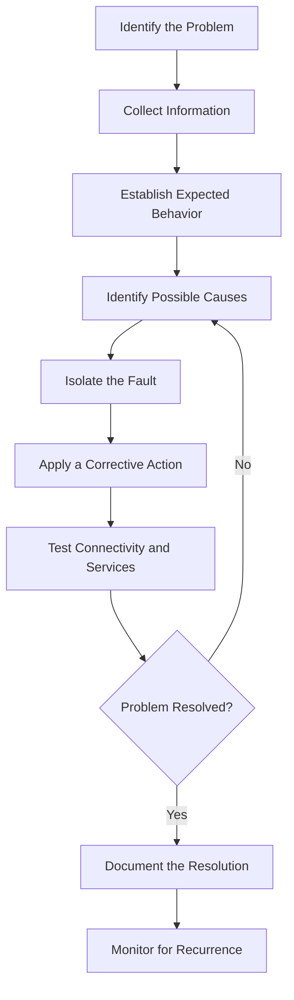

# Network Troubleshooting

Network troubleshooting is the systematic process of identifying, diagnosing, and resolving problems that affect network connectivity, performance, availability, and security.

It involves understanding how network components communicate, collecting relevant information, isolating the source of a problem, applying corrective actions, and verifying that services work correctly.

This section provides practical troubleshooting methods for physical networks, IP connectivity, DNS, DHCP, routing, NAT, firewalls, VLANs, wireless networks, VPNs, and packet-level analysis.

# 🗁 Learning Objectives

After completing this section, you should be able to:

* Follow a structured network troubleshooting methodology.
* Identify physical-layer connectivity problems.
* Diagnose IP addressing and connectivity issues.
* Troubleshoot DNS resolution failures.
* Identify DHCP configuration and address allocation problems.
* Diagnose routing and gateway issues.
* Troubleshoot NAT and firewall behavior.
* Identify VLAN configuration and switching problems.
* Diagnose wireless connectivity and performance issues.
* Troubleshoot VPN connectivity.
* Capture and analyze network packets.
* Use Linux and MikroTik RouterOS v7 diagnostic commands.
* Document incidents and verify corrective actions.

# 🗁 General Troubleshooting Workflow

A structured troubleshooting workflow helps prevent unnecessary configuration changes and reduces resolution time.

# 🗁 Common Troubleshooting Tools

| Tool | Purpose |
| --- | --- |
| `ping` | Test IP reachability and measure RTT |
| `traceroute` | Identify the path toward a destination |
| `mtr` | Continuously inspect route and packet-loss behavior |
| `ip` | Inspect addresses, interfaces, and routing |
| `ss` | Inspect sockets and network connections |
| `arp` / `ip neigh` | Inspect neighbor address mappings |
| `dig` | Diagnose DNS queries and responses |
| `nslookup` | Perform DNS lookups |
| `tcpdump` | Capture and inspect packets |
| `Wireshark` | Analyze network protocols and packet exchanges |
| `nmap` | Discover hosts, ports, and services |
| `ethtool` | Inspect Ethernet link properties and statistics |
| `Torch` | Inspect real-time traffic on MikroTik interfaces |
| `Netwatch` | Monitor remote host reachability in RouterOS |

# 🗁 Troubleshooting Best Practices

* Understand the expected network behavior before making changes.
* Start with the simplest possible explanations.
* Follow a layered troubleshooting approach.
* Check physical connectivity before investigating higher-layer problems.
* Verify IP addresses, subnet masks, and default gateways.
* Compare working and non-working devices.
* Collect command output, logs, and packet captures.
* Change one relevant configuration item at a time.
* Preserve existing configurations before making changes.
* Avoid disabling security controls as a general troubleshooting shortcut.
* Verify both connectivity and application-level functionality.
* Document the root cause and corrective action.
* Monitor the network after resolution to confirm stability.

# 🗁 Practical Learning Approach

Use a lab environment to reproduce network problems safely.

Practice with:

* Ubuntu Linux networking utilities.
* MikroTik RouterOS v7 and CHR.
* VirtualBox.
* GNS3 or EVE-NG.
* Wireshark and tcpdump.
* Zabbix or LibreNMS monitoring data.

For each troubleshooting exercise, document:

* **Problem:** What is not working?
* **Symptoms:** What behavior can be observed?
* **Evidence:** What do commands, logs, and captures show?
* **Root Cause:** What caused the problem?
* **Resolution:** What change corrected it?
* **Verification:** How was normal operation confirmed?

# 🗁 Expected Outcome

By completing this section, you will develop a repeatable troubleshooting process that can be applied to home networks, enterprise infrastructure, MikroTik deployments, and ISP environments.

The objective is not simply to memorize diagnostic commands. It is to understand network behavior, interpret evidence, isolate faults, and resolve problems systematically.
