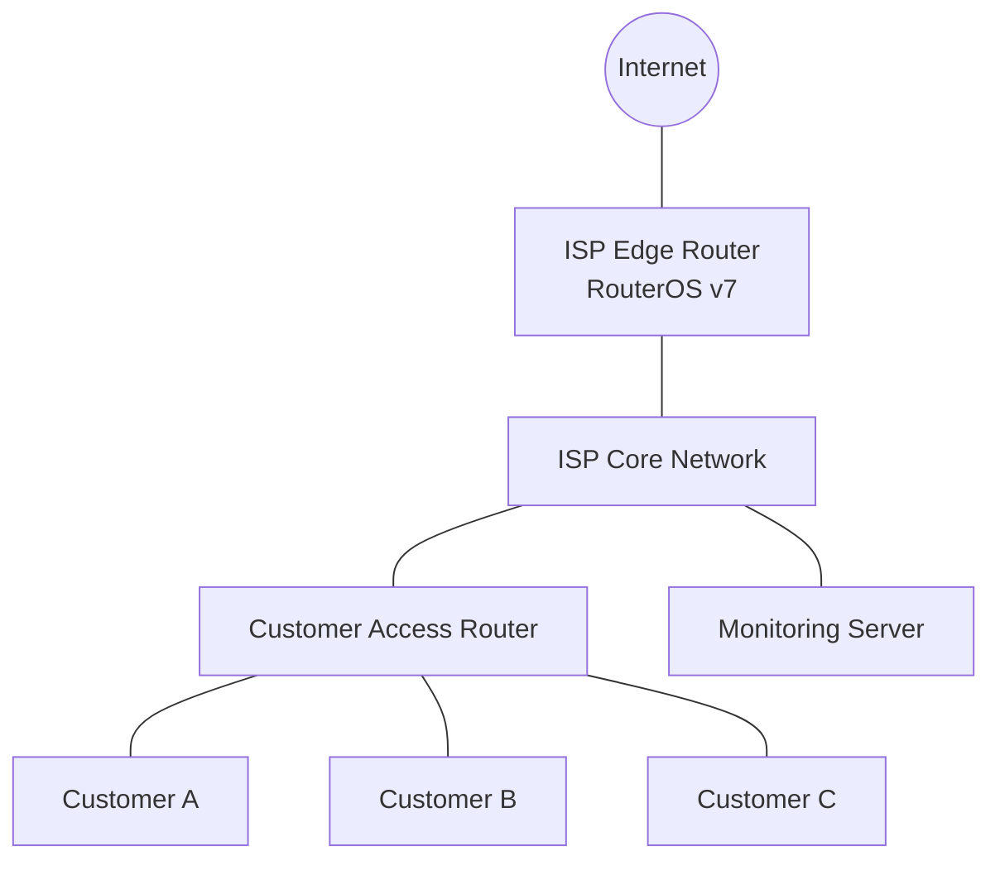

# ISP Scenarios

This document provides practical ISP (Internet Service Provider) network scenarios to help you understand how real-world ISP networks operate. You will work with customer connectivity, IP addressing, routing, NAT, PPPoE, bandwidth management, monitoring, and troubleshooting.

The exercises use MikroTik RouterOS v7 and Ubuntu/Linux where appropriate.

# 🗁 Learning Objectives

By completing these scenarios, you will learn how to:

* Design a small ISP network topology.
* Configure WAN and LAN connectivity.
* Allocate IP addresses to network devices and customers.
* Provide customer internet access through PPPoE.
* Configure NAT and firewall policies.
* Implement bandwidth limitations.
* Configure static routing and WAN failover.
* Understand CGNAT and public IP address allocation.
* Monitor customer traffic and network availability.
* Troubleshoot common ISP connectivity problems.

# 🗁 Lab Environment

### 🖆 Required Equipment and Software

| Component | Purpose |
| --- | --- |
| MikroTik CHR | ISP edge router |
| MikroTik CHR | Customer access router |
| Ubuntu Server | DNS, monitoring, and testing |
| VirtualBox / GNS3 / EVE-NG | Virtual lab environment |
| WinBox / SSH | Router administration |
| Two virtual networks | WAN and customer connectivity |

### 🖆 Example Network Topology



### 🖆 Example IP Addressing Plan

| Network / Device | IP Address | Purpose |
| --- | --- | --- |
| ISP WAN | 203.0.113.2/30 | Upstream connection |
| Upstream gateway | 203.0.113.1 | ISP gateway |
| ISP core | 10.10.0.1/24 | Internal infrastructure |
| Customer network A | 10.20.1.0/24 | Customer A |
| Customer network B | 10.20.2.0/24 | Customer B |
| Customer network C | 10.20.3.0/24 | Customer C |
| Monitoring server | 10.10.0.10 | Network monitoring |

The documentation IP ranges are reserved for examples and are not publicly routable internet addresses.

# 🗁 Scenario: Small ISP Network Deployment

### 🖆 Objective

Build a basic ISP network that provides internet connectivity to multiple customers through a central MikroTik router.

### 🖆 Requirements

* One upstream internet connection.
* One MikroTik ISP router.
* One customer access router.
* Three customer networks.
* NAT-based internet access.
* Basic firewall protection.

### 🖆 ISP Router Configuration

Configure the WAN interface:

```routeros
/ip address
add address=203.0.113.2/30 interface=ether1 comment="Upstream WAN"
```

Configure the internal network:

```routeros
/ip address
add address=10.10.0.1/24 interface=ether2 comment="ISP Core"
```

Configure the default route:

```routeros
/ip route
add dst-address=0.0.0.0/0 gateway=203.0.113.1
```

Configure source NAT:

```routeros
/ip firewall nat
add chain=srcnat out-interface=ether1 action=masquerade
```

### 🖆 Verification

```routeros
/ping 203.0.113.1
/ip route print
/ip firewall nat print
```

From a customer device, test:

```bash
ping -c 4 1.1.1.1
```

### 🖆 Expected Result

* The ISP router reaches its upstream gateway.
* The customer network can reach the internet.
* Customer traffic is translated through the ISP WAN address.

# 🗁 Scenario: Customer IP Address Allocation

### 🖆 Objective

Allocate separate IP address ranges to different customers while preventing accidental address overlap.

### 🖆 Requirements

| Customer | Network | Gateway |
| --- | --- | --- |
| Customer A | 10.20.1.0/24 | 10.20.1.1 |
| Customer B | 10.20.2.0/24 | 10.20.2.1 |
| Customer C | 10.20.3.0/24 | 10.20.3.1 |

### 🖆 Configuration Task

Configure separate customer-facing interfaces or VLAN interfaces on the access router.

Example:

```routeros
/ip address
add address=10.20.1.1/24 interface=ether3 comment="Customer A"
add address=10.20.2.1/24 interface=ether4 comment="Customer B"
add address=10.20.3.1/24 interface=ether5 comment="Customer C"
```

Configure DHCP pools for each customer:

```routeros
/ip pool
add name=pool-customer-a ranges=10.20.1.10-10.20.1.200
add name=pool-customer-b ranges=10.20.2.10-10.20.2.200
add name=pool-customer-c ranges=10.20.3.10-10.20.3.200
```

### 🖆 Practice Tasks

* Create DHCP servers for each customer network.
* Configure the correct gateway and DNS settings.
* Verify that customers receive addresses from their own subnet.
* Test communication between customer networks.
* Implement firewall rules to isolate customers where required.

### 🖆 Expected Result

Each customer receives an IP address from the correct network and uses the corresponding gateway.

# 🗁 Scenario: PPPoE-Based ISP Service

### 🖆 Objective

Provide internet connectivity to customers using PPPoE authentication.

### 🖆 Requirements

* MikroTik PPPoE server.
* Customer PPPoE client.
* Local user authentication.
* IP address pool.
* Customer service profiles.

### 🖆 Configure PPPoE Address Pool

```routeros
/ip pool
add name=pppoe-pool ranges=10.30.0.10-10.30.0.200
```

### 🖆 Configure PPP Profile

```routeros
/ppp profile
add name=basic-plan \
    local-address=10.30.0.1 \
    remote-address=pppoe-pool \
    dns-server=1.1.1.1,8.8.8.8 \
    rate-limit=10M/10M
```

### 🖆 Configure PPPoE User

```routeros
/ppp secret
add name=customer01 \
    password=StrongExamplePassword \
    service=pppoe \
    profile=basic-plan
```

### 🖆 Configure PPPoE Server

Assume `ether2` is the customer-facing interface.

```routeros
/interface pppoe-server server
add interface=ether2 \
    service-name=ISP-PPPoE \
    default-profile=basic-plan \
    disabled=no
```

### 🖆 Configure Customer PPPoE Client

On the customer router:

```routeros
/interface pppoe-client
add name=pppoe-out1 \
    interface=ether1 \
    user=customer01 \
    password=StrongExamplePassword \
    add-default-route=yes \
    use-peer-dns=yes \
    disabled=no
```

### 🖆 Verification

On the ISP router:

```routeros
/ppp active print
/ppp secret print
```

On the customer router:

```routeros
/interface pppoe-client print detail
/ip address print
/ip route print
```

### 🖆 Expected Result

* The customer authenticates successfully.
* A PPPoE session becomes active.
* The customer receives an IP address.
* The customer can access the internet through the ISP network.

# 🗁 Scenario: Bandwidth Management

### 🖆 Objective

Create different internet packages and apply bandwidth limitations to customers.

### 🖆 Example ISP Packages

| Package | Download | Upload |
| --- | ---: | ---: |
| Basic | 10 Mbps | 5 Mbps |
| Standard | 20 Mbps | 10 Mbps |
| Premium | 50 Mbps | 25 Mbps |
| Business | 100 Mbps | 50 Mbps |

### 🖆 Create PPP Profiles

```routeros
/ppp profile
add name=basic \
    rate-limit=5M/10M

add name=standard \
    rate-limit=10M/20M

add name=premium \
    rate-limit=25M/50M

add name=business \
    rate-limit=50M/100M
```

In RouterOS PPP rate-limit notation, the first rate is the upload limit and the second is the download limit from the customer's perspective.

### 🖆 Assign Packages to Customers

```routeros
/ppp secret
add name=customer-basic \
    password=BasicExamplePassword \
    service=pppoe \
    profile=basic

add name=customer-premium \
    password=PremiumExamplePassword \
    service=pppoe \
    profile=premium
```

### 🖆 Verification

```routeros
/ppp active print detail
/queue simple print detail
```

### 🖆 Expected Result

Each customer receives bandwidth according to their assigned service package.

# 🗁 Scenario: CGNAT Deployment

### 🖆 Objective

Understand how an ISP can provide internet access to multiple customers using a shared public IPv4 address.

### 🖆 Example Network

| Component | Address |
| --- | --- |
| Customer A | 100.64.1.10 |
| Customer B | 100.64.1.11 |
| Customer C | 100.64.1.12 |
| CGNAT Router WAN | 203.0.113.2 |
| Upstream Gateway | 203.0.113.1 |

The `100.64.0.0/10` range is reserved for shared address space commonly used in carrier-grade NAT deployments.

### 🖆 Configure CGNAT Source NAT

Assume customer traffic enters through `ether2` and exits through `ether1`.

```routeros
/ip firewall nat
add chain=srcnat \
    src-address=100.64.0.0/10 \
    out-interface=ether1 \
    action=src-nat \
    to-addresses=203.0.113.2
```

### 🖆 Verification

```routeros
/ip firewall nat print stats
/ip firewall connection print
```

### 🖆 Practice Tasks

* Configure a shared customer address pool.
* Connect multiple customer devices.
* Verify internet connectivity.
* Inspect connection tracking entries.
* Observe how multiple private customer addresses share one public address.

### 🖆 Expected Result

Multiple customer devices can access the internet through the shared public IPv4 address.

# 🗁 Scenario: Dual-WAN Failover

### 🖆 Objective

Maintain internet connectivity when the primary upstream connection becomes unavailable.

### 🖆 Example Network

| Connection | Gateway | Distance |
| --- | --- | ---: |
| WAN 1 | 203.0.113.1 | 1 |
| WAN 2 | 198.51.100.1 | 2 |

### 🖆 Configure WAN Addresses

```routeros
/ip address
add address=203.0.113.2/30 interface=ether1
add address=198.51.100.2/30 interface=ether3
```

### 🖆 Configure Default Routes

```routeros
/ip route
add dst-address=0.0.0.0/0 \
    gateway=203.0.113.1 \
    distance=1

add dst-address=0.0.0.0/0 \
    gateway=198.51.100.1 \
    distance=2
```

This is a basic distance-based failover example. It selects the backup route when the primary route becomes inactive. A gateway that remains reachable locally while its upstream internet path fails requires additional recursive routing or health-check logic.

### 🖆 Practice Tasks

* Configure both WAN connections.
* Verify route selection.
* Disconnect the primary WAN.
* Observe whether the backup route becomes active.
* Restore the primary connection.
* Investigate route recovery and connection behavior.

### 🖆 Expected Result

The router uses WAN 1 under normal conditions and switches to WAN 2 when the primary route becomes unavailable.

# 🗁 Scenario: Customer Network Isolation

### 🖆 Objective

Prevent customers from accessing one another's networks while allowing internet connectivity.

### 🖆 Requirements

* Separate customer subnets.
* Router-based Layer 3 forwarding.
* Firewall filtering.
* Internet access for all customers.

### 🖆 Example Firewall Rules

Assume customer networks are:

* Customer A: `10.20.1.0/24`
* Customer B: `10.20.2.0/24`
* Customer C: `10.20.3.0/24`

Block forwarding between customer networks:

```routeros
/ip firewall filter
add chain=forward \
    src-address=10.20.0.0/16 \
    dst-address=10.20.0.0/16 \
    action=drop \
    comment="Isolate customer networks"
```

Allow established and related traffic before the isolation rule:

```routeros
/ip firewall filter
add chain=forward \
    connection-state=established,related \
    action=accept \
    comment="Allow established and related"
```

A production firewall needs a deliberate rule order and explicit WAN/LAN policies. Place these rules within a complete policy that preserves required management, DNS, and customer services.

### 🖆 Practice Tasks

* Test communication between customer networks.
* Verify that customer-to-internet traffic still works.
* Test access to the router's management services.
* Confirm that the isolation rule matches the intended traffic.

### 🖆 Expected Result

Customers cannot directly communicate with other customer networks, but they retain permitted internet access.

# 🗁 Scenario: ISP Network Monitoring

### 🖆 Objective

Monitor the health and performance of the ISP infrastructure.

### 🖆 Monitoring Requirements

| Metric | Purpose |
| --- | --- |
| Router CPU usage | Detect excessive processing load |
| Memory usage | Detect resource exhaustion |
| Interface traffic | Monitor bandwidth consumption |
| Packet loss | Identify connectivity problems |
| Latency | Measure network responsiveness |
| PPPoE sessions | Monitor connected customers |
| Interface status | Detect link failures |
| System logs | Investigate network events |

### 🖆 RouterOS Monitoring Commands

```routeros
/system resource print
/interface monitor-traffic ether1
/interface print
/ppp active print
/log print
```

### 🖆 Practice Tasks

* Monitor WAN interface traffic.
* Identify high CPU utilization.
* Count active PPPoE sessions.
* Generate test traffic and observe interface throughput.
* Configure alerts for interface failures.
* Record network performance over time.

### 🖆 Expected Result

You can identify infrastructure problems and observe customer connectivity and network utilization.

# 🗁 Scenario: ISP Troubleshooting

### 🖆 Objective

Troubleshoot common customer connectivity problems using a structured diagnostic process.

### 🖆 Problem: Customer Cannot Connect to PPPoE

Check:

```routeros
/ppp secret print detail
/ppp active print
/log print
```

Investigate:

* Incorrect username or password.
* PPPoE server disabled.
* Incorrect customer-facing interface.
* Authentication or service configuration errors.
* Physical connectivity problems.

### 🖆 Problem: Customer Connects but Cannot Access the Internet

Check:

```routeros
/ip route print
/ip firewall nat print
/ip firewall filter print
```

Investigate:

* Missing default route.
* Incorrect NAT configuration.
* Firewall rules blocking forwarding.
* Upstream connectivity failure.
* Incorrect customer gateway or IP configuration.

### 🖆 Problem: Customer Experiences Slow Internet

Check:

```routeros
/system resource print
/interface monitor-traffic ether1
/queue simple print stats
/ppp active print detail
```

Investigate:

* Bandwidth package limitations.
* Congested WAN links.
* High CPU utilization.
* Packet loss and latency.
* Incorrect queue configuration.
* Excessive traffic from individual customers.

### 🖆 Problem: Customer Cannot Access Other Network Services

Check:

* DNS configuration.
* DHCP or PPP profile settings.
* Firewall filtering.
* VLAN membership.
* Routing between network segments.

Use the following Linux commands for additional diagnostics:

```bash
ip address
ip route
ip neigh
ping -c 4 1.1.1.1
dig example.com
traceroute 1.1.1.1
```

# 🗁 Practical Assignment

Complete the following ISP deployment exercise using your virtual lab.

### 🖆 Assignment Requirements

* Build an ISP network with one upstream connection.
* Configure a MikroTik edge router.
* Create three customer networks.
* Configure a PPPoE server.
* Create at least three customer accounts.
* Assign different bandwidth packages.
* Configure source NAT or CGNAT.
* Implement customer network isolation.
* Configure a backup WAN route.
* Monitor router resources and customer sessions.
* Test and document connectivity failures.

### 🖆 Submission Checklist

* [ ] Network topology diagram.
* [ ] IP addressing plan.
* [ ] WAN and LAN configuration.
* [ ] PPPoE server configuration.
* [ ] Customer account configuration.
* [ ] Bandwidth management configuration.
* [ ] NAT and firewall configuration.
* [ ] WAN failover test results.
* [ ] Monitoring screenshots or records.
* [ ] Troubleshooting notes.

# 🗁 Knowledge Check

### 🖆 Conceptual Questions

* What is the difference between an ISP edge router and a core router?
* Why do ISPs use PPPoE?
* What is the purpose of a PPP profile?
* How does CGNAT work?
* Why is `100.64.0.0/10` used in carrier-grade NAT deployments?
* What is the difference between source NAT and masquerade?
* How does distance-based WAN failover work?
* Why should customer networks be isolated?
* What is the purpose of bandwidth management?
* Which metrics are important for ISP network monitoring?

### 🖆 Practical Questions

* Configure a PPPoE account with a 20 Mbps download and 10 Mbps upload package.
* Configure a customer network using `10.50.1.0/24`.
* Configure internet access for that network.
* Create a firewall rule that prevents communication between two customer subnets.
* Configure a backup default route.
* Identify why a connected PPPoE customer cannot access the internet.
* Inspect active customer sessions and bandwidth usage.

# 🗁 Completion Criteria

You have completed this exercise when you can independently:

* Design a basic ISP network.
* Configure customer addressing and connectivity.
* Deploy PPPoE services.
* Apply customer bandwidth policies.
* Configure NAT and firewall rules.
* Implement basic WAN failover.
* Monitor network performance.
* Troubleshoot common ISP problems.
