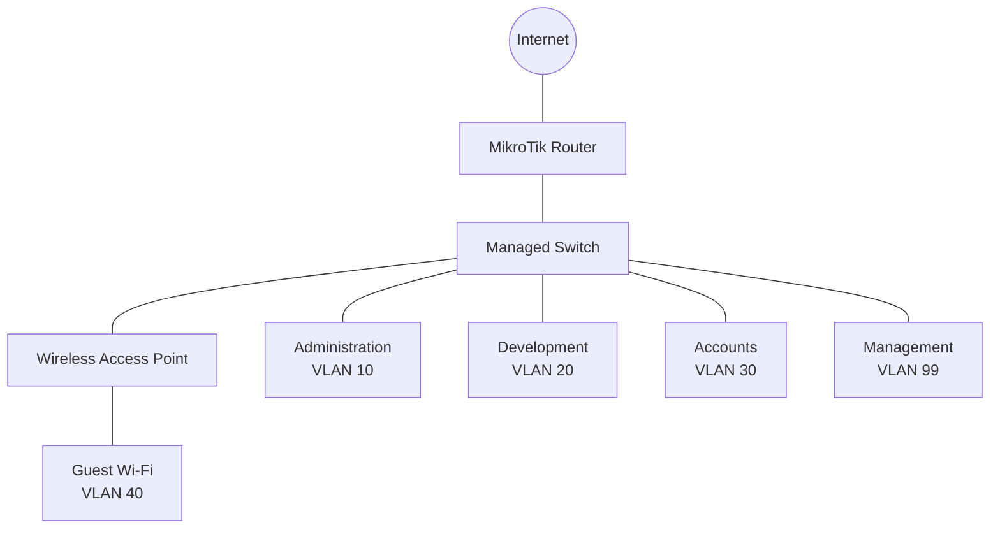
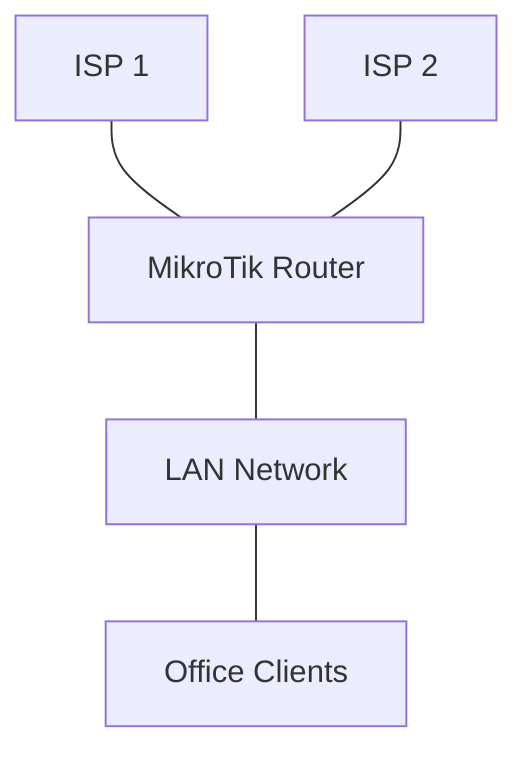
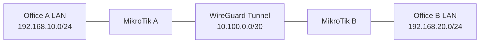
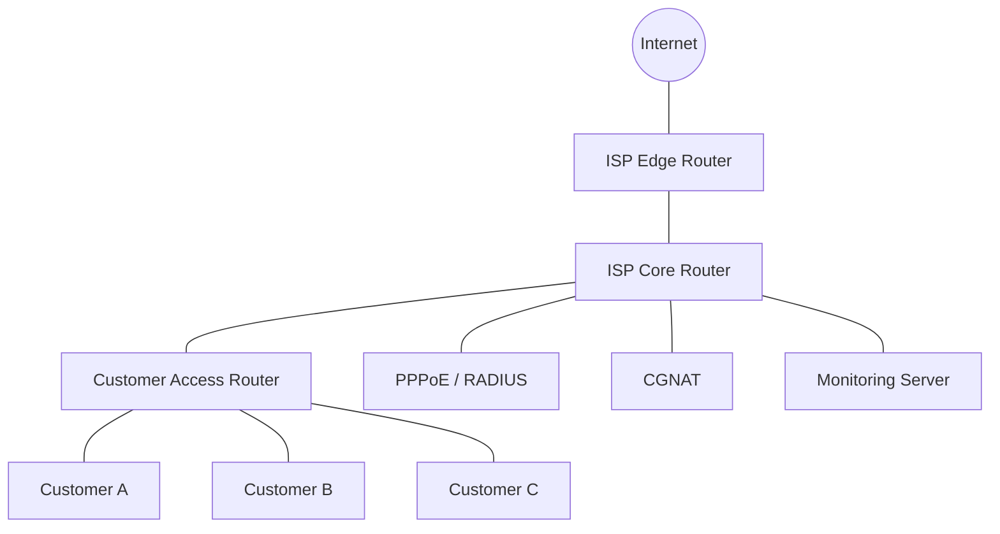

# Capstone Projects

Capstone projects combine the networking concepts covered throughout this knowledge base into complete, practical implementations.

These projects are designed to help you develop real-world networking skills, from network planning and configuration to security, monitoring, troubleshooting, and documentation.

The examples primarily use MikroTik RouterOS v7, Ubuntu Server, VirtualBox, GNS3, and EVE-NG.

# 🗁 Project Objectives

By completing these projects, you will learn how to:

* Design and implement complete network infrastructures.
* Configure routers, switches, VLANs, and IP addressing.
* Implement static and dynamic routing.
* Configure NAT, firewalls, and network segmentation.
* Deploy VPN connections between remote networks.
* Configure ISP services such as PPPoE and bandwidth management.
* Implement WAN failover and load balancing.
* Monitor network health and performance.
* Troubleshoot complex network problems.
* Prepare professional network documentation.

# 🗁 Project: Small Office Network Infrastructure

### 🖆 Project Overview

Design and implement a secure network for a small office with multiple departments.

### 🖆 Network Requirements

The office has the following departments:

| Department | VLAN | Network | Gateway |
| --- | ---: | --- | --- |
| Administration | 10 | 192.168.10.0/24 | 192.168.10.1 |
| Development | 20 | 192.168.20.0/24 | 192.168.20.1 |
| Accounts | 30 | 192.168.30.0/24 | 192.168.30.1 |
| Guest Wi-Fi | 40 | 192.168.40.0/24 | 192.168.40.1 |
| Management | 99 | 192.168.99.0/24 | 192.168.99.1 |

### 🖆 Network Topology



### 🖆 Implementation Tasks

* Configure the router WAN connection.
* Create VLAN interfaces or configure bridge VLAN filtering.
* Configure trunk and access ports.
* Configure inter-VLAN routing.
* Configure DHCP servers for each department.
* Configure internet access using NAT.
* Restrict guest access to internal networks.
* Allow management access only from the management network.
* Configure firewall rules.
* Test connectivity between departments.

### 🖆 Expected Deliverables

* Network topology diagram.
* VLAN and IP addressing plan.
* Router configuration export.
* Switch port configuration.
* Firewall policy documentation.
* Connectivity test results.

# 🗁 Project: Multi-WAN Load Balancing and Failover

### 🖆 Project Overview

Build a network with two independent internet service providers.

The network should distribute traffic across both WAN connections and maintain connectivity when one provider becomes unavailable.

### 🖆 Network Requirements

| Component | Configuration |
| --- | --- |
| WAN 1 | Primary ISP |
| WAN 2 | Secondary ISP |
| LAN | 192.168.50.0/24 |
| Router | MikroTik RouterOS v7 |
| Load balancing | PCC |
| Failover | Gateway health checking |
| NAT | Separate source NAT rules |

### 🖆 Network Topology



### 🖆 Implementation Tasks

* Configure both WAN interfaces.
* Assign IP addresses and gateways.
* Configure connection marking using PCC.
* Configure routing tables for each WAN.
* Implement WAN health checking.
* Configure backup routing.
* Configure NAT for both WAN connections.
* Test traffic distribution.
* Disconnect WAN 1 and verify failover.
* Restore WAN 1 and observe route recovery.

### 🖆 Expected Deliverables

* WAN addressing plan.
* PCC configuration.
* Routing configuration.
* NAT configuration.
* Failover test report.
* Traffic distribution observations.

# 🗁 Project: Site-to-Site VPN Infrastructure

### 🖆 Project Overview

Connect two geographically separated office networks through an encrypted VPN tunnel.

Use WireGuard for the implementation.

### 🖆 Network Requirements

| Component | Site A | Site B |
| --- | --- | --- |
| Router | MikroTik A | MikroTik B |
| LAN | 192.168.10.0/24 | 192.168.20.0/24 |
| VPN address | 10.100.0.1/30 | 10.100.0.2/30 |
| WAN | Public or reachable endpoint | Public or reachable endpoint |

### 🖆 Network Topology



### 🖆 Implementation Tasks

* Configure WireGuard interfaces on both routers.
* Generate and exchange public keys.
* Configure peer endpoints and allowed addresses.
* Assign tunnel IP addresses.
* Configure routes to remote LAN networks.
* Configure firewall rules for WireGuard traffic.
* Allow forwarding between the local and remote LANs.
* Test communication between remote devices.
* Verify tunnel recovery after a temporary WAN interruption.

### 🖆 Expected Deliverables

* VPN topology diagram.
* WireGuard configuration.
* Routing configuration.
* Firewall policy.
* Tunnel connectivity test results.

# 🗁 Project: ISP Network Deployment

### 🖆 Project Overview

Design a small ISP network that provides internet services to multiple customers.

The infrastructure should include customer authentication, bandwidth management, routing, NAT, monitoring, and troubleshooting.

### 🖆 Network Requirements

| Component | Purpose |
| --- | --- |
| Edge Router | Upstream internet connectivity |
| Core Router | Internal ISP routing |
| Access Router | Customer connectivity |
| PPPoE Server | Customer authentication |
| RADIUS Server | Centralized authentication |
| Monitoring Server | Infrastructure monitoring |
| CGNAT | Shared public IPv4 connectivity |

### 🖆 Network Topology



### 🖆 Implementation Tasks

* Design the ISP IP addressing plan.
* Configure upstream connectivity.
* Configure internal routing.
* Deploy PPPoE services.
* Integrate RADIUS authentication.
* Create customer service profiles.
* Configure bandwidth limitations.
* Implement customer isolation.
* Configure CGNAT.
* Configure monitoring and logging.
* Test customer connectivity.
* Document the complete infrastructure.

### 🖆 Expected Deliverables

* ISP network topology.
* IP addressing plan.
* Router configurations.
* PPPoE and RADIUS configuration.
* CGNAT configuration.
* Bandwidth management policies.
* Monitoring dashboard.
* Customer connectivity test report.

# 🗁 Project: Enterprise Network Security

### 🖆 Project Overview

Build a segmented enterprise network with controlled access between departments and secure management services.

### 🖆 Network Requirements

| Security Component | Purpose |
| --- | --- |
| VLAN Segmentation | Separate departments |
| Firewall | Control network traffic |
| ACLs | Restrict access |
| VPN | Secure remote access |
| AAA | Centralized authentication |
| 802.1X | Network access control |
| Logging | Record security events |
| Monitoring | Detect abnormal activity |

### 🖆 Implementation Tasks

* Create separate VLANs for departments.
* Configure inter-VLAN routing.
* Implement least-privilege firewall policies.
* Restrict administrative access.
* Configure secure SSH management.
* Configure VPN access for remote administrators.
* Deploy centralized logging.
* Monitor failed authentication attempts.
* Test unauthorized access scenarios.
* Document security policies.

### 🖆 Expected Deliverables

* Security architecture diagram.
* VLAN and addressing plan.
* Firewall rules.
* Remote access VPN configuration.
* Management access policy.
* Security testing report.

# 🗁 Project: Network Monitoring Infrastructure

### 🖆 Project Overview

Build a centralized monitoring system that tracks network device availability, resource utilization, interface traffic, latency, and packet loss.

### 🖆 Network Requirements

| Component | Purpose |
| --- | --- |
| Ubuntu Server | Monitoring platform |
| Zabbix or LibreNMS | Monitoring application |
| SNMPv3 | Secure device monitoring |
| Syslog | Centralized logging |
| NetFlow/IPFIX | Traffic analysis |
| Alerting | Notify administrators |

### 🖆 Implementation Tasks

* Install a monitoring platform.
* Add MikroTik routers and Linux servers.
* Configure SNMPv3.
* Configure centralized Syslog.
* Monitor interface bandwidth.
* Monitor CPU and memory utilization.
* Track device availability.
* Configure latency and packet-loss checks.
* Create dashboards.
* Configure alert thresholds.
* Test alert delivery.
* Document monitoring results.

### 🖆 Expected Deliverables

* Monitoring architecture.
* SNMP configuration.
* Syslog configuration.
* Device inventory.
* Monitoring dashboard.
* Alerting configuration.
* Performance report.

# 🗁 Project: IPv6 Network Deployment

### 🖆 Project Overview

Deploy a dual-stack network that supports both IPv4 and IPv6 connectivity.

### 🖆 Network Requirements

| Component | IPv4 | IPv6 |
| --- | --- | --- |
| Router LAN | 192.168.100.1/24 | 2001:db8:100::1/64 |
| Server | 192.168.100.10 | 2001:db8:100::10 |
| Client Network | 192.168.100.0/24 | 2001:db8:100::/64 |

The IPv6 prefix shown is documentation-only. Use an assigned prefix or a lab prefix for a real deployment.

### 🖆 Implementation Tasks

* Configure IPv4 and IPv6 addresses.
* Configure IPv6 routing.
* Configure Router Advertisements.
* Configure SLAAC or DHCPv6 as required.
* Configure IPv6 firewall policies.
* Verify IPv6 DNS resolution.
* Test IPv4 and IPv6 connectivity.
* Analyze Neighbor Discovery.
* Test path MTU behavior.
* Document dual-stack operation.

### 🖆 Expected Deliverables

* Dual-stack topology.
* IPv4 and IPv6 addressing plan.
* IPv6 routing configuration.
* IPv6 firewall policy.
* Connectivity test report.

# 🗁 Project: Complete Network Infrastructure

### 🖆 Project Overview

Design and implement a complete network infrastructure that combines enterprise networking, ISP services, security, routing, monitoring, and remote connectivity.

This is the most comprehensive project in this knowledge base.

### 🖆 Infrastructure Requirements

| Area | Required Implementation |
| --- | --- |
| Network Design | Physical and logical topology |
| IP Addressing | IPv4 and IPv6 |
| Switching | VLANs and trunking |
| Routing | Static routing, OSPF, and BGP where appropriate |
| NAT | Source NAT, destination NAT, and CGNAT |
| Firewall | Stateful filtering and segmentation |
| Wireless | Secure Wi-Fi infrastructure |
| VPN | Site-to-site and remote access |
| ISP Services | PPPoE and RADIUS |
| Load Balancing | PCC and WAN failover |
| QoS | Bandwidth management |
| Monitoring | SNMP, Syslog, and traffic analysis |
| Security | AAA and secure management |
| Documentation | Diagrams, configuration, and test reports |

### 🖆 Implementation Phases

**Network Planning**

* Identify network requirements.
* Design physical and logical topology.
* Prepare the IP addressing plan.
* Define VLANs and network segments.
* Identify hardware and software requirements.

**Infrastructure Deployment**

* Configure routers and switches.
* Configure VLANs and trunk links.
* Configure DHCP and DNS.
* Configure routing.
* Establish WAN connectivity.

**Security Implementation**

* Configure firewall policies.
* Restrict management access.
* Implement network segmentation.
* Configure VPN connections.
* Secure administrative accounts.

**Service Deployment**

* Configure internet access.
* Deploy PPPoE services.
* Configure RADIUS authentication.
* Implement bandwidth management.
* Configure load balancing and failover.

**Monitoring and Operations**

* Deploy monitoring services.
* Configure centralized logging.
* Monitor network performance.
* Configure alert notifications.
* Establish troubleshooting procedures.

**Testing and Documentation**

* Test all network segments.
* Verify routing and internet connectivity.
* Test firewall policies.
* Simulate WAN failures.
* Verify VPN connectivity.
* Document configurations and test results.

### 🖆 Final Deliverables

* Complete network topology diagram.
* Physical network diagram.
* Logical network diagram.
* IP addressing plan.
* VLAN documentation.
* Routing configuration.
* Firewall and NAT configuration.
* VPN configuration.
* ISP service configuration.
* Monitoring dashboard.
* Security policy.
* Troubleshooting documentation.
* Backup and recovery procedure.
* Final implementation report.

# 🗁 Project Documentation Standard

For every capstone project, maintain a dedicated project directory with the following structure:

```text
project-name/
├── README.md
├── diagrams/
│   ├── physical-topology.png
│   └── logical-topology.png
├── addressing/
│   └── ip-addressing-plan.md
├── configurations/
│   ├── router-config.rsc
│   └── switch-config.txt
├── security/
│   └── firewall-policy.md
├── testing/
│   └── test-results.md
├── monitoring/
│   └── monitoring-plan.md
└── reports/
    └── implementation-report.md
```

Do not store plaintext passwords, private keys, or other secrets in configuration files committed to a public repository. Use sanitized configuration exports for documentation.

# 🗁 Final Assessment

### 🖆 Technical Assessment

Evaluate your implementation using the following criteria:

| Assessment Area | Weight |
| --- | ---: |
| Network Design | 15% |
| IP Addressing and Subnetting | 10% |
| Switching and VLANs | 10% |
| Routing | 15% |
| Firewall and Security | 15% |
| VPN and Remote Connectivity | 10% |
| Monitoring and Troubleshooting | 10% |
| Documentation | 10% |
| Testing and Verification | 5% |
| **Total** | **100%** |

### 🖆 Completion Checklist

* [ ] Network topology designed.
* [ ] IP addressing plan prepared.
* [ ] VLANs configured.
* [ ] Routing implemented.
* [ ] NAT and firewall configured.
* [ ] Internet connectivity verified.
* [ ] VPN connectivity tested.
* [ ] Bandwidth policies implemented.
* [ ] Monitoring system deployed.
* [ ] Network security tested.
* [ ] Failure scenarios tested.
* [ ] Documentation completed.

# 🗁 Conclusion

These capstone projects bring together the networking concepts covered throughout the knowledge base.

Completing them will help you move beyond individual commands and configurations toward designing, deploying, operating, and maintaining complete network infrastructures.
