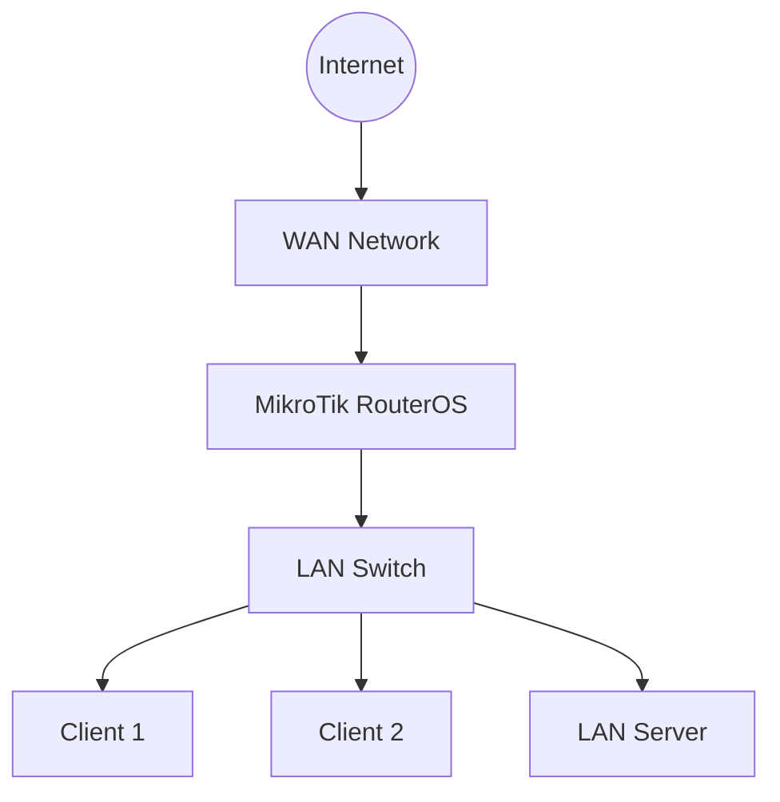

# MikroTik Certified Network Associate (MTCNA) Roadmap

The MikroTik Certified Network Associate (MTCNA) is the foundational certification in the MikroTik training program.

It introduces the essential networking concepts and RouterOS configuration skills required to manage MikroTik routers in small and medium-sized network environments.

MTCNA is an appropriate starting point for anyone who wants to build a career in network administration, network engineering, or ISP operations using MikroTik equipment.

This roadmap organizes the knowledge into theoretical concepts, RouterOS configuration, practical exercises, and examination preparation.

# 🗁 Learning Objectives

After completing this roadmap, you should be able to:

* Understand fundamental networking concepts.
* Explain the OSI and TCP/IP models.
* Configure IPv4 addressing and subnetting.
* Configure MikroTik interfaces and bridges.
* Configure DHCP clients and servers.
* Configure static routing.
* Understand DNS and basic network services.
* Configure NAT and basic firewall rules.
* Configure wireless interfaces.
* Manage users and access permissions.
* Monitor network activity and troubleshoot connectivity.
* Manage RouterOS through WinBox, WebFig, CLI, and SSH.

# 🗁 Prerequisites

Before starting MTCNA preparation, develop a basic understanding of:

* Computer networking fundamentals.
* Ethernet and MAC addresses.
* IPv4 addresses and subnet masks.
* Default gateways and DNS.
* TCP and UDP.
* Basic network troubleshooting.

You do not need advanced routing or network security knowledge to begin.

# 🗁 Networking Fundamentals

Understand the basic technologies that make computer networks work.

### 🖆 Core Concepts

* LAN, WAN, WLAN, and MAN.
* Network topologies.
* Switches, routers, and access points.
* Ethernet and MAC addressing.
* Unicast, broadcast, and multicast.
* OSI and TCP/IP models.
* TCP and UDP.
* Common networking ports and protocols.

### 🖆 IP Addressing

Learn how devices communicate using IP addresses.

* IPv4 addressing.
* Public and private IP addresses.
* Network and host portions.
* Subnet masks.
* CIDR notation.
* Default gateways.
* Static and dynamic addressing.
* Basic subnetting.

### 🖆 Essential Network Services

Understand the purpose of commonly used network services.

* DHCP.
* DNS.
* NAT.
* ICMP.
* ARP.
* HTTP and HTTPS.
* SSH.

# 🗁 RouterOS Fundamentals

Become familiar with the MikroTik RouterOS environment.

### 🖆 RouterOS Introduction

* What is MikroTik RouterOS?
* RouterOS features and capabilities.
* RouterOS v6 and v7 overview.
* MikroTik hardware and software platforms.
* RouterOS licensing.
* RouterOS configuration principles.

### 🖆 Router Management Tools

Learn how to access and manage MikroTik devices.

* WinBox.
* WebFig.
* CLI.
* SSH.
* MAC WinBox access.
* Safe Mode.
* Terminal command structure.

### 🖆 Basic Configuration

Practice essential administrative operations.

* System identity.
* User accounts and permissions.
* Password management.
* Interface identification.
* Router configuration backup.
* Router configuration export.
* RouterOS package management.
* Router reboot and reset procedures.

# 🗁 RouterOS Interface Configuration

Understand how physical and logical interfaces work.

### 🖆 Interface Management

* Physical interfaces.
* Ethernet interfaces.
* Interface naming.
* Interface status.
* Interface enable and disable.
* Interface monitoring.
* Interface statistics.

### 🖆 Bridge Configuration

* Bridge fundamentals.
* Creating a bridge.
* Adding ports to a bridge.
* Understanding Layer 2 connectivity.
* Bridge interface management.

### 🖆 IP Address Configuration

* Assigning IPv4 addresses.
* Configuring subnet masks.
* Assigning multiple addresses.
* Configuring interface-based addressing.
* Verifying IP configuration.

Example:

```routeros
/ip address add address=192.168.10.1/24 interface=bridge
```

# 🗁 DHCP Configuration

Understand how DHCP automatically provides network configuration to clients.

### 🖆 DHCP Client

* DHCP client fundamentals.
* Obtaining an IP address automatically.
* DHCP client interface selection.
* DHCP lease information.
* DHCP client troubleshooting.

Example:

```routeros
/ip dhcp-client add interface=ether1 disabled=no
```

### 🖆 DHCP Server

* DHCP server fundamentals.
* DHCP server setup.
* IP address pools.
* DHCP network configuration.
* Default gateway distribution.
* DNS server distribution.
* DHCP lease management.
* Static DHCP leases.

Example:

```routeros
/ip pool add name=dhcp-pool ranges=192.168.10.100-192.168.10.200

/ip dhcp-server add name=dhcp-server interface=bridge address-pool=dhcp-pool disabled=no

/ip dhcp-server network add address=192.168.10.0/24 gateway=192.168.10.1 dns-server=192.168.10.1
```

# 🗁 DNS Configuration

Understand how domain names are translated into IP addresses.

### 🖆 DNS Fundamentals

* DNS resolution.
* DNS servers.
* Recursive and authoritative DNS.
* DNS caching.
* DNS records.
* DNS troubleshooting.

### 🖆 RouterOS DNS

* Configuring upstream DNS servers.
* Enabling DNS cache.
* Allowing LAN clients to use router DNS.
* Static DNS entries.
* DNS cache monitoring.

Example:

```routeros
/ip dns set servers=1.1.1.1,8.8.8.8 allow-remote-requests=yes
```

Restrict DNS access to trusted networks when enabling remote DNS requests.

# 🗁 Routing Fundamentals

Understand how routers forward packets between different IP networks.

### 🖆 Routing Concepts

* Routing fundamentals.
* Routing tables.
* Connected routes.
* Static routes.
* Default routes.
* Routing distance.
* Gateway selection.
* Route verification.

### 🖆 Static Routing

Configure communication between different networks.

Example:

```routeros
/ip route add dst-address=192.168.20.0/24 gateway=192.168.10.2
```

### 🖆 Default Routing

Configure a default route for destinations not covered by more specific routes.

Example:

```routeros
/ip route add dst-address=0.0.0.0/0 gateway=192.168.1.1
```

Understand how route distance influences route selection and why a configured default route does not automatically guarantee internet connectivity.

# 🗁 NAT Configuration

Understand how Network Address Translation allows private networks to communicate with external networks.

### 🖆 NAT Fundamentals

* NAT concepts.
* Source NAT.
* Destination NAT.
* Masquerade.
* Port forwarding.
* NAT connection tracking.

### 🖆 Source NAT and Masquerade

Configure internet access for private network clients.

Example:

```routeros
/ip firewall nat add chain=srcnat out-interface=ether1 action=masquerade
```

### 🖆 Destination NAT

Understand how incoming connections can be forwarded to internal servers.

Example:

```routeros
/ip firewall nat add chain=dstnat in-interface=ether1 protocol=tcp dst-port=8080 action=dst-nat to-addresses=192.168.10.10 to-ports=80
```

# 🗁 Firewall Fundamentals

Learn how RouterOS firewall rules control network traffic.

### 🖆 Firewall Concepts

* Packet filtering.
* Input, forward, and output chains.
* Accept and drop actions.
* Connection tracking.
* Established and related connections.
* Invalid connections.
* Firewall rule ordering.

### 🖆 Basic Firewall Configuration

Understand how to protect router management services and control forwarded traffic.

Example:

```routeros
/ip firewall filter add chain=input action=accept connection-state=established,related,untracked

/ip firewall filter add chain=input action=drop connection-state=invalid

/ip firewall filter add chain=input action=accept protocol=icmp

/ip firewall filter add chain=input action=drop in-interface=ether1
```

These are illustrative rules, not a complete firewall policy. Rule ordering and trusted management access must be considered before deployment.

# 🗁 Wireless Configuration

Understand how wireless interfaces connect devices to a network.

### 🖆 Wireless Fundamentals

* Wireless networking concepts.
* IEEE 802.11 standards.
* Frequency bands.
* Channels and channel width.
* SSID.
* Wireless security.
* Access point and station modes.
* Signal strength and interference.

### 🖆 RouterOS Wireless Configuration

* Wireless interface management.
* Access point configuration.
* SSID configuration.
* Security profiles.
* Wireless client connectivity.
* Wireless monitoring.

Wireless configuration commands and capabilities vary between legacy wireless drivers and newer RouterOS wireless packages.

# 🗁 Network Monitoring and Troubleshooting

Learn how to verify connectivity and identify network problems.

### 🖆 Monitoring Tools

* Ping.
* Traceroute.
* Torch.
* Interface monitoring.
* IP address monitoring.
* Routing table inspection.
* DHCP lease inspection.
* Log monitoring.
* Resource monitoring.

### 🖆 Troubleshooting Scenarios

Practice resolving common networking issues.

* No IP address received.
* Incorrect subnet mask.
* Incorrect default gateway.
* DNS resolution failure.
* Internet connectivity failure.
* Incorrect NAT configuration.
* Firewall blocking traffic.
* Routing problems.
* Wireless authentication failure.
* Interface connectivity problems.

# 🗁 Practical Lab Exercises

Build a lab environment using MikroTik CHR, VirtualBox, GNS3, or EVE-NG.

### 🖆 Basic Router Setup

* Reset a MikroTik CHR router.
* Configure system identity.
* Configure administrator credentials.
* Identify interfaces.
* Configure WAN and LAN interfaces.
* Verify interface status.

### 🖆 LAN Deployment

* Create a LAN bridge.
* Assign a LAN IP address.
* Configure an IP pool.
* Configure a DHCP server.
* Connect client devices.
* Verify DHCP lease allocation.

### 🖆 Internet Connectivity

* Configure a WAN DHCP client.
* Configure upstream DNS.
* Add a default route when required.
* Configure source NAT.
* Test internet connectivity.
* Troubleshoot connectivity failures.

### 🖆 Firewall Deployment

* Configure input chain protection.
* Allow established and related connections.
* Allow trusted management access.
* Restrict unwanted WAN access.
* Verify firewall rule counters.

### 🖆 Network Services

* Configure DNS caching.
* Configure static DNS entries.
* Create DHCP static leases.
* Configure destination NAT.
* Test internal service access.

### 🖆 Monitoring and Troubleshooting

* Monitor interfaces.
* Use ping and traceroute.
* Inspect routing tables.
* Analyze firewall counters.
* Review RouterOS logs.
* Identify and resolve network failures.

# 🗁 Suggested Lab Topology

Use the following topology to practice a basic MikroTik network.



Example addressing plan:

| Device | Interface | IP Address |
| --- | --- | --- |
| MikroTik Router | WAN | DHCP |
| MikroTik Router | LAN | 192.168.10.1/24 |
| Client 1 | LAN | DHCP |
| Client 2 | LAN | DHCP |
| LAN Server | LAN | 192.168.10.10/24 |

# 🗁 Examination Preparation

Prepare for the examination by combining conceptual understanding with practical configuration experience.

Recommended preparation activities:

* Study official MikroTik MTCNA course materials.
* Understand RouterOS terminology and configuration structure.
* Practice common RouterOS commands.
* Understand networking fundamentals.
* Configure DHCP, DNS, NAT, and firewall services independently.
* Practice static routing.
* Troubleshoot intentionally misconfigured lab environments.
* Review configuration behavior and expected results.
* Follow the current official examination requirements.

Certification course availability, examination arrangements, and assessment requirements should be confirmed through official MikroTik training resources.

# 🗁 Recommended Study Resources

* [MikroTik Official Training](https://mikrotik.com/training)
* [MikroTik RouterOS Documentation](https://help.mikrotik.com/docs/)
* [MikroTik RouterOS Downloads](https://mikrotik.com/download)
* [MikroTik Community Forum](https://forum.mikrotik.com/)

# 🗁 Completion Checklist

Use this checklist to evaluate your preparation.

* [ ] Understand networking fundamentals.
* [ ] Understand IPv4 addressing and subnetting.
* [ ] Understand RouterOS architecture and management tools.
* [ ] Configure interfaces and bridges.
* [ ] Configure IP addresses.
* [ ] Configure DHCP clients and servers.
* [ ] Configure DNS.
* [ ] Configure static and default routes.
* [ ] Configure NAT and masquerade.
* [ ] Understand firewall chains and filtering.
* [ ] Configure wireless networking.
* [ ] Use RouterOS monitoring tools.
* [ ] Troubleshoot common network problems.
* [ ] Complete practical MTCNA lab exercises.
* [ ] Review official examination requirements.

# 🗁 Final Goal

By completing this roadmap, you should be capable of configuring and managing a basic MikroTik network independently.

You should understand how a MikroTik router connects networks, distributes IP addresses, resolves domain names, forwards traffic, applies firewall policies, and provides internet connectivity.

More importantly, you should be able to explain why a configuration works, identify why it fails, and troubleshoot the problem systematically.
