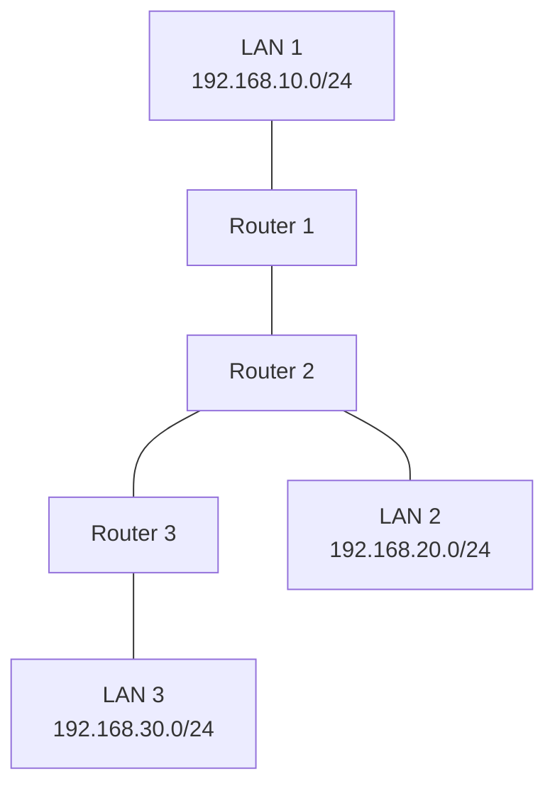

# MikroTik Certified Routing Engineer (MTCRE)

The MikroTik Certified Routing Engineer (MTCRE) is an advanced routing-focused certification in the MikroTik training program.

It builds upon the foundational networking and RouterOS knowledge developed through MTCNA. The primary focus is understanding how routers select paths, exchange routing information, and forward packets between different networks.

MTCRE preparation develops practical skills in static routing, dynamic routing, OSPF, routing tables, route selection, and troubleshooting.

These skills are particularly useful for network engineers working with enterprise networks, multi-router environments, and Internet Service Provider (ISP) infrastructure.

# 🗁 Learning Objectives

After completing this roadmap, you should be able to:

* Understand advanced IP routing concepts.
* Interpret and analyze routing tables.
* Configure static and default routes.
* Understand route selection and administrative distance.
* Configure recursive routing.
* Understand policy-based routing.
* Explain dynamic routing protocols.
* Configure OSPF using RouterOS v7.
* Understand OSPF areas, neighbors, and route advertisements.
* Troubleshoot routing and reachability problems.
* Design and test multi-router network topologies.

# 🗁 Prerequisites

Before starting MTCRE preparation, you should understand:

* IPv4 addressing and subnetting.
* OSI and TCP/IP models.
* Ethernet and MAC addressing.
* RouterOS interface configuration.
* IP address assignment.
* Static and default routing.
* Basic firewall and NAT configuration.
* RouterOS CLI and WinBox.

Completing MTCNA or developing equivalent practical knowledge provides a suitable foundation.

# 🗁 Routing Fundamentals

Understand how routers determine the next hop for IP packets.

### 🖆 Routing Concepts

* What is routing?
* Router forwarding behavior.
* Routing tables.
* Destination networks.
* Next-hop addresses.
* Gateway interfaces.
* Connected routes.
* Static routes.
* Dynamic routes.
* Default routes.
* Route installation and removal.

### 🖆 Routing Table

A routing table contains information that determines how packets reach destination networks.

Important routing table fields include:

* Destination address.
* Gateway or next hop.
* Outgoing interface.
* Route distance.
* Routing protocol information.
* Route status.
* Routing table selection.

RouterOS command:

```routeros
/ip route print detail
```

### 🖆 Longest Prefix Match

Routers use longest prefix matching to select the most specific matching route for a destination.

For example, consider these routes:

| Destination | Next Hop |
| --- | --- |
| 10.0.0.0/8 | 192.0.2.1 |
| 10.10.0.0/16 | 192.0.2.2 |
| 10.10.10.0/24 | 192.0.2.3 |
| 0.0.0.0/0 | 192.0.2.254 |

For destination `10.10.10.50`, the router selects `10.10.10.0/24` because it is the most specific matching prefix.

### 🖆 Route Selection

Understand the difference between:

* Longest prefix match.
* Administrative distance.
* Routing protocol metric.
* Route preference.
* Equal-cost routes.

Administrative distance and routing metrics are not the same thing. Route selection behavior depends on the routing implementation and protocol.

# 🗁 Static Routing

Static routing allows administrators to manually define paths to destination networks.

### 🖆 Static Route Configuration

Understand:

* Static route fundamentals.
* Destination network.
* Gateway configuration.
* Outgoing interface.
* Route distance.
* Route activation.
* Route removal.
* Static route verification.

Example:

```routeros
/ip route add dst-address=192.168.20.0/24 gateway=192.168.10.2
```

### 🖆 Default Routing

A default route provides a path for destinations without a more specific matching route.

Example:

```routeros
/ip route add dst-address=0.0.0.0/0 gateway=192.168.1.1
```

### 🖆 Floating Static Routes

Floating static routes provide an alternative path when a preferred route becomes unavailable.

Example:

```routeros
/ip route add dst-address=192.168.20.0/24 gateway=192.168.10.2 distance=1

/ip route add dst-address=192.168.20.0/24 gateway=192.168.30.2 distance=10
```

The route with the higher distance can serve as a backup when the preferred route is no longer active.

However, route distance alone does not guarantee detection of an upstream failure. Gateway reachability and end-to-end health monitoring must also be considered.

### 🖆 Recursive Routing

Recursive routing allows a router to resolve a route's next hop through another route.

Learn:

* Recursive gateway resolution.
* Gateway reachability.
* Route dependency.
* Recursive route configuration.
* Route scope and target scope in RouterOS.
* Recursive routing for WAN monitoring.
* Recursive routing troubleshooting.

# 🗁 Policy-Based Routing

Policy-based routing allows traffic to use different routing paths based on selected conditions rather than relying exclusively on the main routing table.

### 🖆 Routing Policies

Understand how routing decisions can depend on:

* Source IP address.
* Destination IP address.
* Incoming interface.
* Firewall connection marks.
* Routing marks.
* Routing tables.

### 🖆 RouterOS Routing Tables

Learn how to create and use separate routing tables.

Example:

```routeros
/routing table add name=wan2 fib

/ip route add dst-address=0.0.0.0/0 gateway=192.0.2.2 routing-table=wan2
```

### 🖆 Routing Rules

Understand how RouterOS routing rules select routing tables based on traffic characteristics.

Example:

```routeros
/routing rule add src-address=192.168.20.0/24 action=lookup-only-in-table table=wan2
```

Study the relationship between routing rules, routing marks, firewall mangle, and routing tables.

# 🗁 Dynamic Routing Fundamentals

Dynamic routing protocols automatically exchange network reachability information between routers.

### 🖆 Dynamic Routing Concepts

* Dynamic routing fundamentals.
* Routing protocol operation.
* Neighbor discovery.
* Route advertisement.
* Route learning.
* Route convergence.
* Routing metrics.
* Administrative distance.
* Routing loops.
* Routing protocol authentication.

### 🖆 Static Routing vs Dynamic Routing

| Feature | Static Routing | Dynamic Routing |
| --- | --- | --- |
| Configuration | Manual | Protocol-based |
| Route updates | Administrator-managed | Automatically exchanged |
| Scalability | Limited in large networks | Better for larger networks |
| Resource usage | Generally low | Depends on protocol and topology |
| Failure adaptation | Requires configured alternatives or monitoring | Can recalculate paths |
| Common use | Small or predictable networks | Medium and large networks |

### 🖆 Routing Protocol Categories

Understand the major routing protocol categories:

* Distance-vector routing.
* Link-state routing.
* Path-vector routing.
* Interior Gateway Protocols (IGP).
* Exterior Gateway Protocols (EGP).

Common protocols include RIP, OSPF, IS-IS, and BGP.

# 🗁 OSPF Routing

Open Shortest Path First (OSPF) is a link-state interior gateway routing protocol.

It allows routers within an autonomous system to exchange topology information and calculate paths using the Shortest Path First (SPF) algorithm.

### 🖆 OSPF Fundamentals

Understand:

* OSPF architecture.
* Link-state routing.
* Link-State Advertisements (LSAs).
* Link-State Database (LSDB).
* Shortest Path First algorithm.
* OSPF router ID.
* OSPF areas.
* Backbone Area 0.
* OSPF cost.
* OSPF convergence.

### 🖆 OSPF Neighbor Relationships

Learn how OSPF routers establish and maintain neighbor relationships.

Study these neighbor states:

* Down.
* Attempt.
* Init.
* 2-Way.
* ExStart.
* Exchange.
* Loading.
* Full.

Understand:

* Hello packets.
* Dead intervals.
* Router ID.
* Area ID.
* Network type.
* Authentication compatibility.
* Neighbor formation failures.

### 🖆 OSPF Network Types

Understand common OSPF network types:

* Broadcast.
* Non-broadcast.
* Point-to-point.
* Point-to-multipoint.

Learn how network types influence neighbor discovery, adjacency formation, and designated router elections.

### 🖆 OSPF Router Roles

Understand:

* Internal router.
* Backbone router.
* Area Border Router (ABR).
* Autonomous System Boundary Router (ASBR).
* Designated Router (DR).
* Backup Designated Router (BDR).

### 🖆 OSPF Areas

Learn how OSPF divides large routing domains into manageable areas.

Important concepts:

* Backbone Area 0.
* Regular areas.
* Stub areas.
* Totally stubby areas.
* Not-so-stubby areas (NSSA).
* Inter-area routing.
* Area summarization.

Specific area capabilities and configuration support should be verified against the RouterOS version in use.

### 🖆 OSPF Configuration in RouterOS v7

RouterOS v7 organizes OSPF configuration through instances, areas, and interface templates.

Create an OSPF instance:

```routeros
/routing ospf instance add name=ospf-instance router-id=1.1.1.1
```

Create an OSPF backbone area:

```routeros
/routing ospf area add name=backbone instance=ospf-instance area-id=0.0.0.0
```

Advertise a connected network through an interface template:

```routeros
/routing ospf interface-template add area=backbone networks=192.168.10.0/24
```

Verify OSPF configuration:

```routeros
/routing ospf instance print detail

/routing ospf area print detail

/routing ospf interface-template print detail
```

Monitor OSPF neighbors and learned routes:

```routeros
/routing ospf neighbor print detail

/ip route print detail
```

These commands illustrate the RouterOS v7 configuration structure. A complete deployment must also account for interface selection, addressing, OSPF network type, authentication, and the intended topology.

### 🖆 OSPF Troubleshooting

Practice diagnosing:

* OSPF neighbors not forming.
* Incorrect router ID.
* Area ID mismatch.
* Hello and dead interval mismatch.
* Authentication mismatch.
* Incorrect interface selection.
* Network advertisement problems.
* Missing routes.
* Unexpected OSPF route selection.
* MTU-related adjacency problems.

# 🗁 Route Redistribution and Summarization

Understand how routes from different routing sources can be exchanged.

### 🖆 Route Redistribution

Learn:

* Redistribution fundamentals.
* Connected route redistribution.
* Static route redistribution.
* Dynamic route redistribution.
* Route filtering.
* Redistribution policies.
* Routing loop prevention.

### 🖆 Route Summarization

Route summarization combines multiple contiguous network prefixes into a larger prefix.

For example:

```text
192.168.0.0/24
192.168.1.0/24
192.168.2.0/24
192.168.3.0/24
```

Can be summarized as:

```text
192.168.0.0/22
```

Understand the benefits of summarization:

* Smaller routing tables.
* Reduced routing update information.
* Better routing scalability.
* Simplified network design.

Summarization must be performed carefully to avoid advertising address ranges that are not actually reachable.

# 🗁 Routing Troubleshooting

Develop a systematic method for identifying routing failures.

### 🖆 Routing Table Analysis

Practice checking:

* Destination prefixes.
* Gateway addresses.
* Route distances.
* Route metrics.
* Active and inactive routes.
* Routing table selection.
* Recursive gateway resolution.

Useful commands:

```routeros
/ip route print detail

/ip route print where active

/routing route print detail
```

### 🖆 Connectivity Testing

Use diagnostic tools to identify packet forwarding problems.

```routeros
/ping 192.168.10.1

/tool traceroute 8.8.8.8

/tool torch interface=ether1
```

### 🖆 Common Routing Problems

* Incorrect destination prefix.
* Incorrect gateway.
* Missing return route.
* Overlapping IP networks.
* Incorrect route distance.
* Recursive gateway resolution failure.
* Routing policy mismatch.
* OSPF adjacency failure.
* Incorrect route redistribution.
* Firewall blocking routing traffic.
* MTU-related communication problems.

# 🗁 Practical Lab Exercises

Use MikroTik CHR in VirtualBox, GNS3, or EVE-NG to build multi-router topologies.

### 🖆 Static Routing Lab

Create a topology with three routers connected in sequence.

* Configure IP addresses.
* Configure connected networks.
* Add static routes.
* Configure return routes.
* Test end-to-end communication.
* Inspect routing tables.

### 🖆 Floating Static Route Lab

Create primary and backup paths between two networks.

* Configure primary static routes.
* Configure backup routes with higher distance.
* Test route selection.
* Simulate link failure.
* Verify backup route activation.
* Test end-to-end reachability.

### 🖆 Recursive Routing Lab

Build a topology with multiple WAN gateways.

* Configure recursive gateway routes.
* Configure appropriate route scopes.
* Monitor upstream reachability.
* Simulate upstream failure.
* Verify route changes.
* Troubleshoot recursive resolution.

### 🖆 Policy-Based Routing Lab

Create two WAN connections and separate LAN client networks.

* Configure separate routing tables.
* Configure WAN gateways.
* Create routing rules.
* Assign different source networks to different WANs.
* Verify traffic paths.
* Troubleshoot routing policy behavior.

### 🖆 OSPF Lab

Build a topology with three or more MikroTik routers.

* Configure router IDs.
* Configure OSPF instances.
* Configure OSPF areas.
* Configure interface templates.
* Establish neighbor relationships.
* Advertise connected networks.
* Verify learned routes.
* Simulate link failure.
* Observe route convergence.

### 🖆 Route Redistribution Lab

Build a network using static and OSPF routing.

* Configure static routes.
* Configure OSPF.
* Study route redistribution.
* Apply route filtering.
* Verify advertised routes.
* Identify potential routing loops.

# 🗁 Suggested Lab Topology

Use the following multi-router topology to practice static routing and OSPF.



Example point-to-point addressing plan:

| Connection | Network | Router Interface Addresses |
| --- | --- | --- |
| R1–R2 | 10.0.12.0/30 | R1: 10.0.12.1, R2: 10.0.12.2 |
| R2–R3 | 10.0.23.0/30 | R2: 10.0.23.1, R3: 10.0.23.2 |
| LAN 1 | 192.168.10.0/24 | R1: 192.168.10.1 |
| LAN 2 | 192.168.20.0/24 | R2: 192.168.20.1 |
| LAN 3 | 192.168.30.0/24 | R3: 192.168.30.1 |

# 🗁 Examination Preparation

Prepare for MTCRE by combining theoretical understanding with practical routing configuration.

Recommended preparation activities:

* Review IP addressing and subnetting.
* Understand routing table selection.
* Practice static and default routing.
* Understand recursive routing.
* Study policy-based routing.
* Understand dynamic routing concepts.
* Configure OSPF using RouterOS v7.
* Understand OSPF neighbor states and area architecture.
* Practice route redistribution and summarization.
* Troubleshoot multi-router networks.
* Review official MikroTik training materials.

Use the current official MTCRE course outline and examination requirements as the authoritative preparation reference.

# 🗁 Recommended Study Resources

* [MikroTik Official Training](https://mikrotik.com/training)
* [MikroTik RouterOS Documentation](https://help.mikrotik.com/docs/)
* [RouterOS Routing Documentation](https://help.mikrotik.com/docs/spaces/ROS/pages/328084/IP+Routing)
* [MikroTik Community Forum](https://forum.mikrotik.com/)

# 🗁 Completion Checklist

* [ ] Understand routing fundamentals.
* [ ] Analyze routing tables.
* [ ] Understand longest prefix matching.
* [ ] Configure static routes.
* [ ] Configure default routes.
* [ ] Configure floating static routes.
* [ ] Understand recursive routing.
* [ ] Configure separate routing tables.
* [ ] Understand policy-based routing.
* [ ] Understand dynamic routing protocols.
* [ ] Understand OSPF architecture.
* [ ] Understand OSPF neighbor states.
* [ ] Configure OSPF using RouterOS v7.
* [ ] Understand OSPF areas and router roles.
* [ ] Understand route redistribution.
* [ ] Understand route summarization.
* [ ] Troubleshoot multi-router networks.
* [ ] Complete practical MTCRE lab exercises.
* [ ] Review official examination requirements.

# 🗁 Final Goal

By completing this roadmap, you should be able to design, configure, analyze, and troubleshoot routed networks using MikroTik RouterOS.

You should understand how routers select paths, how routing protocols exchange network information, how OSPF establishes neighbor relationships, and how routing policies influence packet forwarding.

The ultimate goal is to develop the practical routing engineering skills required to operate reliable enterprise and ISP networks.
