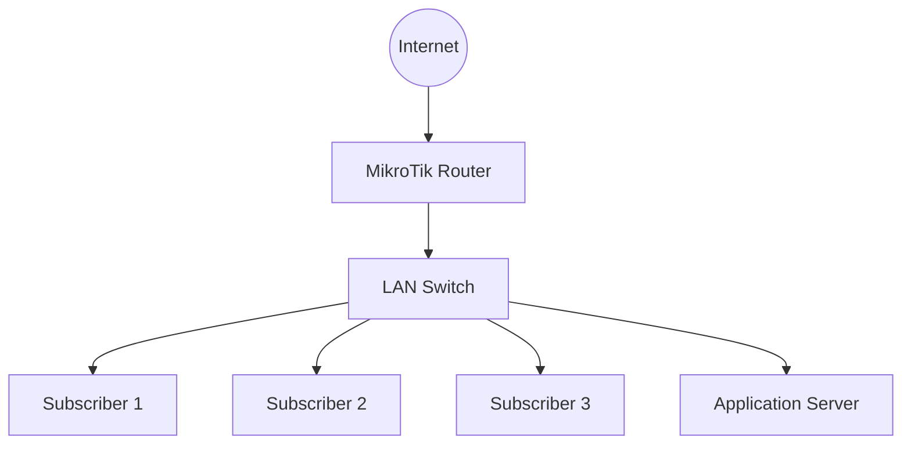

# MikroTik Certified Traffic Control Engineer (MTCTCE)

The MikroTik Certified Traffic Control Engineer (MTCTCE) is a specialized certification focused on traffic management, bandwidth control, packet processing, and Quality of Service (QoS) using MikroTik RouterOS.

Traffic control is an essential part of network administration, particularly in environments where multiple users, applications, and services share limited network resources.

A network engineer must understand how to identify traffic, control bandwidth consumption, prioritize important applications, and maintain acceptable network performance.

This roadmap covers RouterOS packet processing, firewall mangle, queues, traffic shaping, bandwidth allocation, connection tracking, and traffic monitoring.

The primary objective is to develop practical skills for managing network traffic efficiently in enterprise networks and ISP environments.

# 🗁 Learning Objectives

After completing this roadmap, you should be able to:

* Understand traffic control fundamentals.
* Explain bandwidth, throughput, latency, jitter, and packet loss.
* Understand RouterOS packet processing.
* Identify network traffic using firewall mangle.
* Understand connection tracking and connection marks.
* Configure packet marks and routing marks.
* Configure Simple Queues.
* Configure Queue Trees.
* Understand PCQ queue types.
* Apply bandwidth limits to individual users.
* Prioritize important network traffic.
* Understand traffic shaping and policing.
* Monitor traffic consumption.
* Troubleshoot bandwidth and performance problems.

# 🗁 Prerequisites

Before starting MTCTCE preparation, you should understand:

* Networking fundamentals.
* IPv4 addressing and subnetting.
* TCP and UDP.
* Routing and switching.
* NAT and firewall fundamentals.
* MikroTik RouterOS administration.
* Firewall filter and NAT rules.
* Basic network monitoring.

Completing MTCNA or having equivalent RouterOS experience is recommended.

# 🗁 Traffic Control Fundamentals

Understand how network traffic consumes available bandwidth and how routers manage it.

### 🖆 Bandwidth and Throughput

Learn the difference between:

* Bandwidth.
* Throughput.
* Goodput.
* Upload speed.
* Download speed.
* Available bandwidth.
* Network capacity.

Bandwidth represents the capacity of a network connection, while throughput represents the actual rate of data transfer.

### 🖆 Network Performance Metrics

Understand the major performance indicators:

* Latency.
* Round-trip time (RTT).
* Jitter.
* Packet loss.
* Throughput.
* Interface utilization.
* Congestion.
* Queue delay.

### 🖆 Traffic Management Concepts

Study:

* Traffic classification.
* Traffic prioritization.
* Bandwidth allocation.
* Bandwidth limitation.
* Traffic shaping.
* Traffic policing.
* Queue management.
* Congestion management.
* Fair bandwidth distribution.

### 🖆 Traffic Control Objectives

Traffic control helps administrators:

* Prevent individual users from consuming excessive bandwidth.
* Allocate bandwidth fairly.
* Prioritize important applications.
* Reduce network congestion.
* Protect latency-sensitive services.
* Maintain predictable network performance.

# 🗁 RouterOS Packet Processing

Understand how packets move through RouterOS and how firewall facilities interact with traffic control.

### 🖆 Packet Flow

Study the RouterOS packet flow architecture.

Understand:

* Incoming packets.
* Prerouting.
* Input.
* Forward.
* Output.
* Postrouting.
* Connection tracking.
* Routing decisions.
* NAT processing.
* Queue processing.

The packet path differs depending on whether traffic is destined for the router itself, forwarded through the router, or generated locally.

### 🖆 Connection Tracking

Connection tracking allows RouterOS to maintain information about network connections.

Learn:

* Connection tracking fundamentals.
* Connection states.
* New connections.
* Established connections.
* Related connections.
* Invalid connections.
* Connection table.
* Connection timeouts.
* Connection tracking behavior.

Useful command:

```routeros
/ip firewall connection print
```

### 🖆 FastTrack

Understand FastTrack and its impact on packet processing.

Study:

* FastTrack fundamentals.
* FastTrack connection handling.
* Performance improvements.
* FastTrack limitations.
* Interaction with firewall processing.
* Interaction with queues and traffic accounting.

FastTrack can bypass parts of the normal packet-processing path. Traffic that requires queue processing, detailed firewall handling, or certain forms of accounting must be evaluated carefully before enabling it.

# 🗁 Firewall Mangle

Firewall mangle is used to classify and mark packets and connections for further processing.

### 🖆 Mangle Fundamentals

Understand:

* Mangle chains.
* Connection marks.
* Packet marks.
* Routing marks.
* Traffic classification.
* Rule ordering.
* Match conditions.
* Marking actions.

### 🖆 Mangle Chains

Study the purpose of:

* Prerouting.
* Input.
* Forward.
* Output.
* Postrouting.

Understand how packet direction and routing decisions influence which chain should be used.

### 🖆 Connection Marking

Connection marks classify connections so that subsequent packets belonging to those connections can be identified.

Example:

```routeros
/ip firewall mangle add chain=prerouting src-address=192.168.10.0/24 connection-state=new action=mark-connection new-connection-mark=lan-connections passthrough=yes
```

### 🖆 Packet Marking

Packet marks classify packets for queue processing or other traffic-management operations.

Example:

```routeros
/ip firewall mangle add chain=forward connection-mark=lan-connections action=mark-packet new-packet-mark=lan-packets passthrough=no
```

Understand the relationship between connection marks and packet marks.

### 🖆 Routing Marks

Routing marks identify traffic that should use a particular routing table.

Study:

* Routing mark fundamentals.
* Routing table selection.
* Policy-based routing.
* Connection-based routing decisions.
* Interaction between mangle and routing rules.

Routing marks are not interchangeable with packet marks used by queues.

# 🗁 Simple Queues

Simple Queues provide a straightforward way to control bandwidth for individual IP addresses and network ranges.

### 🖆 Simple Queue Fundamentals

Understand:

* Queue targets.
* Maximum upload rate.
* Maximum download rate.
* Queue limits.
* Queue priority.
* Parent queues.
* Packet classification.
* Queue statistics.

### 🖆 Basic Simple Queue Configuration

Example:

```routeros
/queue simple add name=client-01 target=192.168.10.10/32 max-limit=5M/20M
```

In this example:

* Upload limit: 5 Mbps.
* Download limit: 20 Mbps.

For Simple Queues, the `max-limit` values are expressed as upload/download.

### 🖆 Multiple Client Queues

Create bandwidth limits for multiple clients.

```routeros
/queue simple add name=client-01 target=192.168.10.10/32 max-limit=5M/20M

/queue simple add name=client-02 target=192.168.10.11/32 max-limit=3M/10M

/queue simple add name=client-03 target=192.168.10.12/32 max-limit=2M/8M
```

### 🖆 Queue Priority

Understand how queue priority influences bandwidth allocation when queues compete for available resources.

Learn:

* Priority values.
* Queue scheduling.
* Parent and child queue relationships.
* Bandwidth contention.
* Priority limitations.

### 🖆 Simple Queue Ordering

Understand how Simple Queues are evaluated and how queue order can affect matching and performance.

Study:

* Queue target matching.
* First matching queue behavior.
* Parent and child queues.
* Queue hierarchy.
* Queue counters.

# 🗁 Queue Types

Queue types define how packets are scheduled and managed.

### 🖆 Queue Type Fundamentals

Understand:

* FIFO.
* SFQ.
* RED.
* PCQ.
* Queue size.
* Packet scheduling.
* Queue discipline.

### 🖆 FIFO

First In, First Out processes packets in the order they enter the queue.

Understand its simplicity and its limitations during congestion.

### 🖆 SFQ

Stochastic Fairness Queuing distributes transmission opportunities across traffic flows.

Learn how SFQ helps prevent a single flow from monopolizing the queue.

### 🖆 RED

Random Early Detection attempts to manage congestion by probabilistically dropping packets before a queue becomes completely full.

Understand:

* Minimum threshold.
* Maximum threshold.
* Average queue size.
* Early packet dropping.
* Congestion behavior.

### 🖆 PCQ

Per Connection Queue (PCQ) helps distribute bandwidth among multiple users or traffic flows.

Learn:

* PCQ fundamentals.
* Classifiers.
* PCQ rate.
* PCQ limit.
* PCQ total limit.
* PCQ burst behavior.
* PCQ queue statistics.

# 🗁 PCQ Configuration

PCQ is particularly useful in ISP networks where administrators need to distribute bandwidth fairly among many subscribers.

### 🖆 PCQ Classifiers

Understand common classifiers:

* Source address.
* Destination address.
* Source port.
* Destination port.

For subscriber bandwidth distribution, source and destination address classifiers are commonly used for upload and download traffic respectively.

### 🖆 Creating PCQ Queue Types

Example:

```routeros
/queue type add name=pcq-upload kind=pcq pcq-classifier=src-address pcq-rate=5M

/queue type add name=pcq-download kind=pcq pcq-classifier=dst-address pcq-rate=20M
```

### 🖆 Applying PCQ to Simple Queues

Example:

```routeros
/queue simple add name=LAN-PCQ target=192.168.10.0/24 queue=pcq-upload/pcq-download max-limit=100M/500M
```

In this example, the queue types define per-class upload and download limits, while the Simple Queue maximum limits define the overall upload/download ceiling.

### 🖆 PCQ Use Cases

Practice PCQ for:

* Home networks.
* Office networks.
* Public Wi-Fi.
* ISP subscriber networks.
* Shared bandwidth environments.
* Fair bandwidth distribution.

# 🗁 Queue Trees

Queue Trees provide hierarchical traffic management using packet marks and parent-child queue structures.

### 🖆 Queue Tree Fundamentals

Understand:

* Queue Tree architecture.
* Parent queues.
* Child queues.
* Packet marks.
* Queue types.
* Maximum limits.
* Priority.
* Queue hierarchy.
* Global and interface-related queue parents.

### 🖆 Packet Marking for Queue Trees

Traffic must be classified and marked before packet marks can be used by corresponding Queue Tree entries.

Example:

```routeros
/ip firewall mangle add chain=forward src-address=192.168.10.0/24 action=mark-packet new-packet-mark=lan-upload passthrough=yes

/ip firewall mangle add chain=forward dst-address=192.168.10.0/24 action=mark-packet new-packet-mark=lan-download passthrough=yes
```

These are basic classification examples. A production design must account for packet direction, connection tracking, routing, NAT, and possible double matching.

### 🖆 Queue Tree Configuration

Example:

```routeros
/queue tree add name=LAN-Upload parent=ether1 packet-mark=lan-upload max-limit=100M

/queue tree add name=LAN-Download parent=bridge packet-mark=lan-download max-limit=500M
```

The parent interface must match the actual packet direction and topology. Queue Tree parent selection is important because it determines where traffic is controlled.

### 🖆 Hierarchical Queues

Understand how hierarchical queue structures organize bandwidth.

Example:

```text
WAN
├── Upload
│   ├── High Priority
│   ├── Normal Priority
│   └── Low Priority
└── Download
    ├── High Priority
    ├── Normal Priority
    └── Low Priority
```

Study how parent maximum limits and child queue limits interact.

# 🗁 Quality of Service (QoS)

QoS prioritizes important network traffic to improve application performance during congestion.

### 🖆 QoS Fundamentals

Understand:

* Traffic classification.
* Traffic marking.
* Traffic scheduling.
* Queue prioritization.
* Bandwidth reservation.
* Congestion management.
* Service differentiation.

### 🖆 Traffic Categories

Study common traffic categories:

* Voice over IP.
* Video conferencing.
* Streaming media.
* Web browsing.
* File downloads.
* Online gaming.
* Business applications.
* Background synchronization.

### 🖆 QoS Prioritization

Understand how different applications have different performance requirements.

| Traffic Type | Important Requirement |
| --- | --- |
| VoIP | Low latency and jitter |
| Video conferencing | Low latency and stable throughput |
| Online gaming | Low latency and low packet loss |
| Web browsing | Responsive connection |
| File downloads | High throughput |
| Background updates | Lower priority during congestion |

QoS does not create additional bandwidth. It manages how available bandwidth is shared.

### 🖆 DSCP and Priority Marking

Understand:

* Differentiated Services Code Point (DSCP).
* IP precedence.
* Layer 2 priority.
* Packet marking.
* Traffic classification.
* Priority preservation across network devices.

# 🗁 Traffic Shaping and Policing

Understand the difference between traffic shaping and traffic policing.

### 🖆 Traffic Shaping

Traffic shaping controls the rate at which packets are transmitted.

Learn:

* Rate limiting.
* Burst handling.
* Queue buffering.
* Packet scheduling.
* Traffic smoothing.
* Congestion management.

### 🖆 Traffic Policing

Traffic policing measures traffic against configured limits and can drop or remark packets that exceed the permitted rate.

Study:

* Traffic rate measurement.
* Burst allowance.
* Exceeding traffic limits.
* Packet dropping.
* Rate enforcement.

### 🖆 Token Bucket Concepts

Understand how token bucket algorithms control traffic rates.

Study:

* Token generation.
* Token consumption.
* Burst capacity.
* Committed information rate.
* Peak information rate.

# 🗁 Bandwidth Management

Develop practical bandwidth allocation strategies for different network environments.

### 🖆 Per-User Bandwidth Management

Learn how to:

* Identify individual users.
* Assign bandwidth limits.
* Create user-specific queues.
* Monitor consumption.
* Adjust bandwidth profiles.
* Prevent excessive bandwidth usage.

### 🖆 Shared Bandwidth Management

Understand:

* Shared bandwidth pools.
* Aggregate bandwidth limits.
* Fair bandwidth distribution.
* Per-user rate limits.
* Parent queue limitations.
* Subscriber contention.

### 🖆 Burst Configuration

Understand burst mechanisms.

Study:

* Burst limit.
* Burst threshold.
* Burst time.
* Average rate.
* Burst behavior.
* Real-world burst use cases.

Burst configuration can temporarily allow traffic above the normal queue rate when the measured average rate is below the configured threshold.

# 🗁 Traffic Monitoring and Analysis

Learn how to inspect traffic consumption and identify bandwidth problems.

### 🖆 RouterOS Monitoring Tools

Understand:

* Torch.
* Interface monitoring.
* Queue statistics.
* Firewall counters.
* Connection tracking.
* Traffic graphs.
* Packet capture.
* Resource monitoring.

### 🖆 Torch

Torch provides real-time traffic information for selected interfaces.

Example:

```routeros
/tool torch interface=ether1
```

Learn how to inspect:

* Source addresses.
* Destination addresses.
* Protocols.
* Ports.
* Traffic rates.
* Packet rates.

### 🖆 Queue Monitoring

Inspect Simple Queue statistics:

```routeros
/queue simple print stats
```

Inspect Queue Tree statistics:

```routeros
/queue tree print stats
```

Understand how queue counters help identify traffic matching and bandwidth usage.

# 🗁 Troubleshooting Traffic Control

Develop a systematic approach to diagnosing traffic management problems.

### 🖆 Common Problems

* Incorrect upload or download limits.
* Queue not matching traffic.
* Incorrect packet marks.
* Incorrect connection marks.
* Queue ordering problems.
* Queue Tree parent selection errors.
* Incorrect queue type.
* PCQ classifier mismatch.
* FastTrack bypassing queue processing.
* Incorrect interface selection.
* Unexpected bandwidth consumption.
* Excessive latency during congestion.

### 🖆 Troubleshooting Methodology

Follow a structured process:

* Identify the affected user or traffic type.
* Check interface utilization.
* Inspect queue statistics.
* Verify queue targets.
* Inspect firewall mangle counters.
* Verify packet and connection marks.
* Check FastTrack configuration.
* Review queue hierarchy.
* Test upload and download separately.
* Verify the results under controlled traffic conditions.

# 🗁 Practical Lab Exercises

Use MikroTik CHR in VirtualBox, GNS3, or EVE-NG to practice traffic management.

### 🖆 Simple Queue Lab

* Configure a LAN network.
* Connect multiple client devices.
* Create Simple Queues.
* Apply different bandwidth limits.
* Generate upload and download traffic.
* Observe queue statistics.
* Verify bandwidth restrictions.

### 🖆 PCQ Lab

* Configure a shared LAN network.
* Create PCQ upload and download types.
* Apply PCQ to the LAN.
* Generate traffic from multiple clients.
* Observe per-client bandwidth distribution.
* Adjust PCQ rates and overall limits.

### 🖆 Queue Tree Lab

* Configure packet marking.
* Create upload and download queue trees.
* Configure parent limits.
* Create child queues.
* Apply different priorities.
* Generate multiple traffic types.
* Observe queue behavior.

### 🖆 QoS Lab

* Identify different traffic categories.
* Mark latency-sensitive traffic.
* Assign different queue priorities.
* Generate competing traffic.
* Compare latency and packet loss.
* Evaluate QoS effectiveness during congestion.

### 🖆 Bandwidth Management Lab

* Create individual subscriber queues.
* Configure shared bandwidth.
* Configure burst limits.
* Monitor subscriber consumption.
* Test bandwidth fairness.
* Troubleshoot incorrect limits.

### 🖆 ISP Bandwidth Management Lab

Build a simulated ISP subscriber network.

* Configure a subscriber LAN.
* Create individual subscriber profiles.
* Apply per-user bandwidth limits.
* Configure PCQ.
* Configure aggregate bandwidth limits.
* Monitor traffic consumption.
* Simulate peak-hour congestion.

# 🗁 Suggested Lab Topology

Use this topology to practice subscriber bandwidth management.



Example addressing plan:

| Device | IP Address |
| --- | --- |
| MikroTik LAN Gateway | 192.168.10.1/24 |
| Subscriber 1 | 192.168.10.10 |
| Subscriber 2 | 192.168.10.11 |
| Subscriber 3 | 192.168.10.12 |
| Application Server | 192.168.10.100 |

Example bandwidth policy:

| Subscriber | Upload Limit | Download Limit |
| --- | ---: | ---: |
| Subscriber 1 | 5 Mbps | 20 Mbps |
| Subscriber 2 | 3 Mbps | 10 Mbps |
| Subscriber 3 | 2 Mbps | 8 Mbps |

# 🗁 Examination Preparation

Prepare for MTCTCE by combining theoretical knowledge with practical traffic management exercises.

Recommended preparation activities:

* Understand RouterOS packet processing.
* Study connection tracking.
* Practice firewall mangle.
* Understand connection and packet marking.
* Configure Simple Queues.
* Understand Queue Trees.
* Configure PCQ queue types.
* Study QoS concepts.
* Understand traffic shaping and policing.
* Practice bandwidth management.
* Analyze queue statistics.
* Troubleshoot FastTrack and queue interactions.
* Review official MikroTik training materials.

Use the current official MikroTik MTCTCE course outline and examination requirements as the authoritative preparation reference.

# 🗁 Recommended Study Resources

* [MikroTik Official Training](https://mikrotik.com/training)
* [MikroTik RouterOS Documentation](https://help.mikrotik.com/docs/)
* [MikroTik Queues Documentation](https://help.mikrotik.com/docs/display/ROS/Queues)
* [MikroTik Firewall Documentation](https://help.mikrotik.com/docs/display/ROS/Firewall)
* [MikroTik Community Forum](https://forum.mikrotik.com/)

# 🗁 Completion Checklist

* [ ] Understand bandwidth and throughput.
* [ ] Understand latency, jitter, and packet loss.
* [ ] Understand RouterOS packet flow.
* [ ] Understand connection tracking.
* [ ] Understand FastTrack behavior.
* [ ] Understand firewall mangle.
* [ ] Configure connection marks.
* [ ] Configure packet marks.
* [ ] Understand routing marks.
* [ ] Configure Simple Queues.
* [ ] Understand queue types.
* [ ] Configure PCQ.
* [ ] Configure Queue Trees.
* [ ] Understand QoS fundamentals.
* [ ] Understand traffic shaping and policing.
* [ ] Understand burst configuration.
* [ ] Monitor traffic using Torch.
* [ ] Analyze queue statistics.
* [ ] Troubleshoot traffic control problems.
* [ ] Complete practical MTCTCE lab exercises.
* [ ] Review official examination requirements.

# 🗁 Final Goal

By completing this roadmap, you should be able to manage bandwidth, classify network traffic, configure queue structures, and prioritize important applications using MikroTik RouterOS.

You should understand how Simple Queues, Queue Trees, PCQ, firewall mangle, and QoS work together to control network traffic.

The ultimate goal is to develop the practical traffic engineering skills required to maintain fair bandwidth distribution and reliable network performance in enterprise and ISP environments.
