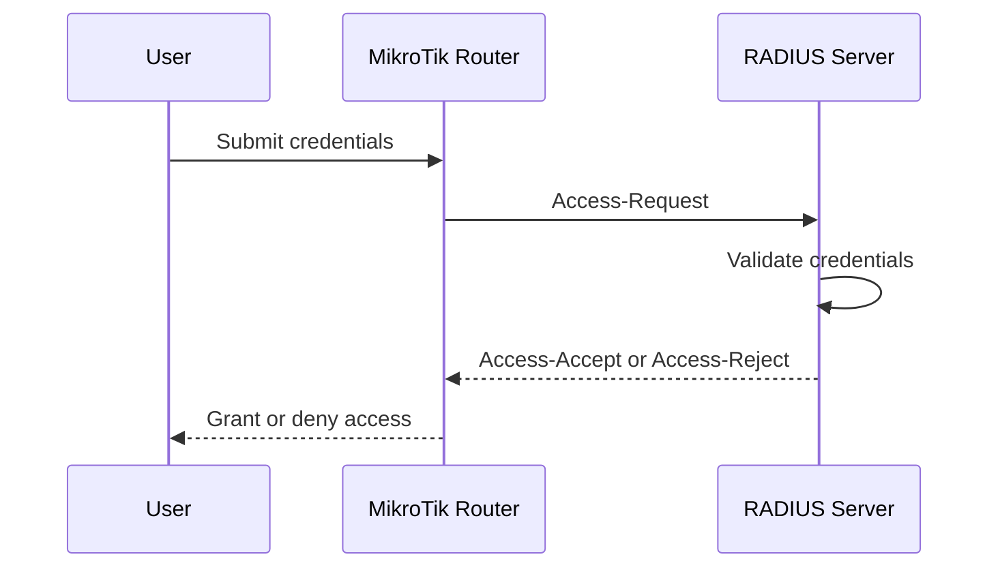
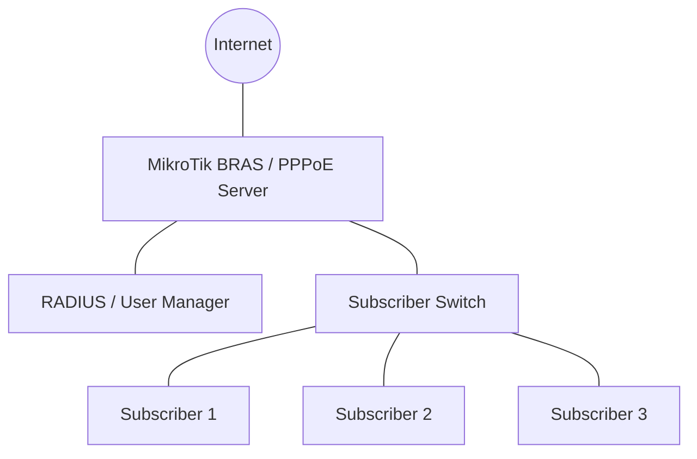

# MikroTik Certified User Management Engineer (MTCUME)

The MikroTik Certified User Management Engineer (MTCUME) is a specialized certification focused on user authentication, authorization, accounting, and access management using MikroTik RouterOS.

User management is an important part of enterprise networking and Internet Service Provider (ISP) operations. Network administrators need to control who can access network services, authenticate subscribers, assign bandwidth profiles, monitor sessions, and manage user permissions.

This roadmap covers PPP, PPPoE, Hotspot, RADIUS, User Manager, authentication methods, subscriber management, and centralized access control.

The primary objective is to develop practical skills for managing network users and delivering controlled network services.

# 🗁 Learning Objectives

After completing this roadmap, you should be able to:

* Understand authentication, authorization, and accounting (AAA).
* Configure PPP and PPP profiles.
* Configure PPPoE servers and clients.
* Manage PPPoE subscriber sessions.
* Configure Hotspot services.
* Manage Hotspot users and user profiles.
* Understand RADIUS authentication.
* Configure RouterOS as a RADIUS client.
* Understand User Manager.
* Manage centralized user accounts.
* Apply bandwidth profiles to subscribers.
* Monitor active user sessions.
* Troubleshoot authentication and accounting problems.

# 🗁 Prerequisites

Before starting MTCUME preparation, you should understand:

* Networking fundamentals.
* IPv4 addressing and subnetting.
* Routing and switching.
* NAT and firewall configuration.
* DHCP and DNS.
* MikroTik RouterOS administration.
* Basic PPP and PPPoE concepts.
* Basic server and authentication concepts.

Completing MTCNA or having equivalent RouterOS knowledge is recommended.

# 🗁 User Management Fundamentals

Understand how network administrators control access to network services.

### 🖆 User Management Concepts

Study:

* User authentication.
* User authorization.
* User accounting.
* Identity management.
* Access control.
* Session management.
* Subscriber management.
* Centralized authentication.
* Local authentication.
* Remote authentication.

### 🖆 AAA Architecture

AAA represents three major components of access management.

| Component | Purpose |
| --- | --- |
| Authentication | Verifies the identity of a user |
| Authorization | Determines which services or resources the user can access |
| Accounting | Records user activity and session information |

Understand how AAA is used in enterprise networks, ISP environments, wireless networks, and remote access systems.

### 🖆 Local and Centralized Authentication

Understand the differences between:

**Local authentication**

* User accounts are stored on individual network devices.
* Each router manages its own user database.
* Suitable for small environments.
* Requires separate account management across multiple devices.

**Centralized authentication**

* User accounts are managed by a central authentication system.
* Multiple network devices can use the same authentication infrastructure.
* Simplifies subscriber management.
* Supports centralized accounting and policy enforcement.

# 🗁 Point-to-Point Protocol (PPP)

Understand PPP as a Layer 2 protocol used to establish point-to-point connections.

### 🖆 PPP Fundamentals

Learn:

* PPP architecture.
* PPP encapsulation.
* Link Control Protocol (LCP).
* Network Control Protocol (NCP).
* Authentication mechanisms.
* PPP session establishment.
* PPP session termination.
* PPP negotiation.

### 🖆 PPP Authentication

Understand common PPP authentication methods:

* PAP.
* CHAP.
* MS-CHAP.
* MS-CHAPv2.

Learn their authentication processes and security characteristics.

### 🖆 PPP Profiles

PPP profiles define configuration parameters applied to PPP sessions.

Study:

* Local address.
* Remote address.
* DNS configuration.
* Session limits.
* Idle timeout.
* Session timeout.
* Rate limits.
* Address pools.
* Profile assignment.

Example:

```routeros
/ppp profile add name=basic-profile local-address=10.10.10.1 remote-address=pppoe-pool dns-server=1.1.1.1,8.8.8.8 rate-limit=5M/20M
```

In this example, the rate-limit values represent upload/download.

# 🗁 PPPoE

Point-to-Point Protocol over Ethernet (PPPoE) allows PPP sessions to be established over Ethernet networks.

PPPoE is commonly used by ISPs to authenticate subscribers and manage their internet connections.

### 🖆 PPPoE Fundamentals

Understand:

* PPPoE architecture.
* PPPoE discovery.
* PPPoE session establishment.
* PPP encapsulation.
* PPPoE client.
* PPPoE server.
* Service names.
* Session management.
* Maximum transmission unit (MTU).
* Maximum receive unit (MRU).

### 🖆 PPPoE Discovery Process

Understand the four main discovery stages:

* PADI — PPPoE Active Discovery Initiation.
* PADO — PPPoE Active Discovery Offer.
* PADR — PPPoE Active Discovery Request.
* PADS — PPPoE Active Discovery Session-confirmation.

Also understand PADT, which is used to terminate a PPPoE session.

### 🖆 PPPoE Server Configuration

Learn how to configure:

* PPPoE server interfaces.
* PPP profiles.
* IP address pools.
* Authentication methods.
* Service names.
* Session limits.
* Subscriber credentials.

Example:

```routeros
/ip pool add name=pppoe-pool ranges=10.10.10.2-10.10.10.254

/ppp profile add name=pppoe-profile local-address=10.10.10.1 remote-address=pppoe-pool dns-server=1.1.1.1,8.8.8.8

/interface pppoe-server server add interface=bridge service-name=ISP-PPPoE default-profile=pppoe-profile authentication=chap,mschap2 disabled=no
```

### 🖆 PPPoE Secret Management

PPP secrets define local subscriber authentication credentials.

Example:

```routeros
/ppp secret add name=customer01 password=StrongPassword123 service=pppoe profile=pppoe-profile
```

Learn how to:

* Create subscriber accounts.
* Assign profiles.
* Disable accounts.
* Change credentials.
* Set individual IP addresses.
* Configure session limits.
* Review account status.

### 🖆 PPPoE Client Configuration

Understand how customer routers connect to a PPPoE server.

Example:

```routeros
/interface pppoe-client add name=pppoe-out1 interface=ether1 user=customer01 password=StrongPassword123 add-default-route=yes use-peer-dns=yes disabled=no
```

Learn how to verify session establishment and troubleshoot authentication failures.

### 🖆 Active PPP Sessions

Monitor connected PPP and PPPoE subscribers.

```routeros
/ppp active print detail
```

Understand:

* Active username.
* Remote address.
* Local address.
* Connection duration.
* Service type.
* Session termination.

# 🗁 Hotspot Services

MikroTik Hotspot provides captive portal-based authentication for network users.

It is commonly used in hotels, restaurants, campuses, public Wi-Fi, and commercial internet access environments.

### 🖆 Hotspot Fundamentals

Understand:

* Captive portal.
* Hotspot gateway.
* User authentication.
* Login pages.
* User profiles.
* Session management.
* Walled garden.
* Shared users.
* Session timeout.

### 🖆 Hotspot Server Configuration

Learn how to configure:

* Hotspot interface.
* IP address.
* DHCP service.
* Address pool.
* DNS configuration.
* Hotspot server profile.
* Login methods.

Example:

```routeros
/ip hotspot setup
```

The interactive setup wizard guides administrators through the basic Hotspot configuration.

### 🖆 Hotspot User Management

Learn how to:

* Create Hotspot users.
* Assign passwords.
* Configure user profiles.
* Set session limits.
* Set idle timeouts.
* Restrict simultaneous sessions.
* Disable accounts.
* Monitor active users.

Example:

```routeros
/ip hotspot user add name=user01 password=StrongPassword123 profile=default
```

### 🖆 Hotspot User Profiles

Understand how profiles control user access and resource limits.

Study:

* Rate limits.
* Shared users.
* Session timeout.
* Idle timeout.
* Keepalive timeout.
* Address assignment.
* On-login scripts.

### 🖆 Hotspot Walled Garden

A Walled Garden allows selected destinations to be accessed without normal Hotspot authentication.

Learn:

* Walled Garden fundamentals.
* Allowed websites.
* Captive portal exceptions.
* Pre-authentication access.
* Access policy design.

### 🖆 Hotspot Login Methods

Understand common Hotspot authentication methods:

* HTTP PAP.
* HTTP CHAP.
* HTTPS.
* MAC authentication.
* Trial access.
* Cookie-based authentication.

Understand the security implications of each method and the importance of HTTPS for protecting login credentials.

# 🗁 RADIUS Authentication

Remote Authentication Dial-In User Service (RADIUS) is a protocol used for centralized authentication, authorization, and accounting.

It allows network devices to communicate with a centralized authentication server.

### 🖆 RADIUS Fundamentals

Understand:

* RADIUS architecture.
* RADIUS client.
* RADIUS server.
* Authentication requests.
* Access-Accept.
* Access-Reject.
* Access-Challenge.
* Accounting requests.
* Shared secrets.
* RADIUS attributes.

### 🖆 RADIUS Ports

Common RADIUS UDP ports:

| Port | Purpose |
| --- | --- |
| UDP 1812 | Authentication and authorization |
| UDP 1813 | Accounting |

Older deployments may use UDP 1645 and UDP 1646.

### 🖆 RADIUS Authentication Flow

Understand the typical authentication process:



### 🖆 RADIUS Attributes

Study commonly used attributes:

* User-Name.
* User-Password.
* NAS-IP-Address.
* NAS-Identifier.
* NAS-Port.
* Service-Type.
* Framed-IP-Address.
* Framed-Pool.
* Session-Timeout.
* Idle-Timeout.
* Filter-Id.
* Acct-Session-Id.
* Acct-Input-Octets.
* Acct-Output-Octets.

Understand how RADIUS attributes can influence user sessions, IP assignment, bandwidth profiles, and accounting.

### 🖆 MikroTik RADIUS Client Configuration

Configure RouterOS to communicate with a RADIUS server.

Example:

```routeros
/radius add service=ppp,hotspot address=192.168.10.100 secret=RadiusSharedSecret authentication-port=1812 accounting-port=1813
```

Enable RADIUS authentication for PPP:

```routeros
/ppp aaa set use-radius=yes accounting=yes
```

Understand the importance of:

* Server reachability.
* Shared secret consistency.
* Firewall permissions.
* Authentication service selection.
* Accounting configuration.
* RADIUS response timeouts.

# 🗁 User Manager

MikroTik User Manager is a RADIUS-based user management system for centralized subscriber administration.

It can be used to manage user accounts, authentication, profiles, limitations, and session accounting.

### 🖆 User Manager Fundamentals

Understand:

* User Manager architecture.
* RADIUS integration.
* User database.
* User profiles.
* Limitations.
* User sessions.
* Accounting records.
* Router and NAS integration.

### 🖆 User Manager Components

Study the main management concepts:

* Routers.
* Users.
* User profiles.
* Limitations.
* Sessions.
* Accounting.
* Authentication requests.

### 🖆 User Manager Deployment

Learn how to:

* Identify supported RouterOS versions.
* Install the compatible User Manager package.
* Configure the User Manager service.
* Create a RADIUS client entry.
* Configure shared secrets.
* Create user accounts.
* Assign user profiles.
* Test authentication.
* Inspect accounting records.

User Manager package availability and configuration syntax depend on RouterOS version and platform. Verify compatibility before deployment.

### 🖆 User Manager User Profiles

Understand how profiles define subscriber service policies.

Study:

* Validity periods.
* Session limits.
* Transfer limits.
* Bandwidth restrictions.
* Shared-user limits.
* Profile assignment.
* Account expiration.

### 🖆 User Manager Accounting

Understand how accounting records track subscriber activity.

Learn:

* Session start.
* Session stop.
* Interim updates.
* Session duration.
* Uploaded data.
* Downloaded data.
* Session identifiers.
* Accounting synchronization.

# 🗁 Subscriber Management

Develop practical skills for managing users in ISP environments.

### 🖆 Subscriber Account Lifecycle

Understand the different stages of a subscriber account:

* Account creation.
* Service activation.
* Authentication.
* Active session monitoring.
* Service modification.
* Account suspension.
* Account expiration.
* Account termination.

### 🖆 Subscriber Service Profiles

Design service profiles for different subscriber packages.

Example:

| Package | Upload | Download |
| --- | ---: | ---: |
| Basic | 5 Mbps | 20 Mbps |
| Standard | 10 Mbps | 30 Mbps |
| Premium | 20 Mbps | 50 Mbps |
| Business | 50 Mbps | 100 Mbps |

Learn how subscriber profiles can be applied through local PPP profiles or centralized RADIUS attributes.

### 🖆 Session Management

Understand:

* Active session monitoring.
* Simultaneous login restrictions.
* Session timeout.
* Idle timeout.
* Manual session termination.
* Session renewal.
* Authentication failures.

### 🖆 Subscriber IP Management

Study:

* Dynamic IP assignment.
* Static IP assignment.
* Local and remote address configuration.
* IP address pools.
* Subscriber IP reservations.
* Address conflict prevention.
* Customer IP documentation.

# 🗁 Access Control and Security

Understand how to protect subscriber accounts and authentication infrastructure.

### 🖆 Authentication Security

Study:

* Strong password policies.
* Secure authentication methods.
* Credential protection.
* Account lockout policies.
* Shared secret management.
* Secure management access.

### 🖆 RADIUS Security

Learn:

* Restricting RADIUS client access.
* Protecting shared secrets.
* Firewall restrictions.
* Secure server communication.
* Authentication logging.
* Accounting integrity.

Traditional RADIUS over UDP does not encrypt the entire packet exchange. Protect communication using appropriate network isolation and secure transport options supported by the environment.

### 🖆 User Access Policies

Understand:

* Service restrictions.
* Session restrictions.
* User groups.
* Access permissions.
* Bandwidth policies.
* Account expiration.
* Unauthorized access prevention.

# 🗁 Monitoring and Troubleshooting

Learn how to identify and resolve user authentication and session problems.

### 🖆 Monitoring Tools

Use RouterOS tools to inspect:

* Active PPP sessions.
* PPP secrets.
* Hotspot users.
* Hotspot active sessions.
* RADIUS configuration.
* User Manager sessions.
* Router logs.
* Interface traffic.
* IP address assignments.

Useful commands:

```routeros
/ppp active print detail

/ppp secret print detail

/ip hotspot active print detail

/ip hotspot user print detail

/radius print detail

/log print
```

### 🖆 Common Authentication Problems

Practice troubleshooting:

* Incorrect username or password.
* RADIUS server unreachable.
* Incorrect shared secret.
* Authentication timeout.
* Missing RADIUS attributes.
* Incorrect service selection.
* Accounting failures.
* Expired subscriber accounts.
* PPPoE session failure.
* Hotspot login failure.
* IP address assignment problems.
* Simultaneous session restrictions.

### 🖆 Troubleshooting Methodology

Follow a systematic process:

* Identify the affected subscriber.
* Check the account status.
* Verify the authentication method.
* Inspect RouterOS logs.
* Verify network reachability to the RADIUS server.
* Check shared secrets.
* Inspect RADIUS request and response behavior.
* Verify authorization attributes.
* Check address assignment.
* Inspect active session information.
* Test the connection again.

# 🗁 Practical Lab Exercises

Use MikroTik CHR and a compatible RouterOS environment to practice user management.

### 🖆 PPPoE Server Lab

* Configure a LAN or subscriber interface.
* Create an IP pool.
* Create a PPP profile.
* Configure a PPPoE server.
* Create subscriber accounts.
* Connect a PPPoE client.
* Verify authentication.
* Monitor active sessions.

### 🖆 PPPoE Subscriber Management Lab

* Create multiple subscriber accounts.
* Assign different service profiles.
* Configure bandwidth limits.
* Set session restrictions.
* Disable a subscriber.
* Terminate an active session.
* Verify account behavior.

### 🖆 Hotspot Authentication Lab

* Configure a Hotspot server.
* Create a login profile.
* Create multiple user accounts.
* Configure session limits.
* Configure bandwidth restrictions.
* Test captive portal authentication.
* Inspect active users.

### 🖆 RADIUS Authentication Lab

* Deploy a RADIUS server.
* Configure MikroTik as a RADIUS client.
* Configure the shared secret.
* Enable PPP authentication through RADIUS.
* Create a test user on the RADIUS server.
* Authenticate a PPPoE client.
* Inspect authentication logs.
* Verify accounting records.

### 🖆 User Manager Lab

* Install the compatible User Manager package.
* Configure a router as a RADIUS client.
* Create subscriber accounts.
* Create service profiles.
* Assign limitations.
* Authenticate users.
* Inspect session and accounting information.

### 🖆 ISP Subscriber Management Lab

Build a simulated ISP subscriber environment.

* Configure a MikroTik PPPoE server.
* Create multiple subscriber packages.
* Configure local or centralized authentication.
* Assign different IP addresses.
* Apply bandwidth limits.
* Monitor active sessions.
* Suspend a subscriber account.
* Review accounting records.

# 🗁 Suggested Lab Topology

Use the following topology to practice centralized subscriber authentication.



Example addressing plan:

| Device | IP Address |
| --- | --- |
| MikroTik PPPoE Server | 192.168.10.1 |
| RADIUS Server | 192.168.10.100 |
| Subscriber 1 | 10.10.10.2 |
| Subscriber 2 | 10.10.10.3 |
| Subscriber 3 | 10.10.10.4 |

The RADIUS server should be reachable through a management or service network, while subscriber addresses should come from the configured PPP address pool.

# 🗁 Examination Preparation

Prepare for MTCUME by combining authentication theory with practical RouterOS configuration.

Recommended preparation activities:

* Understand AAA architecture.
* Study PPP fundamentals.
* Understand PPP authentication methods.
* Configure PPP profiles.
* Configure PPPoE servers and clients.
* Manage PPP secrets.
* Configure Hotspot services.
* Understand RADIUS architecture and attributes.
* Configure RouterOS as a RADIUS client.
* Understand User Manager.
* Practice centralized subscriber management.
* Troubleshoot authentication and accounting problems.
* Review the current official MikroTik MTCUME course outline.

# 🗁 Recommended Study Resources

* [MikroTik Official Training](https://mikrotik.com/training)
* [MikroTik RouterOS Documentation](https://help.mikrotik.com/docs/)
* [MikroTik PPP Documentation](https://help.mikrotik.com/docs/)
* [MikroTik RADIUS Documentation](https://help.mikrotik.com/docs/)
* [MikroTik User Manager Documentation](https://help.mikrotik.com/docs/)
* [MikroTik Community Forum](https://forum.mikrotik.com/)

# 🗁 Completion Checklist

* [ ] Understand AAA architecture.
* [ ] Understand local and centralized authentication.
* [ ] Understand PPP fundamentals.
* [ ] Understand PPP authentication methods.
* [ ] Configure PPP profiles.
* [ ] Configure PPPoE servers.
* [ ] Configure PPPoE clients.
* [ ] Manage PPP subscriber accounts.
* [ ] Monitor active PPP sessions.
* [ ] Configure Hotspot services.
* [ ] Manage Hotspot users and profiles.
* [ ] Understand RADIUS architecture.
* [ ] Understand RADIUS attributes.
* [ ] Configure MikroTik as a RADIUS client.
* [ ] Understand User Manager.
* [ ] Manage centralized subscriber accounts.
* [ ] Understand subscriber service profiles.
* [ ] Monitor user sessions and accounting.
* [ ] Troubleshoot authentication problems.
* [ ] Complete practical MTCUME lab exercises.
* [ ] Review official examination requirements.

# 🗁 Final Goal

By completing this roadmap, you should be able to design and manage user authentication systems using MikroTik RouterOS.

You should understand how PPPoE, Hotspot, RADIUS, and User Manager work together to authenticate subscribers, assign network access, enforce service policies, and maintain session records.

The ultimate goal is to develop the user management skills required to operate enterprise authentication systems and ISP subscriber networks efficiently.
