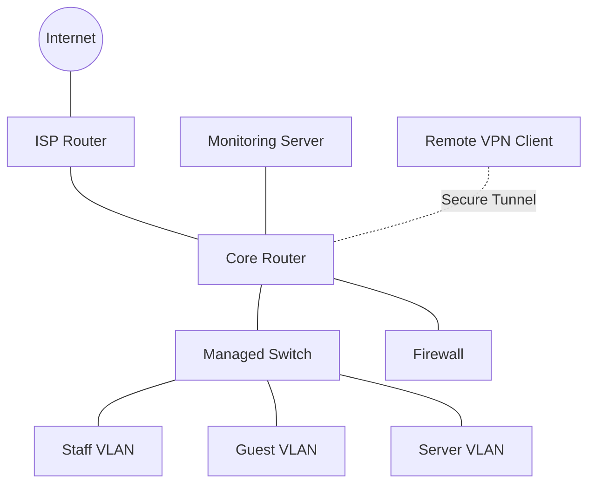

# Network Engineer Roadmap

A Network Engineer designs, implements, maintains, secures, and troubleshoots computer networks.

Network engineers work with routers, switches, firewalls, wireless access points, servers, network monitoring platforms, and communication technologies.

Their responsibilities include ensuring that networks remain:

* Available.
* Secure.
* Reliable.
* Scalable.
* Efficient.
* Properly documented.

This roadmap provides a structured learning path from networking fundamentals to advanced network engineering and ISP infrastructure.

It is designed to develop practical skills rather than focusing only on theoretical knowledge.

# 🗁 Learning Objectives

After completing this roadmap, you should be able to:

* Understand networking concepts and architectures.
* Design IPv4 and IPv6 addressing plans.
* Configure routers and switches.
* Implement VLANs and inter-VLAN routing.
* Configure static and dynamic routing.
* Manage MikroTik RouterOS environments.
* Deploy firewall and network security policies.
* Build wireless and VPN infrastructure.
* Understand ISP networking architecture.
* Monitor network performance.
* Troubleshoot complex connectivity problems.
* Automate repetitive network administration tasks.
* Design and document enterprise network infrastructure.
* Build a professional networking portfolio.

# 🗁 Understanding the Network Engineer Role

### 🖆 What Does a Network Engineer Do?

A Network Engineer is responsible for designing, configuring, operating, and improving network infrastructure.

Common responsibilities include:

* Designing network topologies.
* Configuring routers and switches.
* Managing IP addressing and subnetting.
* Implementing VLANs and routing.
* Configuring firewalls and VPNs.
* Monitoring network availability.
* Troubleshooting connectivity issues.
* Managing network security.
* Planning infrastructure upgrades.
* Maintaining technical documentation.
* Coordinating with system administrators and service providers.

### 🖆 Network Engineer vs Network Administrator

| Network Engineer | Network Administrator |
| --- | --- |
| Designs network architecture | Operates existing network infrastructure |
| Implements complex routing and switching | Manages routine network configurations |
| Plans network expansion | Maintains network availability |
| Designs security architecture | Applies established security policies |
| Performs advanced troubleshooting | Handles common operational problems |
| Evaluates new technologies | Maintains deployed technologies |

In practice, responsibilities overlap significantly, especially in smaller organizations.

### 🖆 Essential Professional Skills

Technical skills are only one part of network engineering.

Develop these professional skills:

* Analytical thinking.
* Problem-solving.
* Documentation.
* Communication.
* Time management.
* Change management.
* Incident management.
* Team collaboration.
* Technical research.
* Continuous learning.

# 🗁 Networking Fundamentals

### 🖆 Networking Concepts

Build a strong understanding of:

* Computer networks.
* LAN, WAN, MAN, and PAN.
* Network topologies.
* Network devices.
* Transmission media.
* Ethernet.
* MAC addresses.
* Unicast, broadcast, and multicast.
* Collision domains.
* Broadcast domains.
* Network performance metrics.

### 🖆 Network Models

Understand:

* OSI model.
* TCP/IP model.
* Encapsulation and decapsulation.
* Protocol Data Units.
* Layer responsibilities.
* Communication between network layers.

You should be able to explain how an application request travels from one host to another through the network stack.

### 🖆 Ethernet Fundamentals

Study:

* Ethernet frame structure.
* MAC addressing.
* Ethernet speeds.
* Full-duplex and half-duplex.
* Auto-negotiation.
* MTU.
* Fiber and copper interfaces.
* SFP and SFP+ modules.

### 🖆 Transport Layer

Understand:

* TCP.
* UDP.
* Ports.
* Sockets.
* TCP three-way handshake.
* TCP connection termination.
* Flow control.
* Congestion control.
* Common application ports.

# 🗁 IP Addressing and Subnetting

### 🖆 IPv4

Master:

* IPv4 address structure.
* Public and private addresses.
* Static and dynamic addressing.
* Subnet masks.
* CIDR notation.
* Network and broadcast addresses.
* Host ranges.
* Default gateways.
* Loopback addresses.
* Link-local addressing.
* APIPA.

### 🖆 Subnetting

Develop the ability to calculate subnets without relying entirely on online calculators.

Practice:

* Network address calculation.
* Broadcast address calculation.
* Usable host ranges.
* Subnet boundaries.
* Variable Length Subnet Masking.
* Classless addressing.
* Supernetting.
* Route summarization.

### 🖆 IPv6

Understand:

* IPv6 address notation.
* Global unicast addresses.
* Link-local addresses.
* Unique local addresses.
* Multicast and anycast.
* Prefix lengths.
* IPv6 subnetting.
* Neighbor Discovery.
* SLAAC.
* DHCPv6.
* IPv6 routing.

### 🖆 Address Planning

Learn how to create addressing plans for:

* Small offices.
* Enterprise networks.
* Data centers.
* Branch offices.
* ISP customer networks.
* Point-to-point router links.
* Management networks.

# 🗁 Switching and VLANs

### 🖆 Switching Fundamentals

Study:

* Layer two switching.
* MAC address learning.
* MAC address tables.
* Frame forwarding.
* Unknown unicast flooding.
* Broadcast forwarding.
* Software and hardware switching.

### 🖆 VLAN Configuration

Master:

* VLAN fundamentals.
* IEEE 802.1Q.
* Access ports.
* Trunk ports.
* Native VLAN.
* PVID.
* VLAN filtering.
* VLAN security.
* Inter-VLAN routing.

### 🖆 Loop Prevention

Understand:

* Spanning Tree Protocol.
* Rapid Spanning Tree Protocol.
* Root bridge selection.
* Root ports.
* Designated ports.
* BPDU.
* Loop prevention.
* Topology convergence.

### 🖆 Link Aggregation

Study:

* Link aggregation.
* LACP.
* Static aggregation.
* Load distribution.
* Link redundancy.
* Failover behavior.

### 🖆 Switching Design

Practice designing networks with:

* Access layer.
* Distribution layer.
* Core layer.
* VLAN-based segmentation.
* Redundant uplinks.
* Management VLANs.
* Server VLANs.
* Guest VLANs.

# 🗁 Routing and Network Protocols

### 🖆 Routing Fundamentals

Understand:

* Routing tables.
* Connected routes.
* Static routes.
* Default routes.
* Dynamic routing.
* Next-hop selection.
* Administrative distance or route preference.
* Routing metrics.
* Longest Prefix Match.
* Route summarization.

### 🖆 Dynamic Routing Protocols

Study:

* RIP.
* OSPF.
* BGP.
* OSPFv3.
* IPv6 BGP.
* Route redistribution.
* ECMP.
* Policy-Based Routing.

Understand when to use each protocol and how routing decisions are made.

### 🖆 Advanced Routing

Develop practical knowledge of:

* Multi-area OSPF.
* OSPF neighbor relationships.
* BGP peering.
* BGP path selection.
* Route filtering.
* Prefix lists.
* Routing policies.
* Recursive routing.
* Failover routing.
* Asymmetric routing.

### 🖆 Routing Design

Practice designing:

* Single-router networks.
* Multi-router enterprise networks.
* Branch-office connectivity.
* Redundant WAN connectivity.
* ISP edge routing.
* Multi-AS BGP environments.

# 🗁 Network Services

### 🖆 DNS

Understand:

* DNS hierarchy.
* Recursive and authoritative servers.
* DNS records.
* A and AAAA records.
* CNAME.
* MX.
* PTR.
* NS.
* DNS caching.
* Reverse DNS.
* DNS troubleshooting.

### 🖆 DHCP

Study:

* DHCP discovery.
* DHCP offer.
* DHCP request.
* DHCP acknowledgment.
* DHCP scopes.
* DHCP reservations.
* DHCP relay.
* DHCP snooping.
* DHCPv6.

### 🖆 Other Network Services

Learn:

* HTTP and HTTPS.
* TLS.
* SSH.
* FTP and SFTP.
* SMTP.
* POP3 and IMAP.
* NTP.
* SNMP.
* Syslog.
* ICMP.
* ARP.
* NDP.

Understand the purpose, ports, security implications, and troubleshooting procedures for each service.

# 🗁 MikroTik and RouterOS

### 🖆 RouterOS Fundamentals

Learn:

* RouterOS architecture.
* RouterOS v6 and v7 differences.
* RouterOS packages.
* RouterOS licensing.
* RouterOS installation.
* Cloud Hosted Router.
* WinBox.
* WebFig.
* CLI.
* SSH administration.

### 🖆 Core Configuration

Practice:

* Interface configuration.
* Bridge configuration.
* IP addressing.
* DHCP client and server.
* DNS configuration.
* Static routing.
* Firewall filtering.
* NAT and masquerade.
* Address lists.
* VLAN configuration.

### 🖆 Advanced RouterOS

Study:

* OSPF.
* BGP.
* Policy-Based Routing.
* PCC load balancing.
* WAN failover.
* Simple queues.
* Queue trees.
* PCQ.
* IPsec.
* WireGuard.
* OpenVPN.
* GRE and IPIP tunnels.
* PPPoE.
* HotSpot.
* RADIUS.
* CGNAT.

### 🖆 RouterOS Operations

Develop skills in:

* RouterOS backups.
* Configuration exports.
* Software upgrades.
* RouterBOOT upgrades.
* Logging.
* Monitoring.
* Packet capture.
* Torch.
* Netwatch.
* Scripting.
* Scheduler.
* RouterOS API.

# 🗁 Network Security

### 🖆 Security Fundamentals

Understand:

* Confidentiality.
* Integrity.
* Availability.
* Authentication.
* Authorization.
* Accounting.
* Least privilege.
* Defense in depth.

### 🖆 Firewall Security

Learn:

* Stateless filtering.
* Stateful filtering.
* Connection tracking.
* Input, forward, and output chains.
* Source NAT.
* Destination NAT.
* Port forwarding.
* Access control lists.
* Network segmentation.

### 🖆 Network Threats

Study:

* Port scanning.
* Brute-force attacks.
* IP spoofing.
* ARP poisoning.
* DNS spoofing.
* Man-in-the-Middle attacks.
* Denial-of-Service attacks.
* Distributed Denial-of-Service attacks.
* VLAN hopping.
* Rogue DHCP servers.

### 🖆 Security Operations

Practice:

* Secure management access.
* VPN-based administration.
* Centralized logging.
* Security monitoring.
* Firewall auditing.
* Backup protection.
* Incident response.
* Access reviews.

# 🗁 Wireless Networking

### 🖆 Wireless Fundamentals

Understand:

* IEEE 802.11.
* Wi-Fi standards.
* Frequency bands.
* Channels.
* Channel width.
* SSID.
* BSSID.
* Signal strength.
* Noise.
* Interference.
* Roaming.

### 🖆 Wireless Security

Study:

* WPA2.
* WPA3.
* Enterprise authentication.
* RADIUS.
* 802.1X.
* Guest wireless isolation.
* Rogue access point detection.

### 🖆 Wireless Deployment

Practice:

* Access point configuration.
* Wireless bridge deployment.
* Point-to-point links.
* Point-to-multipoint networks.
* Channel planning.
* Coverage planning.
* Capacity planning.
* Wireless troubleshooting.

# 🗁 VPN and Remote Connectivity

### 🖆 VPN Fundamentals

Understand how VPN technologies create protected communication paths over untrusted networks.

### 🖆 VPN Technologies

Study:

* IPsec.
* WireGuard.
* OpenVPN.
* GRE.
* VXLAN.
* L2TP.
* PPP.
* EoIP.
* IPIP.

### 🖆 VPN Deployment

Practice:

* Site-to-site VPN.
* Remote-access VPN.
* Branch-office VPN.
* VPN routing.
* VPN authentication.
* Firewall integration.
* Tunnel monitoring.
* VPN troubleshooting.

# 🗁 ISP and Enterprise Networking

### 🖆 ISP Architecture

Understand the major components of an Internet Service Provider network:

* Core routers.
* Edge routers.
* Distribution networks.
* Access networks.
* Broadband access.
* Fiber infrastructure.
* Point of Presence.
* Internet Exchange Points.
* Transit providers.
* Peering connections.

### 🖆 Broadband Technologies

Study:

* Fiber-to-the-Home.
* Passive Optical Networks.
* GPON.
* XGS-PON.
* OLT.
* ONU and ONT.
* PPPoE.
* DHCP-based broadband access.
* Wireless broadband.

### 🖆 ISP Services

Learn:

* PPPoE server.
* HotSpot.
* RADIUS.
* User Manager.
* Customer bandwidth management.
* CGNAT.
* Public IP allocation.
* IPv6 prefix delegation.
* Customer isolation.
* Billing integration concepts.

### 🖆 BGP and Internet Connectivity

Understand:

* Autonomous Systems.
* Public and private ASNs.
* BGP peering.
* Transit.
* Peering.
* Internet Exchange Points.
* Route filtering.
* Prefix announcements.
* Routing policy.
* Route security concepts.

### 🖆 Enterprise Network Design

Practice designing:

* Headquarters networks.
* Branch-office networks.
* Data center networks.
* Redundant core networks.
* Secure management networks.
* Multi-site connectivity.
* Guest and employee segmentation.

# 🗁 Network Monitoring and Troubleshooting

### 🖆 Monitoring Fundamentals

Understand:

* Availability.
* Latency.
* Jitter.
* Packet loss.
* Throughput.
* Bandwidth utilization.
* Interface errors.
* CPU and memory usage.
* Network baselines.

### 🖆 Monitoring Technologies

Study:

* SNMP.
* SNMPv3.
* Syslog.
* NetFlow.
* IPFIX.
* sFlow.
* ICMP monitoring.
* Network discovery.
* Alerting.

### 🖆 Monitoring Tools

Gain practical experience with:

* Zabbix.
* LibreNMS.
* PRTG.
* The Dude.
* Grafana.
* Prometheus.
* Wireshark.
* tcpdump.

### 🖆 Troubleshooting Methodology

Follow a structured troubleshooting process:

* Identify the problem.
* Gather information.
* Establish the scope.
* Check physical connectivity.
* Verify IP configuration.
* Test gateway connectivity.
* Verify routing.
* Test DNS.
* Inspect firewall and NAT.
* Capture packets when necessary.
* Identify the root cause.
* Implement corrective actions.
* Verify the solution.
* Document the incident.

### 🖆 Troubleshooting Tools

Master:

```bash
ip address
ip route
ip neigh
ping
traceroute
mtr
ss
dig
nslookup
tcpdump
```

Also practice MikroTik commands:

```routeros
/interface print
/ip address print
/ip route print
/ip firewall filter print
/ip firewall connection print
/tool ping
/tool traceroute
/tool torch
/tool sniffer
/log print
```

# 🗁 Linux and Server Administration

### 🖆 Linux Fundamentals

A network engineer benefits significantly from Linux administration skills.

Study:

* Linux filesystem.
* Users and groups.
* Permissions.
* Processes.
* Services.
* Package management.
* Network interfaces.
* Routing.
* Firewall management.
* SSH administration.

### 🖆 Linux Networking

Practice:

* Network interface configuration.
* Static IP addressing.
* DHCP clients.
* DNS configuration.
* Static routes.
* VLAN interfaces.
* Bonding.
* Bridges.
* Network namespaces.
* Packet capture.

### 🖆 Network Services on Linux

Learn to deploy and manage:

* DNS servers.
* DHCP servers.
* Web servers.
* NTP servers.
* RADIUS servers.
* Syslog servers.
* Monitoring systems.
* VPN servers.

### 🖆 Server Security

Understand:

* SSH hardening.
* Firewall configuration.
* User access control.
* Security updates.
* Service hardening.
* Log management.
* Backup procedures.

# 🗁 Automation and Network Programming

### 🖆 Programming Fundamentals

Develop programming knowledge that helps automate network operations.

Recommended technologies:

* Python.
* Bash.
* JSON.
* YAML.
* Regular expressions.
* HTTP APIs.
* Git.

### 🖆 Python for Network Engineers

Study:

* Python fundamentals.
* Variables and data types.
* Conditions and loops.
* Functions.
* Modules.
* File handling.
* Exception handling.
* HTTP requests.
* JSON processing.
* SSH automation.

### 🖆 Network Automation

Practice automating:

* Router configuration backups.
* Device inventory collection.
* Interface monitoring.
* Configuration deployment.
* Network discovery.
* IP address management.
* Configuration validation.
* Report generation.

### 🖆 Automation Tools

Explore:

* Ansible.
* Netmiko.
* NAPALM.
* Paramiko.
* REST APIs.
* Git-based configuration management.

### 🖆 MikroTik Automation

Learn:

* RouterOS scripting.
* Scheduler.
* Netwatch automation.
* RouterOS API.
* Remote management.
* Automated backups.
* Notifications and alerts.

# 🗁 Virtualization and Cloud Networking

### 🖆 Virtualization Fundamentals

Understand:

* Hypervisors.
* Virtual machines.
* Virtual switches.
* Virtual network adapters.
* Bridged networking.
* NAT networking.
* Host-only networking.
* VLAN-aware virtual networking.

### 🖆 Virtualization Platforms

Practice with:

* VirtualBox.
* VMware.
* Proxmox VE.
* KVM.
* GNS3.
* EVE-NG.

### 🖆 Cloud Networking

Understand:

* Virtual Private Cloud.
* Subnets.
* Route tables.
* Internet gateways.
* NAT gateways.
* Security groups.
* Network ACLs.
* Site-to-site VPN.
* Cloud load balancing.
* Hybrid connectivity.

### 🖆 Cloud Platforms

Explore networking services from:

* AWS.
* Microsoft Azure.
* Google Cloud.

Focus on networking concepts rather than memorizing platform-specific terminology.

# 🗁 Hands-on Lab Environment

### 🖆 Recommended Lab Setup

Build a dedicated network engineering lab using:

* VirtualBox or VMware.
* MikroTik CHR.
* GNS3 or EVE-NG.
* Ubuntu Server.
* Linux clients.
* Windows clients.
* Wireshark.
* A monitoring server.

### 🖆 Suggested Lab Topology



### 🖆 Lab Management

Maintain a structured lab environment.

Document:

* Device names.
* IP addresses.
* VLAN IDs.
* Routing information.
* Interface connections.
* Firewall policies.
* Configuration backups.
* Test results.

# 🗁 Practical Projects

### 🖆 Home Network Project

Build a home network with:

* Internet connectivity.
* Router configuration.
* DHCP.
* DNS.
* NAT.
* Wireless access.
* Guest network.
* Basic firewall security.

### 🖆 Small Office Network

Design an office network containing:

* Management VLAN.
* Staff VLAN.
* Guest VLAN.
* Server VLAN.
* DHCP services.
* Inter-VLAN routing.
* Firewall policies.
* Centralized monitoring.

### 🖆 Dual-WAN Network

Build a network with:

* Two WAN connections.
* Primary and backup routing.
* Health checking.
* Automatic failover.
* Failback.
* Connection monitoring.

### 🖆 Enterprise Network

Design a multi-layer network with:

* Core switching.
* Distribution switching.
* Access switching.
* VLAN segmentation.
* Redundant links.
* OSPF.
* Firewall policies.
* Centralized authentication.
* Network monitoring.

### 🖆 ISP Network

Build a simulated ISP environment with:

* Core and edge routers.
* BGP connectivity.
* PPPoE.
* RADIUS.
* Customer VLANs.
* Customer bandwidth management.
* CGNAT.
* IPv6 prefix delegation.
* Monitoring and logging.

### 🖆 Network Automation Project

Develop an automation system that:

* Connects to network devices.
* Collects configuration information.
* Generates backups.
* Records device status.
* Detects configuration changes.
* Produces reports.

# 🗁 Certifications and Professional Development

### 🖆 MikroTik Certifications

Explore the MikroTik certification ecosystem and identify courses aligned with your technical interests.

Relevant learning areas include:

* Network Associate.
* Routing Engineering.
* Wireless Engineering.
* Traffic Control.
* User Management.
* Security.
* Switching.
* IPv6.

Verify current course names, certification availability, prerequisites, and examination requirements through MikroTik's official training information.

### 🖆 Other Networking Certifications

Depending on your career goals, consider:

| Certification Path | Focus |
| --- | --- |
| Cisco CCNA | Networking fundamentals, routing, and switching |
| Cisco CCNP Enterprise | Advanced enterprise networking |
| CompTIA Network+ | Foundational networking knowledge |
| CompTIA Security+ | Cybersecurity fundamentals |
| Juniper JNCIA | Juniper networking fundamentals |
| Huawei HCIA | Huawei networking technologies |
| AWS Networking Specialty | Advanced AWS networking |
| Microsoft Azure Networking | Azure network infrastructure |

Choose certifications based on the technologies used in your target industry and job market.

### 🖆 Continuous Learning

Keep improving through:

* Official documentation.
* Technical books.
* Vendor training.
* Lab exercises.
* Networking communities.
* Technical blogs.
* RFC documents.
* Real-world troubleshooting.

# 🗁 Career Paths

### 🖆 Network Support Engineer

Typical responsibilities:

* Handle connectivity incidents.
* Troubleshoot LAN and WAN problems.
* Assist with router and switch configuration.
* Monitor network availability.
* Escalate complex incidents.

### 🖆 Network Administrator

Typical responsibilities:

* Maintain network infrastructure.
* Manage network devices.
* Configure VLANs and DHCP.
* Maintain wireless networks.
* Monitor infrastructure health.
* Maintain network documentation.

### 🖆 Network Engineer

Typical responsibilities:

* Design network architecture.
* Configure routing and switching.
* Implement network security.
* Manage enterprise connectivity.
* Troubleshoot complex network problems.
* Plan infrastructure upgrades.

### 🖆 Senior Network Engineer

Typical responsibilities:

* Design complex network environments.
* Lead network implementation projects.
* Optimize routing and switching.
* Manage high-availability systems.
* Perform advanced troubleshooting.
* Establish network standards.

### 🖆 Network Security Engineer

Typical responsibilities:

* Design firewall architecture.
* Implement network segmentation.
* Manage VPN infrastructure.
* Monitor security events.
* Conduct security assessments.
* Improve network protection.

### 🖆 ISP Network Engineer

Typical responsibilities:

* Manage ISP routing infrastructure.
* Configure BGP.
* Manage customer access networks.
* Deploy PPPoE and RADIUS.
* Manage CGNAT.
* Monitor backbone and access networks.
* Troubleshoot customer connectivity.

### 🖆 Network Automation Engineer

Typical responsibilities:

* Automate network configuration.
* Develop network management scripts.
* Integrate network APIs.
* Implement configuration management.
* Build monitoring and reporting systems.
* Improve operational efficiency.

### 🖆 Network Architect

Typical responsibilities:

* Design large-scale network infrastructure.
* Define network architecture standards.
* Plan capacity and redundancy.
* Evaluate technologies.
* Develop long-term infrastructure strategies.
* Guide engineering teams.

# 🗁 Portfolio and Job Preparation

### 🖆 Build a Technical Portfolio

Document your practical projects in a Git repository.

Each project should include:

* Project overview.
* Requirements.
* Network topology.
* IP addressing plan.
* VLAN table.
* Routing design.
* Firewall policy.
* Configuration examples.
* Testing procedure.
* Troubleshooting notes.
* Screenshots or diagrams where useful.

### 🖆 Recommended Portfolio Projects

* Home network configuration.
* Small office network design.
* VLAN segmentation.
* Dual-WAN failover.
* OSPF multi-router network.
* BGP ISP simulation.
* Site-to-site WireGuard VPN.
* PPPoE ISP deployment.
* Network monitoring platform.
* RouterOS automation scripts.

### 🖆 Prepare for Technical Interviews

Be prepared to explain:

* OSI and TCP/IP models.
* TCP three-way handshake.
* IPv4 subnetting.
* IPv6 addressing.
* ARP and NDP.
* VLANs and trunking.
* STP and RSTP.
* Static and dynamic routing.
* OSPF neighbor formation.
* BGP path selection.
* NAT and firewall processing.
* DHCP and DNS.
* VPN technologies.
* Network troubleshooting methodology.

### 🖆 Demonstrate Practical Skills

During technical interviews, explain your troubleshooting process clearly.

For example, when a user reports that the internet is unavailable:

* Verify physical connectivity.
* Check the client IP configuration.
* Test the default gateway.
* Test external IP connectivity.
* Test DNS resolution.
* Inspect routing.
* Review firewall and NAT policies.
* Identify and document the root cause.

# 🗁 Final Competency Checklist

### 🖆 Networking Fundamentals

* [ ] Understand OSI and TCP/IP models.
* [ ] Understand Ethernet and MAC addressing.
* [ ] Understand TCP, UDP, and ports.
* [ ] Understand network devices and topologies.

### 🖆 Addressing and Routing

* [ ] Configure IPv4 addressing.
* [ ] Calculate IPv4 subnets.
* [ ] Configure IPv6 addressing.
* [ ] Understand static routing.
* [ ] Configure OSPF.
* [ ] Understand BGP.

### 🖆 Switching

* [ ] Configure bridges.
* [ ] Configure VLANs.
* [ ] Configure access and trunk ports.
* [ ] Understand inter-VLAN routing.
* [ ] Understand RSTP.
* [ ] Configure link aggregation.

### 🖆 RouterOS

* [ ] Configure MikroTik routers.
* [ ] Manage RouterOS users and services.
* [ ] Configure DHCP and DNS.
* [ ] Configure NAT and firewall.
* [ ] Configure VPNs.
* [ ] Configure bandwidth management.
* [ ] Perform backups and upgrades.

### 🖆 Security and Monitoring

* [ ] Design firewall policies.
* [ ] Secure administrative access.
* [ ] Configure VPN access.
* [ ] Monitor network devices.
* [ ] Analyze logs.
* [ ] Troubleshoot network incidents.

### 🖆 Professional Skills

* [ ] Maintain technical documentation.
* [ ] Build practical network projects.
* [ ] Use Git for configuration and documentation management.
* [ ] Understand Linux administration.
* [ ] Automate repetitive tasks.
* [ ] Explain technical decisions clearly.

# 🗁 Additional Resources

* MikroTik Official Website: <https://mikrotik.com/>
* MikroTik Training: <https://mikrotik.com/training>
* MikroTik RouterOS Documentation: <https://help.mikrotik.com/docs/>
* Cisco Networking Academy: <https://www.netacad.com/>
* Cisco Learning Network: <https://learningnetwork.cisco.com/>
* Juniper Learning Portal: <https://learningportal.juniper.net/>
* Wireshark Documentation: <https://www.wireshark.org/docs/>
* Linux Documentation: <https://www.kernel.org/doc/>
* RFC Editor: <https://www.rfc-editor.org/>
* Python Documentation: <https://docs.python.org/3/>
* Ansible Documentation: <https://docs.ansible.com/>

The strongest network engineers combine theoretical knowledge, practical configuration experience, structured troubleshooting, security awareness, and continuous learning.
