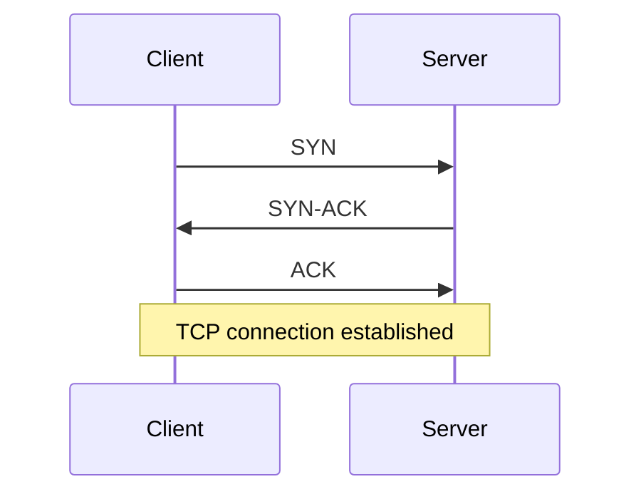
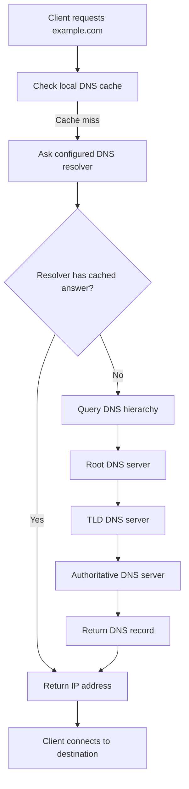
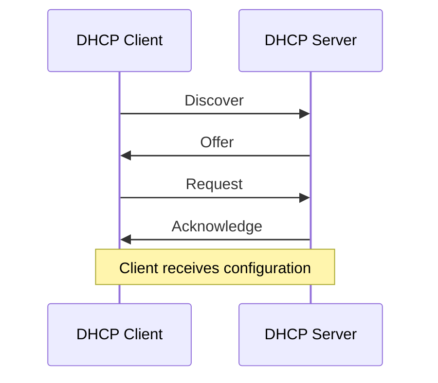

# Common Network Protocols

Network protocols define the rules that devices use to communicate, exchange data, establish connections, authenticate users, and manage network resources.

Understanding common protocols is essential for network engineering, system administration, cybersecurity, ISP operations, and troubleshooting.

# 🗁 What Is a Network Protocol?

A network protocol is a standardized set of rules that determines how devices communicate.

A protocol defines aspects such as:

* Message structure and format.
* Addressing and identification.
* Connection establishment and termination.
* Data transmission and reception.
* Error detection and handling.
* Authentication and encryption.
* Flow control and communication behavior.

For example, when you open a website:

* DNS resolves the domain name into an IP address.
* IP provides logical addressing and packet delivery.
* TCP establishes a reliable transport connection when TCP is used.
* TLS provides encryption and authentication.
* HTTP transfers web requests and responses.
* Ethernet or Wi-Fi carries the traffic across the local network.

# 🗁 Protocol Classification

Protocols can be classified according to their responsibilities in network communication.

| Protocol Category | Main Responsibility | Examples |
| --- | --- | --- |
| Network Layer | Logical addressing and packet delivery | IPv4, IPv6, ICMP |
| Transport Layer | End-to-end data transport | TCP, UDP |
| Application Layer | Application-level communication | HTTP, DNS, SMTP |
| Network Management | Monitoring and administration | SNMP, Syslog |
| Routing | Exchanging network reachability information | OSPF, BGP, RIP |
| Security | Encryption and secure communication | TLS, IPsec, SSH |
| Address Configuration | Automatic network configuration | DHCP |
| Network Access | Local network communication | Ethernet, Wi-Fi |

# 🗁 Internet Protocol (IP)

**Full Name:** Internet Protocol

**Versions:**

* IPv4
* IPv6

**Layer:** Network Layer

**Purpose:** Provides logical addressing and packet delivery between networks.

IP is the foundation of communication across interconnected networks. It identifies source and destination addresses and allows routers to forward packets toward their destinations.

IP itself does not guarantee successful delivery, packet ordering, or retransmission.

**Important characteristics:**

* Connectionless communication.
* Logical source and destination addressing.
* Routing across different networks.
* Best-effort packet delivery.
* Supports fragmentation behavior differently in IPv4 and IPv6.

**Example IPv4 address:**

```text
192.168.10.10
```

**Example IPv6 address:**

```text
2001:db8:10::10
```

**Common troubleshooting commands:**

Ubuntu/Linux:

```bash
ip address
ip route
ping 8.8.8.8
traceroute 8.8.8.8
```

MikroTik RouterOS v7:

```routeros
/ip address print
/ip route print
/ping 8.8.8.8
/tool traceroute 8.8.8.8
```

# 🗁 Transmission Control Protocol (TCP)

**Full Name:** Transmission Control Protocol

**Layer:** Transport Layer

**Protocol Number:** 6

**Purpose:** Provides reliable, connection-oriented communication between applications.

TCP establishes a connection before transferring application data. It uses acknowledgments, sequence numbers, retransmissions, and flow control to provide reliable, ordered byte-stream delivery.

**Important characteristics:**

* Connection-oriented communication.
* Reliable data delivery.
* Ordered byte-stream transmission.
* Error detection and retransmission.
* Flow control.
* Congestion control.
* Full-duplex communication.

**TCP Three-Way Handshake**

TCP establishes a connection through three main steps:



**Common TCP applications:**

| Application | Default Port |
| --- | ---: |
| HTTP | 80 |
| HTTPS | 443 |
| SSH | 22 |
| FTP Control | 21 |
| SMTP | 25 |
| POP3 | 110 |
| IMAP | 143 |
| RDP | 3389 |

**Troubleshooting commands:**

Ubuntu/Linux:

```bash
ss -tulnp
ss -tan
nc -vz example.com 443
```

MikroTik RouterOS v7:

```routeros
/tool sniffer quick ip-protocol=tcp
/ip firewall connection print
```

# 🗁 User Datagram Protocol (UDP)

**Full Name:** User Datagram Protocol

**Layer:** Transport Layer

**Protocol Number:** 17

**Purpose:** Provides connectionless datagram communication.

UDP sends datagrams without establishing a TCP-style connection. It does not provide built-in retransmission, sequencing, or congestion control.

**Important characteristics:**

* Connectionless communication.
* Low protocol overhead.
* No built-in delivery guarantee.
* No built-in packet ordering.
* Suitable for real-time and request-response applications.

**Common UDP applications:**

| Application | Default Port |
| --- | ---: |
| DNS | 53 |
| DHCP Server | 67 |
| DHCP Client | 68 |
| TFTP | 69 |
| NTP | 123 |
| SNMP | 161 |
| SNMP Trap | 162 |
| Syslog | 514 |
| RADIUS Authentication | 1812 |
| RADIUS Accounting | 1813 |
| WireGuard | 51820 |

**Troubleshooting commands:**

Ubuntu/Linux:

```bash
ss -ulnp
nc -vzu 192.168.10.1 53
```

MikroTik RouterOS v7:

```routeros
/tool sniffer quick ip-protocol=udp
/ip firewall connection print
```

# 🗁 TCP vs UDP

| Feature | TCP | UDP |
| --- | --- | --- |
| Communication | Connection-oriented | Connectionless |
| Reliability | Built-in | No built-in guarantee |
| Ordering | Preserved | Not guaranteed |
| Retransmission | Supported | Not built in |
| Flow Control | Supported | Not built in |
| Congestion Control | Supported | Not built in |
| Header Size | 20 bytes minimum | 8 bytes |
| Typical Uses | Web, SSH, email | DNS, VoIP, streaming, DHCP |

**Practical examples:**

* SSH uses TCP because reliable command and data transfer is important.
* DNS commonly uses UDP for ordinary queries, but TCP is also used for cases such as zone transfers and responses requiring it.
* VoIP commonly uses UDP for real-time media because retransmitting late packets may be less useful than continuing with current audio.
* HTTP/3 uses QUIC over UDP rather than TCP.

# 🗁 Internet Control Message Protocol (ICMP)

**Full Name:** Internet Control Message Protocol

**Layer:** Network Layer

**IPv4 Protocol Number:** 1

**IPv6 Protocol Number:** 58

**Purpose:** Provides error reporting and diagnostic information for IP communication.

ICMP helps network devices report problems and communicate control information.

**Common ICMP messages:**

| Message | Purpose |
| --- | --- |
| Echo Request | Requests a diagnostic response |
| Echo Reply | Responds to an echo request |
| Destination Unreachable | Indicates that a destination or service cannot be reached |
| Time Exceeded | Indicates that a packet's TTL or Hop Limit expired |
| Redirect | Provides routing guidance in supported IPv4 scenarios |
| Packet Too Big | IPv6 message used for Path MTU Discovery |

**Common tools:**

```bash
ping 8.8.8.8
traceroute 8.8.8.8
tracepath 8.8.8.8
```

**MikroTik RouterOS v7:**

```routeros
/ping 8.8.8.8
/tool traceroute 8.8.8.8
```

**Practical use cases:**

* Testing IP reachability.
* Identifying routing problems.
* Detecting TTL expiration.
* Investigating packet-size and MTU problems.
* Diagnosing network connectivity.

# 🗁 Internet Control Message Protocol for IPv6 (ICMPv6)

**Full Name:** Internet Control Message Protocol Version 6

**Layer:** Network Layer

**Protocol Number:** 58

**Purpose:** Provides IPv6 error reporting, diagnostics, and essential network functions.

ICMPv6 is more central to normal network operation than ICMPv4 because IPv6 Neighbor Discovery and Router Discovery depend on it.

**Important functions:**

* Neighbor Discovery Protocol (NDP).
* Router Solicitation and Router Advertisement.
* Neighbor Solicitation and Neighbor Advertisement.
* Duplicate Address Detection.
* Path MTU Discovery.
* Error reporting and diagnostics.

**Important note:** Blocking all ICMPv6 traffic can break important IPv6 functionality. Firewall rules should permit the necessary ICMPv6 message types.

# 🗁 Address Resolution Protocol (ARP)

**Full Name:** Address Resolution Protocol

**Layer:** Network Access / Link Layer support

**Purpose:** Resolves an IPv4 address into a MAC address on a local network.

When a host needs to send an IPv4 packet to another device on its local subnet, it needs the destination MAC address.

If the mapping is not already cached, it broadcasts an ARP request. The device owning the requested IPv4 address normally responds with an ARP reply.

**Example:**

```text
Source IP:      192.168.10.10
Destination IP: 192.168.10.20

ARP Request:
Who has 192.168.10.20?

ARP Reply:
192.168.10.20 is at AA:BB:CC:DD:EE:FF
```

**Important characteristics:**

* Used with IPv4.
* Resolves IPv4 addresses to MAC addresses.
* Operates within a local Layer 2 network.
* Uses broadcast requests and normally unicast replies.
* Maintains mappings in an ARP cache.

**Ubuntu/Linux:**

```bash
ip neigh show
ip neigh flush all
```

**MikroTik RouterOS v7:**

```routeros
/ip arp print
```

# 🗁 Neighbor Discovery Protocol (NDP)

**Full Name:** Neighbor Discovery Protocol

**Layer:** Network Layer support for IPv6

**Purpose:** Provides local-link discovery and address-resolution functions for IPv6.

NDP uses ICMPv6 messages rather than ARP broadcasts.

**Important functions:**

* Router Discovery.
* Prefix Discovery.
* Neighbor Discovery.
* Address Resolution.
* Duplicate Address Detection.
* Neighbor Unreachability Detection.

**Important ICMPv6 message types:**

| Message | Purpose |
| --- | --- |
| Router Solicitation (RS) | Requests router advertisements |
| Router Advertisement (RA) | Announces router and network information |
| Neighbor Solicitation (NS) | Requests neighbor information or checks address uniqueness |
| Neighbor Advertisement (NA) | Provides neighbor information |
| Redirect | Provides a better next-hop suggestion |

**Ubuntu/Linux:**

```bash
ip -6 neigh show
ip -6 route show
```

**MikroTik RouterOS v7:**

```routeros
/ipv6 neighbor print
/ipv6 nd print
```

# 🗁 Domain Name System (DNS)

**Full Name:** Domain Name System

**Layer:** Application Layer

**Default Port:** 53

**Transport:** UDP and TCP

**Purpose:** Translates domain names into IP addresses and provides other DNS information.

DNS allows users and applications to access services through names instead of remembering IP addresses.

**Example:**

```text
Domain: example.com
IPv4:   93.184.216.34
```

**Important DNS record types:**

| Record | Purpose |
| --- | --- |
| A | Maps a hostname to an IPv4 address |
| AAAA | Maps a hostname to an IPv6 address |
| CNAME | Creates an alias for another domain name |
| MX | Identifies mail servers for a domain |
| NS | Identifies authoritative name servers |
| PTR | Provides reverse DNS mapping |
| TXT | Stores text information, commonly used for verification and email security |
| SOA | Contains administrative information about a DNS zone |
| SRV | Identifies services and their connection details |
| CAA | Specifies which certificate authorities may issue certificates for a domain |

**DNS resolution process:**



**Ubuntu/Linux commands:**

```bash
resolvectl status
resolvectl query example.com
dig example.com
dig example.com A
dig example.com AAAA
dig example.com MX
nslookup example.com
```

**MikroTik RouterOS v7:**

```routeros
/ip dns print
:put [:resolve "example.com"]
```

**Common DNS troubleshooting problems:**

* Incorrect DNS server configuration.
* DNS server unavailable.
* Incorrect DNS records.
* DNS cache containing outdated information.
* Firewall blocking DNS traffic.
* TCP DNS traffic blocked when required.
* DNS forwarding or recursion misconfigured.

# 🗁 Dynamic Host Configuration Protocol (DHCP)

**Full Name:** Dynamic Host Configuration Protocol

**Layer:** Application Layer

**Transport:** UDP

**Ports:**

* Server: UDP 67
* Client: UDP 68

**Purpose:** Automatically provides IP configuration to network clients.

DHCP reduces manual configuration and helps prevent address conflicts.

**Common DHCP-provided settings:**

* IPv4 address.
* Subnet mask.
* Default gateway.
* DNS servers.
* Lease duration.
* Domain name and other optional parameters.

**DHCP DORA Process**

The typical IPv4 DHCP allocation process uses four messages:



**DHCP message types:**

| Message | Purpose |
| --- | --- |
| Discover | Client searches for DHCP servers |
| Offer | Server offers an address and configuration |
| Request | Client requests the offered configuration |
| Acknowledge | Server confirms the lease |
| NAK | Server rejects a configuration request |
| Release | Client releases its lease |
| Decline | Client indicates that an offered address is already in use |
| Inform | Client requests additional configuration without obtaining a new address |

**Ubuntu/Linux commands:**

```bash
ip address
ip route
nmcli device show
```

**MikroTik RouterOS v7:**

```routeros
/ip dhcp-server print
/ip dhcp-server lease print
/ip dhcp-client print
```

# 🗁 Hypertext Transfer Protocol (HTTP)

**Full Name:** Hypertext Transfer Protocol

**Layer:** Application Layer

**Default Port:** TCP 80

**Purpose:** Transfers web resources between clients and web servers.

HTTP follows a request-response communication model.

**Common HTTP methods:**

| Method | Purpose |
| --- | --- |
| GET | Retrieves a resource |
| POST | Submits data for processing |
| PUT | Creates or replaces a resource |
| PATCH | Partially updates a resource |
| DELETE | Deletes a resource |
| HEAD | Retrieves response headers without the response body |
| OPTIONS | Requests supported communication options |

**Common HTTP status codes:**

| Code | Meaning |
| --- | --- |
| 200 | OK |
| 201 | Created |
| 301 | Moved Permanently |
| 302 | Found |
| 400 | Bad Request |
| 401 | Unauthorized |
| 403 | Forbidden |
| 404 | Not Found |
| 405 | Method Not Allowed |
| 429 | Too Many Requests |
| 500 | Internal Server Error |
| 502 | Bad Gateway |
| 503 | Service Unavailable |
| 504 | Gateway Timeout |

**Testing HTTP:**

```bash
curl -I http://example.com
curl -v http://example.com
```

# 🗁 Hypertext Transfer Protocol Secure (HTTPS)

**Full Name:** Hypertext Transfer Protocol Secure

**Default Port:** TCP 443

**Purpose:** Protects HTTP communication using TLS.

HTTPS provides:

* Confidentiality through encryption.
* Integrity protection against undetected modification.
* Server authentication through digital certificates.
* Optional client authentication.

**Basic communication flow:**

```text
Client
  |
  | Connect to server
  v
TCP connection
  |
  v
TLS handshake
  |
  v
Encrypted HTTP communication
```

HTTP/3 is different: it uses QUIC over UDP, normally on port 443, rather than TCP.

**Testing HTTPS:**

```bash
curl -I https://example.com
curl -v https://example.com
openssl s_client -connect example.com:443 -servername example.com
```

# 🗁 Transport Layer Security (TLS)

**Full Name:** Transport Layer Security

**Layer:** Security protocol used by application protocols

**Purpose:** Provides encrypted and authenticated communication over a network.

TLS is commonly used by HTTPS, secure email services, and other application protocols.

**Important TLS functions:**

* Encryption.
* Data integrity.
* Server authentication.
* Optional client authentication.
* Secure session key establishment.

**TLS versions:**

* TLS 1.0 — Obsolete.
* TLS 1.1 — Obsolete.
* TLS 1.2 — Widely supported.
* TLS 1.3 — Modern version with improved handshake and security properties.

**Important note:** SSL is the historical predecessor of TLS. SSL versions are obsolete and should not be enabled for modern services.

# 🗁 Secure Shell (SSH)

**Full Name:** Secure Shell

**Layer:** Application Layer

**Default Port:** TCP 22

**Purpose:** Provides secure remote access and command execution.

SSH is commonly used to administer Linux servers, routers, switches, and other network devices.

**Important capabilities:**

* Encrypted remote terminal access.
* Public-key authentication.
* Password authentication.
* Secure file transfer through SFTP.
* Port forwarding and tunneling.
* Remote command execution.

**Connect to a remote Linux server:**

```bash
ssh username@192.168.10.10
```

**Specify a different port:**

```bash
ssh -p 2222 username@192.168.10.10
```

**MikroTik RouterOS v7:**

```routeros
/ip service print
/ip ssh print
```

# 🗁 File Transfer Protocol (FTP)

**Full Name:** File Transfer Protocol

**Layer:** Application Layer

**Default Control Port:** TCP 21

**Default Data Port:** TCP 20 in traditional active-mode FTP

**Purpose:** Transfers files between clients and servers.

FTP supports separate control and data connections.

**FTP connection modes:**

* Active Mode: The server initiates the data connection toward the client.
* Passive Mode: The client initiates both control and data connections.

**Important security consideration:**

Traditional FTP does not encrypt credentials or file contents. Secure alternatives include SFTP and FTPS.

# 🗁 Secure File Transfer Protocol (SFTP)

**Full Name:** SSH File Transfer Protocol

**Default Port:** TCP 22

**Purpose:** Provides secure file operations over SSH.

SFTP supports file upload, download, listing, renaming, and other file-management operations.

**Example:**

```bash
sftp username@192.168.10.10
```

**Upload a file:**

```text
put backup.tar.gz
```

**Download a file:**

```text
get backup.tar.gz
```

**Important distinction:** SFTP is not simply encrypted FTP. It is a separate file-transfer protocol operating over SSH.

# 🗁 File Transfer Protocol Secure (FTPS)

**Full Name:** File Transfer Protocol Secure

**Purpose:** Adds TLS protection to FTP communication.

**Common ports:**

| Connection Type | Port |
| --- | ---: |
| Explicit FTPS Control | TCP 21 |
| Implicit FTPS Control | TCP 990 |

FTPS retains FTP's separate control and data connection architecture. Its data-channel configuration can require additional firewall rules.

# 🗁 Simple Mail Transfer Protocol (SMTP)

**Full Name:** Simple Mail Transfer Protocol

**Layer:** Application Layer

**Purpose:** Sends email between mail clients and mail servers and between mail servers.

**Common ports:**

| Port | Purpose |
| --- | --- |
| TCP 25 | Server-to-server SMTP relay |
| TCP 587 | Message submission, commonly with STARTTLS |
| TCP 465 | Message submission using implicit TLS |

**Important characteristics:**

* Transfers outgoing email.
* Supports message submission.
* Uses DNS MX records to locate destination mail servers.
* Can use TLS to protect communication.
* Commonly works with authentication for client submission.

# 🗁 Post Office Protocol Version 3 (POP3)

**Full Name:** Post Office Protocol Version 3

**Default Port:** TCP 110

**Secure Port:** TCP 995

**Purpose:** Retrieves email from a mail server.

POP3 is generally designed around downloading messages to a client. Depending on client and server configuration, messages may be retained on the server or removed after retrieval.

# 🗁 Internet Message Access Protocol (IMAP)

**Full Name:** Internet Message Access Protocol

**Default Port:** TCP 143

**Secure Port:** TCP 993

**Purpose:** Provides access to email stored on a mail server.

IMAP supports server-side folders, message synchronization, and access from multiple devices.

**POP3 vs IMAP:**

| Feature | POP3 | IMAP |
| --- | --- | --- |
| Main Purpose | Retrieve email | Access and synchronize email |
| Server-Side Folders | Limited | Supported |
| Multi-Device Synchronization | Limited | Supported |
| Server Storage | Often downloaded | Generally retained |
| Default Port | 110 | 143 |
| Secure Port | 995 | 993 |

# 🗁 Network Time Protocol (NTP)

**Full Name:** Network Time Protocol

**Layer:** Application Layer

**Default Port:** UDP 123

**Purpose:** Synchronizes system clocks over a network.

Accurate time is important for:

* Log correlation.
* Security event investigation.
* Certificate validation.
* Authentication systems.
* Monitoring systems.
* Distributed applications.

**Ubuntu/Linux:**

```bash
timedatectl status
timedatectl timesync-status
```

**MikroTik RouterOS v7:**

```routeros
/system ntp client print
/system clock print
```

# 🗁 Simple Network Management Protocol (SNMP)

**Full Name:** Simple Network Management Protocol

**Layer:** Application Layer

**Purpose:** Monitors and manages network devices.

SNMP is commonly used by monitoring platforms to collect interface statistics, device health, traffic counters, and other management information.

**Common ports:**

| Port | Protocol | Purpose |
| --- | --- | --- |
| UDP 161 | SNMP | Requests and responses |
| UDP 162 | SNMP | Traps and notifications |

**SNMP components:**

* SNMP Manager: Monitoring platform that collects information.
* SNMP Agent: Software running on the managed device.
* MIB: Structure describing managed objects.
* OID: Identifier for a particular managed object.

**SNMP versions:**

| Version | Characteristics |
| --- | --- |
| SNMPv1 | Original version; weak security |
| SNMPv2c | Improved protocol operations; community-string security without encryption |
| SNMPv3 | Supports authentication, integrity, and privacy |

**Recommendation:** Prefer SNMPv3 with authentication and encryption when supported.

# 🗁 Syslog

**Full Name:** System Logging Protocol

**Purpose:** Collects and transports log messages from network devices and systems.

Syslog is commonly used to centralize logs from routers, switches, firewalls, Linux servers, and applications.

**Common ports:**

| Port | Transport | Usage |
| --- | --- | --- |
| UDP 514 | UDP | Traditional Syslog |
| TCP 514 | TCP | Reliable transport where configured |
| TCP 6514 | TCP with TLS | Common secure Syslog transport |

**Syslog severity levels:**

| Numerical Code | Severity | Meaning |
| ---: | --- | --- |
| 0 | Emergency | System is unusable |
| 1 | Alert | Immediate action required |
| 2 | Critical | Critical condition |
| 3 | Error | Error condition |
| 4 | Warning | Warning condition |
| 5 | Notice | Normal but significant event |
| 6 | Informational | Informational message |
| 7 | Debug | Debugging information |

A lower numerical value indicates a more severe event.

**Linux logging commands:**

```bash
journalctl
journalctl -f
journalctl -p err
```

**MikroTik RouterOS v7:**

```routeros
/system logging print
/log print
```

# 🗁 Routing Information Protocol (RIP)

**Full Name:** Routing Information Protocol

**Layer:** Routing protocol

**Purpose:** Exchanges routing information between routers using a distance-vector approach.

**Important characteristics:**

* Uses hop count as its metric.
* Maximum usable hop count is 15.
* A hop count of 16 represents an unreachable destination.
* Uses periodic route updates.
* RIP version 2 supports classless routing and authentication options.

**Common ports:**

RIP uses UDP port 520 for IPv4. RIPng uses UDP port 521 for IPv6.

**Typical use case:** Small or legacy routing environments where advanced routing capabilities are not required.

# 🗁 Open Shortest Path First (OSPF)

**Full Name:** Open Shortest Path First

**Type:** Link-state Interior Gateway Protocol

**IP Protocol Number:** 89

**Purpose:** Dynamically discovers and calculates routes within an autonomous system.

OSPF uses link-state advertisements and the Shortest Path First algorithm to calculate optimal paths.

**Important characteristics:**

* Link-state routing.
* Cost-based path selection.
* Hierarchical design using areas.
* Supports authentication mechanisms.
* Fast convergence when properly designed.
* Supports IPv4 through OSPFv2 and IPv6 through OSPFv3.

**Important OSPF concepts:**

* Router ID.
* Area.
* Backbone Area 0.
* Neighbor.
* Adjacency.
* Link-State Advertisement (LSA).
* Link-State Database (LSDB).
* Cost.
* Designated Router (DR).
* Backup Designated Router (BDR).

**RouterOS v7 inspection commands:**

```routeros
/routing ospf instance print
/routing ospf area print
/routing ospf neighbor print
/routing ospf route print
```

# 🗁 Border Gateway Protocol (BGP)

**Full Name:** Border Gateway Protocol

**Type:** Path-vector Exterior Gateway Protocol

**Default Port:** TCP 179

**Purpose:** Exchanges routing information between autonomous systems.

BGP is the primary inter-domain routing protocol used to exchange reachability information across the global internet.

**Important characteristics:**

* Policy-based routing decisions.
* Path-vector operation.
* Uses TCP for peer communication.
* Supports route attributes.
* Supports internal BGP and external BGP.
* Supports large-scale routing and internet peering.

**Important BGP attributes:**

* AS_PATH.
* NEXT_HOP.
* LOCAL_PREF.
* MED.
* ORIGIN.
* COMMUNITY.

**Common BGP terms:**

* eBGP: BGP between different autonomous systems.
* iBGP: BGP within the same autonomous system.
* ASN: Autonomous System Number.
* Prefix: An advertised IP network.
* Peering: A BGP relationship between routers.

**MikroTik RouterOS v7:**

```routeros
/routing bgp connection print
/routing bgp session print
/routing route print
```

# 🗁 Routing Protocol Comparison

| Protocol | Type | Metric / Selection Basis | Common Use |
| --- | --- | --- | --- |
| RIP | Distance Vector | Hop Count | Small or legacy networks |
| OSPF | Link State | Cost | Enterprise and ISP internal routing |
| BGP | Path Vector | Policy and path attributes | Internet routing and inter-AS connectivity |
| Static Routing | Manual | Administrative configuration | Small networks and controlled paths |

# 🗁 Internet Group Management Protocol (IGMP)

**Full Name:** Internet Group Management Protocol

**Layer:** Network Layer support for IPv4 multicast

**Purpose:** Manages IPv4 multicast group membership between hosts and directly connected multicast routers.

**Common versions:**

* IGMPv1.
* IGMPv2.
* IGMPv3.

**Important functions:**

* Hosts report multicast group membership.
* Routers learn which multicast groups have interested receivers.
* IGMP snooping allows switches to limit multicast forwarding to relevant ports.

**Common use cases:**

* IPTV.
* Multicast video distribution.
* Real-time multicast applications.

IGMP does not itself route multicast traffic across an entire network. Multicast routing protocols perform that task.

# 🗁 Multicast Listener Discovery (MLD)

**Full Name:** Multicast Listener Discovery

**Layer:** Network Layer support for IPv6 multicast

**Purpose:** Manages IPv6 multicast group membership.

MLD performs a role similar to IGMP in IPv4 and operates using ICMPv6.

**Versions:**

* MLDv1.
* MLDv2.

# 🗁 Point-to-Point Protocol over Ethernet (PPPoE)

**Full Name:** Point-to-Point Protocol over Ethernet

**Purpose:** Establishes PPP sessions over Ethernet networks.

PPPoE is widely used by broadband ISPs to authenticate subscribers and manage individual internet sessions.

**Important characteristics:**

* Subscriber authentication.
* Session establishment.
* PPP negotiation.
* IP address assignment.
* Session accounting when integrated with RADIUS.
* Per-subscriber service policies.

**Common authentication methods:**

* PAP.
* CHAP.
* MS-CHAP variants, depending on implementation.

**Important ports and protocol details:**

* PPPoE Discovery uses EtherType `0x8863`.
* PPPoE Session uses EtherType `0x8864`.
* PPPoE commonly reduces the available IP MTU to 1492 bytes on a standard 1500-byte Ethernet path.

**MikroTik RouterOS v7:**

```routeros
/interface pppoe-client print
/interface pppoe-server server print
/ppp active print
```

# 🗁 Remote Authentication Dial-In User Service (RADIUS)

**Full Name:** Remote Authentication Dial-In User Service

**Purpose:** Provides centralized authentication, authorization, and accounting for network access.

RADIUS is commonly used by ISPs and enterprise networks for:

* PPPoE subscriber authentication.
* Hotspot authentication.
* Wireless authentication.
* VPN user authentication.
* Centralized access policies.
* Session accounting.

**Common ports:**

| Port | Purpose |
| --- | --- |
| UDP 1812 | Authentication and authorization |
| UDP 1813 | Accounting |
| UDP 1645 | Legacy authentication |
| UDP 1646 | Legacy accounting |

**Typical RADIUS communication:**

```text
Network Access Server
        |
        | Authentication Request
        v
   RADIUS Server
        |
        | Access-Accept / Access-Reject
        v
Network Access Server
        |
        v
User Access Decision
```

# 🗁 Point-to-Point Tunneling Protocol (PPTP)

**Full Name:** Point-to-Point Tunneling Protocol

**Purpose:** Creates VPN tunnels using PPP encapsulation.

**Important ports and protocols:**

* TCP 1723 for control connections.
* GRE, IP protocol 47, for tunneled data.

PPTP is considered obsolete because of significant security weaknesses. Modern VPN deployments should use stronger alternatives.

# 🗁 Internet Protocol Security (IPsec)

**Full Name:** Internet Protocol Security

**Purpose:** Provides security services for IP communication.

IPsec is commonly used for site-to-site and remote-access VPNs.

**Important components:**

* AH (Authentication Header): Provides integrity and authentication without encryption.
* ESP (Encapsulating Security Payload): Provides confidentiality and can also provide integrity and authentication.
* IKE (Internet Key Exchange): Negotiates security associations and cryptographic parameters.

**Common ports and protocols:**

| Protocol / Port | Purpose |
| --- | --- |
| UDP 500 | IKE |
| UDP 4500 | NAT Traversal |
| IP Protocol 50 | ESP |
| IP Protocol 51 | AH |

**Important operating modes:**

* Transport Mode: Protects the payload of an IP packet.
* Tunnel Mode: Encapsulates and protects an entire original IP packet.

# 🗁 WireGuard

**Protocol:** WireGuard

**Purpose:** Provides modern encrypted VPN tunnels.

WireGuard uses public-key cryptography and a relatively simple protocol design.

**Important characteristics:**

* Public-key-based peer authentication.
* Encrypted IP traffic.
* Lightweight implementation.
* UDP transport.
* Support for IPv4 and IPv6.
* Configurable listening port.

**Common default port:** UDP 51820, although it can be changed.

**MikroTik RouterOS v7:**

```routeros
/interface wireguard print
/interface wireguard peers print
```

# 🗁 Generic Routing Encapsulation (GRE)

**Full Name:** Generic Routing Encapsulation

**IP Protocol Number:** 47

**Purpose:** Encapsulates network-layer packets inside another IP packet.

GRE can transport different network protocols across an IP network.

**Important characteristics:**

* Supports tunneling.
* Can carry multicast traffic.
* Can transport routing-protocol traffic.
* Does not provide encryption by itself.
* Can be combined with IPsec for protection.

# 🗁 Virtual Extensible LAN (VXLAN)

**Full Name:** Virtual Extensible LAN

**Purpose:** Extends Layer 2 network connectivity over a Layer 3 IP underlay.

VXLAN is commonly used in data centers and virtualized network environments.

**Important characteristics:**

* Layer 2 overlay over Layer 3.
* Uses VXLAN Network Identifiers (VNIs).
* Supports a large number of logical network segments.
* Uses UDP encapsulation.
* Commonly uses UDP port 4789.

# 🗁 QUIC

**Full Name:** Quick UDP Internet Connections

**Purpose:** Provides secure, multiplexed transport over UDP.

QUIC is the transport protocol used by HTTP/3.

**Important characteristics:**

* Runs over UDP.
* Integrates TLS 1.3 security.
* Supports multiplexed streams.
* Reduces connection establishment latency in many scenarios.
* Supports connection migration.

**Common port:** UDP 443 for HTTP/3.

# 🗁 Protocol and Port Reference

The following table summarizes common protocols and their default ports or IP protocol numbers.

| Protocol | Transport / Protocol Number | Default Port |
| --- | --- | ---: |
| FTP Control | TCP | 21 |
| FTP Data (Active Mode) | TCP | 20 |
| SSH | TCP | 22 |
| Telnet | TCP | 23 |
| SMTP Relay | TCP | 25 |
| DNS | UDP/TCP | 53 |
| DHCP Server | UDP | 67 |
| DHCP Client | UDP | 68 |
| TFTP | UDP | 69 |
| HTTP | TCP | 80 |
| POP3 | TCP | 110 |
| NTP | UDP | 123 |
| IMAP | TCP | 143 |
| SNMP | UDP | 161 |
| SNMP Trap | UDP | 162 |
| BGP | TCP | 179 |
| LDAP | TCP/UDP | 389 |
| HTTPS | TCP | 443 |
| SMB | TCP | 445 |
| SMTPS / Submission | TCP | 465 |
| SMTP Submission | TCP | 587 |
| LDAPS | TCP | 636 |
| FTPS Implicit | TCP | 990 |
| IMAPS | TCP | 993 |
| POP3S | TCP | 995 |
| OpenVPN | UDP/TCP | 1194 |
| L2TP | UDP | 1701 |
| RADIUS Authentication | UDP | 1812 |
| RADIUS Accounting | UDP | 1813 |
| PPTP Control | TCP | 1723 |
| IPsec IKE | UDP | 500 |
| IPsec NAT-T | UDP | 4500 |
| Syslog | UDP/TCP | 514 |
| Syslog TLS | TCP | 6514 |
| MySQL | TCP | 3306 |
| RDP | TCP/UDP | 3389 |
| PostgreSQL | TCP | 5432 |
| Redis | TCP | 6379 |
| WireGuard | UDP | 51820 |
| VXLAN | UDP | 4789 |
| QUIC / HTTP/3 | UDP | 443 |

**Important:** A port number identifies a transport-layer service endpoint; it is not the same as an IP protocol number. For example, TCP uses IP protocol number 6, while GRE uses IP protocol number 47 and does not use a TCP or UDP port.

# 🗁 Practical Protocol Troubleshooting

When a network service fails, troubleshoot each relevant communication layer instead of immediately assuming the application is faulty.

**Check local IP configuration:**

```bash
ip address
ip route
```

**Test local gateway reachability:**

```bash
ping -c 4 192.168.10.1
```

**Test external IP connectivity:**

```bash
ping -c 4 8.8.8.8
```

**Test DNS resolution:**

```bash
dig example.com
```

**Test TCP port connectivity:**

```bash
nc -vz example.com 443
```

**Inspect listening services:**

```bash
ss -tulnp
```

**Capture packets:**

```bash
sudo tcpdump -ni any host 192.168.10.10
```

**Inspect MikroTik firewall rules:**

```routeros
/ip firewall filter print
/ip firewall nat print
/ip firewall connection print
```

**Inspect MikroTik packet traffic:**

```routeros
/tool sniffer quick interface=ether1
```

# 🗁 Practical Troubleshooting Examples

| Problem | Protocols to Investigate | Useful Checks |
| --- | --- | --- |
| Website does not open | DNS, TCP, TLS, HTTP | `dig`, `curl`, `nc` |
| Cannot obtain an IP address | DHCP | Check DHCP server, relay, and leases |
| Cannot reach another subnet | IP, ICMP, routing | Check routes and gateway |
| Cannot resolve domain names | DNS | `dig`, `resolvectl`, DNS server logs |
| SSH connection fails | TCP, SSH | Check TCP 22 and SSH service |
| Email cannot be sent | SMTP, DNS | Check SMTP ports and MX records |
| VPN cannot connect | IPsec, WireGuard, OpenVPN | Check ports, peer configuration, and firewall |
| Monitoring data is missing | SNMP, Syslog | Check agent, manager, ports, and credentials |
| Multicast application fails | IGMP, MLD, multicast routing | Check group membership and forwarding |
| PPPoE client cannot connect | PPPoE, RADIUS | Check discovery, authentication, and session logs |

# 🗁 Important Protocol Design Considerations

* **Use encryption for management:** Prefer SSH over Telnet and SFTP over traditional FTP.
* **Secure web communication:** Use HTTPS with modern TLS configurations.
* **Protect network management:** Prefer SNMPv3 and restrict access to trusted management systems.
* **Control DNS access:** Allow only intended DNS resolvers and prevent unauthorized DNS service exposure.
* **Use appropriate firewall rules:** Permit required traffic while restricting unnecessary services.
* **Understand transport behavior:** TCP reliability and UDP's lower overhead make them suitable for different applications.
* **Preserve essential ICMP traffic:** ICMP and ICMPv6 are important for diagnostics and network operation.
* **Synchronize device clocks:** Configure NTP to support accurate logging and troubleshooting.
* **Document custom ports:** Services can use non-default ports, so maintain accurate network documentation.
* **Verify both directions:** Stateful connections and some application protocols require appropriate return traffic and additional data channels.

# 🗁 Learning Outcomes

After studying this document, you should be able to:

* Explain the purpose of common network protocols.
* Distinguish between TCP and UDP.
* Understand IP addressing and packet delivery.
* Explain ARP and IPv6 Neighbor Discovery.
* Understand DNS resolution and DHCP allocation.
* Identify common application protocols and their default ports.
* Explain routing protocols such as OSPF and BGP.
* Understand common VPN technologies.
* Identify protocol-related causes of network failures.
* Use Linux and MikroTik commands to investigate network communication.

# 🗁 Official Documentation and References

* [IETF RFC Editor](https://www.rfc-editor.org/)
* [IANA Service Name and Transport Protocol Port Number Registry](https://www.iana.org/assignments/service-names-port-numbers/service-names-port-numbers.xhtml)
* [IETF Internet Standards](https://www.ietf.org/standards/)
* [MikroTik RouterOS Documentation](https://help.mikrotik.com/docs/)
* [Linux Manual Pages](https://man7.org/linux/man-pages/)
