# Network Diagrams

Network diagrams are visual representations of network infrastructure, devices, connections, communication paths, and logical relationships. They help network engineers design, deploy, troubleshoot, secure, and maintain network environments.

A well-maintained network diagram makes complex infrastructure easier to understand and provides a shared reference for engineers, administrators, security teams, and other technical stakeholders.

# 🗁 Purpose of Network Diagrams

Network diagrams are useful throughout the network lifecycle.

* **Network design:** Plan devices, connections, IP addressing, VLANs, routing, and redundancy before deployment.
* **Implementation:** Follow a documented design when configuring routers, switches, firewalls, and servers.
* **Troubleshooting:** Identify the expected path between devices and locate potential failure points.
* **Security:** Understand trust boundaries, firewall placement, network segmentation, and exposed services.
* **Capacity planning:** Identify bandwidth bottlenecks, overloaded links, and infrastructure expansion requirements.
* **Documentation:** Preserve network knowledge and reduce dependency on individual engineers.
* **Change management:** Compare the existing infrastructure with proposed changes before implementation.
* **Disaster recovery:** Understand dependencies and restore critical network services in the correct order.

# 🗁 Types of Network Diagrams

Different diagrams represent different aspects of a network. A single diagram should not attempt to communicate every technical detail.

# 🗁 Physical Network Diagram

A physical network diagram represents the actual physical infrastructure and connections.

It commonly includes:

* Routers, switches, firewalls, and wireless access points.
* Servers, workstations, printers, and other endpoints.
* Physical interfaces and port numbers.
* Copper Ethernet and fiber-optic connections.
* Rack locations and patch panels.
* Cable identifiers and link speeds.
* Equipment locations, rooms, and buildings.

Example:

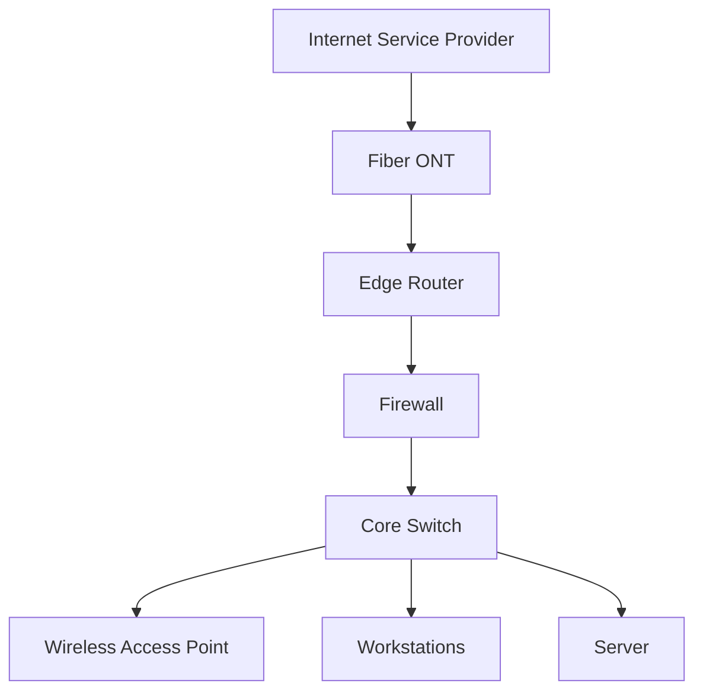

A physical diagram should describe what is actually installed, rather than only what is intended by the network design.

# 🗁 Logical Network Diagram

A logical network diagram represents how devices communicate and how the network is organized, regardless of their physical location.

It commonly includes:

* IP addresses and subnets.
* VLAN IDs and names.
* Routing relationships.
* Default gateways.
* Network segments.
* Firewall zones.
* VPN connections.
* Logical interfaces and tunnels.

Example:

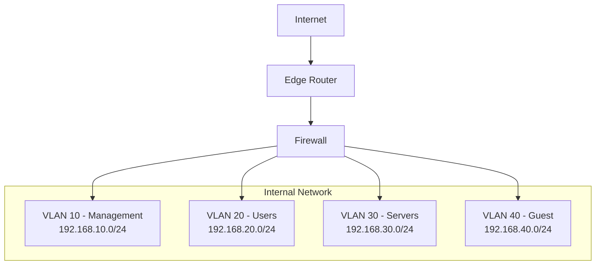

# 🗁 Network Topology Diagram

A topology diagram illustrates how network devices and connections are arranged.

Common topology types include:

**Star topology**

All endpoint devices connect to a central switch or hub.

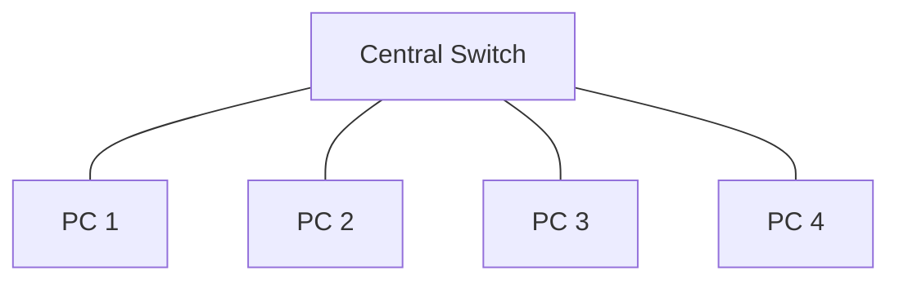

**Bus topology**

Devices share a common communication medium. This topology is mostly associated with older Ethernet implementations.

**Ring topology**

Devices connect in a circular arrangement. Some technologies use ring-based mechanisms for resilience.

**Mesh topology**

Devices have multiple interconnections, providing alternative paths.

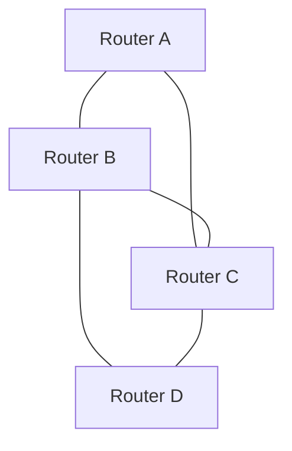

**Tree topology**

Multiple star networks connect through a hierarchical arrangement of distribution and core devices.

**Hybrid topology**

A network combines multiple topology types to satisfy its operational requirements.

# 🗁 Layer 2 Network Diagram

A Layer 2 diagram focuses on switching infrastructure and Ethernet connectivity.

It commonly includes:

* Switches and bridges.
* Access and trunk links.
* VLAN membership.
* 802.1Q tagging.
* Spanning Tree Protocol relationships.
* Link aggregation groups.
* Physical switch ports.
* MAC-based connectivity.

Example:

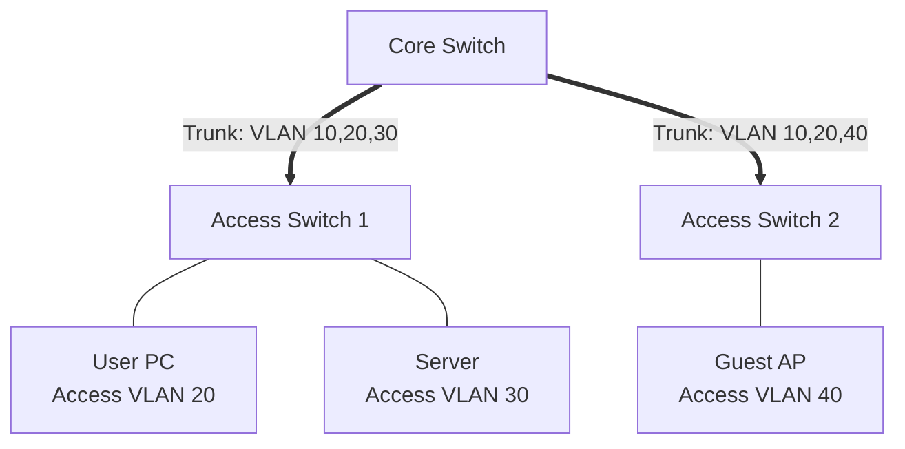

For Layer 2 diagrams, clearly distinguish access ports from trunk links and document the VLANs allowed on each trunk.

# 🗁 Layer 3 Network Diagram

A Layer 3 diagram focuses on IP addressing, routing, gateways, and communication between networks.

It commonly includes:

* Routers and Layer 3 switches.
* IP subnets and prefixes.
* Point-to-point links.
* Default gateways.
* Static and dynamic routing.
* OSPF and BGP relationships.
* Routing boundaries.
* IPv4 and IPv6 networks.

Example:

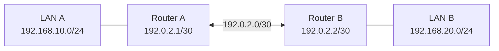

# 🗁 WAN Network Diagram

A WAN diagram represents connectivity between geographically separated networks.

It may include:

* Head office and branch offices.
* Internet service providers.
* Dedicated leased lines.
* MPLS networks.
* Site-to-site VPN tunnels.
* SD-WAN infrastructure.
* Public and private IP addresses.
* Primary and backup WAN connections.

Example:

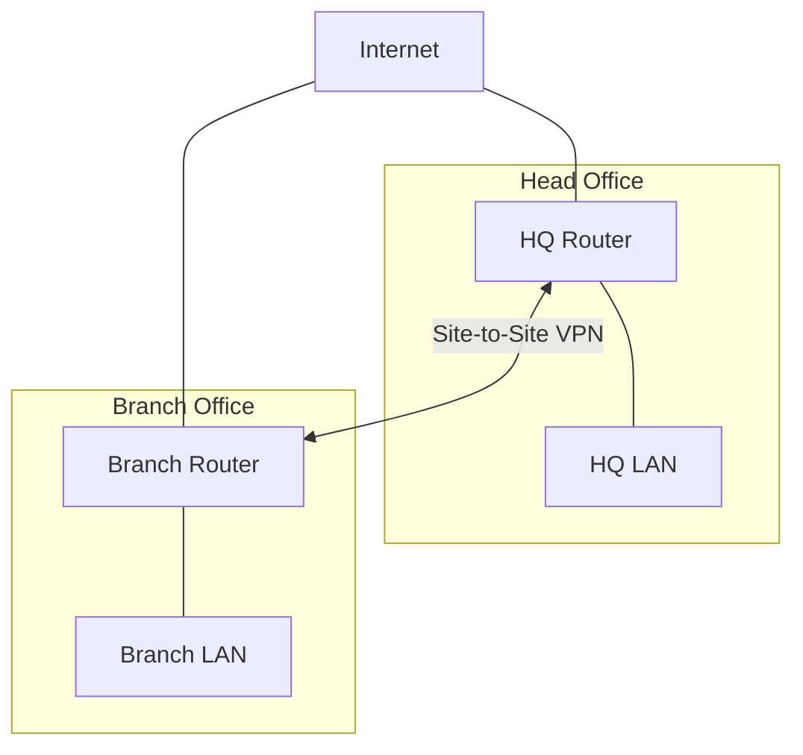

# 🗁 VLAN Network Diagram

A VLAN diagram shows network segmentation and the relationship between VLANs, switches, gateways, and endpoints.

Example VLAN plan:

| VLAN ID | VLAN Name | Subnet | Gateway |
| --- | --- | --- | --- |
| 10 | Management | 192.168.10.0/24 | 192.168.10.1 |
| 20 | Users | 192.168.20.0/24 | 192.168.20.1 |
| 30 | Servers | 192.168.30.0/24 | 192.168.30.1 |
| 40 | Guest | 192.168.40.0/24 | 192.168.40.1 |
| 50 | CCTV | 192.168.50.0/24 | 192.168.50.1 |

Example:

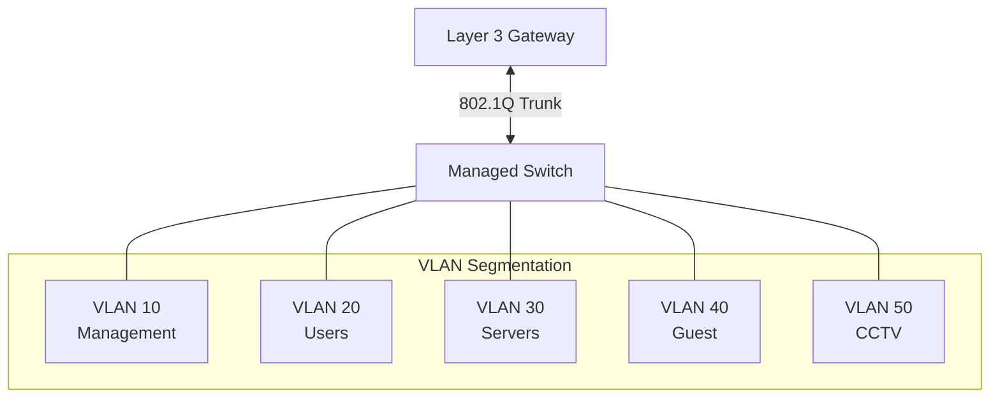

The diagram should identify whether inter-VLAN routing is performed by a router, a Layer 3 switch, or a firewall.

# 🗁 Rack Layout Diagram

A rack diagram represents the physical placement of network equipment inside a server or network rack.

It commonly documents:

* Rack unit positions (U).
* Switches and routers.
* Patch panels.
* Firewalls.
* Servers.
* UPS equipment.
* Cable management panels.
* Power distribution units (PDUs).

Example rack layout:

| Rack Position | Device | Description |
| --- | --- | --- |
| U12–U11 | Core Switch | Main switching infrastructure |
| U10 | Patch Panel | Network cable termination |
| U9 | Firewall | Network security gateway |
| U8 | Router | WAN connectivity |
| U7–U5 | Server | Application and infrastructure services |
| U4–U3 | UPS | Backup power |
| U2–U1 | PDU / Cable Management | Power and cable organization |

Always document rack identifiers, equipment names, and actual rack positions. Leave adequate space for ventilation, maintenance, and cable management.

# 🗁 Security Network Diagram

A security diagram illustrates network trust boundaries, security controls, and permitted communication paths.

It commonly includes:

* Internet-facing networks.
* Firewalls and security gateways.
* DMZ segments.
* Internal trusted networks.
* Guest networks.
* Management networks.
* VPN termination points.
* IDS/IPS systems.
* Authentication and logging systems.

Example:

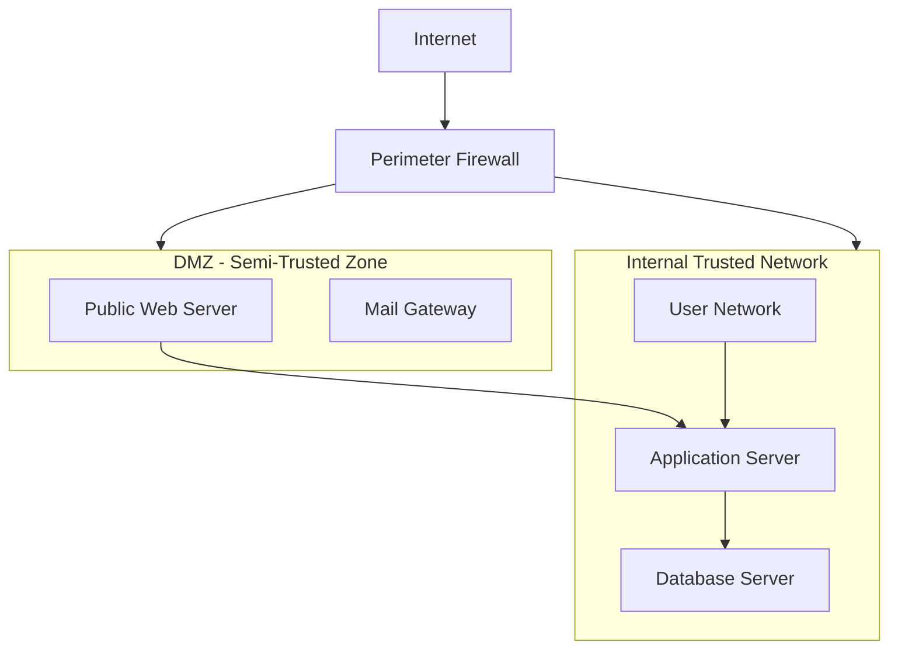

A security diagram should make trust boundaries and traffic-control points clear. Do not imply that every connection shown is permitted; annotate the actual security policy.

# 🗁 Network Traffic Flow Diagram

A traffic flow diagram illustrates how packets travel between source and destination systems.

It is useful for documenting:

* Client-to-server communication.
* DNS resolution.
* Internet access.
* NAT translation.
* Firewall processing.
* VPN traffic.
* Application dependencies.

Example: Client accessing a public web server.

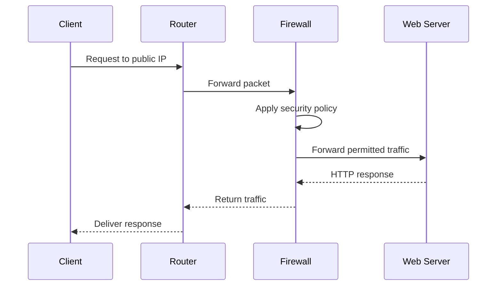

For packet-flow diagrams, specify whether the addresses shown are original, translated, private, or public addresses.

# 🗁 Network Diagram Symbols and Conventions

Use consistent symbols throughout the documentation.

| Symbol | Represents | Typical Use |
| --- | --- | --- |
| Router | Router or Layer 3 gateway | Routing between networks |
| Switch | Ethernet switch | LAN connectivity |
| Firewall | Security appliance | Traffic filtering |
| Cloud | Internet or WAN | External network |
| Server | Physical or virtual server | Application services |
| Desktop | User workstation | End-user endpoint |
| Laptop | Portable endpoint | Mobile user |
| Wireless AP | Access point | Wi-Fi connectivity |
| Database | Database system | Data storage |
| VPN tunnel | Encrypted tunnel | Secure remote connectivity |

The exact visual shape depends on the diagramming tool. Consistency is more important than using a particular vendor's icon library.

# 🗁 Link and Connection Conventions

Use line styles to communicate connection types.

| Line Style | Suggested Meaning |
| --- | --- |
| Solid line | Physical Ethernet connection |
| Dashed line | Logical connection or tunnel |
| Double line | Link aggregation or redundant connection |
| Dotted line | Optional, planned, or indirect relationship |
| Arrow | Direction of traffic or dependency |

These conventions are recommendations, not universal standards. Include a legend in diagrams that use non-obvious line styles.

Label important links with:

* Interface names, such as `ether1`, `Gi0/1`, or `eth0`.
* Link speed, such as `1 Gbps` or `10 Gbps`.
* Link type, such as copper, fiber, or wireless.
* VLAN information, such as `Trunk: VLAN 10,20,30`.
* IP addresses and subnet prefixes.
* Aggregation identifiers, such as `LACP Po1`.
* Circuit or service identifiers where relevant.

Example link label:

```text
Core-SW Gi0/1 <--> Router ether2
10 Gbps Fiber
Trunk: VLAN 10,20,30
```

# 🗁 IP Address and VLAN Annotation

Network diagrams should include enough addressing information to identify each network and its gateway.

Example:

```text
Device: Core-Router
Interface: ether2
IP Address: 192.168.10.1/24
Network: 192.168.10.0/24
VLAN: 10
Role: Management Gateway
```

For point-to-point connections, document the subnet and both endpoint addresses.

Example:

```text
Router-A ether1: 10.0.12.1/30
Router-B ether1: 10.0.12.2/30
Network: 10.0.12.0/30
```

For larger environments, maintain a separate IP address management (IPAM) document or system and reference its network identifiers in diagrams.

# 🗁 Small Office Network Diagram

A small office network commonly contains an ISP connection, router, firewall, switch, wireless access points, workstations, and servers.

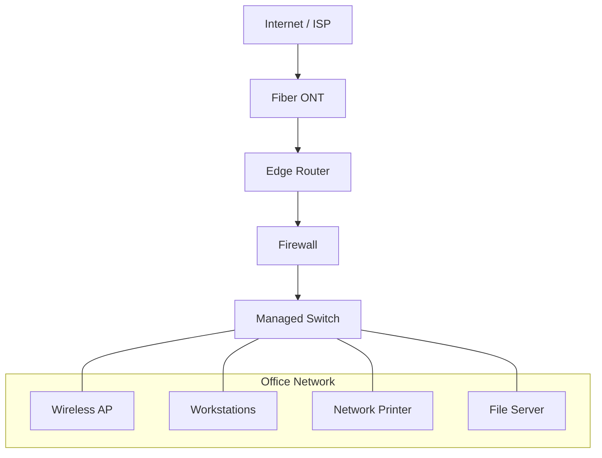

Document the ISP circuit, router WAN configuration, firewall policies, switch ports, internal subnets, and wireless configuration.

# 🗁 VLAN Segmentation Diagram

This example shows how a business can separate management, users, servers, guest Wi-Fi, and CCTV traffic.

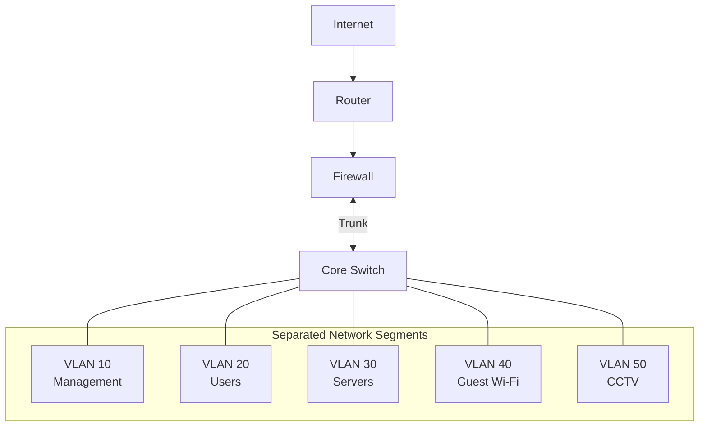

The diagram should also reference the firewall policy defining which segments can communicate. For example, guest devices may have internet access without access to internal servers or management interfaces.

# 🗁 Branch Office and WAN Diagram

A business with multiple branches may use site-to-site VPN tunnels over the internet.

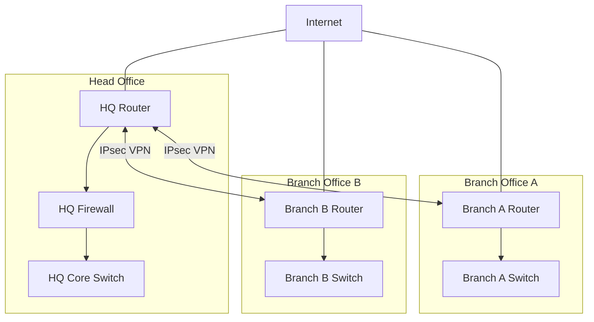

Document tunnel endpoints, local and remote subnets, routing methods, encryption requirements, and failover behavior.

# 🗁 ISP and PPPoE Network Diagram

An ISP network diagram can represent upstream connectivity, edge routers, core infrastructure, aggregation switches, access networks, and customer connections.

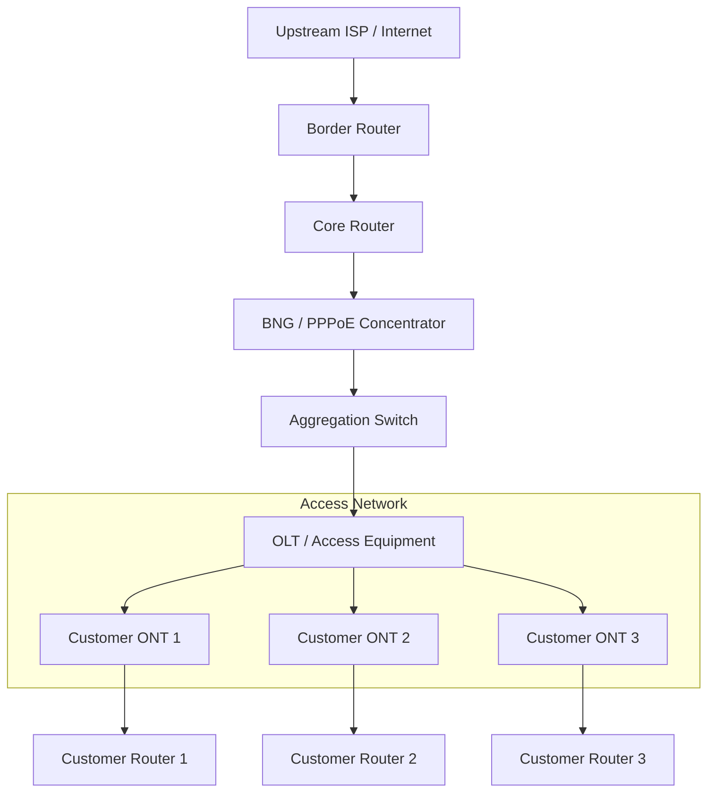

A real ISP design may use different architectures, including integrated BNG functionality, distributed aggregation, GPON, XGS-PON, Ethernet access, or wireless access.

Document:

* Upstream provider and circuit details.
* Public IP allocations.
* BGP peering and routing boundaries.
* Core and aggregation links.
* VLANs and service separation.
* PPPoE access concentrators.
* RADIUS authentication and accounting.
* Customer IP allocation.
* CGNAT boundaries, if applicable.
* Monitoring and management networks.

# 🗁 Redundant Links and Failover Diagram

Redundancy diagrams show alternative paths that keep a network operational when a link or device fails.

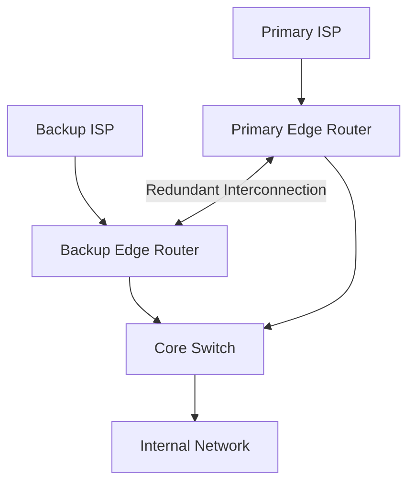

The diagram should identify:

* Primary and backup paths.
* Routing or failover mechanisms.
* Health-check targets.
* Failover and recovery behavior.
* Shared failure points.
* Expected impact during a failure.

Two connections do not necessarily provide true redundancy if they share the same physical cable route, upstream provider, power source, or equipment.

# 🗁 Firewall and NAT Diagram

A firewall and NAT diagram illustrates network zones, packet translation, and security boundaries.

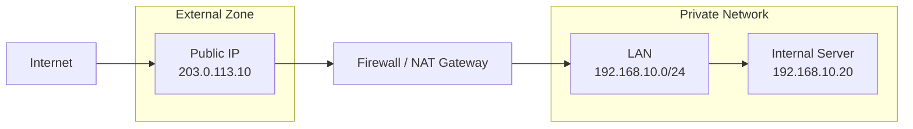

Document the following separately where needed:

* Source NAT (SNAT).
* Destination NAT (DNAT).
* Port forwarding.
* Masquerading.
* Firewall filtering rules.
* DMZ networks.
* Allowed inbound and outbound traffic.
* VPN termination and routing.

Do not expose sensitive firewall rule details or credentials in diagrams shared outside the authorized engineering team.

# 🗁 Diagramming Tools

Several tools can be used to create network diagrams.

| Tool | Main Purpose | Suitable For |
| --- | --- | --- |
| diagrams.net (draw.io) | Visual diagram editor | General network diagrams |
| Mermaid | Text-based diagram generation | Documentation and Git repositories |
| PlantUML | Text-based UML and architecture diagrams | Technical architecture documentation |
| Graphviz | Graph visualization | Complex network relationships |
| Microsoft Visio | Professional diagramming | Enterprise network documentation |
| Lucidchart | Collaborative diagramming | Team-based infrastructure design |

**diagrams.net**

* Free diagramming tool.
* Supports network and infrastructure shapes.
* Provides manual positioning and styling.
* Supports exporting to PNG, SVG, and PDF.
* Suitable for physical and logical network diagrams.

Website: <https://www.diagrams.net/>

**Mermaid**

* Generates diagrams from text definitions.
* Works well with Markdown documentation.
* Supports flowcharts, sequence diagrams, and other diagram types.
* Suitable for version-controlled technical documentation.

Documentation: <https://mermaid.js.org/>

**PlantUML**

* Uses text-based descriptions to generate diagrams.
* Supports component and deployment diagrams.
* Useful for architecture documentation.

Website: <https://plantuml.com/>

**Graphviz**

* Uses the DOT language to describe graphs.
* Useful for large networks and complex relationships.
* Can automatically calculate graph layouts.

Website: <https://graphviz.org/>

**Microsoft Visio**

* Professional diagramming software.
* Supports network and infrastructure templates.
* Useful for enterprise documentation and formal diagrams.

Website: <https://www.microsoft.com/microsoft-365/visio/flowchart-software>

**Lucidchart**

* Browser-based diagramming platform.
* Supports collaboration and diagram templates.
* Useful for teams working on shared architecture documents.

Website: <https://www.lucidchart.com/>

# 🗁 Creating Diagrams with Mermaid

Mermaid is especially useful when maintaining diagrams alongside Markdown documentation in Git repositories.

A basic flowchart:


A flowchart with network zones:

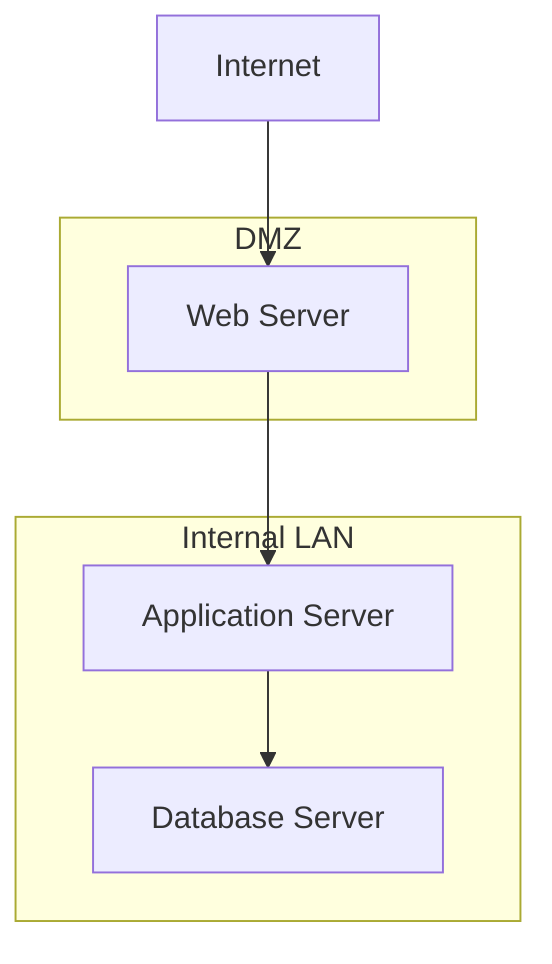

A sequence diagram:

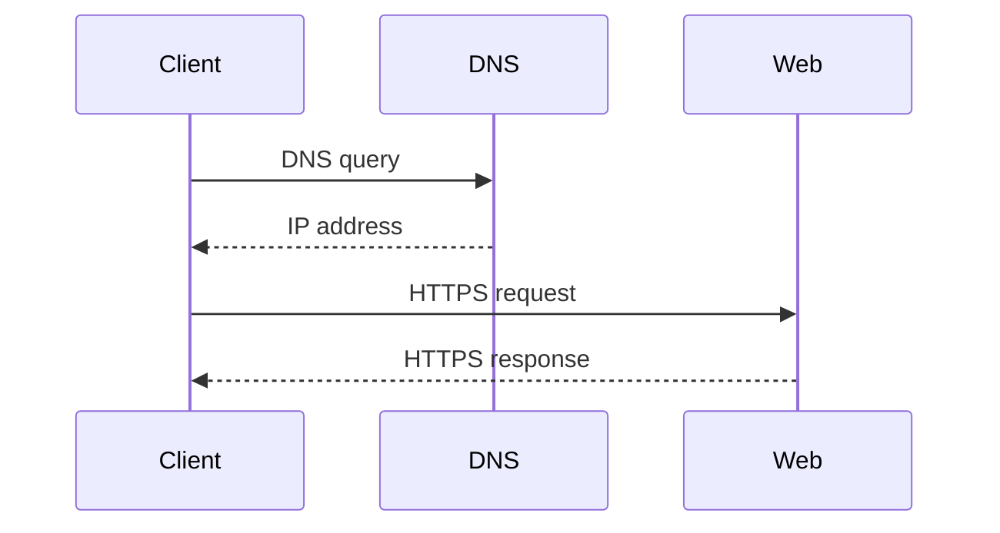

A subgraph helps organize devices into meaningful groups such as offices, VLANs, data centers, and security zones.

Keep Mermaid node labels concise. Put extended descriptions in the surrounding Markdown instead of making diagrams unnecessarily large.

# 🗁 Network Diagram Documentation Standards

Every important network diagram should include basic metadata.

| Metadata | Example |
| --- | --- |
| Diagram Title | Head Office Logical Network |
| Diagram Type | Logical |
| Organization | Example Organization |
| Location | Head Office |
| Created By | Network Engineering Team |
| Created Date | 2026-11-12 |
| Last Updated | 2026-11-12 |
| Version | 1.0 |
| Status | Current |
| Classification | Internal |

Use a consistent naming convention for devices and network segments.

Example:

```text
RTR-HQ-01       Head Office Router
SW-CORE-01      Core Switch
SW-ACC-01       Access Switch
FW-HQ-01        Head Office Firewall
AP-HQ-01        Wireless Access Point
SRV-DC-01       Domain Controller
VLAN-10-MGMT    Management VLAN
VLAN-20-USERS   User VLAN
```

# 🗁 Network Diagram Best Practices

**Keep diagrams readable**

* Avoid unnecessary connections and overlapping lines.
* Group devices by location, role, or network segment.
* Use consistent alignment and spacing.
* Keep labels short and meaningful.
* Split large diagrams into smaller logical views.

**Use consistent notation**

* Use the same symbols for the same device types.
* Maintain consistent line styles and colors.
* Include a legend when symbols or colors are not self-explanatory.
* Distinguish physical links from logical tunnels.

**Include technical information**

* Add device names and roles.
* Include relevant interface names.
* Document important IP addresses and prefixes.
* Identify VLAN IDs and subnet boundaries.
* Label WAN circuits and VPN tunnels.
* Identify primary and backup paths.

**Maintain accuracy**

* Update diagrams after approved network changes.
* Verify device names and interfaces against the live configuration.
* Record the date of the last verification.
* Remove obsolete devices and connections.
* Keep planned designs separate from deployed infrastructure.

**Manage versions**

* Store editable diagram source files in a controlled repository.
* Use meaningful commit messages.
* Maintain change history.
* Review diagrams during infrastructure audits.
* Restrict access to sensitive network documentation.

# 🗁 Organizing Network Diagrams in a Repository

For a network documentation repository, diagrams can be organized by infrastructure area.

Example:

```text
network-documentation/
├── diagrams/
│   ├── physical/
│   │   ├── head-office.drawio
│   │   └── branch-office.drawio
│   ├── logical/
│   │   ├── enterprise-network.mmd
│   │   └── vlan-segmentation.mmd
│   ├── wan/
│   │   └── wan-topology.mmd
│   ├── security/
│   │   └── firewall-zones.mmd
│   ├── isp/
│   │   └── isp-architecture.mmd
│   └── exports/
│       ├── head-office.png
│       └── wan-topology.svg
└── README.md
```

Use editable source files as the primary documents and exported images as convenient previews.

For Mermaid files, use the `.mmd` extension. For diagrams.net, retain the editable `.drawio` file.

# 🗁 Network Diagram Review Checklist

Before publishing or approving a diagram, verify the following:

* [ ] Diagram title and type are clearly identified.
* [ ] Device names and roles are accurate.
* [ ] Physical and logical connections are distinguished.
* [ ] Interfaces and link speeds are documented where relevant.
* [ ] IP addresses and subnet prefixes are correct.
* [ ] VLAN IDs and names are accurate.
* [ ] Routing boundaries and gateways are identified.
* [ ] Firewall zones and trust boundaries are clear.
* [ ] WAN circuits and VPN tunnels are documented.
* [ ] Primary and backup paths are identified.
* [ ] A legend explains non-obvious symbols and line styles.
* [ ] Diagram metadata and revision information are included.
* [ ] Sensitive information is appropriately protected.
* [ ] The diagram matches the deployed network.

# 🗁 Practical Exercises

**Exercise: Small Office Diagram**

Create a physical and logical diagram for an office containing:

* One ISP connection.
* One router.
* One firewall.
* One managed switch.
* Two wireless access points.
* Ten workstations.
* One network printer.
* One application server.

**Exercise: VLAN Segmentation Diagram**

Design a network with these VLANs:

* VLAN 10: Management.
* VLAN 20: Users.
* VLAN 30: Servers.
* VLAN 40: Guest Wi-Fi.
* VLAN 50: CCTV.

Include the IP subnet, gateway, switch connections, and firewall security boundaries.

**Exercise: Dual-WAN Failover Diagram**

Create a diagram containing:

* Two independent ISP connections.
* A primary and backup WAN path.
* An edge router.
* A core switch.
* An internal LAN.

Identify the failover mechanism and explain what happens when the primary ISP becomes unavailable.

**Exercise: ISP Architecture Diagram**

Create an ISP network diagram containing:

* Two upstream providers.
* Border and core routers.
* BGP peering.
* Aggregation switches.
* PPPoE access concentrator.
* RADIUS server.
* OLT and customer ONTs.
* Customer routers.
* CGNAT infrastructure, if applicable.

Identify routing boundaries, customer access paths, and management networks.

# 🗁 Final Notes

Network diagrams are living technical documents, not one-time illustrations. Their value depends on accuracy, readability, consistency, and regular maintenance.

For professional network documentation, maintain separate physical, logical, WAN, VLAN, and security diagrams when necessary. Use editable source files, version control, meaningful labels, and clear legends so engineers can understand and maintain the infrastructure effectively.
